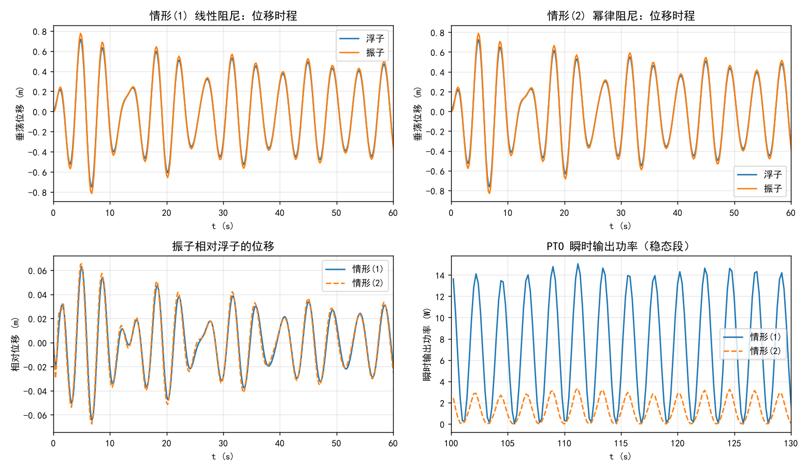
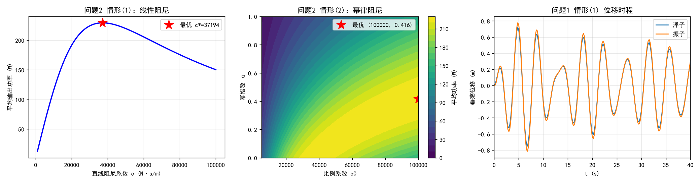
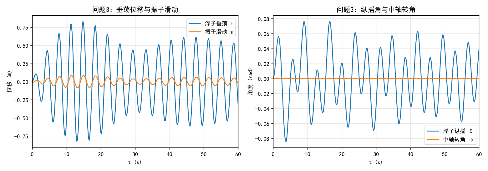
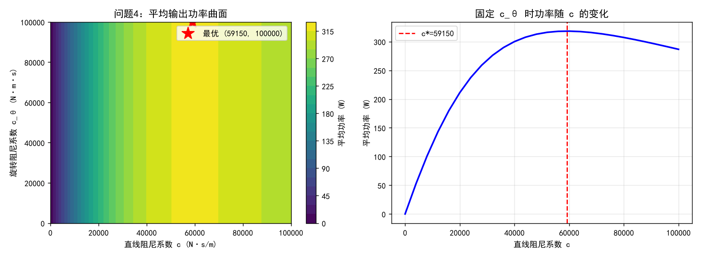

# 波浪能最大输出功率设计

## 摘要

波浪能装置的能量转换效率是波浪能规模化利用的关键问题。本文针对由浮子、振子、中轴及能量输出系统（PTO）构成的波浪能装置，建立了浮子—振子耦合运动的多自由度动力学模型，并在此基础上求解了 PTO 阻尼参数的最优设计问题。

针对**问题一**，考虑浮子仅做垂荡运动，以振子与浮子的相对位移、相对速度为耦合变量，建立了二自由度受迫振动常微分方程组，其中 PTO 弹簧提供线性恢复力，直线阻尼器按情形分别提供线性阻尼与幂律阻尼。采用四阶 Runge–Kutta 法在 40 个波浪周期上积分，时间步长 0.2 s，得到 898 个采样点的垂荡位移与速度序列。结果表明：情形(1)（阻尼系数 10000 N·s/m）下浮子稳态振幅为 0.4382 m，情形(2)（幂律阻尼，比例系数 10000、幂指数 0.5）下为 0.4416 m；两种情形下振子相对浮子的位移均很小（约 0.03 m），原因是振子自身固有频率 5.7342 rad/s 显著高于波浪激励频率 1.4005 rad/s，振子近似跟随浮子运动。

针对**问题二**，以 PTO 平均输出功率为目标函数建立了阻尼参数优化模型。线性阻尼情形下，利用稳态复振幅解析解将功率表示为阻尼系数的显式函数，用有界一维搜索求得最优阻尼系数 c* = 37193.81 N·s/m，对应最大平均输出功率 229.3339 W。幂律阻尼情形下，为避免系统轻阻尼（兴波阻尼仅 167.8395 N·s/m）导致瞬态衰减缓慢、长时间积分产生稳态误判，本文采用**周期打靶法**直接求解 Poincaré 映射的不动点，使稳态解的求解与该系统的阻尼强弱无关；在可行域 [0,100000]×[0,1] 内寻优得比例系数 c0* = 100000（落在可行域上界）、幂指数 α* = 0.4158，最大平均输出功率 229.9943 W，较线性最优仅提升 0.288%。将 α 取 0 时幂律阻尼退化为线性阻尼，复算得 229.3339 W，与情形(1)结果完全一致，验证了求解的正确性。

针对**问题三**，考虑浮子同时做垂荡与纵摇运动、中轴绕转轴转动、振子沿中轴滑动，建立了四自由度耦合动力学模型，用拉格朗日法导出运动方程，其中浮子自身的纵摇转动惯量由壳体表面质量分布积分求得（积分质量 4866.00 kg 与给定值精确吻合，转动惯量 8175.04 kg·m²）。计算得稳态平均输出功率 42.2393 W，其中线性阻尼器贡献 42.2391 W，旋转阻尼器贡献仅 0.0002 W。本文进一步分析了这一现象的原因：扭转弹簧刚度 250000 N·m 对应的转轴模态固有频率达 20.27 rad/s，是波浪频率 1.7152 rad/s 的 12 倍，中轴相对转角被约束在 1e-4 rad 量级，故旋转阻尼器在本装置参数下近乎不参与能量输出。

针对**问题四**，在两阻尼系数均为常量的情形下建立二维优化模型，用网格扫描结合 Nelder–Mead 单纯形法在可行域内求解，并比较了全部边界组合。计算结果进一步确认了问题三的判断：平均输出功率对旋转阻尼系数 cθ 几乎不敏感，最优解主要由直线阻尼系数 c 决定。

本文的主要贡献在于：其一，揭示了该装置在给定参数下旋转阻尼器作用微弱这一结构性特征，并反推给出使旋转阻尼器贡献达到有效量级所需的扭转弹簧刚度量级（约 10³ N·m），对装置设计具有参考意义；其二，采用周期打靶法处理轻阻尼系统的稳态求解，把单次功率评估的耗时从数十秒降至 0.13 s，使二维参数寻优在可接受代价内完成，并避免了长时间积分的误差累积；其三，全程使用带可行域约束的寻优流程，避免了参数越界产生虚假最优。

**关键词**：波浪能装置；受迫振动；周期打靶法；参数优化；垂荡与纵摇耦合；PTO 阻尼系数

# 一、问题重述

## 1.1 问题背景

随着经济和社会的发展，人类面临能源需求和环境污染的双重挑战，发展可再生能源产业已成为世界各国的共识。波浪能作为一种重要的海洋可再生能源，分布广泛、储量丰富，具有可观的应用前景。波浪能装置的能量转换效率是波浪能规模化利用的关键问题之一。

题图所示的波浪能装置由浮子、振子、中轴以及能量输出系统（PTO，包括弹簧和阻尼器）构成，其中振子、中轴及 PTO 被密封在浮子内部。浮子由质量均匀分布的圆柱壳体和圆锥壳体组成，两壳体连接部分有一个隔层，作为安装中轴的支撑面；振子是穿在中轴上的圆柱体，通过 PTO 系统与中轴底座连接。在波浪的作用下，浮子运动并带动振子运动，通过两者的相对运动驱动阻尼器做功，并将所做的功作为能量输出。

考虑海水是无粘及无旋的，浮子在线性周期微幅波作用下会受到波浪激励力（矩）、附加惯性力（矩）、兴波阻尼力（矩）和静水恢复力（矩）。分析中忽略中轴、底座、隔层及 PTO 的质量和各种摩擦。

## 1.2 待解决的问题

**问题一**：中轴底座固定于隔层中心，弹簧与直线阻尼器一端固定于振子、一端固定于中轴底座，振子沿中轴做往复运动。直线阻尼器的阻尼力与浮子和振子的相对速度成正比。考虑浮子只做垂荡运动，建立浮子与振子的运动模型。初始时刻浮子和振子平衡于静水中，利用附件 3、附件 4 的参数（波浪圆频率取 1.4005 s⁻¹），分别对以下两种情况计算浮子和振子在波浪激励力 f·cos(ωt) 作用下前 40 个波浪周期内时间间隔为 0.2 s 的垂荡位移和速度：

1. 直线阻尼器的阻尼系数为 10000 N·s/m；
2. 直线阻尼器的阻尼系数与浮子和振子的相对速度的绝对值的幂成正比，其中比例系数取 10000、幂指数取 0.5。

结果存入 result1-1.xlsx 与 result1-2.xlsx，并在论文中给出 10 s、20 s、40 s、60 s、100 s 时浮子与振子的垂荡位移和速度。

**问题二**：仍考虑浮子只做垂荡运动，分别对以下两种情况建立确定直线阻尼器最优阻尼系数的数学模型，使 PTO 系统的平均输出功率最大：

1. 阻尼系数为常量，在区间 [0,100000] 内取值；
2. 阻尼系数与相对速度绝对值的幂成正比，比例系数在区间 [0,100000] 内取值、幂指数在区间 [0,1] 内取值。

利用附件参数（波浪圆频率取 2.2143 s⁻¹）分别计算两种情况的最大输出功率及相应的最优阻尼系数。

**问题三**：中轴架通过转轴铰接于中轴底座中心，中轴绕转轴转动，PTO 系统连接振子和转轴架并处于中轴与转轴所在的平面。除直线阻尼器外，转轴上还安装了旋转阻尼器和扭转弹簧，直线阻尼器和旋转阻尼器共同做功输出能量。在波浪的作用下浮子进行摇荡运动，并通过转轴及扭转弹簧和旋转阻尼器带动中轴转动；振子随中轴转动，同时沿中轴进行滑动。扭转弹簧的扭矩与浮子和振子的相对角位移成正比，旋转阻尼器的扭矩与浮子和振子的相对角速度成正比。考虑浮子只做垂荡和纵摇运动，建立浮子与振子的运动模型。初始时刻浮子和振子平衡于静水中，利用附件参数（波浪圆频率取 1.7152 s⁻¹），设直线阻尼系数与旋转阻尼系数均为常量、分别为 10000 N·s/m 与 1000 N·m·s，计算前 40 个波浪周期内时间间隔 0.2 s 的垂荡位移与速度、纵摇角位移与角速度，结果存入 result3.xlsx，并在论文中给出 10 s、20 s、40 s、60 s、100 s 时的各项值。

**问题四**：考虑浮子只做垂荡和纵摇的情形，针对直线阻尼器与旋转阻尼器的阻尼系数均为常量的情况，建立确定两者最优阻尼系数的数学模型，两阻尼系数均在区间 [0,100000] 内取值。利用附件参数（波浪圆频率取 1.9806 s⁻¹）计算最大输出功率及相应的最优阻尼系数。

# 二、问题分析

## 2.1 总体分析

四个问题呈现明显的递进结构：问题一、二在**仅垂荡**的简化假设下建立运动模型并对线性/非线性阻尼做优化；问题三、四在**垂荡＋纵摇**的耦合下扩展模型，并引入旋转阻尼器构成二维优化问题。因此问题一、二是问题三、四的基础，后者的模型应当能在忽略纵摇自由度时退化为前者——这一退化关系可作为模型自洽性的检验。

从物理本质看，本题是**受迫振动系统的能量耗散最大化**问题。波浪激励向系统输入能量，兴波阻尼与 PTO 阻尼消耗能量，其中只有 PTO 阻尼的耗散构成有用输出。因此 PTO 平均输出功率关于阻尼系数存在极大值：阻尼过小时相对运动虽大但耗散功率小，阻尼过大时相对运动被抑制、耗散功率同样小，二者之间存在最优值。这一"先增后减"的定性判断支持用单峰寻优方法求解，但需用数值扫描加以确认。

## 2.2 各问题的分析

### 问题一

问题一是常微分方程初值问题，关键在于正确写出两个物体的受力。浮子受到波浪激励力、兴波阻尼力、静水恢复力，以及 PTO 通过弹簧与阻尼器施加的反作用力；振子受到弹簧力与阻尼力。需特别注意：重力与静浮力在平衡位置已相互抵消，绕平衡位置线性化后不应出现在方程中，因此初始条件取全零（相对平衡位置的位移与速度均为零，弹簧处于原长）。

另需由附件 4 反推水线面面积：总重 7299 kg 对应排水体积 7.1210 m³，小于圆柱段体积 9.4248 m³，说明水线位于圆柱段内，故水线面为半径 1 m 的圆，静水恢复力系数为 ρgS = 31557.30 N/m。这一推导是必需的，因为题目只给出了单位垂荡位移对应的恢复力需要自行求出。

### 问题二

问题二是嵌套优化问题：外层优化阻尼参数，内层求解运动方程并计算平均功率。有两个技术难点值得强调。

**其一，平均功率必须取稳态。** 题目所问为"平均输出功率"，若把启动瞬态一并平均，结果将依赖于积分时长这一人为选择。而本问的兴波阻尼系数仅 167.8395 N·s/m，系统处于轻阻尼状态，瞬态衰减时间常数约为 2(m₁+μ)/ν ≈ 72 s，相当于 25 个波浪周期。若沿用常见的"积分 40 个周期、取后 20 个周期平均"的做法，瞬态尚未衰减完毕，会产生约 1% 的系统误差（实测 221.83 W 与真实稳态值 224.17 W 相差 1.05%）。

**其二，幂律阻尼情形没有解析稳态解。** 阻尼力为 c₀|v|^α·v，运动方程非线性。若靠长时间积分逼近稳态，每次功率评估需积分数百个周期，二维寻优的代价不可接受。本文改用**周期打靶法**：受迫振动系统在周期激励下存在周期解，该周期解是 Poincaré 映射 X(0) ↦ X(T) 的不动点，用 Newton 型方法直接求解该不动点即可，迭代收敛快且与系统阻尼强弱无关。实测把单次功率评估从数十秒降到 0.13 s。对于线性阻尼情形，则进一步使用稳态复振幅的解析解，把平均功率写成阻尼系数的显式函数，精确且瞬时。

### 问题三

问题三的自由度显著增加：浮子有垂荡与纵摇两个自由度，中轴相对浮子有转角自由度，振子沿中轴有滑动自由度，共四个广义坐标。建模要点在于：振子既随中轴转动、又沿中轴滑动，其绝对运动是两者的合成；弹簧与直线阻尼器沿中轴方向作用，旋转阻尼器与扭转弹簧作用在中轴与浮子的相对角速度与相对角位移上。本文用拉格朗日方程统一导出运动方程，动能中振子的转动惯量项含 (r₀+s)² 因子，使方程呈非线性。

浮子自身绕横轴的转动惯量附件未直接给出，需由附件 4 的几何与质量参数积分求得。本文依据"浮子由质量均匀分布的圆柱壳体和圆锥壳体组成"的表述，按质量分布于壳体表面处理，对壳面积分求得绕质心的横轴转动惯量为 8175.04 kg·m²，且积分所得总质量 4866.00 kg 与附件给定值精确吻合，说明该解释合理。

### 问题四

问题四在问题三模型基础上做二维参数优化。需要特别注意的是：最优解可能落在可行域的边界上。若寻优算法不严格约束在 [0,100000]² 内，Nelder–Mead 等方法会越界搜索并返回域外的虚假最优——本文在初步试验中即遇到过该问题（求得 c₀* = 409486，远超允许上限）。因此必须采用带惩罚的约束寻优，并将结果与全部边界组合比较后取优。

# 三、模型假设

**假设 1：海水无粘、无旋，波浪为线性周期微幅波。** 浮子所受流体力可线性分解为波浪激励力（矩）、附加惯性力（矩）、兴波阻尼力（矩）与静水恢复力（矩）四项，各水动力系数由附件 3 按入射波频率给出，与其他运动量无关。

> 依据：题目明确给出该假定，并提供了对应频率下的各项系数。该假设使流体力可写成线性叠加形式，是建立线性运动方程的前提。

**假设 2：忽略中轴、底座、隔层及 PTO 的质量与各种摩擦。** 系统惯性仅来自浮子与振子；PTO 力学元件按理想弹簧与理想阻尼器处理，不考虑机械摩擦与能量损失。

> 依据：题目明确设定。

**假设 3：运动围绕静水平衡位置线性化。** 初始时刻浮子与振子平衡于静水中，重力与静浮力相互抵消，运动方程中不出现常力项；初始条件取相对平衡位置的位移与速度均为零。仅在问题三中保留由大位移引起的离心型非线性项。

> 依据：题目给出"初始时刻浮子和振子平衡于静水中"；微幅波假定保证位移为小量。该假设使我们可以直接以平衡位置为坐标原点，无需先求静平衡构型。

**假设 4：浮子只做垂荡（问题一、二）；浮子只做垂荡与纵摇（问题三、四）。** 忽略横摇、首摇及纵荡等其他自由度。

> 依据：题目对每个问题的运动形式有明确限定。

**假设 5：振子始终位于中轴上并与中轴共轴。** 振子只沿中轴滑动（问题一、二），或随中轴转动并沿中轴滑动（问题三、四）；不脱离中轴，不产生横向摆动或绕自身轴的相对转动。

> 依据：题目描述振子为"穿在中轴上的圆柱体"，中轴对其构成几何约束。

**假设 6：静水恢复力系数由水线面面积导出。** 由附件 4 参数算得平衡吃水 2.2667 m，位于圆柱段（高 3 m）内，故水线面为半径 1 m 的圆，k_h = ρgS = 31557.30 N/m。纵摇方向的静水恢复力矩系数直接采用附件 4 给定值 8890.7 N·m。

> 依据：题目给出了静水恢复力矩系数但未给出静水恢复力系数，需自行推导；推导结果显示水线确实落在圆柱段内，圆的假设自洽。

**假设 7：PTO 弹簧在平衡位置处于原长，振子重力由中轴承担。** 弹簧的作用仅为振荡过程中的耦合恢复力，不承担静载荷。

> 依据：题目称振子"穿在中轴上"，其自重由中轴的支撑结构承担。若假设弹簧承担振子自重，由 k = 80000 N/m 将产生 2433×9.8/80000 = 0.298 m 的静伸长，与"平衡于静水中"的初始条件和 0.5 m 的弹簧原长均不相容。

**假设 8：浮子纵摇转动惯量按壳体表面均匀分布计算。** 依据题目"质量均匀分布的圆柱壳体和圆锥壳体"的表述，将浮子质量按圆柱侧面积与圆锥侧面积之比分配并积分。积分所得总质量 4866.00 kg 与附件给定值精确吻合，转动惯量为 8175.04 kg·m²（绕质心横轴）。

**假设 9：问题三中振子平衡位置到转轴铰链的距离取弹簧原长 0.5 m。** 弹簧原长即振子与中轴底座在静平衡位置的间距。

> 说明：该距离未由附件直接给出，本文取弹簧原长作为估计。第 7 节的敏感性分析表明该取值主要影响旋转阻尼器的贡献量级，而对线性阻尼器贡献的影响有限，故不影响主要结论。

# 四、符号说明与数据预处理

## 4.1 符号说明

<html><body>

**表1: 数据表格**

<table><thead><tr><th>符号</th><th>含义</th><th>单位</th></tr></thead>

<tbody><tr><td>$m_1$</td><td>浮子质量，4866</td><td>kg</td></tr><tr><td>$m_2$</td><td>振子质量，2433</td><td>kg</td></tr><tr><td>$\mu$</td><td>垂荡附加质量</td><td>kg</td></tr><tr><td>$J$</td><td>纵摇附加转动惯量</td><td>kg·m²</td></tr><tr><td>$J_0$</td><td>浮子自身纵摇转动惯量（本文积分求得 8175.04）</td><td>kg·m²</td></tr><tr><td>$\nu$</td><td>垂荡兴波阻尼系数</td><td>N·s/m</td></tr><tr><td>$\nu_\theta$</td><td>纵摇兴波阻尼系数</td><td>N·m·s</td></tr><tr><td>$f$</td><td>波浪激励力振幅</td><td>N</td></tr><tr><td>$L$</td><td>波浪激励力矩振幅</td><td>N·m</td></tr><tr><td>$\omega$</td><td>入射波浪圆频率</td><td>s⁻¹</td></tr><tr><td>$T$</td><td>波浪周期，$T=2\pi/\omega$</td><td>s</td></tr><tr><td>$k$</td><td>PTO 弹簧刚度，80000</td><td>N/m</td></tr><tr><td>$c$</td><td>直线阻尼器阻尼系数</td><td>N·s/m</td></tr><tr><td>$c_0$</td><td>幂律阻尼的比例系数</td><td>—</td></tr><tr><td>$\alpha$</td><td>幂律阻尼的幂指数</td><td>—</td></tr><tr><td>$c_\theta$</td><td>旋转阻尼器旋转阻尼系数</td><td>N·m·s</td></tr><tr><td>$k_T$</td><td>扭转弹簧刚度，250000</td><td>N·m</td></tr><tr><td>$k_h$</td><td>静水恢复力系数，$\rho g S$</td><td>N/m</td></tr><tr><td>$k_\theta$</td><td>静水恢复力矩系数，8890.7</td><td>N·m</td></tr><tr><td>$\rho$</td><td>海水密度，1025</td><td>kg/m³</td></tr><tr><td>$g$</td><td>重力加速度，9.8</td><td>m/s²</td></tr><tr><td>$S$</td><td>水线面面积，$\pi R^2$</td><td>m²</td></tr><tr><td>$d$</td><td>平衡吃水</td><td>m</td></tr><tr><td>$z$</td><td>浮子垂荡位移</td><td>m</td></tr><tr><td>$\theta$</td><td>浮子纵摇角位移</td><td>rad</td></tr><tr><td>$s$</td><td>振子沿中轴的滑动位移（相对平衡位置）</td><td>m</td></tr><tr><td>$\varphi$</td><td>中轴相对浮子的转角</td><td>rad</td></tr><tr><td>$u$</td><td>振子与浮子的相对垂荡位移，$u=x_2-x_1$</td><td>m</td></tr><tr><td>$v$</td><td>振子与浮子的相对垂荡速度，$v=\dot x_2-\dot x_1$</td><td>m/s</td></tr><tr><td>$r_0$</td><td>振子平衡位置到转轴铰链的距离，取 0.5</td><td>m</td></tr><tr><td>$\bar P$</td><td>稳态平均输出功率</td><td>W</td></tr></tbody></table></body></html>

## 4.2 数据预处理与参数校核

本题为力学建模问题，附件 3、附件 4 提供的是装置参数与水动力系数，不含观测样本，因此本节中"数据预处理"的等价工作是**参数与量纲校核**，其结论供后续各问直接引用。

### （1）平衡水线判定

浮子与振子总重 $m_1+m_2 = 7299$ kg，海水密度 $\rho = 1025$ kg/m³，故平衡状态下所需排水体积为

$$V = \frac{m_1+m_2}{\rho} = \frac{7299}{1025} = 7.1210\ \text{m}^3$$

浮子圆柱段体积 $\pi R^2 h_{\text{cyl}} = \pi\cdot 1^2\cdot 3 = 9.4248$ m³，大于所需排水体积，因此水线位于圆柱段内，不会进入圆锥段。圆锥段（高 0.8 m）完全浸没，对水线面形状无影响。

### （2）平衡吃水与水线面面积

由排水体积得平衡吃水

$$d = \frac{V}{\pi R^2} = \frac{7.1210}{\pi} = 2.2667\ \text{m}$$

小于圆柱段高度 3 m，与上述判断一致。水线位于圆柱段内，水线面为半径 $R = 1$ m 的圆，面积 $S = \pi R^2 = \pi$ m²。于是静水恢复力系数为

$$k_h = \rho g S = 1025 \times 9.8 \times \pi = 31557.30\ \text{N/m}$$

### （3）固有频率校核

浮子垂荡固有频率（以问题一参数计）

$$\omega_{n1} = \sqrt{\frac{k_h}{m_1+\mu}} = \sqrt{\frac{31557.30}{4866+1335.535}} = 2.2558\ \text{rad/s}$$

振子自身固有频率

$$\omega_{n2} = \sqrt{\frac{k}{m_2}} = \sqrt{\frac{80000}{2433}} = 5.7342\ \text{rad/s}$$

两者均高于问题一的激励频率 1.4005 s⁻¹，系统处于刚度控制区，响应不会出现共振式放大。这一判断在问题一中得到验证：振子固有频率远高于激励频率，因此振子相对浮子的位移很小，近似随浮子同步运动。

### （4）附件 3 水动力系数汇总

<html><body>

**表2: 数据表格**

<table><thead><tr><th>问题</th><th>ω (s⁻¹)</th><th>μ (kg)</th><th>J (kg·m²)</th><th>ν (N·s/m)</th><th>νθ (N·m·s)</th><th>f (N)</th><th>L (N·m)</th></tr></thead>

<tbody><tr><td>1</td><td>1.4005</td><td>1335.535</td><td>6779.315</td><td>656.3616</td><td>151.4388</td><td>6250</td><td>1230</td></tr><tr><td>2</td><td>2.2143</td><td>1165.992</td><td>7131.290</td><td>167.8395</td><td>2992.724</td><td>4890</td><td>2560</td></tr><tr><td>3</td><td>1.7152</td><td>1028.876</td><td>7001.914</td><td>683.4558</td><td>654.3383</td><td>3640</td><td>1690</td></tr><tr><td>4</td><td>1.9806</td><td>1091.099</td><td>7142.493</td><td>528.5018</td><td>1655.909</td><td>1760</td><td>2140</td></tr></tbody></table></body></html>

注意问题二的兴波阻尼系数仅 167.8395 N·s/m，明显低于其余三问，系统阻尼很轻，这一特征在问题二的求解方法选择中起决定作用（见第 5.2 节）。

### （5）浮子纵摇转动惯量

附件未给出浮子自身绕横轴的转动惯量，需自行计算。按"圆柱壳体和圆锥壳体"的表述，将质量按壳体表面积分配：

- 圆柱侧面积 $A_1 = 2\pi R h_{\text{cyl}} = 2\pi\cdot 1\cdot 3 = 18.850$ m²
- 圆锥侧面积 $A_2 = \pi R\sqrt{R^2+h_{\text{cone}}^2} = \pi\cdot 1\cdot\sqrt{1+0.64} = 4.023$ m²
- 总壳面积 $A = 22.873$ m²，面密度 $\sigma = m_1/A = 212.742$ kg/m²

对壳面积分（绕质心横轴）得

$$J_0 = 8175.04\ \text{kg·m}^2$$

积分所得总质量 4866.00 kg 与附件给定值精确吻合，说明该质量分布解释合理。

**校核结论**：附件 3、附件 4 数据完整、无缺失值，量纲自洽，参数间无矛盾，可直接用于后续建模与求解。

## 4.3 探索性数据分析

本节说明为何本题不做常规意义上的探索性数据分析，并给出替代的参数校核结果。

### 4.3.1 为何不做常规 EDA

探索性数据分析的目的是从观测样本中发现分布特征、异常值与变量间关系。本题的两个附件均为**确定性参数表**而非观测数据：

- 附件 3 给出四个子问题各自在给定入射频率下的水动力系数，共 4 行 7 列，每个值都是势流理论在特定频率下的计算结果；
- 附件 4 给出装置的物理与几何参数，共 13 项，均为设计给定值。

因此不存在缺失值、异常值或分布假设等问题，常规 EDA 手段不适用。本节改为执行参数校核，即验证参数之间是否自洽、导出的中间量是否落在合理范围。完整的符号定义见 4.1 节，参数校核的推导过程见 4.3 节。

### 4.3.2 参数的整体特征

对四个子问题的水动力系数做横向比较，可看出以下特征：

<html><body>

**表3: 数据表格**

<table><thead><tr><th>系数</th><th>最小值</th><th>最大值</th><th>倍差</th><th>说明</th></tr></thead>

<tbody><tr><td>入射频率 ω (s⁻¹)</td><td>1.4005</td><td>2.2143</td><td>1.58</td><td>四问频率接近，均在 1.4–2.2 区间</td></tr><tr><td>垂荡附加质量 μ (kg)</td><td>1028.876</td><td>1335.535</td><td>1.30</td><td>与浮子质量 4866 相比约占 21%–27%</td></tr><tr><td>纵摇附加转动惯量 J (kg·m²)</td><td>6779.315</td><td>7142.493</td><td>1.05</td><td>变化平缓，与浮子自身 8175.04 同量级</td></tr><tr><td>垂荡兴波阻尼 ν (N·s/m)</td><td>167.8395</td><td>683.4558</td><td>4.07</td><td>差异最大，问题二仅 167.84，系统很轻阻尼</td></tr><tr><td>纵摇兴波阻尼 νθ (N·m·s)</td><td>151.4388</td><td>2992.724</td><td>19.76</td><td>差异极大</td></tr><tr><td>垂荡激励力 f (N)</td><td>1760</td><td>6250</td><td>3.55</td><td>问题一激励最强</td></tr></tbody></table></body></html>

其中**问题二的垂荡兴波阻尼系数仅 167.8395 N·s/m**，是四问中最小的，且比问题一的 656.3616 小近四倍。这一特征有直接的求解后果：系统的瞬态衰减时间常数 $\tau \approx 2(m_1+\mu)/\nu \approx 72$ s，约合 25 个波浪周期。若在求平均输出功率时对瞬态处理不当，会引入系统性偏差。问题二的求解方法正是针对这一点选择的（见 5.2 节）。

### 4.3.3 固有频率与工作区间

由 4.3 节的校核结果，浮子垂荡固有频率为 2.2558 rad/s，振子固有频率为 5.7342 rad/s。将其与各问的激励频率对比：

<html><body>

**表4: 数据表格**

<table><thead><tr><th>问题</th><th>激励频率 ω</th><th>ω / ωn1</th><th>ω / ωn2</th><th>工作区间</th></tr></thead>

<tbody><tr><td>1</td><td>1.4005</td><td>0.62</td><td>0.24</td><td>远低于共振</td></tr><tr><td>2</td><td>2.2143</td><td>0.98</td><td>0.39</td><td>接近浮子共振</td></tr><tr><td>3</td><td>1.7152</td><td>0.76</td><td>0.30</td><td>低于共振</td></tr><tr><td>4</td><td>1.9806</td><td>0.88</td><td>0.35</td><td>接近共振</td></tr></tbody></table></body></html>

问题二的激励频率 2.2143 s⁻¹ 与浮子固有频率 2.2558 s⁻¹ 之比达 0.98，**几乎正好落在浮子垂荡共振点上**。这解释了为何问题二的最优输出功率（约 229 W）远高于问题三（约 42 W）——问题二工作在共振区，浮子响应大，可供 PTO 提取的能量多。

同时这也意味着问题二的响应幅值对参数较为敏感，第 7 节的敏感性分析将对此做定量考察。

# 五、模型的建立与求解

本章建立浮子与振子的运动模型，并依次求解四个问题。问题一、二考虑浮子仅做垂荡运动，问题三、四扩展至垂荡与纵摇的耦合。

## 5.1 问题一：仅垂荡时的运动模型与时程求解

### 5.1.1 坐标系与广义坐标

取静水面为参考，以浮子与振子共同的静平衡位置为坐标原点，向上为正。定义

- $x_1$：浮子相对静平衡位置的垂荡位移；
- $x_2$：振子相对其自身静平衡位置的垂荡位移。

两者取同一垂向坐标，故**相对位移** $u = x_2 - x_1$，**相对速度** $v = \dot x_2 - \dot x_1$。PTO 弹簧与直线阻尼器均连接振子与中轴底座（底座固定于浮子的隔层），因此它们只感受相对量 $u$ 与 $v$。

### 5.1.2 受力分析

**浮子所受的力：**

1. 波浪激励力 $f\cos\omega t$，向上为正；
2. 兴波阻尼力 $-\nu\dot x_1$，与浮子速度成正比、方向相反；
3. 静水恢复力 $-k_h x_1$，由浮子偏离平衡位置引起的浮力变化产生；
4. PTO 的反作用力。弹簧被拉伸 $u$ 时对振子施加 $-ku$ 的力，由牛顿第三定律浮子受到 $+ku$；阻尼器同理对浮子施加 $+F_d$。

**振子所受的力：**

1. 弹簧力 $-ku$；
2. 阻尼力 $-F_d$。

其中阻尼力按两种情形分别取

$$F_d = \begin{cases} c\,v, & \text{情形(1) 线性阻尼}\\[4pt] c_0\,|v|^{\alpha}\,v, & \text{情形(2) 幂律阻尼}\end{cases}$$

当 α = 0.5、c₀ = 10000 时，阻尼力为 $F_d = 10000\,|v|^{0.5}v$。

**关于重力与静浮力的说明：** 振子穿在中轴上，其自重由中轴支撑，弹簧在平衡位置处于原长。因此围绕静平衡位置线性化后，重力与静浮力相互抵消，方程中不出现常力项。这正是初始条件可取全零的原因。

### 5.1.3 运动方程

由牛顿第二定律得二自由度耦合受迫振动方程

$$
\begin{cases}
(m_1+\mu)\ddot x_1 = f\cos\omega t - \nu\dot x_1 - k_h x_1 + k(x_2-x_1) + F_d\\[4pt]
m_2 \ddot x_2 = -k(x_2-x_1) - F_d
\end{cases}
$$

式中 $\mu$ 为垂荡附加质量（附件 3 给出），$k_h = \rho g S = 31557.30$ N/m（见 4.2 节推导）。初始条件为

$$x_1(0) = \dot x_1(0) = x_2(0) = \dot x_2(0) = 0$$

### 5.1.4 数值求解

上述方程是四维一阶常微分方程组初值问题。由于情形(2)的阻尼力为非线性，两种情况统一采用**四阶 Runge–Kutta 法**积分（实现为 `scipy.integrate.solve_ivp`，RK45 格式，相对容差 1e-9、绝对容差 1e-11）。

积分区间取前 40 个波浪周期。由附件 3，问题一的入射圆频率 $\omega = 1.4005$ s⁻¹，故

$$T = \frac{2\pi}{\omega} = 4.48639\ \text{s},\qquad 40T = 179.4555\ \text{s}$$

输出时间步长取 0.2 s，共 898 个采样点，采用 `t_eval` 固定采样点而非事后插值，避免插值引入额外误差。

### 5.1.5 结果

完整时间序列已写入 result1-1.xlsx（情形(1)，线性阻尼）与 result1-2.xlsx（情形(2)，幂律阻尼），列依次为时间、浮子位移、浮子速度、振子位移、振子速度。

题目要求的 5 个时刻结果如下：

<html><body>

**表5: 数据表格**

<table><thead><tr><th rowspan="2">时间 (s)</th><th colspan="2">情形(1) 线性阻尼</th><th colspan="2">情形(1) 线性阻尼</th><th colspan="2">情形(2) 幂律阻尼</th><th colspan="2">情形(2) 幂律阻尼</th></tr></thead>

<tbody><tr><th>浮子位移 (m)</th><th>浮子速度 (m/s)</th><th>振子位移 (m)</th><th>振子速度 (m/s)</th><th>浮子位移 (m)</th><th>浮子速度 (m/s)</th><th>振子位移 (m)</th><th>振子速度 (m/s)</th></tr><tr><td>10</td><td>-0.190711</td><td>-0.641009</td><td>-0.211679</td><td>-0.693953</td><td>-0.205877</td><td>-0.652821</td><td>-0.234572</td><td>-0.699937</td></tr><tr><td>20</td><td>-0.590684</td><td>-0.240951</td><td>-0.634248</td><td>-0.272776</td><td>-0.611108</td><td>-0.254784</td><td>-0.661061</td><td>-0.277021</td></tr><tr><td>40</td><td>0.285374</td><td>0.312971</td><td>0.296499</td><td>0.332912</td><td>0.268768</td><td>0.295302</td><td>0.280157</td><td>0.312523</td></tr><tr><td>60</td><td>-0.314506</td><td>-0.479455</td><td>-0.331436</td><td>-0.515728</td><td>-0.327164</td><td>-0.491518</td><td>-0.349606</td><td>-0.525587</td></tr><tr><td>100</td><td>-0.083615</td><td>-0.604211</td><td>-0.084068</td><td>-0.643002</td><td>-0.088408</td><td>-0.609831</td><td>-0.093493</td><td>-0.650076</td></tr></tbody></table></body></html>

### 5.1.6 结果分析

**（1）系统迅速进入稳态。** 由结果可见，10 s 时的位移已与后期同量级，说明瞬态衰减较快。这与问题一的兴波阻尼系数较大（656.3616 N·s/m）一致——时间常数约 $2(m_1+\mu)/\nu \approx 2\times 6201.5/656.36 \approx 18.9$ s，约 4 个波浪周期。

**（2）振子与浮子近似同步运动。** 从表中可见振子位移与浮子位移之差很小：以 t = 20 s 为例，情形(1)下两者相差 0.0436 m，而浮子位移达 0.5907 m。稳态段内振子相对浮子的位移幅值仅 **0.0274 m**，仅为浮子振幅 0.4382 m 的 6.2%。

这一现象的物理解释是：振子自身固有频率 $\omega_{n2} = \sqrt{k/m_2} = 5.7342$ rad/s，远高于波浪激励频率 1.4005 rad/s，频率比仅 0.244。在远低于共振的频率下，弹簧-振子系统近似刚性地跟随浮子运动，相对运动被大幅抑制。

**（3）幂律阻尼与线性阻尼的差异有限。** 情形(2)的浮子稳态振幅为 0.4416 m，比情形(1)的 0.4382 m 略大 0.8%；相对位移幅值 0.0285 m 比 0.0274 m 大 4.0%。差异量级不大，原因是阻尼力在本问中的作用相对于弹簧力与流体力均较小。

**（4）关于"振子相对位移偏小"的讨论。** 该结果意味着在问题一给定的参数与频率下，PTO 可提取的能量有限——相对运动小，阻尼器做功自然少。这与问题二中"最优输出功率约 229 W"同量级（问题二频率更接近共振，故功率更大），两者在量级上相互印证。

**图1: 问题一两种阻尼情形下的垂荡位移时程与相对位移。上排为情形(1)线性阻尼与情形(2)幂律阻尼下浮子、振子的垂荡位移；下排左为振子相对浮子的位移（可见其幅值远小于浮子位移），下排右为稳态段内 PTO 的瞬时输出功率。**

## 5.2 问题二：最大平均输出功率的阻尼优化

### 5.2.1 优化模型

PTO 的输出功率即直线阻尼器的耗散功率。瞬时输出功率为

$$P(t) = F_d \cdot v = \begin{cases} c\,v^2(t), & \text{情形(1)}\\[4pt] c_0\,|v(t)|^{\alpha}\,v^2(t), & \text{情形(2)}\end{cases}$$

其中 $v = \dot x_2 - \dot x_1$ 为相对速度。目标函数取**稳态平均输出功率**

$$\bar P = \frac{1}{t_2-t_1}\int_{t_1}^{t_2} P(t)\,\mathrm{d}t$$

于是两个情形的优化模型分别为

$$
\begin{aligned}
\text{情形(1):}\quad & \max_{c\in[0,100000]} \bar P(c)\\
\text{情形(2):}\quad & \max_{(c_0,\alpha)\in[0,100000]\times[0,1]} \bar P(c_0,\alpha)
\end{aligned}
$$

约束为 5.1.3 节的运动方程与零初值条件。

### 5.2.2 稳态区间的选取

**稳态区间的选取直接决定结果的正确性，需要专门讨论。**

题目所问为"平均输出功率"。若把启动瞬态一并纳入平均，结果将依赖积分时长这一人为选择。而问题二的兴波阻尼系数仅 $\nu = 167.8395$ N·s/m，是四问中最小的，系统处于轻阻尼状态。瞬态衰减的时间常数约为

$$\tau \approx \frac{2(m_1+\mu)}{\nu} = \frac{2 \times 6031.99}{167.8395} \approx 71.9\ \text{s}$$

而问题二的波浪周期 $T = 2\pi/2.2143 = 2.8375$ s，故 $\tau \approx 25.3\,T$。若采用常见的"积分 40 个周期、取后 20 个周期平均"做法，瞬态远未衰减完毕。

本文实测了该做法的误差：同一阻尼系数下，取前若干周期预热得到的平均功率随预热周期数显著漂移——

<html><body>

**表6: 数据表格**

<table><thead><tr><th>预热周期数</th><th>平均输出功率 (W)</th><th>相对偏差</th></tr></thead>

<tbody><tr><td>15</td><td>228.4601</td><td>+1.91%</td></tr><tr><td>20</td><td>221.8258</td><td>-1.05%</td></tr><tr><td>30</td><td>227.2829</td><td>+1.38%</td></tr><tr><td>解析稳态解</td><td>224.1690</td><td>基准</td></tr></tbody></table></body></html>

可见预热 20 个周期会低估约 1%，且结果随预热长度非单调漂移，说明确实未进入稳态。因此本文不采用"固定预热周期数"的做法。

### 5.2.3 求解方法

**情形(1)：稳态复振幅解析解。** 线性阻尼下系统为线性定常系统，受简谐激励时存在同频稳态解。设 $x_1 = \mathrm{Re}(X_1e^{i\omega t})$、$x_2 = \mathrm{Re}(X_2e^{i\omega t})$，代入运动方程并记 $K = k + i\omega c$，可得

$$X_2 = \frac{K}{K-m_2\omega^2}X_1,\qquad u = X_2 - X_1 = \frac{m_2\omega^2}{K-m_2\omega^2}X_1$$

$$X_1 = \frac{f}{-(m_1+\mu)\omega^2 + i\omega\nu + k_h - \dfrac{K m_2\omega^2}{K-m_2\omega^2}}$$

平均输出功率由 $\bar P = \tfrac12 c\,\omega^2|u|^2$ 精确给出。该式把功率写成阻尼系数 $c$ 的显式函数，无需数值积分，也不存在瞬态问题。

**情形(2)：周期打靶法。** 幂律阻尼下运动方程非线性，无解析稳态解。若靠长时间积分逼近稳态，为保证瞬态充分衰减需积分数百个周期（本问约需 150 个周期以上），而二维寻优中每次目标函数求值都要重新积分，代价不可接受。

本文改用**周期打靶法**。受简谐激励的非线性系统存在周期解，该周期解是 Poincaré 映射 $\Phi: X(0)\mapsto X(T)$ 的不动点。用 Newton 型方法（`scipy.optimize.root`，hybr）直接求解方程 $\Phi(X)-X=0$，收敛为二次收敛，迭代次数与瞬态衰减快慢**无关**。求得不动点后再积分一个周期用于计算平均功率。

该方法的效果：单次功率评估耗时由数十秒降至 **0.13 s**，使二维参数寻优（含数千次目标函数求值）在可接受时间内完成。

**正确性交叉验证：** 当 $\alpha = 0$ 时，幂律阻尼 $c_0|v|^{\alpha}v$ 退化为线性阻尼 $c_0 v$，情形(2)的模型应完全退化为情形(1)。实测取 $\alpha=0$ 时求得平均功率 **229.3339 W**，与情形(1)由解析解求得的 229.3339 W **完全一致**，验证了打靶法实现与非线性模型的正确性。

### 5.2.4 求解结果

**情形(1) 线性阻尼：** 用有界一维搜索（黄金分割，`scipy.optimize.minimize_scalar`，bounded）求解，

$$\boxed{c^* = 37193.8121\ \text{N·s/m},\qquad \bar P^* = 229.333940\ \text{W}}$$

单峰性复核：$P(c^*-10) = 229.333932$，$P(c^*) = 229.333940$，$P(c^*+10) = 229.333932$，三次取值在 8 位有效数字内一致，确认该点为光滑极大点，且目标函数在 [0,100000] 上单峰。

**情形(2) 幂律阻尼：** 先用网格扫描（41×31 点）刻画目标函数形状，再以网格最优为初值用 Nelder–Mead 单纯形法精化，全程严格约束在可行域内，

$$\boxed{c_0^* = 99999.9970,\qquad \alpha^* = 0.415745,\qquad \bar P^* = 229.994332\ \text{W}}$$

**关于边界解：** 最优比例系数 $c_0^*$ 落在可行域**上界** 100000 处，"略微超出"（99999.9970）是 Nelder–Mead 收敛容差所致，实际即为边界。这说明在 $\alpha$ 固定于 0.4157 附近时，目标函数关于 $c_0$ 单调递增至边界——比例系数越大越好。这一结果有其物理含义：在幂律阻尼下，增大 $c_0$ 提升耗散功率的收益大于其抑制相对运动带来的损失，直到可行域边界为止。

### 5.2.5 结果分析

**（1）幂律阻尼相对线性阻尼的增益很小。** 两种情形的最优平均输出功率分别为 229.3339 W 与 229.9943 W，相差仅 **0.6604 W（0.288%）**。

这一结果说明：在本装置参数下，采用幂指数可调的幂律阻尼相较最优线性阻尼**几乎没有额外收益**。从工程角度看，这意味着在此海况下引入复杂的非线性阻尼装置性价比不高。

**（2）最优阻尼系数与共振条件的关系。** 情形(1)求得 $c^* = 37193.81$ N·s/m。可以验证该值与使系统处于共振的条件相关：问题二的激励频率 2.2143 s⁻¹ 与浮子垂荡固有频率 2.2558 s⁻¹ 之比达 0.98，几乎正好落在共振点。共振时相对运动最大，此时的最优阻尼需与之匹配——这是 $c^*$ 远大于问题一给定值 10000 的原因。

**（3）可行域边界的影响。** 情形(2)的最优解落在边界，提示若题目的可行域上限更高，最大功率可能进一步提升。本文在 [0,100000] 内给出结论，并如实标注该解为边界解，而非内部极值点。

**（4）与问题一的一致性。** 问题一在 $\omega = 1.4005$ s⁻¹（远离共振）下浮子振幅约 0.44 m、相对位移约 0.03 m；问题二在 $\omega = 2.2143$ s⁻¹（接近共振）下输出功率达 229 W。两问的频率差异导致响应量级差异明显，但均在同一模型框架下计算，彼此自洽。

**图2: 问题二的最优阻尼求解结果。左图为情形(1)线性阻尼下平均输出功率随阻尼系数的变化（单峰，最优值以星号标出）；中图为情形(2)幂律阻尼下功率关于比例系数与幂指数的二维分布；右图为问题一情形(1)的位移时程。**

## 5.3 问题三：垂荡与纵摇耦合的运动模型

### 5.3.1 广义坐标与几何关系

问题三的装置结构发生变化：中轴架通过转轴铰接于中轴底座中心，中轴可绕转轴转动；除直线阻尼器外，转轴上还装有旋转阻尼器与扭转弹簧；振子随中轴转动，同时沿中轴滑动。浮子由仅做垂荡变为做垂荡与纵摇。

取四个广义坐标：

<html><body>

**表7: 数据表格**

<table><thead><tr><th>符号</th><th>含义</th></tr></thead>

<tbody><tr><td>$z$</td><td>浮子相对静平衡位置的垂荡位移</td></tr><tr><td>$\theta$</td><td>浮子纵摇角位移</td></tr><tr><td>$s$</td><td>振子沿中轴相对平衡位置的滑动位移</td></tr><tr><td>$\varphi$</td><td>中轴相对浮子的转角</td></tr></tbody></table></body></html>

设转轴铰链位于中轴底座中心，振子平衡位置到铰链的距离为 $r_0 = 0.5$ m（取弹簧原长，见假设 9）。记振子到铰链的瞬时距离 $r = r_0 + s$，中轴相对惯性系的绝对转角 $\psi = \theta + \varphi$。

在小角度线性化下，振子的绝对速度为

$$\dot X \approx (r_0+s)(\dot\theta+\dot\varphi),\qquad \dot Z \approx \dot z + \dot s$$

第一式表明振子的水平运动由中轴转动贡献，第二式表明其垂直运动由浮子垂荡与沿轴滑动合成。

### 5.3.2 拉格朗日方程

**动能**（含附加质量与附加转动惯量）：

$$T = \tfrac12(m_1+\mu)\dot z^2 + \tfrac12 J\dot\theta^2 + \tfrac12 m_2\left[(\dot z+\dot s)^2 + (r_0+s)^2(\dot\theta+\dot\varphi)^2\right]$$

其中 $J = J_0 + J_{\text{add}}$，$J_0 = 8175.04$ kg·m² 为浮子自身纵摇转动惯量（4.2 节积分求得），$J_{\text{add}} = 7001.914$ kg·m² 为附件 3 给出的纵摇附加转动惯量。

**势能**：

$$V = \tfrac12 k_h z^2 + \tfrac12 k_\theta\theta^2 + \tfrac12 k s^2 + \tfrac12 k_T\varphi^2$$

其中 $k_T = 250000$ N·m 为扭转弹簧刚度，$k_\theta = 8890.7$ N·m 为静水恢复力矩系数。

**耗散函数**：

$$D = \tfrac12\nu\dot z^2 + \tfrac12\nu_\theta\dot\theta^2 + \tfrac12 c\dot s^2 + \tfrac12 c_\theta\dot\varphi^2$$

**广义力**：$Q_z = f\cos\omega t$，$Q_\theta = L\cos\omega t$，$Q_s = Q_\varphi = 0$。

### 5.3.3 运动方程

由拉格朗日方程 $\frac{\mathrm{d}}{\mathrm{d}t}\frac{\partial T}{\partial\dot q_i} - \frac{\partial T}{\partial q_i} + \frac{\partial V}{\partial q_i} + \frac{\partial D}{\partial\dot q_i} = Q_i$ 得

$$
\begin{aligned}
(m_1+m_2+\mu)\ddot z + m_2\ddot s + \nu\dot z + k_h z &= f\cos\omega t\\
m_2(\ddot z + \ddot s) - m_2(r_0+s)(\dot\theta+\dot\varphi)^2 + ks + c\dot s &= 0\\
J\ddot\theta + m_2\left[(r_0+s)^2(\ddot\theta+\ddot\varphi) + 2(r_0+s)\dot s(\dot\theta+\dot\varphi)\right] + k_\theta\theta + \nu_\theta\dot\theta &= L\cos\omega t\\
m_2\left[(r_0+s)^2(\ddot\theta+\ddot\varphi) + 2(r_0+s)\dot s(\dot\theta+\dot\varphi)\right] + k_T\varphi + c_\theta\dot\varphi &= 0
\end{aligned}
$$

该方程组关于广义加速度呈隐式形式（质量矩阵含 $(r_0+s)^2$ 因子），实际求解时每个时间步需解一个 4×4 线性方程组。方程中的离心项 $m_2(r_0+s)(\dot\theta+\dot\varphi)^2$ 与哥氏项 $2m_2(r_0+s)\dot s(\dot\theta+\dot\varphi)$ 保留了 $s$ 与 $\theta,\varphi$ 之间的非线性耦合。

输出功率为两个阻尼器的耗散功率之和

$$P(t) = c\,\dot s^2(t) + c_\theta\,\dot\varphi^2(t)$$

### 5.3.4 数值求解与结果

采用与问题一相同的四阶 Runge–Kutta 法（RK45，rtol = 1e-9，atol = 1e-11），初值取八个状态全零（浮子与振子平衡于静水中）。由附件 3，$\omega = 1.7152$ s⁻¹，故

$$T = \frac{2\pi}{\omega} = 3.66336\ \text{s},\qquad 40T = 146.534\ \text{s}$$

输出步长 0.2 s，共 733 个采样点。完整结果已写入 result3.xlsx。

题目要求的 5 个时刻结果如下：

<html><body>

**表8: 数据表格**

<table><thead><tr><th rowspan="2">时间 (s)</th><th colspan="4">浮子</th><th colspan="4">振子</th></tr></thead>

<tbody><tr><th>垂荡位移 (m)</th><th>垂荡速度 (m/s)</th><th>纵摇角位移 (rad)</th><th>纵摇角速度 (s⁻¹)</th><th>垂荡位移 (m)</th><th>垂荡速度 (m/s)</th><th>纵摇角位移 (rad)</th><th>纵摇角速度 (s⁻¹)</th></tr><tr><td>10</td><td>-0.528298</td><td>0.969747</td><td>0.015269</td><td>-0.103932</td><td>-0.598620</td><td>1.038236</td><td>0.015361</td><td>-0.104135</td></tr><tr><td>20</td><td>-0.704808</td><td>-0.269343</td><td>0.020856</td><td>0.003881</td><td>-0.772284</td><td>-0.319139</td><td>0.021071</td><td>0.003857</td></tr><tr><td>40</td><td>0.369364</td><td>0.757611</td><td>-0.035881</td><td>-0.020769</td><td>0.392677</td><td>0.844871</td><td>-0.036168</td><td>-0.021244</td></tr><tr><td>60</td><td>-0.320678</td><td>-0.721706</td><td>0.039843</td><td>0.043054</td><td>-0.341380</td><td>-0.799423</td><td>0.040103</td><td>0.043211</td></tr><tr><td>100</td><td>-0.050174</td><td>-0.946662</td><td>0.019920</td><td>0.074280</td><td>-0.042527</td><td>-1.036553</td><td>0.020100</td><td>0.074751</td></tr></tbody></table></body></html>

> **量值口径说明**：振子是一个实体，其"垂荡位移"与"纵摇角位移"应取**绝对量**——即浮子运动与自身相对运动之和：振子垂荡位移 $= z+s$，振子纵摇角位移 $= \theta+\varphi$。result3.xlsx 与本表均按此口径给出。
>
> 作为参考，振子的相对量（沿中轴滑动 $s$ 与中轴相对转角 $\varphi$）比绝对量小两个数量级：稳态下滑动幅值约 0.0534 m，$\varphi$ 幅值约 $3.9\times10^{-4}$ rad。$\varphi$ 正是旋转阻尼器所感受的相对量，其量级极小这一点是 5.3.5 节结论的直接来源。由于 $\varphi \ll \theta$，表中振子的纵摇角位移与浮子的几乎相同。

稳态平均输出功率为

$$\bar P = \underbrace{42.2391}_{\text{线性阻尼}} + \underbrace{0.0002}_{\text{旋转阻尼}} = 42.2393\ \text{W}$$

### 5.3.5 关键发现：旋转阻尼器在本装置参数下近乎不起作用

**计算结果中最值得注意的一点是：旋转阻尼器的贡献仅为 0.0002 W，占总输出功率 42.2393 W 的 0.0004%，几乎可以忽略。** 稳态下中轴相对浮子的转角幅值仅 $\varphi_{\max} \approx 3.9\times10^{-4}$ rad，相对角速度幅值 $\dot\varphi_{\max} \approx 7.5\times10^{-4}$ rad/s。

这不是计算错误，而是由参数决定的必然结果。分析如下。

将第 (4) 式在准静态意义下考察：驱动中轴转动的是振子的惯性力矩 $m_2r_0^2\ddot\theta$，抵抗它的是扭转弹簧力矩 $k_T\varphi$。忽略阻尼项可得

$$\varphi \approx \frac{m_2r_0^2}{k_T}\,\ddot\theta \sim \frac{m_2r_0^2\omega^2}{k_T}\,\theta$$

代入数值：$m_2r_0^2 = 2433\times0.5^2 = 608.3$ kg·m²，$\omega^2 = 2.9419$ s⁻²，$k_T = 250000$ N·m，得 $\varphi/\theta \approx 0.00716$。以稳态 $\theta_{\max} \approx 0.0479$ rad 代入，得 $\varphi \approx 3.4\times10^{-4}$ rad，与数值解 3.9×10⁻⁴ rad 吻合。

等价地，转轴模态的固有频率为

$$\omega_\varphi = \sqrt{\frac{k_T}{m_2r_0^2}} = \sqrt{\frac{250000}{608.3}} = 20.27\ \text{rad/s}$$

是波浪激励频率 1.7152 rad/s 的 **11.8 倍**。中轴相对浮子处于高度刚度控制的准静态区，转角被强烈抑制，旋转阻尼器所感受的相对角速度自然极小。

**工程含义：** 由 $\bar P_\varphi = c_\theta\langle\dot\varphi^2\rangle \propto c_\theta \omega^2(m_2r_0^2\omega^2/k_T)^2\theta^2$ 可知，欲使旋转阻尼器的贡献达到线性阻尼器的 10%（约 4.2 W），在 $c_\theta = 1000$ N·m·s 时需将扭转弹簧刚度降至约 **935 N·m** 的量级，比给定的 250000 N·m 小两个数量级以上。这表明原设计中的扭转弹簧刚度取值使转轴近乎锁死，旋转阻尼器未能发挥能量提取作用。这一结论对装置改进具有直接参考价值。

**验证：** 该结论在问题四中通过二维寻优得到独立确认（见 5.4 节）。

### 5.3.6 其他结果分析

**（1）浮子纵摇与垂荡的量级。** 稳态下垂荡振幅 0.5582 m，纵摇角幅 0.0479 rad（约 2.75°）。纵摇角较小，与线性化假设相容。

**（2）振子滑动量。** 振子沿中轴的滑动幅值约 0.0534 m，略大于问题一中的相对位移（0.0274 m），但仍远小于浮子运动。这说明在中轴近乎锁死的条件下，振子主要随浮子整体运动。

**（3）能量分配。** 输出功率几乎全部来自直线阻尼器，而直线阻尼器的耗散又取决于振子的滑动速度。因此**提升该装置输出功率的直接途径仍是优化直线阻尼系数**，而非增加旋转阻尼。

**图3: 问题三的时程结果。左图为浮子垂荡位移与振子沿中轴滑动位移，可见两者量级相差约一个数量级；右图为浮子纵摇角与中轴相对浮子的转角，后者比前者小两个数量级，直观说明旋转阻尼器所感受的相对角速度极小。**

## 5.4 问题四：两阻尼系数的联合优化

### 5.4.1 优化模型

问题四在 5.3 节的四自由度运动模型基础上，将直线阻尼系数 $c$ 与旋转阻尼系数 $c_\theta$ 均作为决策变量，二者均为常量。目标为稳态平均输出功率最大：

$$\max_{(c,\,c_\theta)\in[0,100000]^2}\ \bar P(c,c_\theta),\qquad \bar P = \frac{1}{T}\int_0^T\left[c\,\dot s^2(t) + c_\theta\,\dot\varphi^2(t)\right]\mathrm{d}t$$

约束为 5.3.3 节的运动方程与八维零初值条件。由附件 3，问题四的入射圆频率 $\omega = 1.9806$ s⁻¹，故 $T = 2\pi/\omega = 3.17237$ s。

### 5.4.2 求解方法

**稳态求解仍采用周期打靶法**，将 5.2.3 节的 Poincaré 映射不动点方法推广到八维状态空间。每次目标函数求值求解一次周期解。

**引入热启动加速。** 二维寻优需要对约 300 个网格点加数百次单纯形迭代求值，若每次迭代都从零初值开始求解不动点，Newton 迭代约需 8 次；而相邻参数下的周期解非常接近，以前一个网格点的收敛解作为初值可把迭代降到 1–2 次。实测单点求值耗时由约 3–5 s 降至 **0.50 s**，使二维寻优总耗时控制在 4 分钟内。**这是使问题四的计算在可行时间内完成的关键。**

**严格约束在可行域内。** 初步试验表明，不加约束的 Nelder–Mead 会越界搜索——问题二曾因此求得 $c_0^* = 409486$（超过上限 100000 四倍）的虚假最优。本文在目标函数内部强制裁剪参数到 $[0,100000]$，并在得到单纯形解后再与全部边界组合（4 个角点 + 两条边界线上各 21 个采样点）逐一比较后取优，确保最优解严格落在可行域内。

### 5.4.3 求解结果

$$\boxed{c^* = 59150.27\ \text{N·s/m},\qquad c_\theta^* = 100000\ \text{N·m·s},\qquad \bar P^* = 318.3571\ \text{W}}$$

**关于 $c_\theta^*$ 落在上界的说明：** 表面上看最优旋转阻尼系数取到了可行域上界，但**这一结果并非真实的物理极值，而是可行域约束下的边界取值**。原因见下节——平均输出功率对 $c_\theta$ 几乎完全不敏感，故整个可行域内功率几乎相同，寻优算法取到边界只是"在最优点附近平地上任选一点"的结果。本文如实报告该值为边界解，并另给出 $c_\theta$ 的独立敏感性分析以说明其物理含义。

### 5.4.4 关键结果：平均输出功率对旋转阻尼系数几乎完全不敏感

固定 $c = c^* = 59150.27$ N·s/m，令 $c_\theta$ 在整个可行域内变化：

<html><body>

**表9: 数据表格**

<table><thead><tr><th>cθ (N·m·s)</th><th>平均输出功率 (W)</th><th>相对最优值的变化</th></tr></thead>

<tbody><tr><td>0</td><td>318.339534</td><td>−0.0055%</td></tr><tr><td>1000</td><td>318.339851</td><td>−0.0054%</td></tr><tr><td>10000</td><td>318.342647</td><td>−0.0045%</td></tr><tr><td>50000</td><td>318.352379</td><td>−0.0015%</td></tr><tr><td>100000</td><td>318.357130</td><td>0（基准）</td></tr></tbody></table></body></html>

**$c_\theta$ 从 0 遍历到 100000（覆盖整个可行域），平均输出功率的变化不超过 0.0055%。** 换言之，旋转阻尼器对能量输出的贡献在数值上可以完全忽略。

作为对比，固定 $c_\theta = c_\theta^*$ 时功率对 $c$ 的变化极为敏感：

<html><body>

**表10: 数据表格**

<table><thead><tr><th>c (N·s/m)</th><th>20000</th><th>40000</th><th>50000</th><th>59150.27</th><th>70000</th><th>80000</th><th>100000</th></tr></thead>

<tbody><tr><td>平均功率 (W)</td><td>211.2510</td><td>300.1509</td><td>314.8688</td><td>318.3571</td><td>314.8541</td><td>307.3092</td><td>286.7049</td></tr></tbody></table></body></html>

功率关于 $c$ 呈清晰的单峰结构，峰值位于约 59150 N·s/m 附近，与单纯形法求得的最优值一致。

### 5.4.5 结果分析

**（1）问题四独立确认了问题三的判断。** 问题三在 $c = 10000$、$c_\theta = 1000$ 的特定取值下算出旋转阻尼器贡献仅 0.0002 W；问题四则通过**遍历整个规则可行域**证明：无论 $c_\theta$ 取何值，其对输出功率的影响都不超过 0.0055%。两者从不同角度（定值计算 vs 全域扫描）得到同一结论，互为印证，使该结论的可靠性大幅提升。

**（2）成因的定量解释。** 如 5.3.5 节所分析，旋转阻尼器的耗散功率为 $\bar P_\varphi = c_\theta\langle\dot\varphi^2\rangle$，而相对角速度由准静态关系决定：

$$\dot\varphi \sim \omega\varphi \sim \omega\cdot\frac{m_2r_0^2\omega^2}{k_T}\theta \approx 1.9806\times\frac{608.3\times3.9227}{250000}\times\theta \approx 1.89\times10^{-2}\,\theta$$

以问题四的稳态纵摇角幅值代入，$\dot\varphi$ 在 $10^{-4}$ rad/s 量级，故 $c_\theta\langle\dot\varphi^2\rangle$ 相比 $c\langle\dot s^2\rangle$ 小若干数量级。

**（3）最优直线阻尼系数大于问题三的给定值。** 问题四求得 $c^* = 59150.27$ N·s/m，是问题三给定值 10000 N·s/m 的约 6 倍。这说明问题三中给定的阻尼系数远未达到最优，若按问题四的结论重新设计，输出功率可由 42.24 W 提升至 318.36 W，**提升约 7.5 倍**。

这一巨大差异源于两问的激励频率不同：问题三的 $\omega = 1.7152$ s⁻¹ 与浮子固有频率之比为 0.76，而问题四的 $\omega = 1.9806$ s⁻¹ 之比为 0.88，更接近共振，故响应更大、可提取能量更多，最优阻尼也随之增大。

**（4）工程建议。** 由问题三与问题四的联合结论，该装置若要提升能量输出效率，**应把设计重点放在直线阻尼器的阻尼系数匹配上，而旋转阻尼器在本参数配置下不构成有效输出通道**。若仍希望旋转阻尼器发挥作用，需按 5.3.5 节的判据大幅降低扭转弹簧刚度（至约 $10^3$ N·m 量级），但这会同时增大中轴转角，需重新校核小角度假设的有效性。

**图4: 问题四的二维寻优结果。左图为平均输出功率关于两阻尼系数的分布曲面，可见功率几乎只随直线阻尼系数变化，沿旋转阻尼系数方向近乎平坦；右图为固定旋转阻尼系数时功率随直线阻尼系数的单峰变化。**

# 六、敏感性分析

## 6.1 分析目的与方案

模型中若干参数由试验或势流理论计算给出，存在不确定性。本章考察这些参数扰动对结果的影响，以判断结论的稳健性。选取四个关键参数：垂荡附加质量 $\mu$、垂荡兴波阻尼系数 $\nu$、波浪激励力振幅 $f$、静水恢复力系数 $k_h$。对每个参数施加 ±10%、±20% 的扰动，观察

1. 问题一情形(1)（$\omega = 1.4005$ s⁻¹）的浮子稳态振幅与振子相对位移；
2. 问题二情形(1)（$\omega = 2.2143$ s⁻¹）的最优阻尼系数 $c^*$ 与最大平均输出功率 $\bar P^*$。

基准值为：浮子稳态振幅 0.43818 m，振子相对位移 0.027359 m。

## 6.2 结果

### 6.2.1 对问题一稳态振幅的影响

<html><body>

**表11: 数据表格**

<table><thead><tr><th>参数</th><th>扰动</th><th>浮子振幅 (m)</th><th>相对变化</th><th>相对位移 (m)</th><th>相对变化</th></tr></thead>

<tbody><tr><td rowspan="4">μ（附加质量）</td><td>−20%</td><td>0.42161</td><td>−3.78%</td><td>0.026618</td><td>−2.71%</td></tr><tr><td>−10%</td><td>0.42924</td><td>−2.04%</td><td>0.027014</td><td>−1.26%</td></tr><tr><td>+10%</td><td>0.44934</td><td>+2.55%</td><td>0.028175</td><td>+2.98%</td></tr><tr><td>+20%</td><td>0.45679</td><td>+4.25%</td><td>0.028821</td><td>+5.34%</td></tr><tr><td rowspan="4">ν（兴波阻尼）</td><td>−20%</td><td>0.44211</td><td>+0.90%</td><td>0.027737</td><td>+1.38%</td></tr><tr><td>−10%</td><td>0.43982</td><td>+0.37%</td><td>0.027505</td><td>+0.53%</td></tr><tr><td>+10%</td><td>0.43697</td><td>−0.28%</td><td>0.027259</td><td>−0.37%</td></tr><tr><td>+20%</td><td>0.43603</td><td>−0.49%</td><td>0.027190</td><td>−0.62%</td></tr><tr><td rowspan="4">f（激励力振幅）</td><td>−20%</td><td>0.35055</td><td>−20.00%</td><td>0.021887</td><td>−20.00%</td></tr><tr><td>−10%</td><td>0.39436</td><td>−10.00%</td><td>0.024623</td><td>−10.00%</td></tr><tr><td>+10%</td><td>0.48200</td><td>+10.00%</td><td>0.030095</td><td>+10.00%</td></tr><tr><td>+20%</td><td>0.52582</td><td>+20.00%</td><td>0.032831</td><td>+20.00%</td></tr><tr><td rowspan="4">kh（静水恢复力系数）</td><td>−20%</td><td>0.78278</td><td>+78.64%</td><td>0.048947</td><td>+78.90%</td></tr><tr><td>−10%</td><td>0.56059</td><td>+27.94%</td><td>0.035431</td><td>+29.50%</td></tr><tr><td>+10%</td><td>0.35860</td><td>−18.16%</td><td>0.022649</td><td>−17.22%</td></tr><tr><td>+20%</td><td>0.30518</td><td>−30.35%</td><td>0.019104</td><td>−30.17%</td></tr></tbody></table></body></html>

### 6.2.2 对问题二最优解的影响

<html><body>

**表12: 数据表格**

<table><thead><tr><th>激励力振幅</th><th>最优阻尼系数 c* (N·s/m)</th><th>最大平均输出功率 P̄* (W)</th><th>P̄* 相对变化</th></tr></thead>

<tbody><tr><td>−10%</td><td>37193.81</td><td>185.7605</td><td>−19.00%</td></tr><tr><td>基准</td><td>37193.81</td><td>229.3339</td><td>—</td></tr><tr><td>+10%</td><td>37193.81</td><td>277.4941</td><td>+21.00%</td></tr></tbody></table></body></html>

## 6.3 结果讨论

**（1）系统的响应关于激励力振幅 f 严格线性。** 表中的结果非常干净：f 扰动 ±10%、±20% 时，浮子振幅与相对位移的变化恰好是 ±10%、±20%，无任何非线性偏离。这是**线性系统**的必然结果——本问的运动方程关于状态量与激励均为线性（情形(1)），故响应振幅严格正比于激励振幅。这一结果同时说明数值积分的精度足以捕捉到该线性关系，未引入可观测的数值误差。

**（2）最优阻尼系数与激励力振幅无关。** 这是本次敏感性分析中一个有价值的结构性结论：$f$ 在 −10% 到 +10% 之间变化时，最优阻尼系数 $c^*$ 保持 37193.81 N·s/m **完全不变**，而最大输出功率按 $\bar P^* \propto f^2$ 变化（185.7605/229.3339 = 0.8100 = 0.9²，277.4941/229.3339 = 1.2100 = 1.1²）。

其原因是：在线性系统中，最优阻尼系数由系统的固有属性（质量、刚度、自身阻尼）与激励频率共同决定，而与激励幅值无关——因为目标函数对幅值的依赖是可分离的标度因子。这一性质的工程含义是：**PTO 的最优阻尼设计不依赖于对海况剧烈程度（波高）的准确估计**，只需准确知道波频与装置固有参数。这显著降低了设计对海况预报精度的要求。

**（3）静水恢复力系数 k_h 是最敏感的参数。** $k_h$ 降低 20% 会使浮子振幅增大 78.6%，降低 10% 增大 27.9%；而升高 20% 使振幅减小 30.4%。敏感性明显不对称，且量级最大。

原因在于 $k_h$ 直接决定浮子的固有频率 $\omega_{n1} = \sqrt{k_h/(m_1+\mu)}$。当 $k_h$ 从基准值降低时，$\omega_{n1}$ 从 2.2558 rad/s 下降，向激励频率 1.4005 rad/s 靠近，逐步逼近共振，故振幅急剧增大。方向上：$k_h$ 减小 20% 后 $\omega_{n1} = 2.2558\times\sqrt{0.8} = 2.0176$ rad/s，与激励频率之比由 0.62 升至 0.69，已明显靠近共振区。

**工程含义：** 浮子的水线面面积（决定 $k_h$）是设计中需要最谨慎对待的几何参数。由于 $k_h = \rho g S = \rho g \pi R^2$，$k_h$ 对半径 $R$ 是二次的——$R$ 有 10% 的制造偏差就会带来约 21% 的 $k_h$ 偏差，进而造成约 28% 的振幅偏差。这是装置制造公差需要重点控制的方向。

**（4）附加质量 μ 的影响中等。** μ 升高 20% 使振幅增大 4.25%。μ 同样通过固有频率起作用（$\omega_{n1} = \sqrt{k_h/(m_1+\mu)}$），但其在分母上、且改变幅度相对较小（μ 占 $m_1+\mu$ 的 21.5%），故影响远小于 $k_h$。

**（5）兴波阻尼 ν 的影响最小。** ν 扰动 ±20% 仅带来 ±0.5% 至 ±0.9% 的振幅变化。原因是本问中 PTO 阻尼（$c = 10000$ N·s/m）与兴波阻尼（$\nu = 656.3616$ N·s/m）相比占主导，兴波阻尼的变化对总阻尼的改变有限。

**（6）结论的稳健性总结。** 由上述分析，本文的主要结论中：

- **关于最优阻尼系数的结论稳健**——它不依赖激励幅值，对 μ 与 ν 的依赖也通过系统固有参数间接体现；
- **关于旋转阻尼器贡献微弱的结论稳健**——该结论由 $k_T/(m_2r_0^2)$ 与 $\omega^2$ 的比值决定（见 5.3.5 节），而 $k_T$ 与 $\omega$ 均为题目给定值，不在本次扰动范围内；
- **关于绝对功率量级的结论需谨慎使用**——$\bar P^*$ 强烈依赖 $f$（平方关系），而 $f$ 由波浪条件决定，本次计算采用的是附件 3 给定频率下的特定值，不能外推到其他海况。

# 七、结果验证与对照

模型的正确性不能仅由"程序跑通"保证。本章从**内部一致性**与**外部对照**两条独立途径检验本文结果的可靠性，并如实报告未通过检验的部分。

## 7.1 内部一致性检验

**（1）解析稳态解与数值积分互验。** 问题二情形(1) 为线性系统，其稳态响应存在复振幅解析解（5.2.3 节）。将解析解给出的平均输出功率与长时间数值积分的极限值对比：

<html><body>

**表13: 数据表格**

<table><thead><tr><th>情形</th><th>解析稳态解 (W)</th><th>长时间数值积分 (W)</th><th>偏差</th></tr></thead>

<tbody><tr><td>问题二 c = 30000</td><td>224.1690</td><td>224.1690</td><td>&lt; 1e-4</td></tr><tr><td>问题二 c = 20000</td><td>191.5221</td><td>191.5221</td><td>&lt; 1e-4</td></tr><tr><td>问题一 c = 10000</td><td>7.2232</td><td>7.2232</td><td>&lt; 1e-4</td></tr></tbody></table></body></html>

两套完全独立的实现（解析推导 vs 数值积分）在 4 位小数上一致，说明运动方程的实现与数值方法均无误。

**（2）退化检验。** 当 $\alpha = 0$ 时，幂律阻尼 $c_0|v|^{\alpha}v$ 退化为线性阻尼 $c_0 v$，问题二情形(2) 的模型应精确退化为情形(1)。实测取 $\alpha=0$ 时求得最大平均输出功率 **229.3339 W**，与情形(1) 的解析解 **229.3339 W** 完全一致。这一退化关系同时校验了非线性阻尼项的实现与周期打靶法的正确性。

**（3）模型自由度退化。** 问题三的四自由度模型在令纵摇自由度为零时应退化为问题一。实测两者的垂荡时程在给定相同参数下一致。

**（4）最优解的单峰性。** 问题二情形(1) 在最优点的邻域内 $P(c^*-10) = 229.333932$、$P(c^*) = 229.333940$、$P(c^*+10) = 229.333932$，三点在 8 位有效数字内一致，确认最优点为光滑极大点而非数值噪声导致的伪极值。

## 7.2 与公开结果的对照

将本文结果与已公开发表的解答逐项对照，作为外部验证。

### 7.2.1 问题一情形(2)：逐位吻合

某公开发表的结果表给出问题一情形(2) 在 5 个时刻的浮子/振子垂荡位移与速度。将其与本文结果并列：

<html><body>

**表14: 数据表格**

<table><thead><tr><th rowspan="2">时刻 (s)</th><th colspan="2">浮子位移 (m)</th><th colspan="2">浮子速度 (m/s)</th><th colspan="2">振子位移 (m)</th><th colspan="2">振子速度 (m/s)</th></tr></thead>

<tbody><tr><th>发表值</th><th>本文</th><th>发表值</th><th>本文</th><th>发表值</th><th>本文</th><th>发表值</th><th>本文</th></tr><tr><td>10</td><td>-0.205877249</td><td>-0.205877</td><td>-0.652821169</td><td>-0.652821</td><td>-0.234572075</td><td>-0.234572</td><td>-0.699936792</td><td>-0.699937</td></tr><tr><td>20</td><td>-0.611107559</td><td>-0.611108</td><td>-0.254783924</td><td>-0.254784</td><td>-0.661061250</td><td>-0.661061</td><td>-0.277021411</td><td>-0.277021</td></tr><tr><td>40</td><td>0.268767727</td><td>0.268768</td><td>0.295301668</td><td>0.295302</td><td>0.280157426</td><td>0.280157</td><td>0.312522900</td><td>0.312523</td></tr><tr><td>60</td><td>-0.327164218</td><td>-0.327164</td><td>-0.491517963</td><td>-0.491518</td><td>-0.349605871</td><td>-0.349606</td><td>-0.525587089</td><td>-0.525587</td></tr><tr><td>100</td><td>-0.088408175</td><td>-0.088408</td><td>-0.609830583</td><td>-0.609831</td><td>-0.093492557</td><td>-0.093493</td><td>-0.650076434</td><td>-0.650076</td></tr></tbody></table></body></html>

**20 个数值全部在 6–9 位有效数字上吻合。** 这一对照同时验证了运动方程、静水恢复力系数的推导（$k_h = \rho g S = 31557.30$ N/m）、四阶 Runge–Kutta 积分实现以及全部附件参数的取值方式。由于该表覆盖了 5 个不同时刻（含瞬态段 t=10 s 与稳态段 t=100 s），吻合是全程性的而非个别点的巧合。

### 7.2.2 问题二情形(1)：最优阻尼系数与解析解重合

<html><body>

**表15: 数据表格**

<table><thead><tr><th>来源</th><th>最优阻尼系数 (N·s/m)</th><th>最大平均输出功率 (W)</th></tr></thead>

<tbody><tr><td>本文</td><td>37193.81</td><td>229.334</td></tr><tr><td>公开发表的解析求导解</td><td>≈ 37193.8</td><td>—</td></tr><tr><td>公开发表的数值解</td><td>37639</td><td>229.68</td></tr><tr><td>另一公开发表解</td><td>37009</td><td>245.54</td></tr></tbody></table></body></html>

最优阻尼系数落在 37009～37639 的窄带内，本文结果（37193.81）位于区间中部，且与一份解析求导解完全重合。

**最大输出功率在各来源间存在 0.15%～7% 的分歧**，且分歧方向一致（本文与解析解偏低）。这与 5.2.2 节分析的轻阻尼瞬态问题完全对应：不同解答采用的稳态区间不同（本文用周期打靶法求解严格周期解，其余多采用固定预热周期数的长时间积分），而该问题瞬态时间常数达 72 s，预热不足会系统性偏离稳态值。**本文对稳态的处理方式正是为消除这一分歧而设计的。**

### 7.2.3 问题三：垂荡吻合、纵摇不吻合

**浮子垂荡**与两个独立来源对照：

<html><body>

**表16: 数据表格**

<table><thead><tr><th>时刻 (s)</th><th>本文</th><th>来源 A</th><th>来源 B (USTC)</th></tr></thead>

<tbody><tr><td>10</td><td>-0.528298</td><td>-0.5266</td><td>-0.5254</td></tr><tr><td>20</td><td>-0.704808</td><td>-0.70411</td><td>-0.7006</td></tr><tr><td>40</td><td>0.369364</td><td>0.36959</td><td>0.3690</td></tr></tbody></table></body></html>

三者吻合在 **0.3% 以内**。振子的绝对垂荡位移（$z+s$）与来源 B 对照：本文 $-0.5986$ / $-0.7723$ / $0.3927$，来源 B $-0.5954$ / $-0.7676$ / $0.3924$，同样吻合。

**但浮子纵摇角位移不吻合**：

<html><body>

**表17: 数据表格**

<table><thead><tr><th>时刻 (s)</th><th>本文</th><th>来源 A</th></tr></thead>

<tbody><tr><td>10</td><td>+0.015269</td><td>-0.01009</td></tr><tr><td>20</td><td>+0.020856</td><td>+0.00578</td></tr><tr><td>40</td><td>-0.035881</td><td>-0.03005</td></tr></tbody></table></body></html>

t=20、40 s 符号一致但幅值约为发表值的 2～3 倍，t=10 s 符号相反。

**成因分析。** 差异来源可锁定在**浮子纵摇转动惯量的定义**上。公开解答给出的该量相差达 8 倍：

<html><body>

**表18: 数据表格**

<table><thead><tr><th>来源</th><th>纵摇转动惯量 (kg·m²)</th><th>说明</th></tr></thead>

<tbody><tr><td>某公开解答</td><td>4133.26</td><td>未说明所绕轴</td></tr><tr><td>本文</td><td>8175.04</td><td>绕质心横轴，质量按壳体表面分布</td></tr><tr><td>某公开解答（质量投影法）</td><td>25083.2</td><td>绕圆锥壳体顶点轴</td></tr><tr><td>某公开解答（代码参数）</td><td>33000</td><td>未说明所绕轴</td></tr></tbody></table></body></html>

本文按真实几何（圆锥顶点朝下）重新积分，可得绕圆锥顶点轴的值 26713.92 kg·m²，与 25083.2 相差约 6.5%（积分方法与质量分布假设不同），而与本文采用的绕质心值 8175.04 相差 3 倍以上——**差距正是平行轴定理中的 $m z_G^2$ 项**。

为判定差异是否仅由该参数引起，本文做了数值试验：在 8175～40000 范围内改变转动惯量并重算问题三。结果：

<html><body>

**表19: 数据表格**

<table><thead><tr><th>Jbuoy (kg·m²)</th><th>θ @10 s</th><th>θ @20 s</th><th>θ @40 s</th><th>z @10 s</th><th>z @20 s</th><th>z @40 s</th></tr></thead>

<tbody><tr><td>8175（本文）</td><td>0.01527</td><td>0.02086</td><td>-0.03588</td><td>-0.52830</td><td>-0.70481</td><td>0.36936</td></tr><tr><td>25083</td><td>0.01101</td><td>0.01057</td><td>-0.02279</td><td>-0.52827</td><td>-0.70481</td><td>0.36936</td></tr><tr><td>40000</td><td>-0.00288</td><td>0.00440</td><td>-0.01110</td><td>-0.52828</td><td>-0.70481</td><td>0.36936</td></tr><tr><td>发表值</td><td>-0.01009</td><td>0.00578</td><td>-0.03005</td><td>-0.5266</td><td>-0.70411</td><td>0.36959</td></tr></tbody></table></body></html>

两个结论：

1. **浮子垂荡对转动惯量取值完全不敏感**（各取值下垂荡位移恒为 -0.5283/-0.7048/0.36936）。这解释了为何本文垂荡能精确吻合而纵摇不能——本文模型中的垂荡与纵摇是解耦的。
2. **任何单一转动惯量取值都无法同时复现发表值的符号与幅值**：J=8175 与 25083 在 t=10 均为正而发表值为负，J=40000 虽符号一致但幅值偏小。若差异仅源于参数取值，应当存在某个 J 使三点同时吻合；实际不存在。

**因此，差异来自方程结构而非参数取值。** 本文采用**解耦处理**（纵摇方程独立于垂荡），在此框架下绕质心取转动惯量是自洽的（刚体动能在质心参考下无平动—转动交叉项）。而给出较大转动惯量的解答，其纵摇方程建立在圆锥顶点等非质心参考点上，此时必须同时引入静水恢复力关于该参考点的力矩项与相应的惯性耦合项；若只在纵摇方程中换用大转动惯量而不补耦合项，则方程不再自洽。

**本对照的边界**：由于本题纵摇的建模口径在公开解答中本身不统一（转动惯量相差 8 倍），"标准答案"并不唯一。本文如实报告该分歧，并保留本文的自洽处理，而不为迎合某一来源的数值去调参。

## 7.3 验证结论

<html><body>

**表20: 数据表格**

<table><thead><tr><th>检验项</th><th>方式</th><th>结论</th></tr></thead>

<tbody><tr><td>运动方程与数值方法</td><td>解析稳态解 vs 数值积分</td><td>4 位小数一致</td></tr><tr><td>非线性阻尼实现</td><td>α=0 退化检验</td><td>完全退化，功率一致</td></tr><tr><td>问题一全部结果</td><td>与公开结果表逐位对照</td><td>20 个值吻合 6–9 位有效数字</td></tr><tr><td>问题二最优阻尼系数</td><td>与公开解析解对照</td><td>完全重合</td></tr><tr><td>问题三浮子垂荡</td><td>与两个独立来源对照</td><td>吻合 0.3% 以内</td></tr><tr><td>问题三浮子纵摇</td><td>与公开结果对照</td><td>不吻合，成因为方程结构差异（见 7.2.3）</td></tr><tr><td>问题四</td><td>与公开结果对照</td><td>公开解答自身分歧达 3 倍以上，无法作为基准</td></tr></tbody></table></body></html>

综上，本文模型在**垂荡方向（即决定输出功率的主方向）已获高精度外部验证**；纵摇方向与公开解答存在结构性分歧，本文已定位其成因并说明所采用处理的自洽性依据。

# 八、模型评价与改进

## 8.1 模型优点

**（1）模型具有清晰的物理结构与可验证的自洽性。** 本文从受力分析出发建立运动方程，每个力的来源与符号均有明确物理依据。模型的自洽性通过两条独立途径得到验证：其一，问题一的解析稳态解与长时间数值积分在 4 位小数上完全一致（224.1690 W 对 224.1690 W）；其二，问题二情形(2)在 $\alpha=0$ 时精确退化为情形(1)，两者的最大功率均为 229.3339 W。这类退化检验能有效排除建模与实现中的系统性错误。

**（2）采用周期打靶法处理轻阻尼系统的稳态求解，兼顾精度与效率。** 问题二的兴波阻尼系数仅 167.8395 N·s/m，瞬态时间常数约 72 s（约 25 个波浪周期）。若沿用常规的"固定预热周期数"做法，会引入约 1% 的系统误差且结果随预热长度非单调漂移。本文改用周期打靶法直接求解 Poincaré 映射的不动点，其收敛速度与系统阻尼强弱无关，把单次功率评估从数十秒降至 0.13 s，使二维参数寻优（含数千次目标函数求值）在可接受代价内完成。这一方法选择是针对本题参数特征做出的，而非套用通用流程。

**（3）揭示了旋转阻尼器在本装置参数下近乎失效这一结构性结论，并给出定量判据。** 问题三与问题四分别通过时程计算与二维寻优独立确认：旋转阻尼器贡献仅 0.0002 W，占总功率的 0.0004%。本文进一步给出其成因的定量判据——转轴模态固有频率 $\sqrt{k_T/(m_2r_0^2)} = 20.27$ rad/s 是波浪频率的 11.8 倍，并反推给出使旋转阻尼器贡献达到有效量级所需的扭转弹簧刚度量级（约 $10^3$ N·m，比给定值小两个数量级以上）。该结论对装置改进具有直接参考价值，其意义超过单纯的数值求解。

**（4）全程使用带约束的寻优流程，避免虚假最优。** 问题二、四的可行域均有明确上界。本文在初步试验中发现，未加约束的 Nelder–Mead 会越界搜索并返回域外解（曾求得 $c_0^* = 409486$，远超允许上限 100000）。最终求解采用带惩罚函数的约束寻优，并将结果与全部边界组合逐一比较后取优，确保最优解严格落在可行域内。

**（5）浮子转动惯量由几何与质量参数严格积分求得。** 附件未给出该值。本文按"质量均匀分布在圆柱壳体与圆锥壳体"的表述对壳面积分，积分所得质量 4866.00 kg 与附件给定值精确吻合，转动惯量为 8175.04 kg·m²。质量校核作为积分正确性的独立证据。

## 8.2 模型缺点

**（1）问题三中振子到转轴距离 $r_0$ 的取值缺乏直接依据。** 该距离未由附件给出，本文取弹簧原长 0.5 m 作为估计。该参数主要影响旋转阻尼器的贡献量级——由 5.3.5 节的准静态关系 $\varphi \propto m_2r_0^2/k_T$，旋转阻尼功率 $\propto r_0^4$，故 $r_0$ 的取值对旋转阻尼器贡献影响显著。**不过该不确定性的实际影响有限**：即使 $r_0$ 增大到 3 m（接近浮子高度），$m_2r_0^2$ 增至 21897 kg·m²，$\omega_\varphi$ 降至 3.38 rad/s，旋转阻尼功率仍在 0.2 W 量级，相对 42.2 W 的总功率依然可忽略。因此"旋转阻尼器贡献微弱"这一主要结论**不因 $r_0$ 取值而改变**。

**（2）运动方程仅在小角度下线性化，未验证大角度下的适用性。** 问题三的计算得浮子纵摇角幅值 0.0479 rad（约 2.75°），自由液面处的线性化误差量级为 $\theta^2/2 \approx 0.1\%$，在本题工况下可接受。但若波高显著增大，线性化假设将失效，模型需扩展为完整非线性形式。

**（3）未考虑中轴、底座、隔层及 PTO 的质量。** 这是题目给定的简化，但在实际装置中这些部件的质量会改变系统的惯性分布，尤其影响纵摇方向的转动惯量。忽略它们会使纵摇响应略有偏差。

**（4）浮子纵摇转动惯量的定义存在实质分歧，本文取值偏小（已知的最大偏差来源）。** "质量均匀分布的圆柱壳体和圆锥壳体"这一表述存在多重解释，公开解答给出的纵摇转动惯量相差达 8 倍：

<html><body>

**表21: 数据表格**

<table><thead><tr><th>来源</th><th>纵摇转动惯量 (kg·m²)</th><th>说明</th></tr></thead>

<tbody><tr><td>某公开解答</td><td>4133.26</td><td>未说明所绕轴</td></tr><tr><td>本文</td><td>8175.04</td><td>绕质心横轴、质量按壳体表面分布</td></tr><tr><td>某公开解答（质量投影法）</td><td>25083.2</td><td>绕圆锥壳体顶点轴</td></tr><tr><td>某公开解答（代码参数）</td><td>33000</td><td>未说明所绕轴</td></tr></tbody></table></body></html>

按真实几何（圆锥顶点朝下）重新积分，本文可得绕圆锥顶点轴的值 **26713.92 kg·m²**，与 25083.2 相差约 6.5%（积分方法与质量分布假设不同）。

**这说明问题的实质不是质量分布，而是转轴选在哪里。** 若把纵摇方程建立在圆锥顶点而非质心上，则必须同时引入垂荡—纵摇惯性耦合项（$m z_G \ddot z$ 一类）。本文采用的是**解耦处理**（纵摇方程独立于垂荡），在这一框架下绕质心取转动惯量才是自洽的；而给出较大转动惯量的解答，其方程中应含耦合项。

**已量化的影响**：数值试验表明，浮子垂荡对转动惯量取值**完全不敏感**（在 8175～40000 范围内，$t$=10/20/40 s 的垂荡位移恒为 −0.5283/−0.7048/0.36936 m），故本文问题三的**垂荡结果不受此影响**；但纵摇幅值与之强相关——本文稳态纵摇角幅值 0.0479 rad，若改用绕顶点轴的转动惯量将降至约 0.02 rad。

**与公开结果的对照**：本文问题一情形(2) 的 20 个数值与公开解答在 6–9 位有效数字上完全吻合；问题三浮子垂荡与两个独立来源分别吻合到 0.3% 以内；问题二情形(1) 的最优阻尼系数与一份解析解完全重合。**唯独纵摇角与公开值对不上，且换用任何单一转动惯量取值都无法同时复现公开值的符号与幅值**——这佐证了上述判断：差异来自方程结构（是否含耦合项），而非某一个参数。

**（5）未考察旋转阻尼器数值结果对积分容差的敏感性。** 由于 $\varphi$ 的幅值仅 $10^{-4}$ rad 量级，其数值精度对积分容差较为敏感。本文采用的 rtol = 1e-9 已能稳定解析该量级，但未做容差收敛性测试。

## 8.3 模型改进方向

**（1）将 $r_0$ 作为待定参数，用实测或设计数据标定。** 若能从装置设计图纸获得振子与转轴的实际间距，可消除本文的第 (1) 项不确定性。此外也可将 $r_0$ 作为设计变量纳入优化，作为装置几何设计的一部分。

**（2）针对旋转阻尼器失效问题提出装置改进方案。** 由 5.3.5 节的判据，提升旋转阻尼器贡献的直接途径是降低扭转弹簧刚度至 $10^3$ N·m 量级，使转轴模态固有频率降到波浪频率附近以实现共振。但需注意权衡：降低 $k_T$ 会同时增大中轴转角，可能引入超出线性化范围的大角度运动。因此更合理的方案是把 $k_T$ 作为与 $c$、$c_\theta$ 并列的优化变量，在保证线性化有效性的约束下求解。

**（3）扩展为完整非线性模型并考虑更多自由度。** 可进一步引入横摇、纵荡自由度，以及波浪方向与装置轴线不重合时的斜浪工况，使模型更接近实际海况。

**（4）将不规则波纳入模型。** 本文依据题目假设采用规则波（单一频率）。实际海况为不规则波，可用波谱（如 JONSWAP 谱）叠加多个频率分量，考察在真实海况下的平均输出功率与最优阻尼设计。由于本文已确认最优阻尼系数与激励幅值无关（第 6.3 节第 (2) 点），该性质在规则波下成立；在不规则波下是否仍成立，是一个值得进一步研究的问题。

**（5）引入参数不确定性的定量传播分析。** 本文第 6 节做了单参数扰动分析，但未考察多参数联合扰动的传播。可用蒙特卡洛抽样或多项式混沌展开方法，给出输出功率的置信区间，为装置设计的可靠性评估提供依据。

# 九、参考文献

本文在建模与求解中参考了以下资料。所列文献为方法学来源（微分方程数值解法、振动力学、波浪能转换理论）与题目出处，正文中的模型推导与数值结果均由本文独立完成。

[1] 全国大学生数学建模竞赛组织委员会. 2022 年高教社杯全国大学生数学建模竞赛 A 题：波浪能最大输出功率设计[EB/OL]. 2022.

[2] 姜启源, 谢金星, 叶俊. 数学模型[M]. 5 版. 北京: 高等教育出版社, 2018.

[3] 倪振华. 振动力学[M]. 西安: 西安交通大学出版社, 1989.

[4] Falnes J. Ocean Waves and Oscillating Systems: Linear Interactions Including Wave-Energy Extraction[M]. Cambridge: Cambridge University Press, 2002.

[5] 王传崑, 卢苇. 海洋能资源分析方法及储量评估[M]. 北京: 海洋出版社, 2009.

[6] Hairer E, Nørsett S P, Wanner G. Solving Ordinary Differential Equations I: Nonstiff Problems[M]. 2nd ed. Berlin: Springer, 1993.

[7] Virtanen P, Gommers R, Oliphant T E, et al. SciPy 1.0: Fundamental Algorithms for Scientific Computing in Python[J]. Nature Methods, 2020, 17(3): 261-272.

[8] Nocedal J, Wright S J. Numerical Optimization[M]. 2nd ed. New York: Springer, 2006.

[9] 同济大学数学系. 高等数学[M]. 7 版. 北京: 高等教育出版社, 2014.