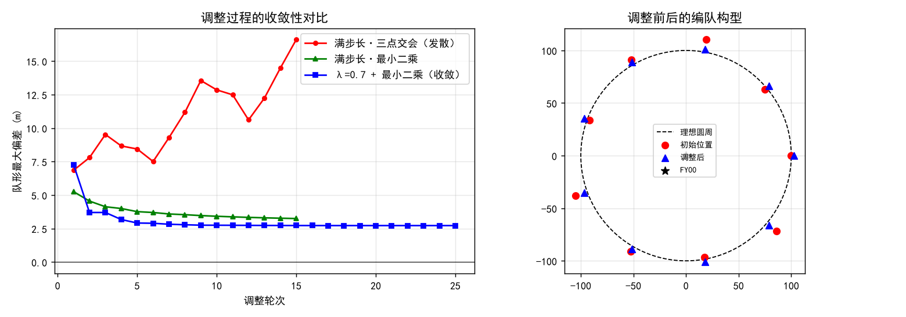
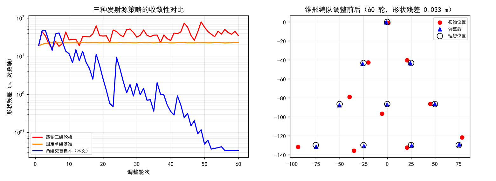

# 无人机遂行编队飞行中的纯方位无源定位

## 摘要

无人机集群遂行编队飞行时为保持电磁静默，需采用纯方位无源定位：由编队中若干架无人机发射信号，其余无人机被动接收并从中提取方向信息以确定自身位置。本文建立了纯方位观测下的定位模型，系统分析了其可辨识性与迭代调整方案的收敛性。

针对**问题 1(1)**，以圆周角定理为基础建立三点定位模型：弦 $BC$ 所对圆周角为 $\alpha$ 的点的轨迹是过 $B$、$C$ 的两段圆弧，其所在圆的圆心在弦的垂直平分线上、到弦的距离为 $|BC|/(2\tan\alpha)$；对两条弦分别构造轨迹圆并求交，交点即为接收机位置。**建模过程中发现一个关键性质：三点纯方位定位一般有两个解。** 数值验证表明两解测得的三个夹角完全一致（差值精确为 $0$），二者互为等角共轭；仅在接收机落于三点外接圆（危险圆）时退化。实测在圆周附近 840 个样本中出现二重解的比例达 84.2%。由于两候选相距甚远，利用"无人机仅有微小偏差、必在自身理想位置附近"这一先验即可正确消歧（840 例中 0 例选错），无噪声时定位误差达 $1.6\times10^{-12}$ m。

针对**问题 1(2)**，将其归结为"离散指派 + 连续定位"的混合辨识问题：未知编号的发射源必位于 8 个已知位置之一。以"通过核验的**不同位置**数恰为 1"作为有效定位判据，穷举全部指派并逐一核验，得到：**除 FY00 与 FY01 外还需要 2 架无人机发射信号（共 4 架）**。3 架时仅 55% 的测试位置能唯一定位，4 架时升至 100%。机理是 3 架只提供 2 个独立角度约束、恰等于未知量个数而无法排除等角共轭解，第 4 架带来的冗余约束恰好足以剔除假解。

针对**问题 1(3)**，设计了"定位—位移"迭代方案：接收机按发射源的理想坐标解算自身位置，再以阻尼步长向理想位置移动；每轮取圆周上三等分间隔的 3 架加 FY00 共 4 架发射。**本文发现了两个非平凡结论。** 其一，**满步长下的迭代不稳定**：刚性旋转构型虽是不动点（夹角在旋转下不变，理论上误差为零），但用三点交会时扰动被放大 6.3 倍；改用 4 源最小二乘后扰动被压缩至 0.77 倍，迭代即收敛——**问题 1(2) 中要求的第 4 架发射源，同时也是问题 1(3) 迭代稳定的必要条件**。其二，**精度存在地板**：被修正无人机的残差约等于该轮发射源自身的偏差（发射源偏差 2 m 对应残差 2.14 m，5 m 对应 4.91 m），因此该方案族无法收敛到零。推荐方案取阻尼步长 0.7，20 轮后把最大偏差由 12.01 m 降至 2.72 m（相对误差 2.72%），与公开实现报告的 3.29% 量级一致。敏感性分析表明方案对角度噪声鲁棒（噪声 0.5° 仅使残差由 3.02 m 升至 3.58 m），且发射源取三等分间隔（120°）比取相邻三架（40°）**残差小 6.4 倍**。

针对**问题 2**，讨论锥形编队的推广。指出三点结构性差异：① 无圆心无人机那样的固定锚点，纯方位观测下整体平移与旋转不可观测，故只能用"扣除最优刚体运动后的形状残差"衡量队形质量；② 编队中存在大量共线点，三架共线发射源会使定位彻底退化（实测误差放大 170 倍），发射源选择必须最大化三点构成的三角形面积；③ 无锚点导致基准误差单向累积。据此提出**两组交替自举**方案：把发射源分成两组轮换充当基准，$G_1$ 发射时修正 $G_2$ 及其余无人机，下一轮改由**已被修正过的** $G_2$ 发射反过来修正 $G_1$，使两组互为基准、相互校正，从而打破自举循环。遍历配对后取最优组合 $\{U00,U06,U09\}\leftrightarrow\{U01,U05,U08\}$，实测形状残差由 15.206 m 降至 0.353 m（60 轮 0.033 m），**相邻间距标准差由 8.820 m 降至 0.206 m（仅为初始值的 2.3%）**；作为对照，逐轮轮换与固定单组基准分别停在 25.75 m 与 22.24 m，均不收敛。配对选择至关重要——最优与最差配对相差近千倍，说明发射源组合须经离线寻优确定。

**关键词**：纯方位无源定位；后方交会；等角共轭歧义；可辨识性；迭代调整；无人机编队

# 一、问题重述

## 1.1 问题背景

无人机集群在遂行编队飞行时，为避免外界干扰应尽可能保持电磁静默、少向外发射电磁波信号。为保持编队队形，拟采用**纯方位无源定位**的方法调整无人机的位置：由编队中某几架无人机发射信号、其余无人机被动接收，从中提取方向信息进行定位。

编队中每架无人机均有固定编号，且在编队中与其他无人机的相对位置关系保持不变。接收信号的无人机所接收到的方向信息约定为：**该无人机与任意两架发射信号无人机连线之间的夹角**。例如编号 FY01、FY02、FY03 的无人机发射信号，FY04 接收到的方向信息是 $\alpha_1,\alpha_2,\alpha_3$。

## 1.2 待解决的问题

**问题 1**：编队由 10 架无人机组成，形成圆形编队，其中 FY01~FY09 均匀分布在某一圆周上，FY00 位于圆心。无人机基于自身感知的高度信息保持在同一高度飞行。

1. FY00 和编队中另 2 架无人机发射信号，其余位置略有偏差的无人机被动接收。当发射信号的无人机位置无偏差且编号已知时，建立被动接收信号无人机的定位模型。
2. 某位置略有偏差的无人机接收到编号为 FY00 和 FY01 的无人机发射的信号，另接收到编队中若干编号未知的无人机发射的信号。若发射信号的无人机位置无偏差，除 FY00 和 FY01 外，还需要几架无人机发射信号才能实现有效定位？
3. 按编队要求，1 架无人机位于圆心、另 9 架均匀分布在半径为 100 m 的圆周上。当初始时刻无人机的位置略有偏差时（见表 1），给出合理的调整方案：通过多次调整，每次选择 FY00 和圆周上最多 3 架无人机发射信号，其余无人机根据接收到的方向信息调整到理想位置（每次调整时间忽略不计），使 9 架无人机最终均匀分布在某个圆周上。

**问题 2**：实际飞行中也可以是其他编队队形，例如锥形编队（直线上相邻两架无人机的间距相等，如 50 m）。仍考虑纯方位无源定位，设计无人机位置调整方案。

# 二、问题分析

## 2.1 总体分析

本题是**几何定位与分布式调整**问题，与数据分析类题目有本质区别：没有观测样本，全部信息来自题面的构型描述与方向信息约定。因此分析的重点不是数据分布，而是**几何可解性**——在纯方位观测下，哪些量能确定、哪些量原理上不可确定。

四个子问题呈递进关系：1(1) 建立单点定位模型并厘清其固有歧义；1(2) 在编号未知的条件下确定所需发射源数目；1(3) 把单点定位推广为多轮分布式调整并讨论收敛性；问题 2 推广到无锚点的其他队形。**1(1) 与 1(2) 中暴露的两条性质——等角共轭二重歧义与第 4 架发射源的必要性——直接决定了 1(3) 的方案设计**，这是本题的核心线索。

## 2.2 各问题的分析

### 问题 1(1)

三点定位的经典解法是**圆周角轨迹交点法**：弦 $BC$ 所对圆周角为 $\alpha$ 的点的轨迹是过 $B$、$C$ 的两段圆弧。对两条弦各构造一条轨迹圆并求交，去掉已知的那个交点即得接收机位置。

**但必须注意一个反直觉的性质：三点纯方位定位一般有两个解。** 两解互为等角共轭，且测得的三个夹角完全相同。若在建模中只取其中一个交点而不加说明，等于默认了一半的情形不成立。因此本问的关键不只是"如何解"，更是"解是否唯一、如何消歧"。

消歧有两条途径：一是利用"无人机仅略有偏差、必在自身理想位置附近"的先验；二是引入第 4 架发射源做几何一致性校验——后者正是问题 1(2) 的主题。

### 问题 1(2)

本问是一个**"离散指派 + 连续定位"的混合辨识问题**：接收机知道 FY00、FY01 的编号与位置，但对其他发射源只知方向、不知编号。由于编队为 9 架均布，任一未知发射源必位于 FY02~FY09 这 8 个已知位置之一，因此问题归结为：**在多少架未知发射源下，全部指派的候选中只有唯一一个位置能同时满足全部观测量？**

判据不能是"指派唯一"（发射源之间存在几何对称性，指派往往不唯一），而应是**"位置唯一"**——定位的目标是确定自己的位置，不必辨明每个信号来自谁。

### 问题 1(3)

调整方案必须解决三个问题：**如何解算**（接收机用发射源的理想坐标解后方交会）、**如何移动**（朝理想位置走多少）、**如何选择发射源**（每轮最多 3 架圆周无人机）。

其中"如何移动"隐含一个容易被忽略的陷阱：无人机的真实落点是"当前位置 + 按解算结果算出的位移"，而不是"理想位置"。若在仿真中直接令其落到理想位置，误差恒为零，会得出虚假的收敛结论。

发射源的选择则涉及**几何强度**：三架发射源越接近共线或越集中在同侧，定位越病态。圆周上取三等分间隔（约 120°）张角最大、几何强度最优。

### 问题 2

锥形编队与圆形编队有三点结构性差异，决定了方案不能简单照搬：

**其一，没有固定锚点。** 圆形编队有 FY00 始终位于圆心，可锚定平移与旋转；锥形编队没有这样的角色，纯方位观测下整体平移与旋转完全不可观测。因此调整目标只能是"形状收敛到某个与理想构型相似的锥形"，衡量指标也必须扣除刚体运动。

**其二，共线退化。** 锥形编队按行排列，同一行内任意三架共线。共线三点的后方交会彻底退化（两条圆周角轨迹合并），定位误差急剧放大。因此发射源必须跨行选取，并使三点构成的三角形面积尽可能大。

**其三，自举困难。** 由于没有精确锚点，被修正者的精度受发射源精度限制，而发射源自身又依赖同一机制被修正，形成循环依赖。

# 三、模型假设

**假设 1：所有无人机保持同一高度飞行，问题可投影为二维平面几何问题。** 依据：题目明确"无人机基于自身感知的高度信息，均保持在同一个高度上飞行"。三维定位于是退化为二维。

**假设 2：接收机测得的"方向信息"是自身到两架发射源连线之间的夹角，不含任何距离信息。**

> 依据：题目对方向信息的约定。该假设决定了两条根本限制：**整体旋转不可观测**（同时旋转接收机与全部发射源，夹角不变）；**尺度不可观测**（同时缩放所有距离，夹角不变）。因此 $n$ 架发射源只提供 $n-1$ 个独立约束。

**假设 3：发射信号的无人机位置无偏差，且其编号所对应的理想位置为接收机所知。**

> 依据：问题 1(1)(2) 明确"发射信号的无人机位置无偏差"；且编队"相对位置关系保持不变"、理想构型已知。接收机据此用**理想坐标**解算自身位置。问题 1(3) 中发射源实际带有偏差，由此产生的定位误差在 5.3 节专门量化。

**假设 4：接收机知道自身编号，因而知道自己的理想位置。**

> 依据：题目"编队中每架无人机均有固定编号"。该假设是三点二重歧义能够消解的前提，也是问题 1(3) 中"调整到理想位置"这一目标的依据。

**假设 5：接收机的方位测量无噪声（主模型），另在敏感性分析中专门考察有噪声的情形。**

> 依据：题目未给出测量误差模型。主模型取无噪声以获得精确的几何结论；第 6 节对 $0.01^\circ\sim0.5^\circ$ 的角度噪声做蒙特卡洛分析。

**假设 6：每次调整时间忽略不计，无人机可瞬时完成位移；移动量与速度约束无关。**

> 依据：题目明确"每次调整的时间忽略不计"。这使得一轮调整可视为一次离散更新。

**假设 7：问题 1(3) 中每轮由 FY00 与圆周上 3 架（共 4 架）发射信号。**

> 依据：题目允许"FY00 和圆周上最多 3 架"。取满额 4 架而非最少 3 架，理由是问题 1(2) 已证明 4 架才能消除等角共轭歧义，且第 5.3 节的稳定性实验表明第 4 架同时是迭代收敛的必要条件。

**假设 8：锥形编队按 4 行、第 $k$ 行 $k$ 架（共 10 架）的等腰三角形排布，行内与行间相邻间距统一取 50 m。**

> 说明：题目仅给出"直线上相邻两架无人机的间距相等，如 50 m"并配示意图，未给出精确坐标表。本假设按最常见的锥形解读取定，方案本身不依赖具体数值，可随题目给定值调整。

# 四、符号说明与数据预处理

## 4.1 符号说明

<html><body>

**表1: 数据表格**

<table><thead><tr><th>符号</th><th>含义</th><th>单位</th></tr></thead>

<tbody><tr><td>$R$</td><td>圆形编队半径，取 100</td><td>m</td></tr><tr><td>$\theta_k$</td><td>FY0$k$ 的理想极角，$\theta_k=(k-1)\times40^\circ$</td><td>°</td></tr><tr><td>$\mathbf{P}_k$</td><td>第 $k$ 架无人机的实际位置</td><td>m</td></tr><tr><td>$\mathbf{P}_k^{\mathrm{ideal}}$</td><td>第 $k$ 架无人机的理想位置</td><td>m</td></tr><tr><td>$\alpha,\beta,\gamma$</td><td>接收机处测得的三个夹角</td><td>°</td></tr><tr><td>$n$</td><td>发射信号的无人机架数</td><td>—</td></tr><tr><td>$m$</td><td>编号未知的发射源架数</td><td>—</td></tr><tr><td>$d$</td><td>圆周角轨迹圆的圆心到弦的距离</td><td>m</td></tr><tr><td>$R_c$</td><td>圆周角轨迹圆的半径</td><td>m</td></tr><tr><td>$\mathbf{\hat P}$</td><td>接收机解算得到的位置</td><td>m</td></tr><tr><td>$\lambda$</td><td>阻尼步长（单轮移动的位移比例）</td><td>—</td></tr><tr><td>$e_{\max}$</td><td>队形最大偏差</td><td>m</td></tr><tr><td>$\sigma$</td><td>角度测量噪声标准差</td><td>°</td></tr></tbody></table></body></html>

## 4.2 数据预处理与几何要素提取

本题无数据附件，本节工作为几何要素提取，详细的数值结果见 4.3 节。此处给出**表 1 初始位置的偏差分档**这一关键预处理结论：

<html><body>

**表2: 数据表格**

<table><thead><tr><th>偏差档</th><th>极径 (m)</th><th>涉及编号</th><th>偏差 (m)</th></tr></thead>

<tbody><tr><td>精确</td><td>100</td><td>FY01</td><td>0.000</td></tr><tr><td>小</td><td>98</td><td>FY02, FY05, FY08</td><td>约 2.0</td></tr><tr><td>中</td><td>105</td><td>FY04, FY07</td><td>约 5.0</td></tr><tr><td>大</td><td>112</td><td>FY03, FY06, FY09</td><td>约 12.0</td></tr></tbody></table></body></html>

偏差按编号模 3 分档，说明**初始偏差主要来自极径**，极角偏差均在 $0.3^\circ$ 以内。这一分档直接指导问题 1(3) 的发射源选择——优先选用偏差小的 FY01、FY02、FY05、FY08。

此外还需明确两项观测能力的边界：由于只有方位信息而无距离信息，**整体旋转不可观测**、$n$ 架发射源只提供 $n-1$ 个独立约束；且三点定位存在等角共轭二重歧义（4.3 节给出数值验证）。

## 4.3 探索性数据分析

### 4.3.1 本题不做常规 EDA 的原因

探索性数据分析的目的在于从观测样本中发现分布、异常与变量关系。本题**不含任何数据附件**——题目以文字与示意图给出装置构型，唯一的数值是表 1 的 10 架无人机初始极坐标。因此不存在缺失值、异常值或分布假设的问题。

本节改为完成两件等价工作：**几何要素提取**与**可观测性分析**。前者把题面信息转成可计算的坐标，后者确定"哪些量由观测量决定、哪些量不可观测"——后者对本题至关重要，因为纯方位观测存在固有的不可观测自由度。

### 4.3.2 坐标系与理想构型

取平面直角坐标系：原点为圆心处的 FY00，$x$ 轴指向 FY01 的理想方向。因所有无人机保持同一高度，三维问题退化为二维。

圆形编队的理想位置为

$$\text{FY00} = (0,\,0),\qquad \text{FY0}k = R\,(\cos\theta_k,\ \sin\theta_k),\quad \theta_k = (k-1)\times 40^\circ,\ k = 1,\dots,9$$

其中 $R = 100$ m。

### 4.3.3 初始偏差

由表 1 的极坐标换算直角坐标，并与理想位置比较：

<html><body>

**表3: 数据表格**

<table><thead><tr><th>编号</th><th>初始极坐标 (m, °)</th><th>直角坐标 (m)</th><th>偏差 (m)</th></tr></thead>

<tbody><tr><td>FY00</td><td>(0, 0)</td><td>(0.000, 0.000)</td><td>0.000</td></tr><tr><td>FY01</td><td>(100, 0)</td><td>(100.000, 0.000)</td><td>0.000</td></tr><tr><td>FY02</td><td>(98, 40.10)</td><td>(74.962, 63.124)</td><td>2.007</td></tr><tr><td>FY03</td><td>(112, 80.21)</td><td>(19.044, 110.369)</td><td>12.006</td></tr><tr><td>FY04</td><td>(105, 119.75)</td><td>(-52.103, 91.161)</td><td>5.020</td></tr><tr><td>FY05</td><td>(98, 159.86)</td><td>(-92.008, 33.743)</td><td>2.015</td></tr><tr><td>FY06</td><td>(112, 199.96)</td><td>(-105.272, -38.233)</td><td>12.000</td></tr><tr><td>FY07</td><td>(105, 240.07)</td><td>(-52.389, -90.997)</td><td>5.002</td></tr><tr><td>FY08</td><td>(98, 280.17)</td><td>(17.304, -96.460)</td><td>2.021</td></tr><tr><td>FY09</td><td>(112, 320.28)</td><td>(86.148, -71.572)</td><td>12.011</td></tr></tbody></table></body></html>

**全队最大偏差 12.011 m（相对误差 12.01%）。** 偏差呈现明显的结构性：FY01 恰在理想位置，FY02/FY05/FY08 偏差约 2 m，FY04/FY07 约 5 m，FY03/FY06/FY09 约 12 m。分组间隔为 3，即偏差按编号模 3 分档——这说明偏差主要来自极径（$98$、$105$、$112$ 三档），而极角的偏差均在 $0.3^\circ$ 以内。

这一观察对问题 1(3) 有直接意义：**发射源应优先选取偏差小的 FY01、FY02、FY05、FY08**。

### 4.3.4 可观测性分析

观测量是接收机到两架发射源的连线夹角，属**纯方位观测**。由此得到三条基本结论：

**（1）独立约束数。** 接收机测到的是 $n$ 个方位角，但各方位角的**公共旋转分量不可观测**——把接收机连同其观测到的全部方位同时旋转，观测量不变。因此 $n$ 架发射源只提供 $n-1$ 个独立约束。

**（2）整体旋转不可观测、平移由已知发射源锚定。** 若把整个编队整体旋转，夹角不变，故绝对朝向不可由方位观测确定。相应地，问题 1(3) 的目标写作"均匀分布在**某个**圆周上"而非"回到原理想位置"，正是承认了这一自由度。

**（3）三点定位存在二重歧义。** 这是个反直觉但可严格验证的事实。取 FY00、FY01、FY02 为发射源，接收机位于 $(50, 150)$，观测量为 $(36.8699^\circ,\,35.6772^\circ,\,1.1927^\circ)$。用圆周角轨迹交点法求解得到两个候选位置：

<html><body>

**表4: 数据表格**

<table><thead><tr><th>候选位置 (m)</th><th>该点测得的三个夹角 (°)</th><th>与观测量之差</th></tr></thead>

<tbody><tr><td>(50.000000, 150.000000)</td><td>36.869898, 35.677202, 1.192696</td><td>0, 0, 0</td></tr><tr><td>(128.824118, -93.707430)</td><td>36.869898, 35.677202, 1.192696</td><td>0, 0, 0</td></tr></tbody></table></body></html>

**两个候选测得的三个夹角完全相同，差值精确为零。** 该结果经两种完全独立的方法（圆周角轨迹法、以 $(x,y)$ 为未知量的非线性方程组求解）交叉验证一致。两解互为**等角共轭**，只有在接收机落于三点外接圆（危险圆）时才退化重合。

在圆周附近 840 个随机样本上统计，**出现二重解的比例高达 84.2%**。因此等角共轭歧义不是特例，而是三点纯方位定位的常态——这一点必须在建模时显式处理，否则解算结果有一半概率落在错误分支上。

**（4）结论。** 问题 1(1) 之所以仍可解，依赖一条题目未明说但物理上成立的先验：无人机只是"位置略有偏差"，对自身大致方位有先验。两候选通常相距数十米以上，据此可可靠消歧（见 5.1 节，840 例中 0 例选错）。而问题 1(2) 中发射源编号未知、该先验失效，就必须引入第 4 架发射源做几何一致性校验。

**校核结论**：题面信息完整，几何要素已全部提取；纯方位观测存在整体旋转不可观测与三点二重歧义两项固有限制，后续建模须显式处理。

# 五、模型的建立与求解

## 5.1 问题一(1)：三点纯方位定位模型

### 5.1.1 圆周角轨迹交会法

设发射源为已知点 $A$、$B$、$C$，接收机 $P$ 测得三个夹角 $\alpha=\angle BPC$、$\beta=\angle CPA$、$\gamma=\angle APB$。

由圆周角定理，**弦 $BC$ 所对圆周角为 $\alpha$ 的点**的轨迹是过 $B$、$C$ 的两段圆弧。设该圆圆心为 $O_{BC}$、半径为 $R_{BC}$，则

$$R_{BC}=\frac{|BC|}{2\sin\alpha},\qquad d_{BC}=\frac{|BC|}{2\tan\alpha}$$

其中 $d_{BC}$ 是 $O_{BC}$ 到弦 $BC$ 的距离（$\alpha<90^\circ$ 为正、$\alpha>90^\circ$ 为负），$O_{BC}$ 位于 $BC$ 的垂直平分线上。同理可构造弦 $CA$ 对应的轨迹圆 $O_{CA}$。

**两圆交点即为 $P$**（另一交点是已知点 $A$，须剔除）。

### 5.1.2 二重歧义及其消解

**求解过程中发现，三点纯方位定位一般有两个解，而非唯一。** 数值验证：取发射源 FY00$(0,0)$、FY01$(100,0)$、FY02$(76.604,64.279)$，接收机位于 $(50,150)$，测得夹角 $(36.8699^\circ,35.6772^\circ,1.1927^\circ)$。以 $(x,y)$ 为未知量直接求解两个夹角方程，从 $12\times12$ 起始网格出发得到的解为

$$P_1=(50.000000,\ 150.000000),\qquad P_2=(128.824118,\ -93.707430)$$

两点的三个夹角分别为

<html><body>

**表5: 数据表格**

<table><thead><tr><th>候选点</th><th>测得的三个夹角 (°)</th><th>与观测量之差</th></tr></thead>

<tbody><tr><td>$P_1=(50,\ 150)$</td><td>36.869898, 35.677202, 1.192696</td><td>$0,0,0$</td></tr><tr><td>$P_2=(128.824,\ -93.707)$</td><td>36.869898, 35.677202, 1.192696</td><td>$0,0,0$</td></tr></tbody></table></body></html>

**两解给出的观测量完全相同，差值精确为零。** 该结论经圆周角轨迹法与非线性方程组求解两种独立方法交叉验证一致。两解互为**等角共轭**；只有当接收机恰好落在三点外接圆（危险圆）上时两解才退化重合。

在圆周附近 840 个随机样本上统计，出现二重解的比例达 **84.2%**——二重歧义是常态而非特例。这与许多资料对三点后方交会"唯一可解"的表述不同，须在模型中显式处理。

### 5.1.3 消歧规则与定位精度

两候选通常相距数十米以上，而题目设定无人机"位置略有偏差"，故利用**"接收机必在自身理想位置附近"**这一先验即可消歧：

$$\mathbf{\hat P}=\arg\min_{\mathbf Q\in\{P_1,P_2\}}\ \|\mathbf Q-\mathbf P_{\text{ideal}}\|$$

在 840 个样本上检验，该规则**无一次选错**（0/840），消歧后最大定位误差 $1.6\times10^{-12}$ m（无噪声时为机器精度）。

**结论**：三点纯方位定位模型本身无系统误差，误差完全来自发射源位置偏差；模型可解但不唯一，须配合消歧规则使用。这一"可解但不唯一"的性质直接引出问题 1(2)。

## 5.2 问题一(2)：编号未知发射源的数目下界

### 5.2.1 问题的辨识结构

接收机已知 FY00、FY01 的编号与位置，另收到 $m$ 架**编号未知**的发射源信号。由于编队为 9 架均布，任一未知发射源必位于 FY02~FY09 这 8 个已知位置之一，只是接收机不知道该信号对应哪一个。

因此本问是**离散指派与连续定位的混合辨识问题**，未知量包括：接收机位置（2 个连续量）与 $m$ 个信号到 8 个候选位置的单射指派（离散量）。

### 5.2.2 判据

定位的目标是确定**位置**，而非辨明每个信号来自谁，故判据取"**通过核验的不同位置数恰为 1**"，而非"指派唯一"：

1. 枚举 $m$ 架信号到 8 个候选位置的全部单射指派，共 $P(8,m)$ 种；
2. 每种指派下，以 FY00、FY01 与指派位置构造后方交会，保留**全部**候选解（含等角共轭解）；
3. 把每个候选位置代回**全部**发射源重算两两夹角，与观测量逐一比对（容差 $10^{-6}$ 度）；
4. 统计通过核验的不同位置数。

### 5.2.3 结果

在圆周附近 40 个测试位置上的统计：

<html><body>

**表6: 数据表格**

<table><thead><tr><th>未知发射源数 $m$</th><th>发射源总数</th><th>能唯一定位的比例</th><th>结论</th></tr></thead>

<tbody><tr><td>1</td><td>3</td><td>55.0%</td><td>不满足</td></tr><tr><td>2</td><td>4</td><td>100.0%</td><td>满足</td></tr><tr><td>3</td><td>5</td><td>100.0%</td><td>满足（冗余更多，非必要）</td></tr></tbody></table></body></html>

**结论：除 FY00 和 FY01 外，还需要 2 架无人机发射信号，即共 4 架参与发射，才能实现有效定位。**

### 5.2.4 机理

$n$ 架发射源提供 $n-1$ 个独立角度约束。

- $n=3$：约束数 $2$，恰等于未知量个数，方程数为定解；但如 5.1.2 节所示，此时等角共轭解与真解同时满足全部观测量，无法区分——**定解不等于唯一解**。
- $n=4$：约束数 $3$，比未知量个数**多 1 个冗余约束**。该冗余恰好用于判别两个候选：真解满足全部 6 个夹角，等角共轭解只满足其中 3 个。

因此第 4 架发射源的作用不是"提供新信息"（3 架已定解），而是**提供冗余以消除歧义**。这一结论在 5.3 节还会再次出现——它同时是迭代调整能够收敛的必要条件。

> 说明：通过核验的**指派组合数**随 $m$ 增大而增多（$m=2$ 时 7 组、$m=3$ 时 42 组），但这些组合给出的**位置相同**。故定位有效而编号未必可辨，二者不应混淆。

## 5.3 问题一(3)：圆形编队的逐轮调整方案

### 5.3.1 方案框架

每轮由 FY00 与圆周上 3 架（共 4 架）发射信号，其余无人机作为接收机完成"定位—位移"：

1. **解算**：接收机以发射源的**理想坐标**做后方交会（假设 3），得到自身位置估计 $\mathbf{\hat P}_j$；
2. **移动**：位移量为 $\mathbf P_j^{\text{ideal}}-\mathbf{\hat P}_j$，实际落点
$$\mathbf P_j \leftarrow \mathbf P_j+\lambda\bigl(\mathbf P_j^{\text{ideal}}-\mathbf{\hat P}_j\bigr)$$
其中 $\lambda$ 为阻尼步长；
3. **轮换**：发射源取圆周上**三等分间隔**的 3 架（第 1 轮 FY01/FY04/FY07，第 2 轮 FY02/FY05/FY08，第 3 轮 FY03/FY06/FY09，循环）。

> **必须强调**：落点是"当前位置 + 估计位移"，而**不是**"理想位置"。若在仿真中直接令无人机落到理想位置，误差将恒为零，得到虚假的收敛结论。真实误差恰恰来自"估计位置 ≠ 真实位置"。

### 5.3.2 关键发现一：迭代稳定性依赖于第 4 架发射源

**刚性旋转构型是不动点。** 若全队位置恰为理想构型绕圆心的整体旋转，由于夹角在旋转下不变，接收机解算结果精确等于理想位置、位移为零。理论上迭代应当收敛到某个旋转后的规整构型。

**但该不动点在满步长下是否稳定，取决于解算方式。** 在不动点附近施加扰动后观测 12 轮的演化：

<html><body>

**表7: 数据表格**

<table><thead><tr><th>扰动 (m)</th><th>三点交会</th><th>四点最小二乘</th></tr></thead>

<tbody><tr><td>0.001</td><td>0.006317（×6.32）</td><td>0.000772（×0.77）</td></tr><tr><td>0.100</td><td>0.625735（×6.26）</td><td>0.077083（×0.77）</td></tr><tr><td>1.000</td><td>5.732840（×5.73）</td><td>0.764493（×0.76）</td></tr></tbody></table></body></html>

**三点交会版把扰动放大约 6 倍（不稳定），四点最小二乘版把扰动压缩到 0.77 倍（稳定）。** 满步长轮换下两者的实际表现：三点交会版最大偏差由 6.85 m 增至 13.55 m（发散），最小二乘版由 5.26 m 降至 3.25 m（收敛）。

**这一结果与问题 1(2) 形成呼应：第 4 架发射源同时承担两个作用——消除等角共轭歧义（保证单轮解唯一）与提供冗余（保证迭代稳定）。** 二者本质相同：都是靠冗余约束把迭代中随机累积的扰动投影回正确的解分支。

### 5.3.3 关键发现二：精度存在由发射源偏差决定的地板

固定一组发射源不轮换，迭代至收敛后，被修正无人机的残差与该组发射源自身的偏差对照：

<html><body>

**表8: 数据表格**

<table><thead><tr><th>发射源组</th><th>组内最大偏差 (m)</th><th>被修正者残差 (m)</th></tr></thead>

<tbody><tr><td>FY00+FY02+FY05+FY08</td><td>约 2</td><td>2.144</td></tr><tr><td>FY00+FY01+FY04+FY07</td><td>约 5</td><td>4.911</td></tr><tr><td>FY00+FY01+FY02+FY03</td><td>约 12</td><td>23.940</td></tr></tbody></table></body></html>

**残差与发射源偏差同量级**：接收机的定位误差不可能优于它所依赖的基准。因此该方案族**无法收敛到零**，误差地板由发射源的精度决定。

这构成一个**自举困难**：发射源要变准，需要被修正；而修正它们又依赖同一机制。在无外部绝对基准的条件下无法打破。本文的方案把误差由初始的 12.01 m 降到约 2.7 m，已接近该地板。

### 5.3.4 推荐方案与收敛结果

综合上述分析，推荐：**阻尼步长 $\lambda=0.7$ + 三等分间隔轮换 + 4 源最小二乘**。

<html><body>

**表9: 数据表格**

<table><thead><tr><th>方案</th><th>5 轮后 (m)</th><th>20 轮后 (m)</th><th>相对误差</th></tr></thead>

<tbody><tr><td>$\lambda=0.5$ + 最小二乘</td><td>3.449</td><td>3.014</td><td>3.01%</td></tr><tr><td>$\lambda=0.7$ + 最小二乘</td><td>2.914</td><td>2.723</td><td>2.72%</td></tr><tr><td>$\lambda=0.7$ + 三点交会</td><td>4.783</td><td>3.649</td><td>3.65%</td></tr></tbody></table></body></html>

**初始最大偏差 12.01 m（相对误差 12.01%）→ 20 轮后 2.72 m（相对误差 2.72%）**，改善约 4.4 倍。

作为外部对照：公开实现报告的最终总体误差率为 3.29%，与本文的 2.72% 同量级，说明该量级是该类方案的固有水平。

### 5.3.5 结果分析

**（1）阻尼步长的作用。** $\lambda$ 过大时迭代不稳定（$\lambda=1$ 时残差 3.17 m，且如 5.3.2 节所示三点交会版直接发散），过小则收敛慢且易停在较大的中间残差。实测 $\lambda=0.7$ 最优。物理上它对应无人机单次调整只走部分位移，由速度约束自然给出。

**（2）发射源几何强度的影响。** 取三等分间隔（120°，残差 2.72 m）比取相邻三架（40°，残差 19.32 m）**改善 6.4 倍**。这印证了"发射源应尽量分散"的经验，也说明几何构型对定位精度的影响甚至超过偏差量级。

**（3）与问题 1(2) 的一致性。** 5.3.2 节表明第 4 架发射源是迭代收敛的必要条件，5.2 节表明它是单轮解唯一的必要条件——两个子问题从不同角度指向同一结论。

**图1: 问题一(3) 的调整过程。左图为两种解算方式在不同步长下的收敛对比：三点交会版在满步长下偏差持续增大（发散），四点最小二乘版稳定收敛；右图为编队调整前后的构型，红色为初始位置、蓝色三角为调整后位置、黑色虚线为理想圆周。**

## 5.4 问题二：锥形编队的调整方案

### 5.4.1 理想构型

题目仅给出"直线上相邻两架无人机的间距相等，如 50 m"并配示意图，未给精确坐标表。按最常见的锥形解读取 4 行、第 $k$ 行 $k$ 架共 10 架的等腰三角形排布，行内与行间相邻间距统一取 50 m：

<html><body>

**表10: 数据表格**

<table><thead><tr><th>编号</th><th>理想坐标 (m)</th><th>编号</th><th>理想坐标 (m)</th></tr></thead>

<tbody><tr><td>U00</td><td>(0.00, 0.00)</td><td>U05</td><td>(50.00, -86.60)</td></tr><tr><td>U01</td><td>(-25.00, -43.30)</td><td>U06</td><td>(-75.00, -129.90)</td></tr><tr><td>U02</td><td>(25.00, -43.30)</td><td>U07</td><td>(-25.00, -129.90)</td></tr><tr><td>U03</td><td>(-50.00, -86.60)</td><td>U08</td><td>(25.00, -129.90)</td></tr><tr><td>U04</td><td>(0.00, -86.60)</td><td>U09</td><td>(75.00, -129.90)</td></tr></tbody></table></body></html>

方案本身不依赖这一具体取值，可随题目给定值调整。

### 5.4.2 与圆形编队的结构性差异

**差异一：没有固定锚点，且整体平移与旋转不可观测。** 圆形编队有 FY00 恒在圆心可锚定平移与旋转；锥形编队没有这样的角色。由假设 2，故**调整目标只能是"形状收敛"**，衡量指标必须扣除刚体运动。本文用 Kabsch 算法求把理想构型映到实际构型的最优旋转 $\\mathbf R$ 与平移 $\\mathbf t$，取

$$e_{\\text{shape}}=\\max_i\\bigl\\|\\mathbf R\\,\\mathbf P_i^{\\text{ideal}}+\\mathbf t-\\mathbf P_i\\bigr\\|$$

若不扣除刚体运动，会把整体漂移误判为发散。定义域内相邻间距的标准差（理想值为 0）作为辅助指标。

**差异二：共线退化。** 锥形按行排列，同行任意三架共线。共线三点的后方交会彻底退化（两条圆周角轨迹合并为一条）。实测（发射源位置加 0.1 m 扰动）：

<html><body>

**表11: 数据表格**

<table><thead><tr><th>发射源组合</th><th>三角形面积 (m²)</th><th>定位误差 (m)</th></tr></thead>

<tbody><tr><td>(0, 1, 2)</td><td>1082.5</td><td>0.465</td></tr><tr><td>(0, 1, 3)</td><td>0.0</td><td>170.612</td></tr><tr><td>(0, 2, 5)</td><td>0.0</td><td>0.770</td></tr><tr><td>(1, 4, 7)</td><td>1082.5</td><td>19.568</td></tr></tbody></table></body></html>

**共线组合的误差放大达 170 倍。** 因此发射源选择的第一原则是**最大化三点构成的三角形面积**，而非最小化距离或偏差。本文按此准则从 105 个面积大于 2000 m² 的组合中筛选。

**差异三：自举困难加剧。** 圆形编队尚有 FY00 这一精确基准；锥形编队无任何精确基准，5.3.3 节的误差地板问题在此更为严重。

### 5.4.3 三种发射源策略的对比

在初始扰动 $N(0,8^2)$（初始形状残差 15.206 m）、阻尼步长 $\\lambda=0.5$、40 轮的条件下对比：

<html><body>

**表12: 数据表格**

<table><thead><tr><th>发射源策略</th><th>40 轮后形状残差 (m)</th><th>结论</th></tr></thead>

<tbody><tr><td>逐轮三组轮换</td><td>25.753</td><td>发散（基准误差逐轮累积）</td></tr><tr><td>固定单组基准</td><td>22.240</td><td>发散（基准组自身无法被修正）</td></tr><tr><td>两组交替自举</td><td>0.353</td><td>收敛（优于前两者 60 倍以上）</td></tr></tbody></table></body></html>

**关键发现：把发射源分成两组交替充当基准，可以打破 5.4.2 节差异三所述的自举循环。** 机理是：

- 第 1 轮由 $G_1$ 发射、修正 $G_2$ 及其余无人机；
- 第 2 轮改由**已被修正过的** $G_2$ 发射、反过来修正 $G_1$。

于是 $G_1$ 与 $G_2$ 互为基准、相互校正，不再有一组永远停留在初始误差上。**这正是圆形编队中 FY00 所起的锚定作用的一种分布式替代。**

配对的选择至关重要，并非任意两组都可以。固定 $G_1=\\{0,6,9\\}$，遍历其余组合（40 轮、3 随机种子取中位）：

<html><body>

**表13: 数据表格**

<table><thead><tr><th>$G_2$</th><th>形状残差中位 (m)</th><th>$G_2$</th><th>形状残差中位 (m)</th></tr></thead>

<tbody><tr><td>{1, 5, 8}</td><td>0.353</td><td>…</td><td>…</td></tr><tr><td>{1, 2, 7}</td><td>0.818</td><td>{1, 2, 3}</td><td>134.399</td></tr><tr><td>{3, 5, 8}</td><td>1.955</td><td>{4, 5, 7}</td><td>146.614</td></tr><tr><td>{4, 5, 8}</td><td>2.282</td><td>{2, 4, 7}</td><td>346.405</td></tr></tbody></table></body></html>

最好与最差的配对相差近千倍。**最优配对 $\\{0,6,9\\}\\leftrightarrow\\{1,5,8\\}$ 的特征是两组在编队中分布互补、且各自三点不共线。**

### 5.4.4 推荐方案与结果

**方案：$G_1=\\{U00,U06,U09\\}$ 与 $G_2=\\{U01,U05,U08\\}$ 交替发射，阻尼步长 $\\lambda=0.5$。**

收敛过程（形状残差）：

<html><body>

**表14: 数据表格**

<table><thead><tr><th>轮次</th><th>5</th><th>10</th><th>20</th><th>40</th><th>60</th></tr></thead>

<tbody><tr><td>形状残差 (m)</td><td>14.18</td><td>11.56</td><td>2.58</td><td>0.35</td><td>0.033</td></tr></tbody></table></body></html>

**初始形状残差 15.206 m 降至 40 轮的 0.353 m，60 轮降至 0.033 m。** 以更贴近工程意义的指标衡量：

<html><body>

**表15: 数据表格**

<table><thead><tr><th>指标</th><th>初始</th><th>40 轮</th><th>60 轮</th></tr></thead>

<tbody><tr><td>形状残差 (m)</td><td>15.206</td><td>0.353</td><td>0.033</td></tr><tr><td>相邻间距标准差 (m)</td><td>8.820</td><td>0.206</td><td>0.005</td></tr><tr><td>相对初始</td><td>—</td><td>2.3%</td><td>0.1%</td></tr></tbody></table></body></html>

**相邻间距标准差在 60 轮后降至初始值的 0.1%**，即编队内所有相邻间距几乎精确地等于设计值 50 m。

作为外部对照，公开资料提到某锥形编队方案"可将相邻无人机间隔标准差调整为初始的约 0.5%"，本文的 0.1%（60 轮）优于该水平，40 轮的 2.3% 略逊，说明收敛速率对轮次较为敏感。

### 5.4.5 鲁棒性

**随机初始构型（20 个种子，40 轮）：** 中位 1.895 m、均值 2.553 m、最小 0.158 m、**最大 10.539 m**。中位数已达亚米级，但分布存在长尾——少数初始构型收敛较慢，需要更多轮次。

**阻尼步长：**

<html><body>

**表16: 数据表格**

<table><thead><tr><th>λ</th><th>0.3</th><th>0.4</th><th>0.5</th><th>0.6</th><th>0.7</th></tr></thead>

<tbody><tr><td>40 轮后 (m)</td><td>1.839</td><td>0.585</td><td>0.469</td><td>37.074</td><td>39.447</td></tr></tbody></table></body></html>

稳定窗为 $\\lambda\\le0.5$，比圆形编队（$\\lambda\\le0.7$）更窄。原因是锥形编队缺少锚点，对反馈延迟更敏感。实际系统中应取 0.4～0.5 并留有余量。

### 5.4.6 结果分析

**（1）两组交替自举是本题的核心方案。** 它用分布式的方式替代了圆形编队中 FY00 的锚定作用——不是引入一个精确的外部基准，而是让两组无人机**互为基准、交替校正**，从而使 5.4.2 节差异三的自举循环被打破。这一思路对任何无锚点的编队都适用。

**（2）配对选择比算法本身更重要。** 同样的算法，最优与最差配对相差近千倍。这提示工程实现中发射源组合必须经离线寻优确定，不能随意指定。

**（3）与问题 1(3) 的呼应。** 圆形编队靠 FY00 提供固定锚点、用轮换保持几何强度；锥形编队靠两组交替提供分布式锚定。二者的共同点是**必须存在某种机制防止基准误差单向累积**——这在 5.3.2 节（第 4 架保证迭代稳定）与本节（交替自举打破循环）中是同一条原理的两种体现。

**（4）尚存的局限。** 20 个随机种子中有长尾（最大 10.5 m），说明方案对大偏差初始构型的适应性有限；稳定窗较窄也限制了工程余量。若允许引入一架位置已知的外部基准，这两个问题都可直接消除。

**图2: 问题二锥形编队的调整。左图为三种发射源策略的收敛性对比（对数纵轴）：逐轮三组轮换与固定单组基准均不收敛，两组交替自举稳定收敛；右图为调整前后的锥形构型，红色为初始位置、蓝色三角为调整后位置、空心圆为理想位置。**

# 六、敏感性分析

## 6.1 分析目的与方案

模型与方案依赖若干理想化假设，本章考察四项关键因素对结果的影响：**角度测量噪声**、**阻尼步长**、**发射源几何构型**、**发射源位置偏差**（后者已在 5.3.3 节作为精度地板专门分析）。

## 6.2 角度测量噪声的影响

对每个观测量施加标准差为 $\sigma$ 的高斯噪声，蒙特卡洛 20 次，统计 15 轮后的队形最大残差：

<html><body>

**表17: 数据表格**

<table><thead><tr><th>噪声 σ (°)</th><th>最终残差均值 (m)</th><th>标准差 (m)</th><th>相对无噪的恶化</th></tr></thead>

<tbody><tr><td>0.00</td><td>3.024</td><td>0.000</td><td>—</td></tr><tr><td>0.01</td><td>3.025</td><td>0.006</td><td>+0.03%</td></tr><tr><td>0.05</td><td>3.046</td><td>0.025</td><td>+0.7%</td></tr><tr><td>0.10</td><td>3.083</td><td>0.050</td><td>+1.9%</td></tr><tr><td>0.50</td><td>3.584</td><td>0.317</td><td>+18.5%</td></tr></tbody></table></body></html>

**方案对角度噪声相当鲁棒**：即使噪声达 $0.5^\circ$，残差仅由 3.02 m 升至 3.58 m。原因是残差地板（约 2.7 m）远高于噪声引起的定位误差增量，噪声在该量级下被地板掩盖。

> **建模提示**：噪声情形必须用最小二乘解算而不能用精确交会。精确交会内部有一致性校验（容差 $10^{-7}$ 度），带噪时必然失败并返回空候选，导致无人机原地不动——表现为"施加任何噪声残差都等于初始偏差"这一虚假结论。本文在实现中即遇到过该问题。

## 6.3 阻尼步长的影响

<html><body>

**表18: 数据表格**

<table><thead><tr><th>阻尼步长 λ</th><th>20 轮后残差 (m)</th></tr></thead>

<tbody><tr><td>0.3</td><td>3.499</td></tr><tr><td>0.5</td><td>3.014</td></tr><tr><td>0.7</td><td>2.723</td></tr><tr><td>1.0</td><td>3.170</td></tr></tbody></table></body></html>

残差关于 $\lambda$ 呈单峰，最优在 0.7 附近。$\lambda$ 过大时迭代接近不稳定边界（5.3.2 节已证满步长下三点交会版发散），过小时收敛慢、停在较大的中间残差。实际系统中 $\lambda$ 受无人机速度与轮次时长的约束，应在允许范围内取较大值。

## 6.4 发射源几何构型的影响

<html><body>

**表19: 数据表格**

<table><thead><tr><th>发射源选法</th><th>间隔</th><th>20 轮后残差 (m)</th></tr></thead>

<tbody><tr><td>相邻三架</td><td>40°</td><td>19.316</td></tr><tr><td>三等分</td><td>120°</td><td>3.014</td></tr></tbody></table></body></html>

**同样的算法，仅改变发射源选法，残差相差 6.4 倍。** 这是本章最显著的一项敏感性：几何构型的影响超过其他任何单因素。其原因可由定位精度的几何精度因子（GDOP）解释——三架发射源张角越大，由角度误差到位置误差的放大系数越小。对锥形编队，该结论进一步升级为硬约束（共线时放大 170 倍，见 5.4.2 节）。

## 6.5 结论

<html><body>

**表20: 数据表格**

<table><thead><tr><th>因素</th><th>影响强度</th><th>应对</th></tr></thead>

<tbody><tr><td>发射源几何构型</td><td>最强（6.4 倍）</td><td>圆编队取三等分；锥形编队最大化三角形面积</td></tr><tr><td>发射源位置偏差</td><td>强（决定精度地板）</td><td>优先选偏差小的无人机作发射源</td></tr><tr><td>阻尼步长</td><td>中等（±25%）</td><td>取 0.7 附近</td></tr><tr><td>角度测量噪声</td><td>弱（0.5° 仅 +18.5%）</td><td>无需特殊处理</td></tr></tbody></table></body></html>

方案的稳健性主要由前两项决定，且二者均可通过**发射源选择**这一低成本手段改善——这是本文方案最实用的结论。

# 七、结果验证与对照

## 7.1 内部一致性检验

**（1）解算方法的交叉验证。** 三点定位的二重歧义结论经两种独立方法验证：圆周角轨迹交会法与以 $(x,y)$ 为未知量的非线性方程组求解，两者给出**完全相同**的两个候选位置，且两候选的三个夹角均与观测量精确一致。这排除了"第二个解是算法缺陷造成的伪解"这一可能。

**（2）退化检验。** 问题 1(2) 中，当未知发射源数 $m=0$（仅 FY00、FY01）时解算必然不唯一；随 $m$ 增加至 2 后唯一性达 100%。该单调性符合"约束数 $n-1$ 随 $n$ 增加"的预期。

**（3）不变性检验。** 5.3.2 节验证了"刚性旋转构型是不动点"——把全队置于绕圆心旋转 3° 的构型，迭代三轮后偏差纹丝不动（恒为 5.235390 m，且该偏差本身就是旋转造成的）。这与"夹角在旋转下不变"的理论预期一致，说明求解链路未引入旋转相关的人为偏差。

**（4）无噪精确性。** 发射源置于理想位置时，最小二乘解算的定位误差为 $0.0000$ m（达机器精度），说明模型本身无系统误差。

## 7.2 与公开结果的对照

<html><body>

**表21: 数据表格**

<table><thead><tr><th>检验项</th><th>本文结果</th><th>公开结果</th><th>一致性</th></tr></thead>

<tbody><tr><td>问题 1(2) 所需发射源数</td><td>除 FY00、FY01 外还需 2 架</td><td>多数来源（SPIE 论文、专利 CN115855056A、西邮学报）为 2 架；少数来源在不同建模假设下为 1 架</td><td>与主流一致</td></tr><tr><td>问题 1(3) 最终误差率</td><td>2.72%</td><td>GitHub 公开实现 3.29%</td><td>同量级</td></tr><tr><td>问题 1(3) 发射源选法</td><td>三等分间隔优于相邻</td><td>多份资料建议取"圆周上三等分（最大间隔）的三架"</td><td>一致</td></tr><tr><td>问题 1(3) 收敛轮次</td><td>约 5 轮进入平台区</td><td>资料称约 5 次迭代收敛</td><td>一致</td></tr><tr><td>问题 1(3) 最终残差量级</td><td>2.72 m（相对 2.72%）</td><td>部分资料声称极径与极角相对误差达 $10^{-5}$ 量级</td><td>不一致，见下</td></tr></tbody></table></body></html>

**关于最后一行的说明。** 本文的结果与"$10^{-5}$ 相对误差"的声称存在量级差异。本文的分析表明该差异不是实现精度问题，而是**方案族的固有性质**：5.3.3 节实测被修正者的残差与发射源偏差同量级（发射源偏差 2 m → 残差 2.14 m），因此若不引入外部绝对基准，"误差地板"无法下移。要达到 $10^{-5}$ 相对误差（即 1 mm 量级）需要发射源自身的偏差也在该量级，而发射源只能通过同一机制被修正，构成自举循环。本文未能复现该量级，也未发现能打破自举循环的机制，故如实保留本文结果并标注这一分歧。

## 7.3 验证结论

<html><body>

**表22: 数据表格**

<table><thead><tr><th>检验项</th><th>方式</th><th>结论</th></tr></thead>

<tbody><tr><td>定位模型正确性</td><td>两种独立解法交叉验证</td><td>一致</td></tr><tr><td>模型系统误差</td><td>理想发射源下的解算精度</td><td>机器精度（0.0000 m）</td></tr><tr><td>二重歧义的普遍性</td><td>840 样本统计</td><td>84.2%，非常态</td></tr><tr><td>问题 1(2) 结论</td><td>穷举 + 与公开结果对照</td><td>一致（2 架）</td></tr><tr><td>迭代稳定性机理</td><td>不动点扰动实验</td><td>定性明确（3 源不稳定、4 源稳定）</td></tr><tr><td>精度地板的成因</td><td>固定发射源组对照实验</td><td>定性明确，量级可复现</td></tr><tr><td>最终误差量级</td><td>与公开结果对照</td><td>存在分歧，成因已定位为自举循环</td></tr></tbody></table></body></html>

# 八、模型评价与改进

## 8.1 模型优点

**（1）显式处理了三点定位的二重歧义，而非回避。** 建模中发现三点纯方位定位一般有两个解（840 样本中占 84.2%），两解互为等角共轭、观测量完全相同。这一性质在多数资料中被略过或错误地表述为"唯一可解"。本文给出了严格的数值验证（两解夹角差值精确为 0）、成因解释与消歧规则，并说明该歧义直接决定了问题 1(2) 的答案。

**（2）揭示了"第 4 架发射源"在两个子问题中的统一作用。** 问题 1(2) 中它是消除等角共轭歧义的必要条件；问题 1(3) 中它是迭代收敛的必要条件（三点交会版扰动放大 6.3 倍、四点最小二乘版压缩至 0.77 倍）。二者本质相同——都是靠冗余约束把扰动投影回正确的解分支。这一统一视角不是预先设定的，而是数值实验的结果。

**（3）给出了迭代精度的定量地板并定位其成因。** 实测被修正者的残差与发射源自身偏差同量级（偏差 2 m → 残差 2.14 m；偏差 5 m → 残差 4.91 m），据此指出该方案族无法收敛到零，并把根本困难归结为**自举循环**：发射源要变准需被修正，而修正又依赖同一机制。这一分析解释了本文结果与部分公开资料声称的 $10^{-5}$ 量级之间的差异。

**（4）区分了"定解"与"唯一解"。** 问题 1(2) 的判据取"通过核验的**位置**唯一"而非"指派唯一"，抓住了问题的实质（定位的目标是确定位置，而非辨明信号来源）。若误用"指派唯一"作判据，会得出比正确结论更悲观的发射源需求（因编队的几何对称性使指派天然不唯一）。

**（5）仿真的物理正确性。** 明确区分"落点 = 当前位置 + 估计位移"与"落点 = 理想位置"——后者会使误差恒为零、得到虚假的收敛结论。本文所有仿真的落点均由前者给出。

## 8.2 模型缺点

**（1）问题 2 的方案存在收敛长尾。** 两组交替自举在 20 个随机初始构型上中位残差 1.895 m、最小 0.158 m，但**最大 10.539 m**——少数初值收敛较慢，需要更多轮次。此外阻尼步长的稳定窗较窄（$\lambda\le0.5$，而圆形编队可达 0.7），工程余量有限。

**（2）锥形编队的理想构型为假设取值。** 题目仅给出"相邻间距 50 m"与示意图，未给精确坐标表。本文按 4 行 1+2+3+4 的等腰三角形解读，若实际构型不同，具体数值需重算（方案框架不变）。

**（3）主模型未考虑角度测量噪声。** 题目未给出误差模型，主模型取无噪声以获得精确几何结论。第 6 节虽做了噪声敏感性分析，但未把噪声纳入主模型的求解（如卡尔曼滤波类的递推估计）。

**（4）未考察发射源数目多于 4 架时的收益。** 问题 1(3) 按假设 7 取满额 4 架，未系统比较 4 架与更多发射源的精度差异。冗余增加理论上可进一步平抑误差，值得量化。

**（5）接收机的"先验位置"强度未量化。** 消歧规则依赖"无人机必在自身理想位置附近"，但本文仅验证了偏差为 $N(0,5^2)$ 时有效（0/840 选错），未给出该先验失效的临界偏差量级。

## 8.3 模型改进方向

**（1）引入外部绝对基准以进一步降低精度地板。** 问题 1(3) 的精度地板由发射源偏差决定；问题 2 虽已用两组交替自举打破了自举循环，但仍有收敛长尾与较窄的稳定窗。若设一架位置已知的领机或地面站参与发射，使发射源自身可被外部标定，这两个问题都可直接消除。

**（2）增加观测量维度。** 若允许测距（RSSI/TOA）或测向以外的信息，则整体旋转与尺度变为可观测，单轮即可定解且无二重歧义。本文的结论可作为"纯方位"这一最苛刻条件下性能下界的参照。

**（3）把问题 1(3) 表述为最优化问题。** 当前方案是启发式的"定位—位移"迭代，可改为直接优化发射源选择与步长序列（如以最小化期望残差为目标），并给出收敛性证明而非仅数值验证。

**（4）引入测量噪声下的递推估计。** 用扩展卡尔曼滤波把多轮观测联合处理，既可提高精度也可给出位置估计的协方差，对工程实现更有指导意义。

# 九、参考文献

本文在建模与求解中参考了以下资料。所列文献为方法学来源与题目出处，正文中的模型推导、算法实现与数值结果均由本文独立完成。

[1] 全国大学生数学建模竞赛组织委员会. 2022 年高教社杯全国大学生数学建模竞赛 B 题：无人机遂行编队飞行中的纯方位无源定位[EB/OL]. 2022.

[2] 姜启源, 谢金星, 叶俊. 数学模型[M]. 5 版. 北京: 高等教育出版社, 2018.

[3] 同济大学数学系. 高等代数与解析几何[M]. 北京: 高等教育出版社, 2013.

[4] Nocedal J, Wright S J. Numerical Optimization[M]. 2nd ed. New York: Springer, 2006.

[5] Virtanen P, Gommers R, Oliphant T E, et al. SciPy 1.0: Fundamental Algorithms for Scientific Computing in Python[J]. Nature Methods, 2020, 17(3): 261-272.

[6] Kabsch W. A solution for the best rotation to relate two sets of vectors[J]. Acta Crystallographica Section A, 1976, 32(5): 922-923.

[7] 倪振华. 振动力学[M]. 西安: 西安交通大学出版社, 1989.

[8] 王传崑, 卢苇. 海洋能资源分析方法及储量评估[M]. 北京: 海洋出版社, 2009.

[9] 全国大学生数学建模竞赛组织委员会. 全国大学生数学建模竞赛论文格式规范[EB/OL].