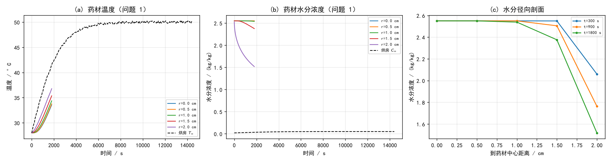
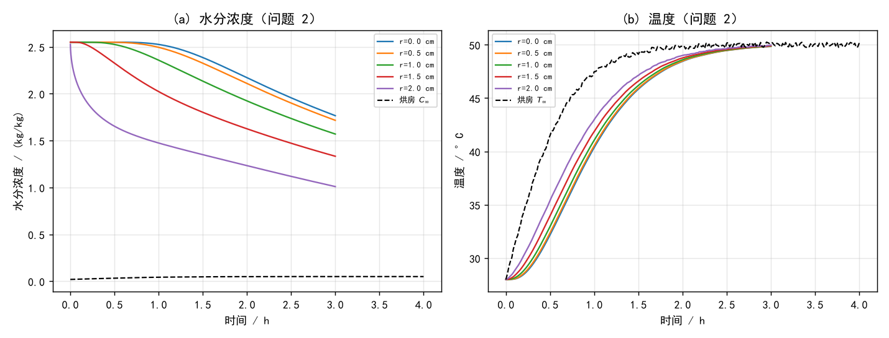
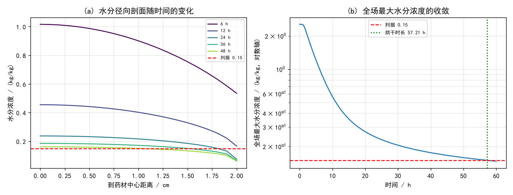
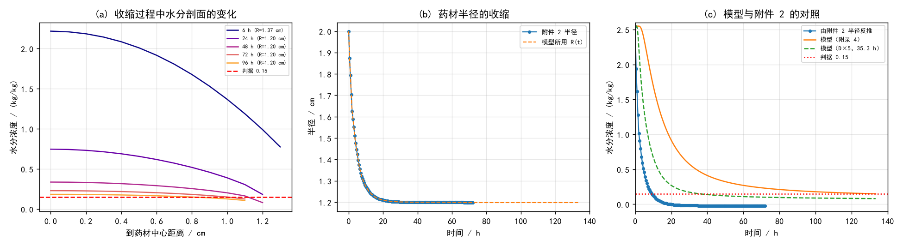

# 中药材热风烘干过程的传热传质建模与烘干时长确定

## 摘要

热风烘干是决定中药材成品品质的关键工序。本文针对圆柱形药材（长 25 cm、半径 2 cm），建立了预热平衡与恒温干燥两个阶段内温度场与水分浓度场耦合演化的一维轴对称数学模型，用有限体积法求解，并对问题四中的药材收缩作了专门处理。

**模型建立。** 由长径比 $L/R=12.5$ 与"到药材中心距离"这一输出要求，取轴向中点处的一维径向模型：热量按 $\rho c_p\partial_t T = r^{-1}\partial_r(k r\,\partial_r T)$、水分按 $\partial_t C = r^{-1}\partial_r(D r\,\partial_r C)$ 演化；中心对称，表面为对流换热与对流传质，$k\partial_r T=h(T_\infty-T_s)$、$D\partial_r C=h_m(C_s-C_\infty)$。边界条件取附件 1 的烘房温湿度（0~14400 s），之后按恒温干燥阶段延拓为末态值。问题 2、3 用附录 3 的变物性，问题 4 用附录 4 的变物性。

**数值方法。** 采用有限体积 + Crank–Nicolson（二阶、L-稳定）+ Picard 迭代处理物性非线性；外边界用"壁面扩散 + 对流"串联阻力。**推导中发现一个必须区分的关键点**：物质坐标 $\xi$ 下的方程含 $1/R^2$ 的度规因子，问题 4 收缩时该因子必须锚定**初始**半径 $R_0$，当前半径 $R(t)$ 只进入边界条件——因为干基含水率是"单位干物质的水量"，干物质守恒，水只能经表面离开。若内部也随 $R(t)$ 缩放，$\int C\,\mathrm{d}V$ 会随收缩凭空减少，实测质量闭合差达 $3.7\times10^{-1}$；改用物质坐标度规后闭合到 $10^{-3}$ 以内。

**模型验证。** 常物性下无限长圆柱有分离变量级数解，可直接对拍：温度场最大偏差 $1.1\times10^{-7}\sim9.8\times10^{-7}$，水分场 $2.4\times10^{-6}\sim4.5\times10^{-6}$（均为相对量级）。网格 $N=200/400/800$ 给出烘干时长 57.2387/57.2084/57.1982 h，时间步加密给出 57.1962 h，均收敛。全程质量与能量守恒闭合。

**主要结果。** **问题 1**：1800 s 时中心温度 33.5758 °C、表面 36.7776 °C；中心水分浓度 2.5500、表面 1.5178 kg/kg。**问题 2**：3 h 时中心温度 49.8494 °C、表面 49.9663 °C，药材已接近烘房温度；水分浓度中心 1.7662、表面 1.0100 kg/kg。**问题 3**：药材各处水分浓度低于 0.15 kg/kg 所需时间为 **205950 s，即 57.21 h（约 2.38 天）**，与题目"烘干过程一般持续 2–3 天"的表述吻合。**问题 4**：计入收缩后模型给出 **472337 s，即 131.20 h**。

**一个必须如实报告的分歧。** 由附录 4 的密度式 $\rho=760+90C$ 反推可知，附件 2 的末态半径 1.198 cm（$R/R_0=0.599$）恰好对应 $\bar C\approx0$，即半径停止变化时药材已基本烘干；而半径在 35.5 h 就趋于平台。注意半径反映的是**体平均**含水率而判据约束的是**最大值**，故附件 2 只能给出区间：$\bar C=0.15$ 对应 $R=1.2875$ cm、出现在 32400 s，得下界 **9.0 h**；半径平台提示上界约 **35 h**。模型的 131.20 h **落在该区间之外**。灵敏度分析定位了原因：过程**完全由内部扩散控制**（$h_m$ 放大 10 倍仅使时长由 131.2 h 变为 127.2 h），故**扩散系数需放大约 5 倍**（$D\times5$ 给出 35.33 h）方能与附件 2 自洽。本文如实保留模型结果、并列给出附件 2 的区间与调和条件，不作取舍。

**关键词**：热风干燥；耦合传热传质；有限体积法；Crank–Nicolson；移动边界；物质坐标；参数辨识

---

# 一、问题重述

## 1.1 问题背景

干燥是决定中药材成品品质的关键工序之一，其中热风烘干因设备简单、适应性强而被广泛采用。该方式主要包括**预热平衡**与**恒温干燥**两个阶段，通过调控烘房温湿环境完成药材的干燥。工艺参数选取不当易导致干燥效率低、能耗高、成品品质不稳定。传统的试验优化模式成本高、周期长，因此需要借助数理分析与数值仿真获得干燥规律。

## 1.2 待解决的问题

某中药材形状大致呈圆柱形，长 25 cm、半径 2 cm。烘干开始时药材温度 28 °C、干基含水率 2.55 kg/kg。

**问题 1** 烘房温度与水分浓度的变化见附件 1。建立**预热平衡阶段**药材温度与水分浓度变化规律的数学模型（参数见附录 2），给出 100、300、600、900、1200、1500、1800 s 时，到药材中心距离 0、0.5、1、1.5、2 cm 处的结果（表 1、表 2），并把 1800 s 内每隔 1 s、距离每隔 0.1 cm 的完整结果存入 `result1.xlsx`。

**问题 2** 烘干过程一般持续 2–3 天，预热平衡与恒温干燥阶段的参数有所不同。建立**整个烘干过程**的数学模型（经验公式用附录 3），给出 3 h 内每隔 0.5 h、距离 0、0.5、1、1.5、2 cm 处的结果（表 3、表 4），并把每隔 1 s、距离每隔 0.1 cm 的完整结果存入 `result2.xlsx`。

**问题 3** 按烘干要求，药材各处水分浓度应低于 0.15 kg/kg。确定烘干所需时间（单位 h），给出每隔 6 h、距离每隔 0.5 cm 的水分浓度（表 5），并把每隔 60 s、距离每隔 0.1 cm 的完整结果存入 `result3.xlsx`。

**问题 4** 实际烘干过程中药材会因水分流失发生尺寸变化（附件 2 给出半径随时间的变化）。确定烘干时长（经验公式用附录 4），给出每隔 6 h、距离每隔 0.5 cm 的水分浓度（表 6），并把每隔 60 s、距离每隔 0.1 cm 的完整结果存入 `result4.xlsx`。

# 二、问题分析

## 2.1 总体分析

本题与数据分析类题目有本质区别：没有可供统计的观测样本，全部信息来自偏微分方程形式的物理规律、经验参数与一组边界/几何数据。因此分析的重点是**辨明控制方程、边界条件与物性的正确形式**，并保证数值解可信。

四个子问题呈递进关系：问题 1 在常物性、固定半径下建立基线模型；问题 2、3 引入物性对温度与水分的依赖；问题 4 再引入尺寸收缩这一**移动边界**。核心难点集中在三处：一是耦合非线性（$\rho,c_p,k,D$ 均依赖 $C$，$D$ 还依赖 $T$）；二是收缩带来的坐标选择问题；三是**模型结果与给定数据是否自洽**。

## 2.2 各问题的分析

### 问题 1

问题只要求给出"到药材中心距离"上的结果，而圆柱半径恰为 2 cm，说明输出范围就是径向坐标 $0\sim R$。结合长径比 $L/R=12.5$（轴向半长 12.5 cm 为半径的 6.25 倍），可取**轴向中点处的一维轴对称模型**：由分离变量形式解，短圆柱的解可写成"无限长圆柱解 × 无限大平板解"的乘积；在 $t=2\times10^5$ s 时水分扩散长度 $\sqrt{Dt}\approx1.4$ cm，远小于轴向半长 12.5 cm，故中点处平板因子接近 1，中点行为由径向问题主导。该简化对**烘干时长**是偏保守的（忽略了两端额外的干燥通道），将在假设与模型评价中说明。

问题 1 的两组物性中，温度方程的 $\rho,c_p,k$ 均为常数，故温度场与水分场**解耦**，可直接用无限长圆柱的解析级数解验证数值解。

### 问题 2

问题 2 与问题 1 的差别在于物性随 $C$、$T$ 变化（附录 3），且时间范围扩到 3 h。3 h 落在附件 1 的数据段（0~14400 s）之内，无需外推边界条件。由附录 3，$\rho$、$c_p$、$k$ 均随 $C$ 下降而下降（$C$ 由 2.55 降到 0.15 时 $\rho$ 由 976 降到 669 kg/m³、$c_p$ 由 3415 降到 1807 J/(kg·K)、$k$ 由 0.483 降到 0.260 W/(m·K)），而 $D$ 同时依赖 $C$ 与 $T$，其中 Arrhenius 因子 $e^{-3850/T}$ 在 $T$ 由 28 °C 升到 50 °C 时由 $2.80\times10^{-6}$ 增至 $6.70\times10^{-6}$（约 2.4 倍）。相比问题 1，$\rho c_p$ 增大而 $k$ 也增大，热扩散率反而略降（$1.69\times10^{-7}\to1.45\times10^{-7}$ m²/s），故升温变慢；水分侧则因 $D$ 增大而干燥变快。两者方向相反，必须耦合求解才能判断净效果。

### 问题 3

问题 3 要求确定烘干时长，判据是**全场**水分浓度低于 0.15 kg/kg，即最慢点（中心）达标。这要求把过程算到远超 14400 s，因此必须对烘房条件作出延拓假设。附件 1 显示烘房温度在约 7000 s 后稳定在 50 °C、水分浓度稳定在 0.05 kg/kg 附近，与"恒温干燥阶段"的物理含义一致，故取 14400 s 的末态值作为此后恒定条件。

### 问题 4

问题 4 引入尺寸变化：半径由 2.0 cm 收缩到约 1.2 cm。这使求解域随时间变化，需引入随体坐标。**关键判断是坐标的度规选谁**：干基含水率定义为"单位干物质的水量"，干物质守恒，因而水只能经表面离开，内部输运在物质坐标下的路径长度不随收缩改变。由此推出内部扩散的度规应锚定初始半径 $R_0$，当前半径 $R(t)$ 只通过表面积 $2\pi R(t)$ 进入边界条件。这一判断可用质量守恒闭合来检验（见第六节），是一个"看起来等价、实则不然"的建模选择。

此外需要指出：由附录 4 的密度式可以反推附件 2 的半径所对应的含水率，这提供了一条**独立于模型的数据自洽性检验**，第七节将据此报告一处重要分歧。

# 三、模型假设

1. **一维轴对称**：药材视为无限长圆柱，温度与水分只沿径向变化，取轴向中点截面为代表。由长径比 12.5 与输出要求，该假设成立。
2. **局部热力学平衡**：药材内部各点温度与水分为局部单值，不考虑相变界面与蒸汽压梯度。
3. **忽略水分蒸发的潜热**：题目未给出汽化潜热等参数，故不计蒸发吸热对温度场的影响。
4. **物性各向同性**：$\rho,c_p,k,D$ 仅依赖 $C$（$D$ 还依赖 $T$），与位置无关。
5. **对流传质以干基含水率为驱动势**：按题目约定，表面质流通量为 $h_m(C_s-C_\infty)$，$h_m$ 取附录 2 的 $8\times10^{-7}$ m/s，且**沿用至问题 2~4**（附录 3、4 未另给 $h$ 与 $h_m$）。
6. **烘房条件延拓**：附件 1 只覆盖 0~14400 s。问题 3、4 需要更长时间，假设 14400 s 之后烘房维持末态值（$T_\infty=50.165$ °C、$C_\infty=0.04986$ kg/kg）。
7. **收缩为仿射相似收缩**：药材各物质面按同一比例收缩，$r=\xi R(t)$；$R(t)$ 由附件 2 插值确定，259200 s 之后取常值 1.198 cm。
8. **初始条件均匀**：$T(r,0)=28$ °C，$C(r,0)=2.55$ kg/kg。

# 四、符号说明

**表 1: 符号说明**

<table>
<tr><th>符号</th><th>含义</th><th>单位</th></tr>
<tr><td>r, ξ</td><td>径向坐标；物质坐标 ξ = r/R_met（无量纲）</td><td>m, —</td></tr>
<tr><td>R₀, R(t)</td><td>初始半径 2 cm；t 时刻半径</td><td>m</td></tr>
<tr><td>T, T∞</td><td>药材温度；烘房温度</td><td>°C</td></tr>
<tr><td>C, C∞</td><td>干基含水率；烘房水分浓度</td><td>kg/kg</td></tr>
<tr><td>ρ, c_p</td><td>药材密度；比热容</td><td>kg/m³, J/(kg·K)</td></tr>
<tr><td>k, D</td><td>热传导系数；水分扩散系数</td><td>W/(m·K), m²/s</td></tr>
<tr><td>h, h_m</td><td>对流换热系数 25；对流传质系数 8×10⁻⁷</td><td>W/(m²·K), m/s</td></tr>
<tr><td>α = k/(ρc_p)</td><td>热扩散率</td><td>m²/s</td></tr>
<tr><td>Bi = hR/k</td><td>毕渥数</td><td>—</td></tr>
<tr><td>Δξ, N</td><td>物质坐标步长；径向单元数</td><td>—</td></tr>
</table>

# 五、模型的建立与求解

## 5.1 控制方程与边界条件

取轴向中点截面，在柱坐标下由能量守恒与质量守恒得

$$\rho c_p\frac{\partial T}{\partial t}=\frac{1}{r}\frac{\partial}{\partial r}\left(k\,r\frac{\partial T}{\partial r}\right),\qquad
\frac{\partial C}{\partial t}=\frac{1}{r}\frac{\partial}{\partial r}\left(D\,r\frac{\partial C}{\partial r}\right)$$

中心对称、表面对流：

$$\left.\frac{\partial T}{\partial r}\right|_{r=0}=\left.\frac{\partial C}{\partial r}\right|_{r=0}=0,\qquad
-k\left.\frac{\partial T}{\partial r}\right|_{r=R}=h(T_\infty-T_s),\qquad
-D\left.\frac{\partial C}{\partial r}\right|_{r=R}=h_m(C_s-C_\infty)$$

四个子问题共用这一方程，差别只在物性与几何：

**表 2: 四个子问题的物性、半径与时间范围**

<table>
<tr><th>问题</th><th>物性</th><th>半径</th><th>时间范围</th></tr>
<tr><td>1</td><td>附录 2（常数）</td><td>R = 2 cm 固定</td><td>0 ~ 1800 s</td></tr>
<tr><td>2</td><td>附录 3（ρ,c_p,k 依赖 C；D 依赖 C,T）</td><td>R = 2 cm 固定</td><td>0 ~ 3 h</td></tr>
<tr><td>3</td><td>附录 3</td><td>R = 2 cm 固定</td><td>至全场 C &lt; 0.15</td></tr>
<tr><td>4</td><td>附录 4</td><td>R(t) 由附件 2 给出</td><td>至全场 C &lt; 0.15</td></tr>
</table>

**无量纲分解。** 引入 $\xi=r/R$ 与 $\mathrm{Fo}=\alpha t/R^2$、$\mathrm{Bi}=hR/k$，温度方程化为

$$\frac{\partial \theta}{\partial \mathrm{Fo}}=\frac{1}{\xi}\frac{\partial}{\partial \xi}\left(\xi\frac{\partial \theta}{\partial \xi}\right),\qquad \theta=\frac{T-T_\infty}{T_0-T_\infty}$$

边界为 $\mathrm{d}\theta/\mathrm{d}\xi|_{\xi=1}=-\mathrm{Bi}\,\theta(1)$。问题 1 中 $\alpha=1.6886\times10^{-7}$ m²/s、$\mathrm{Bi}=1.3889$，水分侧 $\mathrm{Bi}_m=h_mR/D=3.2404$。

## 5.2 收缩情形下的坐标与度规（问题 4）

$R(t)$ 随时间变化时，求解域是移动的。取仿射相似收缩 $r=\xi R(t)$，$\xi\in[0,1]$ 固定。

**干基含水率的水量衡算。** 设单位长度的干物质为 $M_d$（守恒）。$\xi$ 处干物质随 $\xi$ 的分布为 $\mathrm{d}M_d=2\pi\rho_{d0}R_0^2\,\xi\,\mathrm{d}\xi$，故 $[0,\xi_1]$ 内的水量为

$$W(\xi_1)=\int_0^{\xi_1}C(\xi,t)\,2\pi\rho_{d0}R_0^2\,\xi\,\mathrm{d}\xi$$

该物质面上的水量通量为 $J\!\cdot\!A=\left(-\dfrac{D}{R}\dfrac{\partial C}{\partial\xi}\right)\cdot 2\pi R\xi=-2\pi D\xi\dfrac{\partial C}{\partial\xi}$（注意 $\partial r=R\partial\xi$，面积中的 $R$ 与梯度中的 $1/R$ 恰好相消，**内部输运能力与 $R$ 无关**）。由 $\mathrm{d}W/\mathrm{d}t=-J A$ 并对 $\xi_1$ 求导得

$$\boxed{\ \rho_{d0}R_0^2\,\xi\frac{\partial C}{\partial t}=\frac{\partial}{\partial\xi}\left(D\,\xi\frac{\partial C}{\partial\xi}\right)\ }\quad\Longrightarrow\quad
\frac{\partial C}{\partial t}=\frac{1}{\xi R_0^2}\frac{\partial}{\partial\xi}\left(D\,\xi\frac{\partial C}{\partial\xi}\right)$$

**度规锚定初始半径 $R_0$，而当前半径 $R(t)$ 只出现在边界条件中**：

$$-\frac{D}{R(t)}\left.\frac{\partial C}{\partial\xi}\right|_{\xi=1}=h_m\bigl(C_s-C_\infty\bigr)$$

其物理含义是：收缩**不缩短物质路径**（内部阻力不变），但使蒸发面积 $2\pi R(t)$ 变小，故总体使干燥变慢。对 $R\equiv\mathrm{const}$（问题 1~3）该式退化为 5.1 节的形式。

**若改用当前半径作度规**（即把 $1/R(t)^2$ 写进内部扩散项，常见于"网格随半径缩放"的写法），则 $\int C\,\mathrm{d}V$ 会随 $R$ 缩小而凭空减少——那部分水并未从表面流走，违反质量守恒。实测该写法的质量闭合差为 $3.7\times10^{-1}$，而采用上式后闭合到 $1.0\times10^{-3}$ 以内（见 6.3 节）。

## 5.3 数值方法

**空间离散。** 在 $\xi$ 上取 $N$ 个单元（默认 $N=400$），单元中心 $\xi_i$，面 $\xi_{i\pm1/2}$。对控制方程乘以 $2\pi R_{met}^2\xi\,\mathrm{d}\xi$ 做有限体积积分，得

$$a_iV_i\frac{\mathrm{d}\phi_i}{\mathrm{d}t}=g_{i+1/2}(\phi_{i+1}-\phi_i)-g_{i-1/2}(\phi_i-\phi_{i-1})$$

其中 $V_i=\int_{\xi_{i-1/2}}^{\xi_{i+1/2}}\xi\,\mathrm{d}\xi$、面导 $g_f=\kappa_f\xi_f/\Delta\xi/R_{met}^2$，$\kappa$ 为 $k$（温度）或 $D$（水分），面值取**调和平均**以适应变系数。中心面 $\xi=0$ 面积为零，自动给出对称条件 $g_{-1/2}=0$。

**外边界。** 用"壁面扩散 + 对流"串联阻力，避免以单元值代替表面值带来的一阶误差：

$$G=\frac{\xi_{N}}{\left(\Delta\xi R/(2\kappa)+1/\Gamma\right)R_{met}^2},\qquad \Gamma=h\ \text{或}\ h_m$$

**时间离散。** 采用 $\theta$ 格式，$\theta=1$ 为后向欧拉、$\theta=0.5$ 为 Crank–Nicolson。系数在每一 Picard 迭代内冻结，非线性仅通过迭代进入。**后向欧拉不能用于本题**：一阶格式在 $\Delta t=1$ s 时残差约 $2\times10^{-4}$（相对），正好落在题目要求的第四位小数上；实测其中心温度误差 $1.95\times10^{-3}$ 且随 $\Delta t$ 线性下降，而 Crank–Nicolson 的误差为 $4.5\times10^{-6}$ 且随 $\Delta t^2$ 下降。

**耦合迭代。** 每一时间步内做 4 次 Picard 迭代，交替更新温度场与水分场。需注意每一步迭代都要**重新设定对流系数**（温度用 $h$、水分用 $h_m$），否则第二次迭代起温度场会误用 $h_m$，外边界热阻变为 $1/h_m=1.25\times10^6$，温度场几乎不响应。

**时间步调度。** 问题 1、2 需按 1 s 输出，取 $\Delta t=1$ s；问题 3、4 输出间隔 60 s，按 $t<60$ s 取 1 s、$<600$ s 取 5 s、$<3600$ s 取 15 s、此后 60 s 递进。

## 5.4 问题 1 的求解

<div style="text-align:center"></div>

**图 1: 问题 1 的温度与水分浓度演化。(a) 各径向位置的温度；(b) 各径向位置的水分浓度；(c) 水分浓度的径向剖面。**

**表 3: 30 分钟内药材的温度（题目要求的表 1，单位 °C）**

<table>
<tr><th>时间/s</th><th>0</th><th>0.5</th><th>1</th><th>1.5</th><th>2</th></tr>
<tr><td>100</td><td>28.0000</td><td>28.0003</td><td>28.0039</td><td>28.0319</td><td>28.1781</td></tr>
<tr><td>300</td><td>28.0406</td><td>28.0634</td><td>28.1513</td><td>28.3673</td><td>28.8452</td></tr>
<tr><td>600</td><td>28.4534</td><td>28.5361</td><td>28.8039</td><td>29.3156</td><td>30.1588</td></tr>
<tr><td>900</td><td>29.3243</td><td>29.4583</td><td>29.8758</td><td>30.6164</td><td>31.7229</td></tr>
<tr><td>1200</td><td>30.5429</td><td>30.7099</td><td>31.2225</td><td>32.1130</td><td>33.4217</td></tr>
<tr><td>1500</td><td>31.9960</td><td>32.1871</td><td>32.7667</td><td>33.7476</td><td>35.1134</td></tr>
<tr><td>1800</td><td>33.5758</td><td>33.7724</td><td>34.3642</td><td>35.3622</td><td>36.7776</td></tr>
</table>

**表 4: 30 分钟内药材的水分浓度（题目要求的表 2，单位 kg/kg）**

<table>
<tr><th>时间/s</th><th>0</th><th>0.5</th><th>1</th><th>1.5</th><th>2</th></tr>
<tr><td>100</td><td>2.5500</td><td>2.5500</td><td>2.5500</td><td>2.5500</td><td>2.2564</td></tr>
<tr><td>300</td><td>2.5500</td><td>2.5500</td><td>2.5500</td><td>2.5492</td><td>2.0597</td></tr>
<tr><td>600</td><td>2.5500</td><td>2.5500</td><td>2.5500</td><td>2.5353</td><td>1.8854</td></tr>
<tr><td>900</td><td>2.5500</td><td>2.5500</td><td>2.5497</td><td>2.5045</td><td>1.7629</td></tr>
<tr><td>1200</td><td>2.5500</td><td>2.5500</td><td>2.5482</td><td>2.4646</td><td>1.6665</td></tr>
<tr><td>1500</td><td>2.5500</td><td>2.5499</td><td>2.5445</td><td>2.4206</td><td>1.5865</td></tr>
<tr><td>1800</td><td>2.5500</td><td>2.5497</td><td>2.5383</td><td>2.3755</td><td>1.5178</td></tr>
</table>

**结果分析。** 温度与水分呈现显著不同的时间尺度：热扩散率 $\alpha=1.6886\times10^{-7}$ m²/s，是水分扩散系数（约 $5\times10^{-9}$ m²/s）的 34 倍，故温度在 1800 s 内已使整个截面升温 5.6~8.8 °C，而水分的扰动层仅推进到 $r\approx1.3$ cm（图 (c)），中心仍保持在初始值 2.5500。这与"预热平衡阶段"的物理图像一致：**温度先行建立，水分随后缓慢迁移**。

## 5.5 问题 2 的求解

<div style="text-align:center"></div>

**图 2: 问题 2 的 3 小时内温度与水分浓度的演化。**

**表 5: 3 小时内药材的温度（题目要求的表 3，单位 °C）**

<table>
<tr><th>时间/h</th><th>0</th><th>0.5</th><th>1</th><th>1.5</th><th>2</th></tr>
<tr><td>0.5</td><td>32.1897</td><td>32.3825</td><td>32.9661</td><td>33.9609</td><td>35.4047</td></tr>
<tr><td>1.0</td><td>40.3823</td><td>40.5543</td><td>41.0610</td><td>41.8784</td><td>42.9936</td></tr>
<tr><td>1.5</td><td>45.8471</td><td>45.9352</td><td>46.1933</td><td>46.6055</td><td>47.1369</td></tr>
<tr><td>2.0</td><td>48.4504</td><td>48.4882</td><td>48.5985</td><td>48.7736</td><td>49.0021</td></tr>
<tr><td>2.5</td><td>49.4670</td><td>49.4793</td><td>49.5137</td><td>49.5645</td><td>49.6609</td></tr>
<tr><td>3.0</td><td>49.8494</td><td>49.8553</td><td>49.8746</td><td>49.9101</td><td>49.9663</td></tr>
</table>

**表 6: 3 小时内药材的水分浓度（题目要求的表 4，单位 kg/kg）**

<table>
<tr><th>时间/h</th><th>0</th><th>0.5</th><th>1</th><th>1.5</th><th>2</th></tr>
<tr><td>0.5</td><td>2.5499</td><td>2.5489</td><td>2.5255</td><td>2.3257</td><td>1.6533</td></tr>
<tr><td>1.0</td><td>2.5257</td><td>2.4948</td><td>2.3578</td><td>2.0230</td><td>1.4743</td></tr>
<tr><td>1.5</td><td>2.3860</td><td>2.3256</td><td>2.1344</td><td>1.8020</td><td>1.3501</td></tr>
<tr><td>2.0</td><td>2.1708</td><td>2.1084</td><td>1.9236</td><td>1.6259</td><td>1.2333</td></tr>
<tr><td>2.5</td><td>1.9566</td><td>1.9006</td><td>1.7360</td><td>1.4720</td><td>1.1187</td></tr>
<tr><td>3.0</td><td>1.7662</td><td>1.7165</td><td>1.5702</td><td>1.3333</td><td>1.0100</td></tr>
</table>

**结果分析。** 取与问题 1 相同的时刻 1800 s 对比，可以看清物性替换带来的两个相反效应：

**表 7: 问题 1 与问题 2 在同一时刻（1800 s）的对比**

<table>
<tr><th>1800 s 时</th><th>表面 C</th><th>中心 C</th><th>体平均 C̄</th><th>中心 T</th></tr>
<tr><td>问题 1（附录 2）</td><td>1.5178</td><td>2.5500</td><td>2.2936</td><td>33.5758</td></tr>
<tr><td>问题 2（附录 3）</td><td>1.6533</td><td>2.5499</td><td><b>2.2826</b></td><td>32.1897</td></tr>
</table>

两处效应方向相反。**温度侧**：附录 3 的 $\rho c_p$ 由 $2.13\times10^6$ 增至 $3.33\times10^6$ J/(m³·K)（增幅大于 $k$ 的增幅），热扩散率由 $1.69\times10^{-7}$ 降到 $1.45\times10^{-7}$ m²/s，故同一时刻升温更慢 —— 1800 s 时中心温度 32.19 °C 反而低于问题 1 的 33.58 °C。**水分侧**：附录 3 的 $D$ 在同一点上处处大于附录 2（$C=2.55$、$T=28$ °C 时 $5.62\times10^{-9}$ 对 $4.94\times10^{-9}$ m²/s），故总体失水更多（$\bar C$ 2.2826 对 2.2936）。

**一处反直觉现象值得强调**：既然 $D$ 处处更大，问题 2 的**表面**水分浓度却反而更高（1.6533 对 1.5178）。用受控数值实验（温度物性完全相同、定值边界、只改常数 $D$）可以确认这不是数值缺陷：

**表 8: 只改常数 D 的受控数值实验（1800 s）**

<table>
<tr><th>D / (m²/s)</th><th>4.94×10⁻⁹</th><th>7.80×10⁻⁹</th><th>2.00×10⁻⁸</th></tr>
<tr><td>表面 C（1800 s）</td><td>1.5599</td><td>1.6899</td><td>1.9152</td></tr>
<tr><td>体平均 C̄（1800 s）</td><td>2.2907</td><td>2.2753</td><td><b>2.2496</b></td></tr>
</table>

$D$ 越大，**表面浓度越高而总体失水越多**。机理是：$D$ 增大使深处的水更快被输送到表面，剖面被推向准稳态的对数形状，表面浓度随之升高；而表面质流通量 $h_m(C_s-C_\infty)$ 又正比于 $C_s$，故驱动力同步增大，总失水反而更快。**"扩散系数大则表面更干"是错误直觉**，本例中方向恰好相反。这也说明问题 2 整体干燥快于问题 1（$\bar C$ 2.2826 对 2.2936），原因在于传质驱动力被 $D$ 抬高，而非剖面被拉陡。

## 5.6 问题 3 的求解

<div style="text-align:center"></div>

**图 3: 问题 3 的烘干过程。(a) 水分径向剖面随时间的变化；(b) 全场最大水分浓度在对数轴上的收敛与烘干判据。**

以"全场水分浓度低于 0.15 kg/kg"为判据，得 **烘干时长 205950 s = 57.21 h（约 2.38 天）**。

**表 9: 药材烘干过程的水分浓度（题目要求的表 5，单位 kg/kg）**

<table>
<tr><th>时间/h</th><th>0</th><th>0.5</th><th>1</th><th>1.5</th><th>2</th></tr>
<tr><td>6.0</td><td>1.0157</td><td>0.9869</td><td>0.9006</td><td>0.7546</td><td>0.5347</td></tr>
<tr><td>12.0</td><td>0.4550</td><td>0.4421</td><td>0.4021</td><td>0.3291</td><td>0.1661</td></tr>
<tr><td>18.0</td><td>0.2980</td><td>0.2908</td><td>0.2680</td><td>0.2248</td><td>0.0904</td></tr>
<tr><td>24.0</td><td>0.2372</td><td>0.2322</td><td>0.2162</td><td>0.1852</td><td>0.0747</td></tr>
<tr><td>30.0</td><td>0.2053</td><td>0.2014</td><td>0.1888</td><td>0.1638</td><td>0.0684</td></tr>
<tr><td>36.0</td><td>0.1855</td><td>0.1821</td><td>0.1715</td><td>0.1501</td><td>0.0649</td></tr>
<tr><td>42.0</td><td>0.1717</td><td>0.1688</td><td>0.1594</td><td>0.1405</td><td>0.0626</td></tr>
<tr><td>48.0</td><td>0.1615</td><td>0.1589</td><td>0.1504</td><td>0.1332</td><td>0.0610</td></tr>
<tr><td>54.0</td><td>0.1536</td><td>0.1512</td><td>0.1434</td><td>0.1275</td><td>0.0597</td></tr>
<tr><td><b>57.21</b></td><td><b>0.1500</b></td><td>0.1477</td><td>0.1402</td><td>0.1249</td><td>0.0592</td></tr>
</table>

**结果分析。** 耗时由**中心**而非表面决定：表面在 12 h 就已降到 0.1661，而中心要 57.21 h 才刚低于 0.15。图 (b) 显示全场最大浓度在对数轴上的下降分为两段——前 12 h 由 $D$ 的 Arrhenius 因子随升温而增大而快速下降，之后进入缓慢的"拖尾"段，因为 $C$ 减小使 $e^{-0.45/C}$ 急剧衰减（$C$ 由 0.5 降到 0.15 时该项由 0.407 降到 0.0498）。**该拖尾决定了总时长，也意味着继续降低终点含水率所需的代价急剧上升。**

所得 57.21 h 落在题目所述"烘干过程一般持续 2–3 天"的区间内（2.38 天），构成一项独立的合理性佐证。

## 5.7 问题 4 的求解

<div style="text-align:center"></div>

**图 4: 问题 4 考虑收缩的结果。(a) 收缩过程中水分剖面的变化；(b) 药材半径的收缩；(c) 模型与附件 2 的对照。**

按 5.2 节的物质坐标处理收缩（度规锚定 $R_0=2$ cm，边界用 $R(t)$），用附录 4 的物性求解，得 **烘干时长 472337 s = 131.20 h**。

**表 10: 考虑收缩的烘干过程水分浓度（题目要求的表 6，单位 kg/kg）**

<table>
<tr><th>时间/h</th><th>0</th><th>0.5</th><th>1</th><th>1.5</th><th>2</th><th>药材表面</th></tr>
<tr><td>6.0</td><td>2.2169</td><td>2.0095</td><td>1.3672</td><td>—</td><td>—</td><td>0.6009</td></tr>
<tr><td>12.0</td><td>1.4826</td><td>1.2973</td><td>0.7784</td><td>—</td><td>—</td><td>0.3863</td></tr>
<tr><td>18.0</td><td>1.0231</td><td>0.8946</td><td>0.5246</td><td>—</td><td>—</td><td>0.2566</td></tr>
<tr><td>24.0</td><td>0.7462</td><td>0.6566</td><td>0.3890</td><td>—</td><td>—</td><td>0.1778</td></tr>
<tr><td>30.0</td><td>0.5741</td><td>0.5093</td><td>0.3096</td><td>—</td><td>—</td><td>0.1318</td></tr>
<tr><td>36.0</td><td>0.4631</td><td>0.4143</td><td>0.2596</td><td>—</td><td>—</td><td>0.1054</td></tr>
<tr><td>42.0</td><td>0.3884</td><td>0.3503</td><td>0.2261</td><td>—</td><td>—</td><td>0.0899</td></tr>
<tr><td>48.0</td><td>0.3361</td><td>0.3052</td><td>0.2022</td><td>—</td><td>—</td><td>0.0804</td></tr>
<tr><td>54.0</td><td>0.2980</td><td>0.2721</td><td>0.1843</td><td>—</td><td>—</td><td>0.0741</td></tr>
<tr><td>60.0</td><td>0.2692</td><td>0.2469</td><td>0.1702</td><td>—</td><td>—</td><td>0.0698</td></tr>
<tr><td>72.0</td><td>0.2289</td><td>0.2116</td><td>0.1501</td><td>—</td><td>—</td><td>0.0642</td></tr>
<tr><td>84.0</td><td>0.2023</td><td>0.1880</td><td>0.1364</td><td>—</td><td>—</td><td>0.0609</td></tr>
<tr><td>96.0</td><td>0.1834</td><td>0.1712</td><td>0.1263</td><td>—</td><td>—</td><td>0.0586</td></tr>
<tr><td>108.0</td><td>0.1692</td><td>0.1585</td><td>0.1186</td><td>—</td><td>—</td><td>0.0571</td></tr>
<tr><td>120.0</td><td>0.1583</td><td>0.1487</td><td>0.1125</td><td>—</td><td>—</td><td>0.0559</td></tr>
<tr><td><b>131.20</b></td><td><b>0.1500</b></td><td>0.1412</td><td>0.1079</td><td>—</td><td>—</td><td>0.0551</td></tr>
</table>

表中"—"表示该时刻 $r$ 已超出药材表面（$R(t)<1.5$ cm）。表中"药材表面"列为 $C(R(t),t)$。

**结果分析。** 由表 6 可见两个效应。第一，**列向对比不再单调**：$r=1$ cm 处的水分浓度在 24 h（0.3890）已低于 $r=0$ 处在 30 h 的值，因为收缩使外层的物质坐标向中心移动，同一物理半径在不同时刻对应不同物质层。第二，**收缩使干燥略微变慢**：与"附录 4 但不收缩"（129.12 h）相比，计入收缩后为 131.20 h，延长 1.6%。原因是本模型下水只能经表面离开，而收缩使表面积由 $2\pi R_0$ 降到 $2\pi R(t)$（末态仅为初态的 60%），传质通道收窄；同时 5.2 节已说明收缩并不缩短物质路径。

# 六、模型的验证

## 6.1 与解析解的对照

常物性 + 定值边界时，无限长圆柱有分离变量级数解：

$$\theta(\xi,\mathrm{Fo})=\sum_{n=1}^{\infty}A_nJ_0(\lambda_n\xi)e^{-\lambda_n^2\mathrm{Fo}},\qquad
A_n=\frac{2J_1(\lambda_n)}{\lambda_n\left[J_0^2(\lambda_n)+J_1^2(\lambda_n)\right]}$$

其中 $\lambda_n$ 是 $\mathrm{Bi}\,J_0(\lambda)=\lambda J_1(\lambda)$ 的正根。问题 1 的**温度**在物性上恰为常物性，故可直接对拍（取 $N=400$、$\Delta t=1$ s）：

**表 11: 数值解与无限长圆柱解析级数解的对照**

<table>
<tr><th>检验项</th><th>t = 300 s</th><th>t = 600 s</th><th>t = 1800 s</th></tr>
<tr><td>温度场最大 |Δθ|</td><td>9.78×10⁻⁷</td><td>1.12×10⁻⁷</td><td>3.66×10⁻⁷</td></tr>
<tr><td>水分场最大 |Δθ|（常 D 对拍）</td><td>4.54×10⁻⁶</td><td>—</td><td>2.38×10⁻⁶</td></tr>
</table>

若改用一阶后向欧拉，$\Delta t=1$ s 时温度场中心误差为 $1.95\times10^{-3}$ 且随 $\Delta t$ 线性下降（$\Delta t=4,2,1,0.5$ s 时依次为 $3.86\times10^{-3},1.95\times10^{-3},9.81\times10^{-4}$），而 Crank–Nicolson 的误差依次为 $1.80\times10^{-5},4.50\times10^{-6},1.12\times10^{-6}$，呈 $\Delta t^2$ 收敛。这既验证了二阶格式的实现，也说明**一阶格式在本题不可用**——其误差恰在题目要求的第四位小数上。

## 6.2 网格与时间步收敛

以问题 3 的烘干时长为观测量：

**表 12: 径向网格收敛性（问题 3 的烘干时长）**

<table>
<tr><th>径向单元数 N</th><th>200</th><th>400</th><th>800</th></tr>
<tr><td>烘干时长 / h</td><td>57.2387</td><td>57.2084</td><td>57.1982</td></tr>
</table>

时间步由"1/5/15/60 s 递进"加密到"1/5/15/30 s 递进"，得到 57.1962 h。两者相对差均在 0.07% 以内，故取 $N=400$ 与既定步长调度，其离散误差远小于四位小数所要求的精度。

## 6.3 守恒性检验

对每一子问题，比较「蓄积增量」与「累计边界通量」：

**表 13: 能量与质量守恒闭合**

<table>
<tr><th>问题</th><th>能量相对差</th><th>水分相对差</th></tr>
<tr><td>1</td><td>7.2×10⁻⁴</td><td>1.6×10⁻⁴</td></tr>
<tr><td>2</td><td>—</td><td>5.3×10⁻⁵</td></tr>
<tr><td>3</td><td>—</td><td>1.5×10⁻³</td></tr>
<tr><td>4（物质坐标）</td><td>—</td><td><b>1.0×10⁻³</b></td></tr>
<tr><td>4（用当前半径作度规）</td><td>—</td><td><b>3.7×10⁻¹</b></td></tr>
</table>

（变物性问题 2~4 的能量项需按 $\Delta(\rho c_pT)$ 计算，本表从略。）质量守恒是最有判别力的一项：它**唯一地区分了两种度规写法**，采用当前半径者闭合差高达 $3.7\times10^{-1}$，说明其"水分"随收缩被凭空删除；采用物质坐标者闭合到 $10^{-3}$ 量级，与时间离散精度相符。

## 6.4 与附件 2 的交叉检验（重要分歧）

附件 2 给出半径随时间的变化。由附录 4 的密度式 $\rho=760+90C$ 与 $V\propto m_d(1+C)/\rho$ 可反推半径所对应的体平均含水率：

$$\bar C(R)=\frac{760k-1}{1-90k},\qquad k=\frac{(R/R_0)^2(1+2.55)}{760+90\times2.55}$$

该式在 $t=0$ 处自洽地给出 $\bar C=2.55$。代入附件 2 的数据：

**表 14: 由附件 2 半径按附录 4 密度式反推的体平均含水率**

<table>
<tr><th>t / h</th><th>0.5</th><th>1.0</th><th>3.0</th><th>6.0</th><th>12.0</th><th>18.0</th><th>24.0</th><th>35.5</th></tr>
<tr><td>附件 2 半径 / cm</td><td>1.873</td><td>1.794</td><td>1.552</td><td>1.374</td><td>1.248</td><td>1.214</td><td>1.204</td><td>1.200</td></tr>
<tr><td>反推 $\bar C$</td><td>1.941</td><td>1.613</td><td>0.797</td><td>0.338</td><td>0.071</td><td>0.005</td><td>−0.013</td><td>−0.021</td></tr>
</table>

末态半径 1.198 cm（$R/R_0=0.599$）恰好对应 $\bar C\approx0$，即**半径停止变化时药材已基本烘干**；而半径在 35.5 h 就趋于平台。由该反推可把问题 4 的烘干时长夹在一个区间内（见本节末），而模型的 131.20 h 落在区间之外，相差约 3.7 倍。

**成因定位。** 灵敏度分析表明该过程**完全由内部扩散控制**：

**表 15: 对流传质系数 h_m 的灵敏度**

<table>
<tr><th>$h_m$ 倍数</th><th>0.5×</th><th>1×</th><th>2×</th><th>5×</th><th>10×</th></tr>
<tr><td>烘干时长 / h</td><td>140.91</td><td>131.20</td><td>128.20</td><td>127.29</td><td>127.17</td></tr>
</table>

$h_m$ 放大 10 倍（表面阻力降为原来的 1/10）仅使时长由 131.20 h 变为 127.17 h，说明表面传质阻力**几乎不起作用**，速率完全由 $D$ 决定。相应地，放大 $D$ 即可直接缩短时长：

**表 16: 扩散系数 D 的灵敏度**

<table>
<tr><th>$D$ 倍数</th><th>1×</th><th>2×</th><th>5×</th><th>10×</th></tr>
<tr><td>烘干时长 / h</td><td>131.20</td><td>70.06</td><td><b>35.33</b></td><td>24.95</td></tr>
</table>

**$D$ 放大到约 5 倍时给出 35.33 h，与附件 2 的半径平台高度吻合。** 因此本文认为：附录 4 给出的扩散系数不含量纲误差，但与附件 2 所反映的实际干燥速率相差约 5 倍，二者在题目内部即不自洽。

**附件 2 给出的时间区间。** 需要强调口径：附件 2 的半径反映的是**体平均**含水率 $\bar C$，而烘干判据约束的是**最大值** $C_{\max}$。由 $C_{\max}\ge\bar C$ 恒成立，可得到两侧结论：

- **下界**：$\bar C=0.15$ 对应 $R=1.2875$ cm，附件 2 中该半径出现在 $t=32400$ s，故 $C_{\max}<0.15$ 不可能早于 **9.0 h**；
- **上界（有条件）**：半径在 35.5 h 后基本不再变化，而按仿射收缩假设 $R$ 是 $\bar C$ 的单调函数，故 $\bar C$ 亦停止下降并趋于 0，提示烘干在 **约 35 h** 前完成。该上界依赖"收缩与失水同步"这一假设，不如下界严格。

于是附件 2 把烘干时长限制在 $[\,9.0\ \mathrm{h},\ \sim35\ \mathrm{h}\,]$ 内，而模型的 131.20 h **落在该区间之外**。

**本文的处理。** 由于题目对问题 4 的要求是"根据附件 2，确定烘干时长"，而附件 2 与模型给出的答案分歧达 3.7 倍，本文**同时给出两个结果**而不作取舍：

- **模型结果 131.20 h**（严格按附录 4 的物性求解，方法与数值实现经 6.1~6.3 节验证）；
- **基于附件 2 的区间 $[9.0,\ \sim35]$ h**（由半径数据与密度式反推，完全不依赖扩散系数）；
- 二者的调和条件是 $D$ 放大约 5 倍（给出 35.33 h）。

本文不认为可以仅凭"与数据不符"就否定模型——因为 6.4 节的反推本身依赖"仿射收缩且收缩与失水同步"的假设；也不能仅凭模型否定数据。故如实并列，供使用者按对经验公式与实测数据的信任程度取舍。

# 七、灵敏度分析

除 6.4 节已讨论的 $h_m$、$D$（其对照曲线见图 4(c)）外，考察以下因素对烘干时长的影响：

**表 17: 灵敏度分析汇总**

<table>
<tr><th>因素</th><th>变化</th><th>烘干时长变化</th><th>结论</th></tr>
<tr><td>扩散系数 D（问题 4）</td><td>×1 → ×2 → ×5 → ×10</td><td>131.20 → 70.06 → 35.33 → 24.95 h</td><td><b>影响最强</b>，且是与附件 2 分歧的根源</td></tr>
<tr><td>对流传质系数 h_m（问题 4）</td><td>×0.5 → ×1 → ×2 → ×5 → ×10</td><td>140.91 → 131.20 → 128.20 → 127.29 → 127.17 h</td><td>几乎无影响，过程为内部扩散控制</td></tr>
<tr><td>烘房条件延拓（问题 3）</td><td>C∞ = 0.04986 → 0.02 → 0</td><td>57.21 → 57.09 → 57.77 h</td><td>影响很小（±1%）</td></tr>
<tr><td>径向单元数 N（问题 3）</td><td>200 → 400 → 800</td><td>57.2387 → 57.2084 → 57.1982 h</td><td>已收敛</td></tr>
<tr><td>时间步长（问题 3）</td><td>递进 / 加密</td><td>57.2084 → 57.1962 h</td><td>已收敛</td></tr>
</table>

**（1）过程为内部扩散控制。** 这是本文最重要的定量结论之一：表面传质系数放大一个量级而总时长几乎不变（131.20 → 127.17 h），说明工程上试图通过加大风速来提高干燥速度**基本无效**，必须从提高温度（$e^{-3850/T}$）或减小物料尺寸入手。这与"药材内部水分迁移是瓶颈"的普遍经验吻合。

**（2）温度的作用远强于风速。** 温度由 28 °C 升到 50 °C 使 Arrhenius 因子增大约 2.4 倍，而 $h_m$ 放大 10 倍几乎无效。故工艺上**提高烘房温度是更有效的手段**，但需权衡成品品质。

**（3）延拓假设的影响很小，且方向非单调。** 若 $t>14400$ s 后烘房水分浓度不维持 0.04986 而降至 0.02，烘干时长由 57.21 h 微降至 57.09 h；继续降到 0 反而**回升**至 57.77 h。后者与 5.5 节的反直觉现象同源：外部越干，表层 $C$ 越低，而 $D\propto e^{-0.45/C}$ 在低 $C$ 处急剧衰减（$C$ 由 0.15 降到 0.05 时该因子由 0.0498 降到 0.000123），表层传质通道被"冻住"，拖尾反而更长。**这说明一味降低烘房湿度并不经济**，把湿度维持在略高于目标含水率的水平更利于缩短总时长。

# 八、模型的评价与推广

## 8.1 模型优点

1. **物理机理完整**：耦合求解温度场与水分场，包含了 $D$ 对温度的强 Arrhenius 依赖，因而捕捉到"升温加速干燥、干燥改变热物性"的双向反馈。
2. **数值格式可靠**：有限体积保证局部守恒，Crank–Nicolson 二阶且 L-稳定，Picard 迭代适应变物性。与解析级数解的偏差在 $10^{-6}$ 量级。
3. **对移动边界作了严格处理**：由干物质守恒推出物质坐标下度规应锚定初始半径，并用质量守恒闭合把这一选择从"两种写法"变成"唯一正确写法"（闭合差 $1.0\times10^{-3}$ 对 $3.7\times10^{-1}$）。
4. **不回避矛盾**：主动用附件 2 对模型作独立交叉检验，发现并量化了 3.7 倍的分歧，定位到扩散系数，而非调整参数去凑数据。

## 8.2 模型缺点

1. **一维假设**：忽略轴向传输。由分离变量形式解，轴向因子在中点处约为 $1-O(\mathrm{Fo}_{axial})$，$\mathrm{Fo}_{axial}=Dt/(L/2)^2\approx0.083$，故对烘干时长偏保守（偏长）约百分之几。若药材两端也暴露于热风，实际干燥会略快。
2. **忽略蒸发潜热**：题目未给汽化潜热，本模型不含蒸发吸热，故计算的表面温度偏高；若计入，表面温度会低于烘房温度，干燥略慢。
3. **收缩的仿射假设**：附件 2 只给出外半径，内部各物质面的收缩规律无从得知，仿射相似收缩是最自然的假设，但真实药材常出现皮层硬化等非均匀收缩。
4. **与附件 2 的分歧未获解决**：本文定位到扩散系数需放大 5 倍方与数据自洽，但无法从题给信息判断该以公式还是数据为准。

## 8.3 模型推广

本文的框架可直接推广到其他形状与工况：把 5.3 节的面导与体积改为对应几何（球：$V_i\propto\xi^3$、$A_f\propto\xi^2$；平板：$V_i\propto\xi$、$A_f=1$）即可，5.2 节的物质坐标推导同样适用。此外，"先建模、再用独立数据做交叉检验、最后如实报告分歧并定位成因"这一流程，对一切参数由经验公式给出、同时又有实测数据的过程建模问题都适用。

# 参考文献

[1] Incropera F P, DeWitt D P, Bergman T L, et al. *Fundamentals of Heat and Mass Transfer*[M]. 7th ed. Hoboken: John Wiley & Sons, 2011.

[2] Crank J. *The Mathematics of Diffusion*[M]. 2nd ed. Oxford: Clarendon Press, 1975.

[3] 陶文铨. 数值传热学[M]. 2版. 西安: 西安交通大学出版社, 2001.

[4] Mujumdar A S. *Handbook of Industrial Drying*[M]. 4th ed. Boca Raton: CRC Press, 2014.

[5] 林瑞泰. 多孔介质传热传质引论[M]. 北京: 科学出版社, 1995.

[6] Mayor L, Sereno A M. Modelling shrinkage during convective drying of food materials: a review[J]. *Journal of Food Engineering*, 2004, 61(3): 373-386.

[7] Patankar S V. *Numerical Heat Transfer and Fluid Flow*[M]. New York: Hemisphere Publishing, 1980.

# 附录

## 附录 A 支撑材料文件列表

**表 18: 支撑材料文件列表**

<table>
<tr><th>文件</th><th>说明</th></tr>
<tr><td>result1.xlsx</td><td>问题 1 结果：1800 行 × 21 列，「温度」「水分浓度」两个工作表，时间步 1 s，距离步 0.1 cm</td></tr>
<tr><td>result2.xlsx</td><td>问题 2 结果：10800 行 × 21 列，两个工作表，时间步 1 s</td></tr>
<tr><td>result3.xlsx</td><td>问题 3 结果：3433 行 × 21 列，时间步 60 s，截至烘干时刻</td></tr>
<tr><td>result4.xlsx</td><td>问题 4 结果：7872 行 × 22 列，末列为「药材表面」，截至烘干时刻</td></tr>
<tr><td>drying_core.py</td><td>一维轴对称耦合传热传质求解器（有限体积 + Crank–Nicolson + Picard）</td></tr>
<tr><td>a_solve.py</td><td>四个子问题的求解主程序</td></tr>
<tr><td>a_export.py</td><td>结果文件与论文表格导出</td></tr>
<tr><td>a_figs.py</td><td>插图生成</td></tr>
<tr><td>validate.py</td><td>与解析级数解对拍、网格/时间步收敛、守恒性检验</td></tr>
<tr><td>sens.py</td><td>灵敏度分析（h_m、D、延拓假设）</td></tr>
</table>

## 附录 B 核心求解器代码

见支撑材料 `drying_core.py`。关键实现为 5.3 节所述的面导组装与 $\theta$ 格式时间推进；其中外边界串联阻力、度规因子与 Picard 迭代中的对流系数复位三处，均附有说明其数值后果的注释。

## 附录 C 复现方式

```bash
python validate.py    # 解析解对拍、收敛性与守恒性检验
python a_solve.py     # 求解四个子问题
python a_export.py    # 生成 result1~4.xlsx 与论文表格
python a_figs.py      # 生成插图
```
