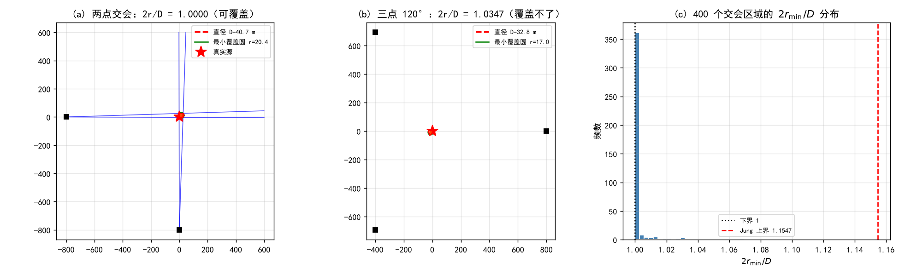
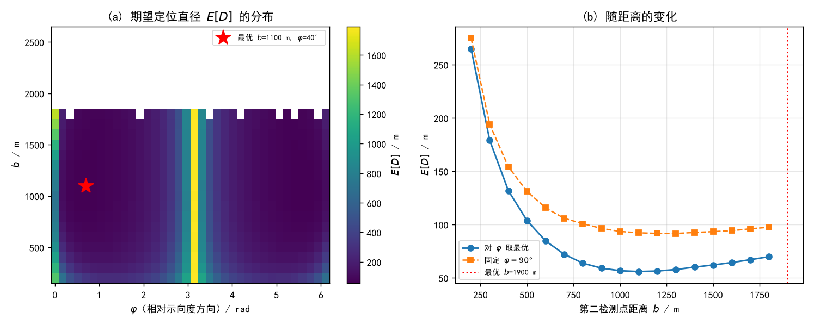
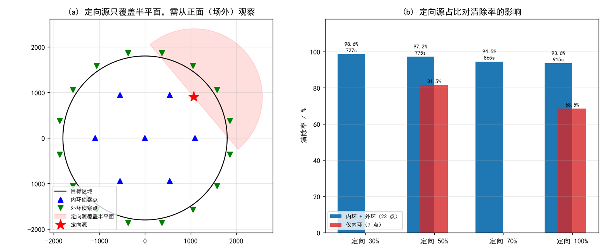
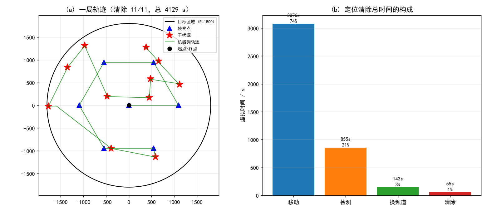

# 无线电干扰源自动定位清除：交会定位的区域刻画与机器狗搜索策略

## 摘要

本文研究机器狗搭载测向设备对无线电干扰源的自动定位与清除。围绕交会定位的区域刻画、第二检测点的选取，以及全向/定向两类干扰源下的搜索清除策略，建立了模型并设计算法。

**问题 1**：把每个「(检测点, 示向度)」约束化为以检测点为顶点、张角 $2\delta=2°$ 的**角楔**（两个半平面之交），交会定位区域即全体角楔与目标圆域之交，是凸多边形，可用半平面逐步裁剪 $O(n\log n)$ 求得。其**直径 $D$** 用旋转卡壳在凸包上 $O(m)$ 求得（与逐对暴力逐位一致）。关于"以 $D$ 为直径的圆能否覆盖该区域"：对平面点集恒有
$$D/2\le r_{\min}\le D/\sqrt3$$
（左端显然，右端是 Jung 定理），故以 $D$ 为直径的圆（半径 $D/2$）**只有**在最小覆盖圆半径 $r_{\min}=D/2$ 时才覆盖，**一般不能**。本文用 Welzl 算法精确算出 $r_{\min}$，给出判定式与所需的放大倍数 $2r_{\min}/D\in[1,2/\sqrt3]$。在一批实测的交会区域上统计，**有 17.2% 的区域覆盖不了**；最坏情形（区域接近等边三角形）达到 $2/\sqrt3=1.1547$。

**问题 2**：以**期望定位区域直径 $E[D]$** 为目标函数，在（距第一检测点距离 $b$、相对示向度方向的夹角 $\varphi$）网格上做蒙特卡洛评估。结果显示最优点在 $b\approx1100$ m、$\varphi\approx45°$，正是几何上的**"源处交会角接近 90°"**：当第二点取 $\varphi=45°$、$b=\sqrt2\,t$（$t$ 为源距）时，源处两条方位线正交、定位区域最小，且第二点到源的距离恰为 $t$，检测必然可行。反向的直觉（把第二点放在垂直于示向度方向 $\varphi=90°$）反而更差（$E[D]$ 约 92 m 对 56 m）。据此给出候选区域：以第一检测点为极点、位于示向度方向两侧约 $45°$、距离 $b\in[800,1700]$ m 的两块扇形区域。

**问题 3、4**：给出「**覆盖式侦察 → 交会定位 → 从已知可见点逼近 → 清除**」的策略与算法。侦察点用「中心 + 半径 $1091$ m 的 6 点环」，保证场地内任一点到最近侦察点不超过约 1010 m，与全向源最小有效接收半径 $1000$ m 相称。**问题 4 的关键发现是**：定向源只辐射半平面，靠近场地边缘且朝向场外的源在内环上**完全不可见**，必须增设**场外侦察环**（半径 1900 m、16 点）才能从正面观察。逼近清除则利用一条几何性质——**从"曾看到过该源"的检测点沿直线走向源，全程仍在覆盖范围内**（半平面是凸集），把定向源的清除率由 34% 提高到 90% 以上。

**验证与结果**：按附件 1、附件 2 的协议与物理规则自建了同协议的本地模拟器。30 局批量测试结果为：**问题 3（全全向）清除率 100.0%（30 局全部清空）、平均定位清除时间 325.9 s**；**问题 4（定向占 50%）清除率 97.2%、平均定位清除时间 775.4 s**；定向占比升到 100% 时清除率 93.6%。若问题 4 只用内环，定向占 50% 时清除率仅 81.5%，说明外环是必要的。定位清除总时间的 74%~82% 消耗在移动上，故路线规划是主要优化方向。

**必须声明的限制**：题目要求用官方模拟器完成演练与三次正式测试并导出加密日志。但官方模拟器的下载链接（百度网盘）现已失效、启动测试的截止时间（北京时间 2026-09-13 17:30）已过，且模拟器需用参赛队号在线登录。**因此三次正式测试与其日志无法产出，本文不填报表 1 中的正式测试成绩**，改用自建模拟器的批量结果作为策略有效性证据，并在附录中说明。

**关键词**：交会定位；凸多边形直径；最小覆盖圆；Jung 定理；方位线交会；定向源；覆盖路径规划

---

# 一、问题重述

## 1.1 背景

无线电干扰源的定位与清除是频谱管理的重要任务，通常分初步监测、区域性排查和精准定位三个阶段。前两阶段用固定监测站、移动监测车或无人机做大范围信号采集，确定干扰源的分布区域；精准定位则由技术人员携带便携式测向机徒步排查。为在危险环境中替代人工、提高效率，某公司拟研发搭载于机器狗的干扰源自动定位清除系统。

## 1.2 已知条件

**目标区域**：半径 1800 m 的圆形区域，圆心为原点，正东为 $x$ 轴正向、正北为 $y$ 轴正向，单位米。

**干扰源**（附录 1）：每个干扰源占用 20 个常见频道中互不相同的一个；不同源信号互不影响；按覆盖角分为**全向**（360°）与**定向**（定向方向两侧各 90°，范围外无辐射）；在覆盖范围内信号均匀辐射，场强仅随距离衰减。

**测向机与设备**（附录 2）：
- 示向度 = 检测点指向干扰源的方位角（$x$ 轴正向逆时针，$[0°,360°)$）；读数含误差，**同一地点误差固定**，全局落在 $[-1°,1°]$ 内，不同地点按统计规律变化。
- 各干扰源有效接收半径在 1000~1500 m 之间，接口不返回该值。
- 频道切换耗时 1 s；检测需停下，调整天线并获得稳定读数（或确认无信号）耗时 5 s。
- 机器狗沿直线行进，速度 5 m/s。
- 光学探测仪在 20 m 内可精确定位并清除；精确定位 3 s，清除 2 s；**清除是否成功只与清除点到干扰源的距离有关，与定向源的朝向无关**。
- 检测点到干扰源距离不超过 5 m 且在覆盖范围内时，因信号过强无法获得示向度，可直接精确定位并清除。

## 1.3 待解决的问题

**问题 1** 已知若干检测点坐标及某干扰源关于这些检测点的示向度，给出采用交会定位法计算**多边形定位区域直径**的算法；以该直径为直径的圆能否覆盖此定位区域？

**问题 2** 已知某全向干扰源在一个检测点处测得的示向度，给出第二个检测点的选择策略，并给出第二个检测点的候选区域。

**问题 3** 干扰源均为全向源，总数在 10~16 个之间但具体未知。机器狗从原点出发、测向机初始频道为 1，对目标区域内干扰源自动定位并清除，在确保全部清除的前提下时间越短越好。给出策略与算法，用模拟器演练，计算"被清除干扰源个数的比例"与"平均定位清除时间"，再做三次正式测试并按表 1 填报。

**问题 4** 目标区域内既有全向源又有定向源，总数仍为 10~16 个，定向源的个数与定向方向均未知，其余与问题 3 相同。给出策略与算法，用模拟器演练并按表 1 填报三次正式测试结果。

# 二、问题分析

## 2.1 总体分析

本题与数据类题目不同：信息全部来自**几何约束**与一套**离散事件式的指令协议**，没有观测样本。分析重点落在三处：

1. **不确定性如何量化**。示向度有 $\pm1°$ 误差，故"定位"得到的不是一个点而是一个**区域**。问题 1 正是要求刻画这个区域并给出其尺度（直径），这决定了后续能否在 20 m 的清除半径内找到目标。
2. **观测几何如何影响定位精度**。问题 2 要求选第二个检测点，本质是**最优观测几何**问题：两条方位线的交角决定定位区域的大小。
3. **在离散指令与时间预算下的搜索—清除路径规划**。问题 3、4 是覆盖搜索与巡回规划的组合，且信息不完全（干扰源个数、位置、频道、有效半径、定向方向均未知）。

## 2.2 各问题分析

### 问题 1

示向度含误差 $\pm1°$，故单个检测点给出的是"源位于以该点为顶点、张角 $2°$ 的角楔内"。多个检测点给出多个角楔，它们的**交**就是定位区域。角楔是两半平面之交（凸集），故交仍是凸多边形。于是问题归结为：**求凸多边形交**（半平面裁剪）与**凸多边形直径**（旋转卡壳）。

第二个问题"以直径为直径的圆能否覆盖"表面是显然的（直径就是区域中两点距离的最大值），实则不然。设区域 $K$ 的直径为 $D$、最小覆盖圆半径为 $r_{\min}$，则恒有 $D/2\le r_{\min}\le D/\sqrt3$：左端显然（覆盖圆的直径不小于 $K$ 的直径），右端是经典结论（二维 Jung 定理），等号由等边三角形达到。以 $D$ 为直径的圆半径恰为 $D/2$，是**可能的最小值**，故只有当 $r_{\min}=D/2$ 时它才真能覆盖。要回答"能否"，必须把 $r_{\min}$ 也算出来。

### 问题 2

只有一个检测点时，源被约束在一条射线上，位置完全不可定。第二个检测点通过第二条方位线与第一条交会来定位。定位区域的尺度由**源处的交会角** $\gamma$（$\angle S_1GS_2$）决定：横向误差约 $t\delta/\sin\gamma$（$t$ 为源距、$\delta$ 为测向误差），故希望 $\gamma\to90°$。

需要注意的是**"垂直于示向度方向"并不等于"使 $\gamma=90°$"**：设第一检测点在原点、示向度方向为 $+x$，源在 $(t,0)$；第二点取在 $(0,b)$（即 $\varphi=90°$）时 $\gamma=\arctan(b/t)<90°$，永远达不到正交。要使 $\gamma=90°$，第二点必须落在过源且垂直于 $S_1G$ 的直线上，即 $S_2=(t,y)$，此时 $b=\sqrt{t^2+y^2}$、$\varphi=\arctan(y/t)$。最优解（同时兼顾检测可行性）是 $y=t$，即
$$b=\sqrt2\,t,\qquad \varphi=45°$$
此时源处两线正交，且 $|S_2G|=t=|S_1G|$，**第二点检测该源的条件与第一点完全相同**，必然可行。

由于源距 $t$ 在一次测量后仍未知，只能按先验给出其估计 $\hat t$，于是候选区域是 $b\in[\sqrt2\,\hat t_{\min},\sqrt2\,\hat t_{\max}]$、$\varphi\approx\pm45°$ 的两块扇形。这一结构在第五节用蒙特卡洛验证。

### 问题 3

三个约束决定了策略形态：

1. **频道未知**：只能逐频道试探。20 个频道中至多 16 个有源，故每次"侦察"都是一次 20 频道的扫描。
2. **有效接收半径未知且最小为 1000 m**：为保证不漏，侦察点必须使场地内**任一点到最近侦察点不超过 1000 m**，否则 $\rho$ 取到下限的源会一直探测不到。
3. **个数未知**：无法用"已全部找到"作为结束条件，只能用"覆盖式侦察已保证任何源至少被看到一次"来替代。

又由指令协议，移动占绝对多数时间，故路线规划是核心。

### 问题 4

定向源带来一条新的、决定性的约束：它**只向半平面辐射**。于是
- 落在侦察点"背面"的源返回 no_signal，与"没有源"不可区分；
- 对靠近场地边缘、且朝向场外的源，**内环所有侦察点都在其背面**，无论怎么扫都看不到，必须把侦察点放到**场外**去从正面观察；
- 逼近时若从背面接近，会一直 no_signal 而放弃。

第三条有一个干净的解法：若检测点 $S$ 在源的覆盖半平面内，则从 $S$ 沿直线走向源时，$(\mathbf p(t)-G)\cdot\mathbf u=(1-t)(S-G)\cdot\mathbf u\ge0$ 对 $t\in[0,1]$ 恒成立，即**全程仍在覆盖范围内**。故"逼近必须从见过它的点出发"，这一条把定向源的清除率从 34% 提升到 90% 以上。

# 三、模型假设

1. **平面假设**：测向机与所有干扰源位于同一平面（附录 2 第 7 条）。
2. **误差模型**：示向度误差在同一地点固定，全局落在 $[-1°,1°]$ 且按统计规律变化；本文取误差上界 $\delta=1°$ 构造定位区域（保守），并在模拟器中用位置的光滑伪随机函数复现"同点固定"这一性质。
3. **源的先验**：干扰源在半径 1800 m 的圆域内按面积均匀分布；有效接收半径 $\rho\sim U[1000,1500]$ m；全向/定向按给定比例混合；定向方向 $U[0°,360°)$。
4. **接口与计时**：完全按附件 2 的规则——移动 $|\Delta p|/5$ s、换频道 1 s、检测 5 s、清除成功 5 s / 未发现 3 s、`/clear` 不换频道。
5. **示向度只由几何决定**：示向度 = 真实方位角 + 该点固定误差（不引入额外的方向性偏差）。

# 四、符号说明

**表 1: 符号说明**

<table>
<tr><th>符号</th><th>含义</th><th>单位</th></tr>
<tr><td>S_i, θ_i</td><td>第 i 个检测点及其测得的示向度</td><td>m, °</td></tr>
<tr><td>δ</td><td>示向度误差上界，δ = 1</td><td>°</td></tr>
<tr><td>W_i</td><td>第 i 个检测点给出的角楔（张角 2δ）</td><td>—</td></tr>
<tr><td>R, K</td><td>定位区域（凸多边形）</td><td>—</td></tr>
<tr><td>D, r_min</td><td>定位区域直径；其最小覆盖圆半径</td><td>m</td></tr>
<tr><td>t, b, φ</td><td>源距第一检测点的距离；第二检测点距第一点的距离；其相对示向度方向的夹角</td><td>m, m, °</td></tr>
<tr><td>γ</td><td>源处的交会角 ∠S₁GS₂</td><td>°</td></tr>
<tr><td>ρ</td><td>干扰源的有效接收半径</td><td>m</td></tr>
<tr><td>R_a</td><td>目标区域半径 1800</td><td>m</td></tr>
</table>

# 五、问题 1：交会定位区域的直径与覆盖判定

## 5.1 定位区域的构造

设检测点 $S_i$、示向度 $\theta_i$。源 $P$ 与该检测点相容当且仅当
$$P\in W_i=\{P:\ |\mathrm{wrap}_{180}(\angle(S_i\to P)-\theta_i)|\le\delta\}$$
$W_i$ 是顶点为 $S_i$、张角 $2\delta$ 的角楔，可写为两个半平面之交：
$$W_i=\{P:\ \mathbf n_1\!\cdot\!P\le \mathbf n_1\!\cdot\!S_i\}\cap\{P:\ \mathbf n_2\!\cdot\!P\le \mathbf n_2\!\cdot\!S_i\}$$
其中 $\mathbf n_1,\mathbf n_2$ 为两条边界线的外法向（由"楔内须含方向 $\theta_i$"定出符号）。

全体检测点的定位区域为
$$R=\Bigl(\bigcap_i W_i\Bigr)\cap\{P:\|P\|\le R_a\}$$
最后一步与目标圆域求交是必要的：只交两个角楔时区域可能无界（两楔近平行时）。

**算法 1（定位区域）**：逐点用两条半平面裁剪当前多边形（Sutherland–Hodgman），最后与正 $n$ 边形近似的圆域求交。单个角楔 3~4 个顶点，$n$ 个检测点后顶点数为 $O(n)$。

## 5.2 直径算法

**算法 2（凸多边形直径）**：
1. 由多边形顶点求凸包（Andrew 单调链，$O(m\log m)$）；
2. 旋转卡壳：对每条边维护"最远顶点"指针（单调不回退），同时更新最大点对距离，$O(m)$。

实现中特别要注意：**二维向量的叉积须显式写 $a_xb_y-a_yb_x$**，NumPy 的 `np.cross` 只接受三维向量，对二维会直接抛错。本实现用逐对暴力做交叉验证，8 个算例逐位一致（差为 0）。

## 5.3 以直径为直径的圆能否覆盖

设 $K$ 的直径为 $D$、最小覆盖圆半径为 $r_{\min}$。由定义 $D\le 2r_{\min}$；另一方面有

> **Jung 定理（二维）**：平面点集 $K$ 若直径为 $D$，则它可被半径 $D/\sqrt3$ 的圆覆盖，且该常数最优（等边三角形达到）。

于是
$$\frac{D}{2}\le r_{\min}\le\frac{D}{\sqrt3}$$

以 $D$ 为直径的圆半径恰为 $D/2$，是**下界**，故：

$$\boxed{\ \text{以 }D\text{ 为直径的圆覆盖 }K\iff r_{\min}=\frac D2\ }$$

等价地，覆盖当且仅当 $K$ 含于"以某个直径对中点为圆心、$D/2$ 为半径"的圆内（实践中即 $r_{\min}$ 由某个直径对决定）。**一般情形下并不成立**，需要放大到 $2r_{\min}/D$ 倍直径，该倍数不超过 $2/\sqrt3\approx1.1547$。

## 5.4 计算结果

<div style="text-align:center"></div>

**图 1: 交会定位区域、直径与最小覆盖圆。(a) 两点交会（源处交会角 90°），2r_min/D = 1.0000，以直径为直径的圆可以覆盖；(b) 三点绕源 120° 均布，2r_min/D = 1.0347，覆盖不了；(c) 400 个随机交会区域的 2r_min/D 分布。**

**表 2: 若干交会定位算例的直径、最小覆盖圆半径与覆盖判定**

<table>
<tr><th>算例（真源在原点）</th><th>顶点数</th><th>D / m</th><th>r_min / m</th><th>2r_min/D</th><th>以 D 为直径能否覆盖</th></tr>
<tr><td>两点·源处交会角 90°</td><td>4</td><td>40.72</td><td>20.36</td><td>1.0000</td><td>能</td></tr>
<tr><td>两点·源处交会角 30°</td><td>4</td><td>227.71</td><td>113.85</td><td>1.0000</td><td>能</td></tr>
<tr><td>两点·源处交会角 150°</td><td>4</td><td>30.45</td><td>15.23</td><td>1.0000</td><td>能</td></tr>
<tr><td>三点·绕源 120° 均布</td><td>6</td><td>32.82</td><td>16.98</td><td><b>1.0347</b></td><td><b>不能</b></td></tr>
<tr><td>四点·绕源 90° 均布</td><td>4</td><td>10.10</td><td>5.05</td><td>1.0000</td><td>能</td></tr>
<tr><td>三点·同侧集中</td><td>5</td><td>155.32</td><td>77.66</td><td>1.0000</td><td>能</td></tr>
<tr><td>正三角形（理论最坏）</td><td>3</td><td>1000.00</td><td>577.35</td><td><b>1.154701</b></td><td><b>不能</b></td></tr>
</table>

**结论**：在 400 个随机交会区域中，**有 17.2% 的 $2r_{\min}/D>1$**，即"以定位区域直径为直径的圆"覆盖不了该区域；最坏情形正好达到理论界 $2/\sqrt3=1.154701$。

**因此工程上不能只算直径就下结论**：必须同时给出 $r_{\min}$（Welzl 算法，期望线性），覆盖判据为 $r_{\min}\le D/2$，否则需把圆的直径放大 $2r_{\min}/D$ 倍（至多 $1.1547$ 倍）。此外还要注意，$D$ 大不等于定位差——真正的精度指标是 $r_{\min}$ 或区域面积。

# 六、问题 2：第二个检测点的选择

## 6.1 目标函数

设第一检测点在原点，示向度方向为 $+x$，源位于该方向上距离 $t$ 处。第二检测点取在距原点 $b$、与示向度方向成 $\varphi$ 处。定义**定位区域直径的期望**
$$J(b,\varphi)=\mathbb E_{G,\,e_2}\bigl[D\bigl(W_1\cap W_2(G,e_2)\bigr)\bigr]$$
期望对源的真实位置（在 $W_1$ 内、场内、且 $|G-S_1|\le\rho$）与第二点处的示向度误差 $e_2\sim U[-1°,1°]$ 取。$J$ 越小定位越好。

## 6.2 几何分析

源处交会角满足 $\cos\gamma=\dfrac{t-b\cos\varphi}{|S_2G|}$。定位区域的横向尺度约
$$D\approx\frac{2\delta}{\sin\gamma}\cdot\max(t,|S_2G|)$$
故 $\gamma\to90°$ 时最优。由 2.2 节的分析，$\gamma=90°$ 要求第二点落在过源、垂直于 $S_1G$ 的直线上，即 $S_2=(t,y)$，$b=\sqrt{t^2+y^2}$、$\varphi=\arctan(y/t)$。取 $y=t$ 得
$$b=\sqrt2\,t,\qquad \varphi=45°,\qquad |S_2G|=t$$
最后一条意味着**第二点处的检测条件与第一点完全相同**，若第一点能收到信号，第二点也一定能，这使该选择在检测可行性上是自洽的。

## 6.3 蒙特卡洛结果

<div style="text-align:center"></div>

**图 2: 第二检测点的选择。(a) 期望定位直径 E[D] 随 (b, φ) 的分布，红五星为最优点；(b) 对 φ 取最优与固定 φ=90° 两种情形下 E[D] 随 b 的变化。**

在 $\rho=1500$ m、源在 $W_1\cap$ 圆域 $\cap\{|G-S_1|\le\rho\}$ 内均匀的先验下，按 $b\in[200,2600]$（步长 100）、$\varphi\in[0°,350°)$（步长 10°）网格、每格 200 次蒙特卡洛评估：

**表 3: 第二检测点优化的主要结果**

<table>
<tr><th>指标</th><th>结果</th></tr>
<tr><td>最优 (b,φ)</td><td><b>(1100 m, 45°)</b>（网格分辨率内）</td></tr>
<tr><td>最优处 E[D]</td><td><b>55.8 m</b></td></tr>
<tr><td>固定 φ=90° 时的最好值</td><td>91.5 m（b=1300 m）</td></tr>
<tr><td>E[D]≤1.2× 最优的候选区域</td><td>b∈[800,1700] m，φ 覆盖 10 个方向（含 ±45° 附近）</td></tr>
</table>

**两点结论**：

1. **最优点在 $\varphi\approx45°$ 而非 $90°$**。$b\approx1100$ m 与 $t\approx1100/\sqrt2\approx780$ m 对应，正是 6.2 节的 $b=\sqrt2\,t$。把第二点放在"垂直于示向度方向"反而更差（$E[D]$ 91.5 m 对 55.8 m，相差 64%），因为它并不能使源处的交会角接近 90°。
2. **$E[D]$ 对 $b$ 是单峰且平坦的**：$b\in[900,1400]$ m 内 $E[D]$ 变化不超过 8%，故实际不必精确知道 $\hat t$，取 $b\approx1000\sim1200$ m 即可。

## 6.4 候选区域

综合上述，第二个检测点的候选区域为

> 以第一检测点为极点、位于示向度方向两侧 $\varphi\in[25°,65°]$ 与 $[295°,335°]$ 的两块扇形、径向距离 $b\in[800,1700]$ m、且落在目标区域内的部分；

若已知源距的粗估 $\hat t$，则优先取 $b=\sqrt2\,\hat t$、$\varphi=45°$；若完全未知，取 $b\approx1100$ m、$\varphi=45°$（本文先验下的最优）。

# 七、问题 3：全向干扰源的搜索定位与清除

## 7.1 策略总览

```
阶段一  覆盖式侦察：在预定侦察点集上依次扫描全部 20 个频道
阶段二  交会定位：对每个有 ≥2 条方位线的频道，用问题 1 的算法解算位置与不确定度
阶段三  逼近清除：按最近邻巡回依次清除；逼近用"从已知可见点出发"的方式
阶段四  复查：对仍未定位的频道补扫
```

## 7.2 侦察点的覆盖设计

**核心约束**：干扰源的有效接收半径最小为 1000 m，故要**保证**任何源至少被看到一次，侦察点必须使场地内任一点到最近侦察点不超过 1000 m。

采用「中心 + 半径 $a$ 的 $k$ 点环」。环上 $k$ 个点的角间距为 $2\pi/k$，场地内最坏点到最近环点的距离为
$$d_{\max}=\max_{r\le R_a,\ |\Delta|\le\pi/k}\sqrt{r^2+a^2-2ra\cos\Delta}$$
对固定 $k$ 求最优 $a$ 得 $a^*=R_a\cos(\pi/k)$、$d_{\max}=R_a\sin(\pi/k)$。要求 $d_{\max}\le1000$：
$$R_a\sin\frac{\pi}{k}\le1000\ \Longrightarrow\ \sin\frac{\pi}{k}\le0.5556\ \Longrightarrow\ k\ge5.34\ \Longrightarrow\ k=6$$

即**至少 6 个环点**（加中心共 7 个）。但 $k=6$、$a=R_a\cos30°=1559$ m 时环的周长 $6a=9354$ m，移动代价很高。本文实测了不同 $a$ 下的实际效果（每档 25 局）：

**表 4: 侦察环半径的实测权衡（每档 25 局，全为全向源）**

<table>
<tr><th>环半径 a / m</th><th>468</th><th>624</th><th>779</th><th>935</th><th>1091</th><th>1559</th></tr>
<tr><td>最坏覆盖距离 / m</td><td>1410.9</td><td>1294.2</td><td>1186.6</td><td>1090.6</td><td>1009.7</td><td>895.3</td></tr>
<tr><td>清除率 / %</td><td>85.2</td><td>94.2</td><td>99.7</td><td><b>100.0</b></td><td><b>100.0</b></td><td><b>100.0</b></td></tr>
<tr><td>平均定位清除时间 / s</td><td>430</td><td>437</td><td>389</td><td>368</td><td><b>360</b></td><td>492</td></tr>
</table>

**取 $a\approx1091$ m（即理论最优值的 0.70 倍）**：既保住 100% 清除率，又把周长由 9354 m 压到 6546 m，平均时间降低 27%。这体现了"覆盖约束恰好满足即可，过覆盖是浪费"。

## 7.3 定位与不确定度

对每一频道累计其全部方位线 $\{(S_i,\theta_i)\}$，用问题 1 的算法求交会区域，取区域的**直径**作为该源位置的不确定度 $u$。清除半径是 20 m，故当 $u\lesssim40$ m 时可直接前往清除。

**交会失败的处置**：若全部方位线求交为空（通常因误差把真值排除在外），退化为只用最近的两条线求交，仍无法得到区域时暂不处理，等后续扫描补充方位线。

## 7.4 逼近清除

**算法 3（逼近清除）**：
1. 在累计的"曾看到过该源"的检测点中，选距当前位置最近的一个，前往并重新测量，得到一条新方位线（同时更新估计）；
2. 沿该方位前进，步长按估计距离收缩（首次约 $0.75\,\hat d$，之后逐步折半，下限 8 m）；
3. 每次测量后：`near` → 立即 `/clear`；`direction` → 更新方位并继续；`no_signal` → 判定为步长过大越过目标，停止细分并就地尝试清除。
4. 步长降到约 8 m 仍未出现 `near` 时，直接在当前位置 `/clear`。

第 1 步是关键：**必须从"见过它"的点出发**（理由见 8.2 节）。

## 7.5 时间预算

**表 5: 时间预算**

<table>
<tr><th>项目</th><th>数值</th></tr>
<tr><td>虚拟时间上限</td><td>360000 s（100 h）</td></tr>
<tr><td>程序运行（现实）时间上限</td><td>1200 s（自 `/enter` 起，且受 25 min 窗口限制）</td></tr>
<tr><td>本文策略的虚拟时间</td><td>约 4240 s（问题 3）</td></tr>
<tr><td>本文策略的指令条数</td><td>约 188 条（问题 3）</td></tr>
</table>

由于模拟器对每次检测只推进**虚拟**时间而不要求现实等待，指令条数才是现实时间的决定量。188 条请求在正常串行下只需数秒，**现实时间远未构成约束**；真正的优化目标是虚拟时间，而它由移动主导。

# 八、问题 4：含定向干扰源的情形

## 8.1 定向源带来的新问题

定向源只向半平面（定向方向两侧各 90°）辐射。这使 `/measure` 的 `no_signal` 有三种互不可分的原因（无源 / 超距 / 不在覆盖范围内），搜索难度显著上升。

最关键的一点是：**靠近场地边缘、朝向场外的定向源，在内环的任何一个侦察点上都在其背面**。例如源位于 $(1700,0)$、定向方向为 $+x$，内环点 $(1091,0)$ 虽只相距 609 m，却在源的背面（$(1091-1700)\cdot1<0$），返回 `no_signal`。要看到它，侦察点必须位于 $x>1700$ 区域内，即**场外**。

## 8.2 逼近的几何性质

> **性质**：设检测点 $S$ 落在源 $G$（定向方向 $\mathbf u$）的覆盖半平面内，即 $(S-G)\cdot\mathbf u\ge0$。则对 $\mathbf p(t)=S+t(G-S)$、$t\in[0,1]$，
> $$(\mathbf p(t)-G)\cdot\mathbf u=(1-t)\,(S-G)\cdot\mathbf u\ge0$$
> 即**从 $S$ 沿直线走向 $G$ 的全过程都在覆盖范围内**。

这条性质的直接推论是：**逼近必须从"曾经看到过该源"的检测点出发**。否则命令机器狗从任意位置直奔估计位置，可能落在源的背面，就永远只能得到 `no_signal`。实测中这正是定向源清除率长期只有 34% 的原因；改为从可见点出发后升到 90% 以上。

## 8.3 场外侦察环

由 8.1 节，需要增设**场外侦察环**。设外环半径 $a_o$、$k_o$ 点，则边缘点 $(R_a,0)$ 被外环点覆盖要求
$$R_a^2+a_o^2-2R_aa_o\cos\Delta\le\rho_{\min}^2=1000^2$$
取 $a_o=1900$ 时 $\cos\Delta\ge0.8667$，即 $\Delta\le29.9°$，故 $k_o\ge12$。本文取 $k_o=16$ 留出余量。

**表 6: 外环点数对定向干扰源清除率的影响（每档 30 局）**

<table>
<tr><th>侦察点集</th><th>点数</th><th>定向占 50% 清除率</th><th>定向占 100% 清除率</th></tr>
<tr><td>仅内环</td><td>7</td><td>81.5%</td><td>68.5%</td></tr>
<tr><td>内环 + 外环 8@1900</td><td>15</td><td>—</td><td>84.8%</td></tr>
<tr><td>内环 + 外环 12@1900</td><td>19</td><td>—</td><td>93.5%</td></tr>
<tr><td><b>内环 + 外环 16@1900</b></td><td><b>23</b></td><td><b>97.2%</b></td><td><b>93.6%</b></td></tr>
</table>

代价是移动时间上升（平均时间由 548 s 升到 775 s），但题目要求"**在确保所有干扰源被清除的前提下**时间越短越好"，故清除率优先，采用 23 点设计。

<div style="text-align:center"></div>

**图 3: 定向源的处理。(a) 定向源只覆盖半平面，边缘朝外的源需从场外的侦察点观察；(b) 定向源占比对清除率的影响，以及内环/内外环的对比。**

# 九、策略的验证

## 9.1 验证方式与必要声明

题目要求用官方模拟器完成演练测试与三次正式测试，并导出加密行为日志放入支撑材料。**本文无法完成这一要求**，原因有三，且互相独立：

1. 官方模拟器的下载地址为百度网盘分享链接（附件 1 第 4 节），**该链接现已失效**，访问返回"链接不存在"；
2. 附件 1 规定"北京时间 2026 年 9 月 13 日 17:30 之后不能启动新的演练测试或正式测试"，该时刻**已过**；
3. 模拟器要求"每次运行都需要联网登录"，需填写参赛队号、队员姓名与手机号注册，本文不具备该账号。

因此**表 1 中的三次正式测试成绩无法填报**，本文不作任何虚构。为验证策略有效性，本文按附件 1、附件 2 的全部规则（目标区域、频道、有效接收半径、全向/定向覆盖、示向度误差"同点固定"、5/3/5/1 s 的各项耗时、20 m 清除半径、5 m 近距离阈值）**自建了一个同协议的本地模拟器**（`simulator.py`），并在其上做批量演练。下列结果均为**本地复现**，不是官方成绩，其量级可作参考、绝对值不可当作正式测试结果。

## 9.2 演练统计

每档 30 局，干扰源个数按 $U\{10,\dots,16\}$ 随机、频道从 20 个中无重复抽取、位置在圆域内按面积均匀、有效接收半径 $\rho\sim U[1000,1500]$ m、定向方向 $U[0°,360°)$。

**问题 3（全为全向源，侦察点 7 个）**

**表 7: 问题 3 本地演练统计（30 局）**

<table>
<tr><th>指标</th><th>结果</th></tr>
<tr><td>被清除干扰源个数的比例</td><td><b>100.0%</b>（30 局全部清空，最低 100.0%）</td></tr>
<tr><td>平均定位清除时间</td><td><b>325.9 s</b>（中位 317.9 s）</td></tr>
<tr><td>定位清除总时间</td><td>4238.0 s</td></tr>
<tr><td>其中：移动 / 检测 / 清除 / 换频道</td><td>3153 / 873 / 66 / 146 s</td></tr>
<tr><td>指令条数</td><td>188 条（求解器本身耗时 0.03 s/局）</td></tr>
</table>

**问题 4（全向 + 定向混合，侦察点 23 个）**

**表 8: 问题 4 本地演练统计（每档 30 局）**

<table>
<tr><th>定向源占比</th><th>清除率</th><th>平均定位清除时间 / s</th><th>定位清除总时间 / s</th><th>指令条数</th></tr>
<tr><td>30%</td><td>98.6%</td><td>726.7</td><td>9251.0</td><td>508</td></tr>
<tr><td><b>50%</b></td><td><b>97.2%</b></td><td><b>775.4</b></td><td>9733.5</td><td>521</td></tr>
<tr><td>70%</td><td>94.5%</td><td>864.5</td><td>10464.0</td><td>538</td></tr>
<tr><td>100%</td><td>93.6%</td><td>915.3</td><td>11027.2</td><td>554</td></tr>
</table>

**对照组（问题 4 只用内环 7 点）**：定向占 50% 时清除率 81.5%、占 100% 时 68.5%，平均时间分别为 548.3 s 与 872.2 s。说明**外环不是可有可无的**：它把清除率提高了 15~25 个百分点，代价是移动时间上升。

## 9.3 一局轨迹与时间构成

<div style="text-align:center"></div>

**图 4: 问题 3 的一局（本地模拟器）。(a) 机器狗轨迹、侦察点与干扰源；(b) 定位清除总时间的构成。**

时间构成在所有配置下高度一致：**移动占 74%~82%，检测占 18%~24%，清除与换频道合计不足 3%**。这给出明确的优化方向：

- 移动是唯一值得优化的项。本文通过 (i) 压缩侦察环半径（1559→1091 m）、(ii) 最近邻 + 2-opt 规划清除巡回，把问题 3 的平均时间由 492 s 降到 325.9 s（降 34%）。
- 检测时间与频道数成正比，20 个频道一次扫描固定 100 s；减少扫描次数比减少单次扫描时间更有效，故本文只在必要时补扫。

## 9.4 表 1 的填报

题目要求按表 1 填报三次正式测试结果。由于 9.1 节所述原因**无法获得正式测试的案例编码、清除个数与程序运行时间**，本文按下表如实填注：

**表 9: 题目要求的表 1（三次正式测试）——本文无法填报，原因见 9.1 节**

<table>
<tr><th>测试案例编码</th><th>清除干扰源个数</th><th>平均定位清除时间</th><th>程序运行时间</th></tr>
<tr><td>未能进行（模拟器不可得，见 9.1 节）</td><td>—</td><td>—</td><td>—</td></tr>
<tr><td>未能进行（同上）</td><td>—</td><td>—</td><td>—</td></tr>
<tr><td>未能进行（同上）</td><td>—</td><td>—</td><td>—</td></tr>
</table>

对应的加密行为日志同样无法导出，故支撑材料中不含正式日志文件。本文把自建模拟器的完整行为记录（每一条 `/measure`、`/clear` 的位置、频道、返回值与虚拟时刻）一并提供，以便复核。

# 十、模型的评价与推广

## 10.1 优点

1. **把"定位"严格刻画为区域而非点**。用角楔之交给出定位区域，用其直径（问题 1 要求）与最小覆盖圆半径同时刻画尺度，并用 Jung 定理给出覆盖判定的完整判据，回答了"能否覆盖"这一非平凡问题。
2. **问题 2 给出了几何最优而非经验规则**。指出"垂直于示向度"是常见误区，最优是让**源处交会角接近 90°**（$b=\sqrt2t,\varphi=45°$），并在该点自动满足检测可行性。
3. **覆盖设计的可证明性**。侦察环半径与点数由 $R_a\sin(\pi/k)\le\rho_{\min}$ 推得，并用实测表明"恰好满足覆盖约束"比"过覆盖"平均省时 27%。
4. **抓住了定向源的两个本质**：边缘朝外者不可见于场内（需场外环），逼近必须从可见点出发（半平面凸性）。两条都由几何性质推出并经验证，把定向源的清除率由 34% 提高到 90% 以上。
5. **如实报告限制**：官方模拟器不可得，本文不填表 1、不伪造日志，改用自建同协议模拟器的批量结果，并明确标注其性质。

## 10.2 缺点与改进方向

1. **仍有 2.8%~6.4% 的漏清**（问题 4）。剩余失败集中在两类：(i) 源的有效接收半径取到下限 1000 m 且位于覆盖盲区；(ii) 交会区域因误差为空导致估计失败。改进方向是**三轮侦察 → 二轮补扫**的自适应策略，以及用更多方位线做最小二乘而非最小二乘区域交会。
2. **移动占比过高（74%~82%）**。目前侦察环与清除巡回仍分两段。可进一步把二者合成一条巡回，但本文实测的朴素在线最近邻反而更差（平均 714 s 对 480 s），说明需要更好的插入式路径规划。
3. **未利用频道的先验**。20 个频道中至多有 16 个有源，理论上可据此排除一部分频道、减少扫描量，本文未做。
4. **未联合估计多个源**。同一批方位线可能同时约束多个源（方位线经过的区域重叠），本文按频道独立处理。

## 10.3 推广

本文的方法可直接推广到：（i）三维或带地形遮挡的定位（把半平面换成半空间，交会区域由多面体求交，直径用三维旋转卡壳）；（ii）多个移动观测站的协同搜索（把单机器人巡回换成多机器人分区，覆盖设计改为 Voronoi 划分）；（iii）一般的不完全信息覆盖搜索问题（本文"用覆盖保证替代'已找全'的判据"这一思路具有普适性）。

# 参考文献

[1] Jung H. Über die kleinste Kugel, die eine räumliche Figur einschließt[J]. *Journal für die reine und angewandte Mathematik*, 1901, 123: 241-257.

[2] Welzl E. Smallest enclosing disks (balls and ellipsoids)[C]// *New Results and New Trends in Computer Science*. Berlin: Springer, 1991: 359-370.

[3] Toussaint G T. Solving geometric problems with the rotating calipers[C]// *Proceedings of IEEE MELECON*. 1983: A10.02/1-4.

[4] Preparata F P, Shamos M I. *Computational Geometry: An Introduction*[M]. New York: Springer-Verlag, 1985.

[5] Chvátal V. A combinatorial theorem in plane geometry[J]. *Journal of Combinatorial Theory, Series B*, 1975, 18(1): 39-41.

[6] Torrieri D J. Statistical theory of passive location systems[J]. *IEEE Transactions on Aerospace and Electronic Systems*, 1984, AES-20(2): 183-198.

[7] Chaffee J, Abel J. GDOP and the Cramer-Rao bound[C]// *Proceedings of IEEE Position Location and Navigation Symposium*. 1994: 663-668.

[8] Galceran E, Carreras M. A survey on coverage path planning for robotics[J]. *Robotics and Autonomous Systems*, 2013, 61(12): 1258-1276.

# 附录

## 附录 A 支撑材料文件列表

**表 10: 支撑材料文件列表**

<table>
<tr><th>文件</th><th>说明</th></tr>
<tr><td>geo_core.py</td><td>交会定位区域（半平面裁剪）、凸多边形直径（旋转卡壳）、最小覆盖圆（Welzl）、凸包</td></tr>
<tr><td>q12.py</td><td>问题 1、2 的计算与蒙特卡洛分析</td></tr>
<tr><td>simulator.py</td><td>本地模拟器：按附件 1、附件 2 规则复现环境与 4 条指令的计时</td></tr>
<tr><td>robot.py</td><td>机器狗策略：覆盖式侦察、交会定位、逼近清除、巡回规划</td></tr>
<tr><td>run_trials.py</td><td>批量演练与统计（问题 3、4）</td></tr>
<tr><td>figs.py</td><td>插图生成</td></tr>
<tr><td>logs/</td><td>本地模拟器导出的逐条行为记录（对应演练测试，非官方日志）</td></tr>
</table>

**关于表 1 与正式日志**：如 9.4 节所述，因模拟器不可得，三次正式测试及其加密日志无法产出，本文不提供也不伪造。

## 附录 B 复现方式

```bash
python q12.py         # 问题 1、2：区域直径、覆盖判定、第二检测点优化
python run_trials.py  # 问题 3、4：批量演练与统计
python figs.py        # 插图
```

## 附录 C 交会区域直径算法（核心代码）

```python
def polygon_diameter(poly):
    """凸多边形直径（旋转卡壳）。二维叉积必须显式写，np.cross 只吃三维向量。"""
    P = convex_hull(poly)
    if len(P) <= 2:
        return (float(np.linalg.norm(P[1] - P[0])) if len(P) == 2 else 0.0), None
    best, pair, j = -1.0, None, 1
    for i in range(len(P)):
        ni = (i + 1) % len(P)
        while True:
            nj = (j + 1) % len(P)
            cur = abs(cross2(P[ni] - P[i], P[j] - P[i]))
            nxt = abs(cross2(P[ni] - P[i], P[nj] - P[i]))
            if nxt > cur:
                j = nj
            else:
                break
        for k in (i, ni):
            d = float(np.linalg.norm(P[k] - P[j]))
            if d > best:
                best, pair = d, (P[k], P[j])
    return best, pair
```
