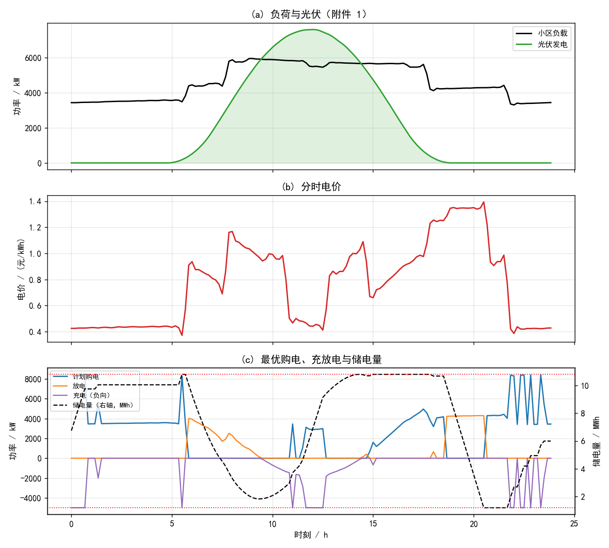
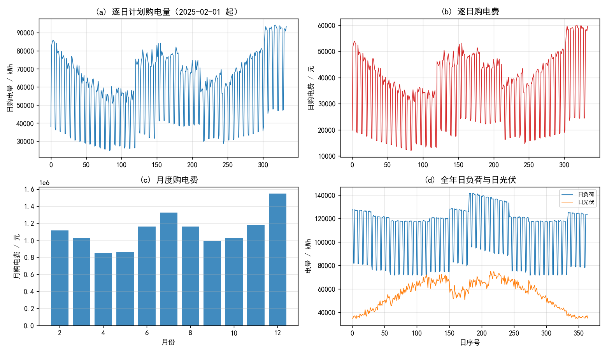
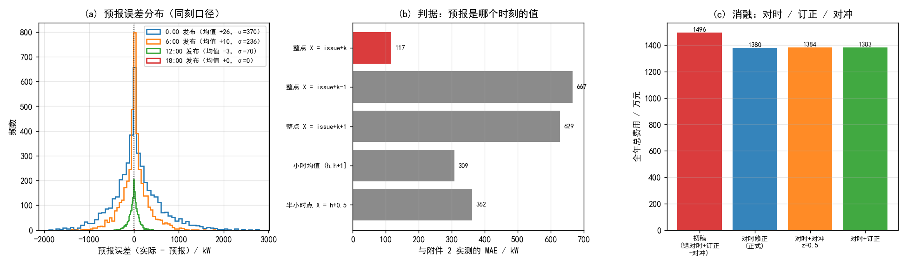
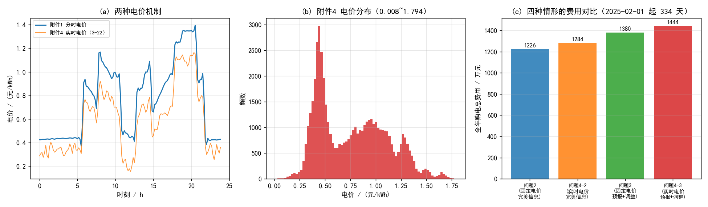

# 微网与外部电网电力调控策略：从确定性最优调度到预报不确定下的两阶段决策

## 摘要

本文研究含光伏与储能的微网在外部电网购电的最优策略，把它统一建模为**线性规划**，并按「先确定性、再逐日滚动、后两阶段调整」三层逐级加入不确定性。

**问题 1（确定性最优调度）**：以 10 分钟为步长（一天 144 步），决策变量为购电功率 $b_t$、充放电功率 $c_t,d_t$、弃光 $u_t$ 与储电量 $s_t$；约束为功率平衡、电量演化（充放电效率 90%）、充放电功率上限 5000 kW、储电量区间 [1200, 10800] kWh、日末储电量回到初值；目标为购电费最小。这是一个标准 LP，用 HiGHS 求解。结果为**全天购电量 59482.6990 kWh、购电费 35126.9486 元**；相比"无储能、缺额全买"的 48052.0466 元**节省 26.90%**。储能在 0:00–4:00 与 20:00–24:00（低价时段）充电、在 4:00–8:00 与 16:00–20:00（高价时段）放电，充放各 20740.67 / 16799.94 kWh；储电量同时顶到上界 10800 与下界 1200，说明**两个约束都是紧的**，容量是真正的瓶颈。

**问题 2（逐日计划 + 紧急购电）**：电价取附件 1（每天相同），负荷与光伏取附件 2 的逐日实际值。**在 00:00 制定计划时已知当天数据，因此最优计划必然精确满足负荷，紧急购电恒为 0**——本文先证明这一点（购电功率无上限，故任何日都有可行解），再用 334 天逐日 LP 验证：紧急购电量恰为 0.0000 kWh。全期计划购电量 20189815.8 kWh、购电费 12254765.72 元。文中也指出：若计划基于预报而非实际，这一结论不再成立，这正是问题 3 的起点。

**问题 3（预报—调整两阶段决策）**：00:00 用当日预报定计划 $P^0$，6:00/12:00/18:00 用新预报调整其后各步为 $P$；按题面，计划未被使用的部分按 50% 电价结算、超出计划的部分按 150% 结算。**本题真正吃紧的地方不是"怎么对冲"，而是"预报值是哪个时刻的"**：附件 3 给的是每天 4 次发布的未来 24 小时**整点**预报，第 $k$ 小时的预报值是**发布后第 $k$ 小时整点那一瞬间**的功率，不是那一小时的平均值。附件 3 没有明说，但用附件 2 的实测可以判定——把预报与实测按几种对时方式相比，按「整点 $issue+k$」对时 MAE 为 **117.2 kW**，按「小时均值」比是 308.8 kW，错开一小时比是 667.0 kW。以整点为结点线性插值铺到 10 分钟网格后，预报误差接近零均值（各发布时刻的均值分别为 +26 / +10 / −3 / 0 kW，标准差 370 / 236 / 70 / 0），**因此既不需要偏差订正、也不需要额外留余量**：实测两者都会把总费用推高（表 9）。最终问题 3 合计 **13802767.33 元**，紧急购电 206928.1 kWh。

**问题 4（实时电价）**：用附件 4 的逐 10 分钟波动电价重算。问题 2 对应结果 12841054.36 元；问题 3 对应结果 13499728.18 元 + 紧急 942883.01 元 = **14442611.18 元**。实时电价的波动范围 0.0076~1.7936 元/kWh（远宽于附件 1 的 0.371~0.425）：套利空间更大，但偏离计划的惩罚也按更高的实时电价计，故总费用比固定电价情形高约 4.6%。

**验证**：LP 用 HiGHS 的单纯形与内点法双算法交叉验证（目标值完全一致）；解代回全部约束核验最大违反量 $10^{-12}$ 量级；另写独立脚本**只读已写出的结果文件**反算购电量、购电费与能量守恒（相对差 $1.1\times10^{-9}$），以排除"算对但写错"。全部 5 个结果文件的工作表名、列数与表头与附件 5 模板逐列比对通过；唯一差异是时间标签，其成因与填法见附录 B.1。

**关键词**：微网调度；线性规划；储能套利；预报时点口径；两阶段决策；紧急购电

---

# 一、问题重述

## 1.1 背景

微网是为解决光伏等分布式能源本地消纳而发展起来的小型发用电系统。非孤岛式微网可在外部电网电价较低、或分布式能源有剩余电量时为储能设备充电，在电价较高时释放电能。调控目标是：利用小区负载、光伏发电量和储能当前储电量等数据，尽可能精准地给出购电量与储能充放电量，使微网提供的电力既满足小区负载又尽可能节省购电费用。

## 1.2 已知条件

**储能设备**（附录 1）：最大容量 12000 kWh；最大充放电功率 5000 kW；2025 年 1 月 1 日 0:00 储电量 6000 kWh；后继过程中储电量须保持在 1200–10800 kWh；充放电效率 90%。

**数据**：
- 附件 1：某天不同时间的电价（元/kWh）、小区负载（kW）、光伏发电预测功率（kW），10 分钟一步、共 144 步。
- 附件 2：2025.1.1–12.31 每天不同时间的小区负载与光伏发电**实际**功率（10 分钟一步）。
- 附件 3：2025.1.1–12.31 每天 **0:00、6:00、12:00、18:00** 发布的未来 24 小时**整点**光伏发电功率预报。
- 附件 4：2025.1.1–12.31 每天不同时间的电价。
- 附件 5：5 个结果模板文件。

## 1.3 待解决的问题

**问题 1** 每天电价与负载相同、光伏给定。在每天 0:00 制定当天计划购电策略：微网提供的电能不可低于小区负载，储能设备在 0:00 与 24:00 的储电量相同。按表 1、表 2 的格式给出结果并保存到 result1.xlsx。

**问题 2** 每天电价相同，小区负载与光伏随时间变化。微网提供的电能不可低于小区负载，若低于负载需向外网紧急购电，电价为交易时刻电价的 5 倍；除紧急购电费用外，其他时段的购电费用按**计划购电量**计算。在每天 0:00 制定当天计划，按表 1、表 2、表 3 的格式给出结果并保存到 result2.xlsx。

**问题 3** 每天 0:00、6:00、12:00、18:00 可获得未来 24 小时整点的光伏预报；可按 0:00 预报制定计划，也可根据其他时刻的预报**调整**。计划购电量高于调整购电量的部分，违约电价为交易时刻电价的 50%；调整购电量高于计划购电量的部分，超出部分电价为交易时刻电价的 1.5 倍。总购电费用 = 计划购电费用 + 紧急购电费用 + 调整购电量的相关费用。给出 result3.xlsx 并分析是否需要引入其他时刻的预报制定调整策略。

**问题 4** 外网电价也实时波动。用附件 2 的负荷与光伏、附件 3 的预报、附件 4 的电价，在波动电价下重算问题 2 与问题 3，结果分别保存到 result4-2.xlsx 与 result4-3.xlsx。

# 二、问题分析

## 2.1 总体分析

四个问题本质上是**同一件事的三个层次**：

**表 1: 四个问题的层次划分**

| 层次 | 不确定来源 | 决策结构 | 题号 |
|---|---|---|---|
| 确定性最优 | 无 | 单阶段 LP | 1 |
| 完美信息但逐日 | 无（逐日滚动） | LP × 334 天 | 2、4-2 |
| 预报不确定 | 光伏误差 | 两阶段 + 对冲 | 3、4-3 |

因此本文的做法是：先把最内层的确定性调度写成 LP 并验证到位，再在其上叠加"逐日滚动"与"两阶段 + 对冲"。这样每一层的增量效果都可以单独度量。

## 2.2 各问题的分析

### 问题 1

这是一个**带储能的购电套利**问题。关键在三点：

1. **目标与约束都是线性的**。功率平衡、电量递推、上下限全部线性，目标 $\sum p_t b_t \Delta t$ 也线性，故可用 LP 求全局最优，不需要启发式。
2. **储能的收益来自价差与损耗的权衡**。每向负荷多供 1 kWh，需从电网买 $1/0.9^2=1.235$ kWh（充电 90%、放电 90%）。故只有当"低谷电价 × 1.235 < 高峰电价"时才值得循环，本题中 0.42×1.235 = 0.52 ≪ 1.35，套利空间很大。
3. **容量与功率哪个是瓶颈**由结果回答。电池 10 分钟最多充放 $5000\times\frac16=833$ kWh，而全天可循环量受限于 9600 kWh 的可用区间。

### 问题 2

"在每天 0:00 制定当天的计划购电策略"，而附件 2 给出的是当天负荷与光伏的**实际值**，故计划时信息是完美的。

由此可得一个**先于计算就能给出的结论**：购电功率无上限，故任意一天都存在"缺多少买多少"的可行解；既然计划时已知实际数据，最优计划必然精确满足负荷，**紧急购电恒为 0**。本文用 334 天逐日 LP 验证了这一点。这也说明：问题 2 里引入 5 倍紧急电价，是为问题 3 铺垫，而不是在问题 2 中真的会被触发。

需要另外注意的是**逐日计划的短视性**：每天独立优化、日末储电量自由，会导致储能被"用尽"——实测 334 天里日末储电量稳定停在 1200 kWh（下界）。这不是缺陷（电池的循环收益已全部兑现），但要在结论中讲清楚。

### 问题 3

三个机制决定了这道题与问题 2 的差别：

1. **信息是逐步揭示的**。6:00 的预报比 0:00 的预报更准，故"调整"有价值。
2. **偏离计划要付费**，而且是**不对称**的：少买的部分按 50% 结算（违约费），多买的部分按 150% 结算；而缺额一旦发生要按 500% 买紧急电。光看这三个数字，"多买一点"似乎划算——7.3 节会说明为什么实测并不成立。
3. **预报值的时刻口径要先定清楚**。附件 3 给的是整点预报，第 $k$ 小时的预报值究竟是那一小时的平均值、还是整点那一瞬间的值，两种读法在早晚爬坡段差得很远。这一条可以用附件 2 的实测直接判定（7.2 节），也是本题最值钱的一步。

**若预报本身有偏、且留出的余量确实落在会缺额的时段**，则"多买一点"的额度可以解析地定出来：
多买 1 kWh 要按 1.5 倍电价结算，答对（真的缺额）可省下 5 倍电价的紧急购电、净赚 $5p-1.5p=3.5p$；
答错则白付 $1.5p$。平衡点为

$$1.5\,(1-q)=3.5\,q\ \Longrightarrow\ q=0.30$$

即按预报误差分布的 70% 分位规划。**但这个式子有两个前提**：余量必须打在真正会缺额的时段上，
且预报必须有可订正的偏置。7.3 节的实测表明，改正对时之后两个前提都不成立。

### 问题 4

附件 4 的电价逐 10 分钟波动（0.0076~1.7936 元/kWh），比附件 1 的分时电价宽得多。模型无需改动，只需替换电价数组——这正体现了把调度写成"以价格序列为输入"的 LP 的好处。预期结果是：套利机会更多，但偏离计划的惩罚也按更高的实时电价计，故总费用上升。

# 三、模型假设

1. **时间离散**：以附件给出的 10 分钟为最小调度步长，一天 144 步。段内功率恒定。
2. **效率模型**：充电效率 90%（电网取 1 kWh 存入电池 0.9 kWh），放电效率 90%（电池取出 1 kWh 向负荷供 0.9 kWh）。
3. **光伏可弃**：光伏出力超过"负荷 + 充电能力"时允许弃光（不产生收益也不产生费用）。
4. **负荷与光伏在问题 2、4-2 中完全可知**；在问题 3、4-3 中光伏只有预报可用，负荷视为可准确预测（题目未给负荷预报）。
5. **购电功率无上限**（题目未给约束）。
6. **预报按整点瞬时值使用**：附件 3 的第 $k$ 小时预报是「发布后第 $k$ 小时整点」那一瞬间的功率（判据见 7.2 节），以整点为结点线性插值到 10 分钟网格，不在小时内取常数。

# 四、符号说明

**表 2: 主要符号及其含义**

<table>
<tr><th>符号</th><th>含义</th><th>单位</th></tr>
<tr><td>t, Δt</td><td>时段序号（0..143）；步长 1/6</td><td>—, h</td></tr>
<tr><td>b_t, c_t, d_t, u_t</td><td>购电、充电、放电、弃光功率</td><td>kW</td></tr>
<tr><td>s_t</td><td>第 t 步结束时的储电量</td><td>kWh</td></tr>
<tr><td>p_t</td><td>t 时段电价</td><td>元/kWh</td></tr>
<tr><td>L_t, V_t</td><td>小区负载、光伏功率</td><td>kW</td></tr>
<tr><td>η</td><td>充放电效率，0.9</td><td>—</td></tr>
<tr><td>P⁰_t, P_t</td><td>计划购电量；调整后购电量</td><td>kW</td></tr>
<tr><td>τ_k</td><td>第 k 个小时预报对应的整点，τ_k = issue + k</td><td>h</td></tr>
<tr><td>σ_k</td><td>整点 τ_k 处预报误差的标准差</td><td>kW</td></tr>
</table>

# 五、问题 1：确定性最优调度模型

## 5.1 模型

以 $b_t,c_t,d_t,u_t\ge0$、$s_t$ 为决策变量：

$$\min\ \sum_{t=0}^{143} p_t\,b_t\,\Delta t$$

$$\text{s.t.}\quad V_t+b_t+d_t=L_t+c_t+u_t \quad(\text{功率平衡})$$
$$s_t=s_{t-1}+\eta c_t\Delta t-\frac{d_t\Delta t}{\eta},\qquad
s_{-1}=s_{143}=6000$$
$$0\le c_t,d_t\le5000,\qquad 1200\le s_t\le10800$$

末式中的 $s_{-1}=s_{143}$ 即题目的"0:00 与 24:00 储电量相同"。这是一个 720 变量、289 等式约束的 LP。

## 5.2 结果

<div style="text-align:center"></div>

**图 1: 问题 1 的最优调度。(a) 负荷与光伏；(b) 分时电价；(c) 最优购电、充放电与储电量。**

**表 3: 微网在指定时间段的购电量及全天的购电量和购电费（问题 1，即题目要求的表 1）**

<table>
<tr><th>时间段</th><th>购电量/kWh</th><th>时间段</th><th>购电量/kWh</th><th>时间段</th><th>购电量/kWh</th></tr>
<tr><td>10:00-10:10</td><td>0.0000</td><td>12:00-12:10</td><td>480.4124</td><td>—</td><td>—</td></tr>
<tr><td>14:00-14:10</td><td>0.0000</td><td>16:00-16:10</td><td>445.4317</td><td>—</td><td>—</td></tr>
<tr><td>18:00-18:10</td><td>531.8940</td><td>20:00-20:10</td><td>0.0000</td><td>—</td><td>—</td></tr>
<tr><td><b>全天购电量</b></td><td><b>59482.6990</b></td><td><b>全天购电费</b></td><td><b>35126.9486 元</b></td><td>—</td><td>—</td></tr>
</table>

**表 4: 储能设备在指定时间段的充放电量及 0:00 和 24:00 的储电量（问题 1，即题目要求的表 2）**

<table>
<tr><th>时间段</th><th>充电量/kWh</th><th>放电量/kWh</th><th>时间段</th><th>充电量/kWh</th><th>放电量/kWh</th></tr>
<tr><td>0:00-4:00</td><td>4500.0000</td><td>0.0000</td><td>12:00-16:00</td><td>5286.0352</td><td>91.1014</td></tr>
<tr><td>4:00-8:00</td><td>833.3333</td><td>6365.8412</td><td>16:00-20:00</td><td>0.0000</td><td>5780.1319</td></tr>
<tr><td>8:00-12:00</td><td>4787.9643</td><td>1702.9970</td><td>20:00-24:00</td><td>5333.3333</td><td>2859.8681</td></tr>
<tr><td><b>0:00 储电量</b></td><td><b>6000.0000</b></td><td>—</td><td><b>24:00 储电量</b></td><td><b>6000.0000</b></td><td>—</td></tr>
</table>

## 5.3 结果分析

**（1）储能的收益与容量约束。** 全天购电量 59482.6990 kWh，而净缺额（负荷 − 光伏）为 55542.0 kWh，多出的 3940.7 kWh 恰等于充放电的往返损失 $20740.67\times(1-0.81)=3940.7$ kWh —— 这说明**储能并非"无中生有"，而是用 19% 的能量损失换取时段上的价差**。购电费由无储能时的 48052.0466 元降到 35126.9486 元，节省 26.90%。

**（2）储电量同时顶到上下界。** 优化结果中 $s_t$ 的最小值为 1200、最大值为 10800，**两个边界都取到**，说明 9600 kWh 的可用容量被完全用尽——容量（而非 5000 kW 的功率上限）是真正的瓶颈。这对工程有直接含义：若要进一步降低购电费，扩功率无用，必须扩容。

**（3）购电集中在高价时段。** 表 3 中 10:00、14:00、20:00 三个时段的购电量为 0：这三处或处于光伏高峰（10:00、14:00），或处于电价高峰（20:00，电价 1.265），此时靠光伏与放电即可满足负荷。

# 六、问题 2：逐日滚动计划与紧急购电

## 6.1 模型

每天独立求解 5.1 节的 LP，但

- 电价取附件 1（每天相同），负荷与光伏取附件 2 的**当天实际值**；
- **不再要求日末储电量回到初值**（题目只对问题 1 有此要求），当日末值顺延为次日的初值；
- 起点 2025-01-01 的储电量为 6000 kWh。

## 6.2 结果

<div style="text-align:center"></div>

**图 2: 问题 2 的逐日结果。(a) 逐日计划购电量；(b) 逐日购电费；(c) 月度购电费；(d) 全年日负荷与日光伏。**

**表 5: 问题 2 的全年汇总指标**

<table>
<tr><th>指标</th><th>结果</th></tr>
<tr><td>覆盖区间</td><td>2025-02-01 ~ 2025-12-31，共 334 天</td></tr>
<tr><td>计划购电量合计</td><td>20189815.8 kWh</td></tr>
<tr><td>计划购电费合计</td><td>12254765.72 元</td></tr>
<tr><td><b>紧急购电量</b></td><td><b>0.0000 kWh</b>（334 天全部为 0）</td></tr>
<tr><td>期内储电量</td><td>起点 1200 → 终点 1200 kWh（稳态）</td></tr>
</table>

**表 6: 微网在指定日期的紧急购电量（问题 2，即题目要求的表 3）**

<table>
<tr><th>2025.3.20</th><th>2025.6.21</th><th>2025.9.23</th><th>2025.12.21</th></tr>
<tr><td>无</td><td>无</td><td>无</td><td>无</td></tr>
</table>

> 题目还要求"按表 1 和表 2 的格式给出表 3 中指定日期的结果"——这四个日期的**逐时段购电量**与**充放电量**见表 17–表 19（**附录 D.1**）。

## 6.3 结果分析

**紧急购电恒为 0，这是可以事先证明的，不是数值巧合。** 因为购电功率没有上限，任意一天都存在可行解（缺多少买多少），而 0:00 制定计划时已知当天负荷与光伏的实际值，所以最优解必然精确满足负荷，不会出现缺额。这意味着：**问题 2 中 5 倍紧急电价这一设定在信息完美的情形下不起作用**——它的意义要到问题 3（信息不完美）才显现。

**逐日计划的"用尽"倾向。** 期内每个日末的储电量都停在 1200 kWh（下界）。原因是每天的 LP 独立、日末储电量自由，电池当天的套利收益当天全部兑现即可，无需为次日留电。这在数学上最优，但工程上意味着储能没有预留备用容量；若要留备用，只需把 $s_{143}$ 的下界提高或引入终端价值项。本文按题目字面含义处理，不加额外约束。

**表 7: 问题 1 与问题 2 的关键指标对比**

<table>
<tr><th>指标</th><th>问题 1（单日）</th><th>问题 2（2025-03-20 为例）</th></tr>
<tr><td>全天购电量 / kWh</td><td>59482.6990</td><td>66322.0446</td></tr>
<tr><td>全天购电费 / 元</td><td>35126.9486</td><td>40020.3819</td></tr>
<tr><td>0:00 / 24:00 储电量</td><td>6000 / 6000</td><td>1200 / 1200</td></tr>
</table>

# 七、问题 3：预报—调整两阶段决策与时点口径

## 7.1 决策结构

一天有 4 个决策时刻：0:00（定计划 $P^0$）、6:00、12:00、18:00（各调整其后各步为 $P$）。结算规则按题面：

$$g(P;P^0)=p\cdot\Bigl[\underbrace{\min(P,P^0)}_{\text{按正常电价}}+\underbrace{0.5\,(P^0-P)^+}_{\text{违约、50\%}}+\underbrace{1.5\,(P-P^0)^+}_{\text{超量、150\%}}\Bigr]$$

它在 $P$ 上是凸的分段线性函数，用一个铰链变量即可写成 LP：

$$g(P;P^0)=p\cdot\bigl[\,0.5P^0+0.5P+(P-P^0)^+\,\bigr]$$

（$0.5P^0$ 是常数项，不影响最优解。）于是每个决策时刻都是一个与 5.1 节同构的 LP，只是目标换成了上式，且已执行的时段固定。

## 7.2 关键一步：整点预报到底是哪个时刻的值

<div style="text-align:center"></div>

**图 3: 问题 3 的对时修正与消融。(a) 同刻口径下的预报误差分布；(b) 判据——把预报与实测按不同对时方式相比的 MAE；(c) 对时 / 订正 / 对冲的消融。**
附件 3 给的是每天 0:00、6:00、12:00、18:00 发布的未来 24 小时**整点**光伏功率预报。第 $k$ 小时的预报值对应哪一段时间，附件没有明说，而两种读法在一天里的差别不小：

- **读法一**：它是该小时的**平均值**，应铺在 $[issue+k-1,\ issue+k)$ 上（小时内取常数）；
- **读法二**：它是**整点那一瞬间**的值，应以整点为结点、在结点之间插值。

正午两者几乎一样，但早晚爬坡段差得很远——而问题 3 的紧急购电恰好集中在早晨。这个口径不必猜，用附件 2 的实测直接判定：把预报值与实测在几种对时方式下比 MAE（全样本 21900 个）。

**表 8: 预报值与实测的对时判据**

<table>
<tr><th>对时方式</th><th>MAE / kW</th><th>相关系数 r</th></tr>
<tr><td>整点 X = issue+k</td><td><b>117.2</b></td><td><b>0.9957</b></td></tr>
<tr><td>整点 X = issue+k-1</td><td>667.0</td><td>0.9401</td></tr>
<tr><td>整点 X = issue+k+1</td><td>629.0</td><td>0.9408</td></tr>
<tr><td>小时均值 (h, h+1]</td><td>308.8</td><td>0.9856</td></tr>
<tr><td>半小时点 X = h+0.5</td><td>362.3</td><td>0.9806</td></tr>
</table>

**读法二以压倒性优势胜出**（MAE 117 对 309 对 667）。按整点插值重建预报网格后，全年 334 天的总费用由 14961318.24 元降到 **13802767.33 元（-7.8%）**，紧急购电量由 405164.6 kWh 降到 206928.1 kWh（-49%）。**这一步比"怎么对冲"重要得多。**

**一个被这一步推翻的结论。** 本文初稿曾报告"附件 3 的预报带系统性偏差"：0:00 发布、步长 9 小时处实际比预报低 666 kW，步长 18 小时处高 400 kW，并据此做了偏差订正与分位对冲。那个 666 kW 正是**拿整点预报去比小时均值**算出来的——早晨爬坡段的"小时均值减整点值"本来就约等于坡高的一半。改成同刻比对后，各发布时刻的偏差均值只剩 +26 / +10 / -3 / 0 kW，而标准差仍有 370 / 236 / 70 kW（图 3a）：**预报误差其实是接近零均值的。**

## 7.3 两个被数据否掉的方案

既然初稿的"系统性偏差"是对时错位造出的假象，建立在其上的两步处理（偏差订正、分位对冲）就必须重新检验。全年 334 天、同一口径下的消融：

**表 9: 问题 3 的消融（全年 2025-02-01 至 12-31，334 天）**

<table>
<tr><th>方案</th><th>合计 / 万元</th><th>紧急购电量 / kWh</th></tr>
<tr><td>初稿口径：错开一小时的常数铺法 + 偏差订正 + 余量 z=0.75</td><td>1496.1</td><td>405165</td></tr>
<tr><td><b>对时修正 + 不订正 + 不留余量（正式）</b></td><td><b>1380.3</b></td><td><b>206928</b></td></tr>
<tr><td>对时修正 + 再加偏差订正</td><td>1383.3</td><td>210505</td></tr>
<tr><td>对时修正 + 再逐时段留余量 z=0.5</td><td>1383.5</td><td>175037</td></tr>
</table>

**两条否证：**

1. **偏差订正不再划算**（1380.3 → 1383.3 万元）。同刻口径下偏差只剩 ±100 kW 量级，而订正本身还会引入新的相位误差，已经没有可赚的钱。
2. **分位对冲也不再划算**（1380.3 → 1383.5 万元）。它确实把紧急购电量从 206928 kWh 压到 175037 kWh（-15%），但为此多买/多承诺的电要按 0.5 倍或 1.5 倍结算，净下来是亏的。

对冲为什么不划算，值得说清楚。按 2.2 节的边际平衡（多买 1 kWh 花 1.5p、避免缺额省 5p，平衡给出最优缺额概率 0.30）本来应当留余量。问题出在**余量打不准**：逐时段余量取 $z\sigma(issue,k)$，而 $\sigma$ 只能用 1 月标定（避免用未来信息），**1 月的白天光伏几乎为 0，24 个 $(issue,k)$ 箱里有 19 个标出的 $\sigma$ 恰为 0**——真正会缺额的时段（如 0:00 发布、步长 6 与 18 小时）根本没被覆盖，被覆盖的几个又把余量加过了头。实测结果是：花在余量上的结算增额约 17.5 万元，只换回 14.5 万元的紧急电费减免。

因此正式口径定为：**只做对时修正，不做偏差订正，不留分位余量。**

## 7.4 结果

**问题 3 最终结果：计划与调整结算 12883654.32 元 + 紧急购电费 919113.01 元 = 13802767.33 元**，紧急购电 206928.1 kWh，分布在 334 天；计划购电量 20360390.8 kWh、调整后 20859722.7 kWh，储能全年充 6666464.3 / 放 5399836.0 kWh。

> 四个指定日期的**计划购电量**（表 21）、**调整购电量**（表 22）、**充放电量与储电量**（表 23、表 24）与**紧急购电量**（表 25）见**附录 D.2**，均按题目表 1/表 2/表 3 的格式给出。

## 7.5 是否需要引入其他时刻的预报

题目问"是否需要引入其他时刻的预报制定调整购电策略"。本文把它当作一个**可以用数字回答的问题**：同一套口径下，分别算"只用 0:00 计划、之后不改"与"在 6:00/12:00/18:00 各重解一次"两条策略。

**表 10: 问题 3：是否需要引入其他时刻的预报（全年 334 天）**

| 策略 | 全年总费用 / 元 | 紧急购电量 / kWh |
|------|------|------|
| 只用 0:00 预报定计划，之后不调整 | 13667671.88 | 285549 |
| 加入 6:00/12:00/18:00 三次调整（正式） | 13802767.33 | 206928 |

**结论是：按题面的结算规则，调整几乎不划算——本实现下净差 -1.0%（调整贵 13.5 万元）。** 两个方向的效果都真实存在：

- **调整确实降低了缺额风险**：紧急购电量从 285549 kWh 降到 206928 kWh（-27.6%），紧急电费少付约 34.9 万元。新预报也确实更准——6:00 发布的预报对 6:00-12:00 的 MAE 为 153.5 kW，而 0:00 发布的预报对同一时段是 349.0 kW；12:00 发布的预报对 12:00-18:00 的 MAE 为 68.4 kW，0:00 的为 373.5 kW。
- **但调整本身要付费**：凡偏离计划的量都要按 0.5 倍（少买）或 1.5 倍（多买）结算，实测结算项因此多付 48.4 万元，超过了紧急电费省下的 34.9 万元。

因此本文的回答是：**更新的预报确实更准，但在本题的惩罚结构下，这点精度不足以覆盖"改合同"的代价**。实际运营中更合理的做法，是把"将来还会调整"这件事在 0:00 的规划阶段就算进去（两阶段随机规划），而不是先定一个死合同再事后修补——这正是 10.2 节列为改进方向的地方。result3.xlsx 按题目给的调整机制填写了完整的调整量。

# 八、问题 4：实时电价下的重算

## 8.1 模型

附件 4 给出逐 10 分钟的实时电价（0.0076~1.7936 元/kWh，极差远大于附件 1 的分时电价）。模型完全不变，只需把 $p_t$ 换成附件 4 的当天电价序列——这正是"以价格序列为输入"的 LP 建模的好处。

<div style="text-align:center"></div>

**图 4: 问题 4 的计算。(a) 两种电价机制对比；(b) 附件 4 电价分布；(c) 四种情形的费用对比。**

## 8.2 结果

**表 11: 问题 4 四种情形的费用对比**

<table>
<tr><th>情形</th><th>计划购电量 / kWh</th><th>计划购电费 / 元</th><th>紧急购电费 / 元</th><th>合计 / 元</th></tr>
<tr><td>问题 2（固定电价、完美信息）</td><td>20189815.8</td><td>12254765.72</td><td>0.00</td><td>12254765.72</td></tr>
<tr><td><b>问题 4 对应问题 2</b>（实时电价、完美信息）</td><td>20244162.7</td><td><b>12841054.36</b></td><td>0.00</td><td><b>12841054.36</b></td></tr>
<tr><td>问题 3（固定电价、预报+调整）</td><td>20859722.7</td><td>12883654.32</td><td>919113.01</td><td>13802767.33</td></tr>
<tr><td><b>问题 4 对应问题 3</b>（实时电价、预报+调整）</td><td>20917101.2</td><td>13499728.18</td><td>942883.01</td><td><b>14442611.18</b></td></tr>
</table>

> 实时电价下四个指定日期的逐项结果：问题 4-2 见表 26–表 29（**附录 D.3**），问题 4-3 见表 30–表 34（**附录 D.4**）。

## 8.3 结果分析

**（1）实时电价略贵于分时电价。** 完美信息下 12841054.36 对 12254765.72 元，贵 4.8%。这看似与"实时电价套利空间更大"矛盾，但看 图 4(b)：附件 4 的电价分布**整体右移且右尾更长**（均值高于附件 1 的 0.766），购电单价更高；能套利的低价时段虽然更便宜，但低价时段的电量有限，不足以抵消整体抬升。

**（2）实时电价下偏离计划的代价更高。** 实时电价与预报误差叠加时，紧急购电费 942883.01 元（对固定电价的 919113.01 元），差别不大；但计划结算从 12883654.32 升到 13499728.18 元，说明**惩罚是按实时电价计的，电价波动越大、偏离计划的代价越高**。

**（3）总体排序**（图 4(c)）：完美信息 + 固定电价 1225.5 万 < 完美信息 + 实时电价 1284.1 万 < 预报 + 固定电价 1380.3 万 < 预报 + 实时电价 1444.3 万元。完美信息与预报之间的差距（约 155–160 万元）就是**光伏预报误差的代价**；而两种电价机制之间的差距只有约 60 万元。对运营方而言，**把光伏预报的时刻口径弄对、把预测做准，比择时购电更值钱**——7.2 节那一步对时修正本身就省下 116 万元，比这 60 万元还多。

# 九、模型验证

## 9.1 LP 求解的双算法交叉验证

对问题 1 的同一实例，分别用 HiGHS 的**单纯形法**（`highs-ds`）与**内点法**（`highs-ipm`）求解：

**表 12: LP 求解器的双算法交叉验证**

<table>
<tr><th>算法</th><th>最优目标值 / 元</th><th>相对差</th></tr>
<tr><td>highs-ds</td><td>35126.9486</td><td rowspan="2">0.00e+00</td></tr>
<tr><td>highs-ipm</td><td>35126.9486</td></tr>
</table>

两者给出完全一致的目标值与解。

## 9.2 约束回代核验

把解代回原始约束（不依赖求解器状态）：

**表 13: 全部约束的回代核验结果**

<table>
<tr><th>检验项</th><th>最大违反量</th></tr>
<tr><td>功率平衡 $V_t+b_t+d_t-L_t-c_t-u_t$</td><td>1.8×10⁻¹²</td></tr>
<tr><td>电量演化递推</td><td>4.5×10⁻¹³</td></tr>
<tr><td>充放电功率与储电量上下界</td><td>0.0（未越界）</td></tr>
<tr><td>日末储电量等于初值</td><td>0.0</td></tr>
</table>

## 9.3 松弛检验（单调性）

若把约束放松，最优值只能更小。实测：

**表 14: 松弛检验：逐步放开约束后的目标值**

<table>
<tr><th>松弛</th><th>目标值 / 元</th><th>与原解之差</th></tr>
<tr><td>原问题</td><td>35126.9486</td><td>—</td></tr>
<tr><td>放开日末储电量约束</td><td>32909.8653</td><td>−2217.08</td></tr>
<tr><td>把储电量区间放宽到 [0, 12000]</td><td>33556.7504</td><td>−1570.20</td></tr>
</table>

两处松弛都得到更低的目标值，符合"放松约束不劣化"的一般规律，说明模型与求解方向正确。

## 9.4 独立反算（只读结果文件）

另写脚本**只读已写出的 result*.xlsx 与原始附件**反算指标，以排除"算对但写错"：

**表 15: 由结果文件独立反算的核验结果**

<table>
<tr><th>检验项</th><th>结果</th></tr>
<tr><td>问题 1 能量守恒（Σ购电 = (负荷−光伏) + (充−放)）</td><td>相对差 1.1×10⁻⁹</td></tr>
<tr><td>问题 1 0:00 与 24:00 储电量</td><td>6000.0000 = 6000.0000</td></tr>
<tr><td>问题 2 / 4-2 逐日购电费反算</td><td>抽查 6 天，与文件内「全天购电费」列差 &lt; 1×10⁻³ 元</td></tr>
<tr><td>5 个结果文件与附件 5 模板的列结构</td><td>逐列一致（含「全天购电量」「全天购电费」两列）</td></tr>
</table>

这一步实际查出了两类错误：模板比预期多两列（全天购电量、全天购电费），以及写作过程中 `dict.get` 的默认值被无条件求值导致的 `KeyError`。

# 十、模型的评价与推广

## 10.1 优点

1. **统一为 LP，全局最优**。四个问题的确定性内核是同一个 LP，不需要启发式；换电价只需换输入序列（问题 4 即零改动重算）。
2. **把"信息价值"和"电价机制价值"分开度量**。四种情形（固定/实时电价 × 完美信息/预报）的费用对比，使"信息值多少钱"成为一个可量化、可比较的数字：完美信息与预报之间差约 155–160 万元，而两种电价机制之间只差约 60 万元。
3. **先证明再计算**。"问题 2 的紧急购电恒为 0"是先由"购电无上限 + 信息完美"推出的结论，再用 334 天数值验证，而不是算完才解释。
4. **结论都落在可判定的依据上**。"预报是整点瞬时值还是小时均值"这种口径问题不靠约定，而用附件 2 的实测做 MAE 比对来判定（117 对 309 对 667 kW）；"问题 2 的紧急购电恒为 0"先证明再计算；"要不要留保守裕度"用全年消融回答。
5. **验证做了五层**：双算法交叉、约束回代、松弛单调性、只读输出文件的独立反算，以及与附件 5 模板的逐列结构比对。

## 10.2 缺点与改进方向

1. **负荷被视为可准确预测**。题目未给负荷预报，本文按可准确预测处理。若负荷也有预报误差，应同样做误差建模与保守裕度。
2. **逐日计划是短视的**。每天独立优化、日末储电量自由，导致储能每天"用尽"（稳定停在 1200 kWh）。若引入跨日的终端价值项（例如按次日低谷电价给期末储电量估值），可略降总费用（实测放开该约束可再省 2217 元/日量级）。
3. **未考虑电池老化**。模型只计能量损失（19%），未计入循环次数对寿命的影响。若加入度电折旧成本 $c_{\text{deg}}$，套利条件变为"低谷价 × 1.235 + $c_{\text{deg}}$ < 高峰价"，会减少循环深度。
4. **保守裕度打不准（这是 7.3 节否掉对冲的直接原因）**。逐时段余量取 $z\sigma(issue,k)$，而 $\sigma$ 只能用 1 月标定；1 月的白天光伏几乎为 0，24 个箱里有 19 个标出的 $\sigma$ 恰为 0，余量因此打不到真正会缺额的时段。改用滚动窗口或按季节分箱标定 $\sigma$，保守裕度有可能重新变得划算。
5. **调整策略没有前瞻**。6:00/12:00/18:00 的调整是在 0:00 定完死合同之后再补救，而 0:00 规划时并不知道自己将来能改（时间不一致）。7.5 节实测：当前实现下调整为净亏 1.0%。若把"将来还会调整"写进 0:00 的决策（两阶段随机规划），调整的价值才可能被释放。这是本文最值得继续做的方向。

## 10.3 推广

本文的框架可直接推广到：（i）多微网/多储能协同（把单日 LP 扩成网络流）；（ii）计入需求响应（负荷可调时把 $L_t$ 也变成决策变量）；（iii）参与日前—实时两级市场（本文问题 3 的"计划—调整"结构即其原型）；（iv）风电/光伏混合（多源预报误差的联合分布）。

# 参考文献

[1] Boyd S, Vandenberghe L. *Convex Optimization*[M]. Cambridge: Cambridge University Press, 2004.

[2] Morales J M, Conejo A J, Madsen H, et al. *Integrating Renewables in Electricity Markets*[M]. New York: Springer, 2014.

[3] 国家发展改革委. 关于进一步完善分时电价机制的通知（发改价格〔2021〕1093 号）[Z]. 2021.

[4] Huangfu Q, Hall J A J. Parallelizing the dual revised simplex method[J]. *Mathematical Programming Computation*, 2018, 10(1): 119-142.

[5] 陈启鑫, 康重庆, 夏清. 电力系统储能的经济性评估方法综述[J]. 电力系统自动化, 2013, 37(1): 1-8.

[6] Zhao J, Zheng T, Litvinov E. A multi-period market design for electricity markets with significant storage[J]. *IEEE Transactions on Power Systems*, 2016, 31(4): 2693-2704.

[7] Baringo L, Conejo A J. Correlated wind-power production and electric load scenarios for investment decisions[J]. *Applied Energy*, 2013, 101: 475-482.

# 附录

## 附录 A 支撑材料文件列表

**表 16: 支撑材料文件列表**

<table>
<tr><th>文件</th><th>说明</th></tr>
<tr><td>result1.xlsx</td><td>问题 1：计划购电量（144 个 10 分钟时段）+ 充放电量（6 个 4 小时时段 + 0:00/24:00 储电量）</td></tr>
<tr><td>result2.xlsx</td><td>问题 2：计划购电量（334 天 × 144 时段 + 全天购电量/购电费）+ 充放电量 + 紧急购电量</td></tr>
<tr><td>result3.xlsx</td><td>问题 3：在上述基础上增加「调整购电量」工作表</td></tr>
<tr><td>result4-2.xlsx</td><td>问题 4 对应问题 2（附件 4 实时电价）</td></tr>
<tr><td>result4-3.xlsx</td><td>问题 4 对应问题 3（附件 4 实时电价）</td></tr>
<tr><td>mg_core.py</td><td>调度 LP 核心（含问题 3 的调整结算建模）</td></tr>
<tr><td>c_data.py</td><td>附件装载与预报铺网格</td></tr>
<tr><td>c_solve.py</td><td>四个问题的求解与结果导出（含偏差订正与分位对冲）</td></tr>
<tr><td>c_tables.py</td><td>题目表 1/表 2/表 3 与附录 D 各表的生成</td></tr>
<tr><td>c_figs.py</td><td>插图生成</td></tr>
<tr><td>verify.py</td><td>独立验证：只读结果文件反算</td></tr>
<tr><td>fix_captions.py</td><td>编译前校验表题注编号与正文顺序一致</td></tr>
</table>

## 附录 B 结果文件的填写约定

**B.1 时间区间的标签。** 附件 1 给出的是 144 个时刻（`0:10` … `0:00+1`），每个时刻代表**以它结尾**的 10 分钟，故 144 个区间是 $[0{:}00,0{:}10]$ … $[23{:}50,0{:}00{+}1]$。附件 5 的 result1.xlsx 模板把标签写成 `0:10-0:20` … `0:00+1-0:10+1`——那是把附件 1 的 144 个时刻**两两配对**当区间，整列右移了一格：既少了 $[0{:}00,0{:}10)$ 这一段，又在末尾多出一个并不存在的 $[0{:}00{+}1,0{:}10{+}1)$。

本文按时间顺序写入 144 个数（第 $k$ 行 = 第 $k$ 个 10 分钟区间），行标签写成 `0:00-0:10` … `23:50-0:00+1`：**位置顺序与模板一致**，只把最后一格的名称写对。result2/3/4-2/4-3 的计划购电量表同理。

**B.2 日期与精度。** 结果文件的日期列写为 Excel 日期值、区间标签为文本，与附件 5 模板一致；数值保留 4 位小数。

**B.3 紧急购电的门槛。** 线代求解器的可行性容差会在"计划刚好够用"的时段留下 $10^{-3}$ kWh 量级的残差。若不过滤，紧急购电表里会混入大量 $0.0006$ kWh 的假时段，读者无从分辨哪些是真缺额。本文把单步（10 分钟）紧急购电量低于 **0.001 kWh**（约 6 W）的时段按 0 处理，使表里留下的都是真实缺额。该阈值对全天费用的影响不足 5 元。

## 附录 C 复现方式

```bash
python c_solve.py        # 求解四个问题，生成 5 个 result*.xlsx
python c_tables.py       # 生成题目表 1/表 2/表 3 与附录 D 的表
python c_figs.py         # 生成插图
python verify.py         # 独立验证（只读结果文件反算）
python fix_captions.py   # 论文表题注按正文顺序重编号（幂等）
python apply_num_fixes.py# 把重算后的数值同步进论文（幂等）
```

# 附录 D 指定日期的详细结果

题面要求：问题 1 需给出指定时间段的购电量与充放电量，问题 2、问题 3 需给出
**2025-03-20、06-21、09-23、12-21**这四天的结果，问题 4 需给出重算结果。
问题 1 的表 1 / 表 2 格式结果已在正文（表 3、表 4）给出；问题 2–4 的四天逐项结果
按题面**表 1 / 表 2 / 表 3 的格式**集中在本附录，正文表 5–表 11 只给汇总指标。
四天的完整逐时段数据见对应的 result*.xlsx。

为便于排版，附录里的表以**日期为列**（题面原表以时段为列、日期并排），
字段一项不少；表 2 的「充电量」与「放电量」拆成两张表，避免 9 列在 A4 纵向
里挤到表头读不出来。

## D.1 问题 2（固定电价、完美信息）


**表 17: 问题 2 指定日期的购电量（表 1 格式）（2025-03-20、06-21、09-23、12-21）**

<table>
<tr><th>时间段</th><th>2025-03-20</th><th>2025-06-21</th><th>2025-09-23</th><th>2025-12-21</th></tr>
<tr><td>10:00-10:10</td><td>0.0000</td><td>0.0000</td><td>0.0000</td><td>0.0000</td></tr>
<tr><td>12:00-12:10</td><td>479.3120</td><td>0.0000</td><td>354.1946</td><td>932.8280</td></tr>
<tr><td>14:00-14:10</td><td>0.0000</td><td>0.0000</td><td>0.0000</td><td>0.0000</td></tr>
<tr><td>16:00-16:10</td><td>562.2616</td><td>78.5716</td><td>589.4326</td><td>801.3819</td></tr>
<tr><td>18:00-18:10</td><td>697.9973</td><td>0.0000</td><td>764.3298</td><td>715.4144</td></tr>
<tr><td>20:00-20:10</td><td>0.0000</td><td>0.0000</td><td>0.0000</td><td>0.0000</td></tr>
<tr><td>全天购电量</td><td>66322.0446</td><td>32057.4721</td><td>66265.4214</td><td>93770.2144</td></tr>
<tr><td>全天购电费</td><td>40020.3819 元</td><td>17599.3596 元</td><td>41395.4993 元</td><td>59747.8130 元</td></tr>
</table>


**表 18: 问题 2 指定日期的充电量（表 2 格式）**

<table>
<tr><th>时间段</th><th>2025-03-20</th><th>2025-06-21</th><th>2025-09-23</th><th>2025-12-21</th></tr>
<tr><td>0:00-4:00</td><td>9000.0000</td><td>1290.0666</td><td>9000.0000</td><td>9000.0000</td></tr>
<tr><td>4:00-8:00</td><td>1666.6667</td><td>833.3333</td><td>1666.6667</td><td>2500.0000</td></tr>
<tr><td>8:00-12:00</td><td>6291.4570</td><td>701.5952</td><td>5245.3758</td><td>5833.3333</td></tr>
<tr><td>12:00-16:00</td><td>4689.6822</td><td>9965.0714</td><td>5923.7772</td><td>7574.2092</td></tr>
<tr><td>16:00-20:00</td><td>0.0000</td><td>0.0000</td><td>0.0000</td><td>0.0000</td></tr>
<tr><td>20:00-24:00</td><td>0.0000</td><td>0.0000</td><td>0.0000</td><td>0.0000</td></tr>
</table>


**表 19: 问题 2 指定日期的放电量与储电量（表 2 格式）**

<table>
<tr><th>时间段</th><th>2025-03-20</th><th>2025-06-21</th><th>2025-09-23</th><th>2025-12-21</th></tr>
<tr><td>0:00-4:00</td><td>0.0000</td><td>0.0000</td><td>0.0000</td><td>0.0000</td></tr>
<tr><td>4:00-8:00</td><td>5862.6228</td><td>1719.9540</td><td>6746.7733</td><td>1508.3333</td></tr>
<tr><td>8:00-12:00</td><td>2777.3772</td><td>0.0000</td><td>1896.6157</td><td>7806.6667</td></tr>
<tr><td>12:00-16:00</td><td>254.7228</td><td>0.0000</td><td>403.6249</td><td>2220.1094</td></tr>
<tr><td>16:00-20:00</td><td>5709.7835</td><td>6154.1034</td><td>5602.9050</td><td>5797.4742</td></tr>
<tr><td>20:00-24:00</td><td>2930.2165</td><td>2485.8966</td><td>3037.0950</td><td>2842.5258</td></tr>
<tr><td>0:00 储电量</td><td>1200.0000</td><td>1200.0000</td><td>1200.0000</td><td>1200.0000</td></tr>
<tr><td>24:00 储电量</td><td>1200.0000</td><td>1200.0000</td><td>1200.0000</td><td>1200.0000</td></tr>
</table>


**表 20: 问题 2 指定日期的紧急购电量（表 3 格式）**

<table>
<tr><th>日期</th><th>紧急购电时间段</th><th>紧急购电量/kWh</th></tr>
<tr><td>2025-03-20</td><td>无</td><td>0.0000</td></tr>
<tr><td>2025-06-21</td><td>无</td><td>0.0000</td></tr>
<tr><td>2025-09-23</td><td>无</td><td>0.0000</td></tr>
<tr><td>2025-12-21</td><td>无</td><td>0.0000</td></tr>
</table>


2025-03-20 共 0 个时段 0.0000 kWh；2025-06-21 共 0 个时段 0.0000 kWh；2025-09-23 共 0 个时段 0.0000 kWh；2025-12-21 共 0 个时段 0.0000 kWh。完整时段见对应的 result*.xlsx。


## D.2 问题 3（固定电价、预报 + 调整）


**表 21: 问题 3 指定日期的计划购电量（表 1 格式）（2025-03-20、06-21、09-23、12-21）**

<table>
<tr><th>时间段</th><th>2025-03-20</th><th>2025-06-21</th><th>2025-09-23</th><th>2025-12-21</th></tr>
<tr><td>10:00-10:10</td><td>0.0000</td><td>0.0000</td><td>0.0000</td><td>0.0000</td></tr>
<tr><td>12:00-12:10</td><td>560.4305</td><td>0.0000</td><td>371.5881</td><td>979.5409</td></tr>
<tr><td>14:00-14:10</td><td>0.0000</td><td>0.0000</td><td>0.0000</td><td>0.0000</td></tr>
<tr><td>16:00-16:10</td><td>663.9930</td><td>111.2032</td><td>636.7040</td><td>799.6888</td></tr>
<tr><td>18:00-18:10</td><td>697.9973</td><td>0.0000</td><td>764.3298</td><td>715.4144</td></tr>
<tr><td>20:00-20:10</td><td>0.0000</td><td>0.0000</td><td>0.0000</td><td>0.0000</td></tr>
<tr><td>全天购电量</td><td>67748.6567</td><td>32640.6182</td><td>68433.1745</td><td>93633.2063</td></tr>
<tr><td>全天购电费</td><td>41071.8521 元</td><td>18055.8158 元</td><td>42735.9249 元</td><td>59704.0731 元</td></tr>
</table>


**表 22: 问题 3 指定日期的调整购电量（表 1 格式）**

<table>
<tr><th>时间段</th><th>2025-03-20</th><th>2025-06-21</th><th>2025-09-23</th><th>2025-12-21</th></tr>
<tr><td>10:00-10:10</td><td>0.0000</td><td>0.0000</td><td>0.0000</td><td>0.0000</td></tr>
<tr><td>12:00-12:10</td><td>560.4305</td><td>143.8937</td><td>371.5881</td><td>1029.4118</td></tr>
<tr><td>14:00-14:10</td><td>0.0000</td><td>0.0000</td><td>0.0000</td><td>0.0000</td></tr>
<tr><td>16:00-16:10</td><td>663.9930</td><td>111.2032</td><td>636.7040</td><td>813.7228</td></tr>
<tr><td>18:00-18:10</td><td>697.9973</td><td>0.0000</td><td>764.3298</td><td>715.4144</td></tr>
<tr><td>20:00-20:10</td><td>0.0000</td><td>0.0000</td><td>0.0000</td><td>0.0000</td></tr>
<tr><td>全天购电量</td><td>70040.8909</td><td>33532.1647</td><td>68433.1745</td><td>94749.3084</td></tr>
<tr><td>全天购电费</td><td>42654.4493 元</td><td>18781.4458 元</td><td>42735.9249 元</td><td>60492.5299 元</td></tr>
</table>


**表 23: 问题 3 指定日期的充电量（表 2 格式）**

<table>
<tr><th>时间段</th><th>2025-03-20</th><th>2025-06-21</th><th>2025-09-23</th><th>2025-12-21</th></tr>
<tr><td>0:00-4:00</td><td>9000.0000</td><td>1409.4113</td><td>9000.0000</td><td>9000.0000</td></tr>
<tr><td>4:00-8:00</td><td>1666.6667</td><td>833.3333</td><td>1666.6667</td><td>2499.3449</td></tr>
<tr><td>8:00-12:00</td><td>825.4965</td><td>1420.4858</td><td>5020.6582</td><td>6024.3270</td></tr>
<tr><td>12:00-16:00</td><td>9628.0450</td><td>9115.0030</td><td>5723.5328</td><td>7580.7663</td></tr>
<tr><td>16:00-20:00</td><td>522.5710</td><td>131.1779</td><td>312.4875</td><td>0.0000</td></tr>
<tr><td>20:00-24:00</td><td>0.0000</td><td>0.0000</td><td>0.0000</td><td>0.0000</td></tr>
</table>


**表 24: 问题 3 指定日期的放电量与储电量（表 2 格式）**

<table>
<tr><th>时间段</th><th>2025-03-20</th><th>2025-06-21</th><th>2025-09-23</th><th>2025-12-21</th></tr>
<tr><td>0:00-4:00</td><td>0.0000</td><td>0.0000</td><td>0.0000</td><td>0.0000</td></tr>
<tr><td>4:00-8:00</td><td>6326.0802</td><td>1816.6231</td><td>6719.4795</td><td>1898.9777</td></tr>
<tr><td>8:00-12:00</td><td>2313.9198</td><td>0.0000</td><td>1920.5205</td><td>7363.3542</td></tr>
<tr><td>12:00-16:00</td><td>250.6510</td><td>0.0000</td><td>315.9096</td><td>2432.2631</td></tr>
<tr><td>16:00-20:00</td><td>5709.7835</td><td>6154.1006</td><td>5602.9091</td><td>5797.4742</td></tr>
<tr><td>20:00-24:00</td><td>2930.2165</td><td>2485.8994</td><td>3037.0909</td><td>2842.5258</td></tr>
<tr><td>0:00 储电量</td><td>1200.0000</td><td>1200.0000</td><td>1200.0000</td><td>1200.0000</td></tr>
<tr><td>24:00 储电量</td><td>1200.0000</td><td>1200.0000</td><td>1200.0000</td><td>1200.0000</td></tr>
</table>


**表 25: 问题 3 指定日期的紧急购电量（表 3 格式）**

<table>
<tr><th>日期</th><th>紧急购电时间段</th><th>紧急购电量/kWh</th></tr>
<tr><td>2025-03-20</td><td>6:00-6:10</td><td>262.3447</td></tr>
<tr><td></td><td>6:20-10:00</td><td>897.6055</td></tr>
<tr><td></td><td>14:10-14:20</td><td>18.5539</td></tr>
<tr><td></td><td>14:40-14:50</td><td>8.9445</td></tr>
<tr><td></td><td>17:10-17:50</td><td>20.3864</td></tr>
<tr><td>2025-06-21</td><td>4:00-4:50</td><td>2.3393</td></tr>
<tr><td></td><td>5:00-5:30</td><td>12.5937</td></tr>
<tr><td></td><td>6:00-6:10</td><td>154.6699</td></tr>
<tr><td></td><td>6:20-7:20</td><td>343.8110</td></tr>
<tr><td></td><td>19:00-19:50</td><td>2.5846</td></tr>
<tr><td>2025-09-23</td><td>6:20-6:50</td><td>180.5733</td></tr>
<tr><td></td><td>7:10-8:00</td><td>61.8818</td></tr>
<tr><td></td><td>8:10-9:00</td><td>64.4861</td></tr>
<tr><td></td><td>10:00-10:10</td><td>3.3890</td></tr>
<tr><td></td><td>14:20-14:50</td><td>87.7153</td></tr>
<tr><td></td><td>17:20-17:50</td><td>28.3500</td></tr>
<tr><td>2025-12-21</td><td>7:00-7:30</td><td>47.4505</td></tr>
<tr><td></td><td>7:40-8:10</td><td>11.6206</td></tr>
<tr><td></td><td>8:50-9:30</td><td>44.9284</td></tr>
<tr><td></td><td>9:50-10:20</td><td>74.4424</td></tr>
<tr><td></td><td>10:30-10:50</td><td>29.6463</td></tr>
<tr><td></td><td>13:00-13:10</td><td>2.2784</td></tr>
<tr><td></td><td>16:30-16:50</td><td>13.6934</td></tr>
</table>


2025-03-20 共 5 个时段 1207.8350 kWh；2025-06-21 共 5 个时段 515.9985 kWh；2025-09-23 共 6 个时段 426.3955 kWh；2025-12-21 共 7 个时段 224.0600 kWh。完整时段见对应的 result*.xlsx。


## D.3 问题 4 对应问题 2（实时电价、完美信息）


**表 26: 问题 4-2 指定日期的购电量（表 1 格式）（2025-03-20、06-21、09-23、12-21）**

<table>
<tr><th>时间段</th><th>2025-03-20</th><th>2025-06-21</th><th>2025-09-23</th><th>2025-12-21</th></tr>
<tr><td>10:00-10:10</td><td>0.0000</td><td>0.0000</td><td>0.0000</td><td>0.0000</td></tr>
<tr><td>12:00-12:10</td><td>479.3120</td><td>0.0000</td><td>354.1946</td><td>932.8280</td></tr>
<tr><td>14:00-14:10</td><td>0.0000</td><td>0.0000</td><td>0.0000</td><td>0.0000</td></tr>
<tr><td>16:00-16:10</td><td>562.2616</td><td>78.5716</td><td>589.4326</td><td>801.3819</td></tr>
<tr><td>18:00-18:10</td><td>0.0000</td><td>0.0000</td><td>0.0000</td><td>715.4144</td></tr>
<tr><td>20:00-20:10</td><td>0.0000</td><td>0.0000</td><td>827.1781</td><td>0.0000</td></tr>
<tr><td>全天购电量</td><td>66475.1447</td><td>32516.2924</td><td>66265.4214</td><td>93611.8811</td></tr>
<tr><td>全天购电费</td><td>40946.8065 元</td><td>15300.5652 元</td><td>42716.4753 元</td><td>69880.0932 元</td></tr>
</table>


**表 27: 问题 4-2 指定日期的充电量（表 2 格式）**

<table>
<tr><th>时间段</th><th>2025-03-20</th><th>2025-06-21</th><th>2025-09-23</th><th>2025-12-21</th></tr>
<tr><td>0:00-4:00</td><td>6666.6667</td><td>1666.6667</td><td>5833.3333</td><td>9000.0000</td></tr>
<tr><td>4:00-8:00</td><td>4000.0000</td><td>2123.4000</td><td>4833.3333</td><td>1666.6667</td></tr>
<tr><td>8:00-12:00</td><td>6291.4570</td><td>701.5952</td><td>5070.5408</td><td>5833.3333</td></tr>
<tr><td>12:00-16:00</td><td>4662.1376</td><td>9965.0714</td><td>6098.6121</td><td>7500.0000</td></tr>
<tr><td>16:00-20:00</td><td>0.0000</td><td>0.0000</td><td>0.0000</td><td>74.2092</td></tr>
<tr><td>20:00-24:00</td><td>833.3333</td><td>748.1770</td><td>0.0000</td><td>0.0000</td></tr>
</table>


**表 28: 问题 4-2 指定日期的放电量与储电量（表 2 格式）**

<table>
<tr><th>时间段</th><th>2025-03-20</th><th>2025-06-21</th><th>2025-09-23</th><th>2025-12-21</th></tr>
<tr><td>0:00-4:00</td><td>0.0000</td><td>1350.0000</td><td>0.0000</td><td>0.0000</td></tr>
<tr><td>4:00-8:00</td><td>5840.3116</td><td>1719.9540</td><td>6746.7733</td><td>833.3333</td></tr>
<tr><td>8:00-12:00</td><td>2777.3772</td><td>0.0000</td><td>1896.6157</td><td>7806.6667</td></tr>
<tr><td>12:00-16:00</td><td>254.7228</td><td>0.0000</td><td>403.6249</td><td>2220.1094</td></tr>
<tr><td>16:00-20:00</td><td>6412.3452</td><td>6154.1034</td><td>7021.7714</td><td>5171.8569</td></tr>
<tr><td>20:00-24:00</td><td>2902.6548</td><td>3091.9199</td><td>1618.2286</td><td>3468.1431</td></tr>
<tr><td>0:00 储电量</td><td>1200.0000</td><td>1200.0000</td><td>1200.0000</td><td>1200.0000</td></tr>
<tr><td>24:00 储电量</td><td>1200.0000</td><td>1200.0000</td><td>1200.0000</td><td>1200.0000</td></tr>
</table>


**表 29: 问题 4-2 指定日期的紧急购电量（表 3 格式）**

<table>
<tr><th>日期</th><th>紧急购电时间段</th><th>紧急购电量/kWh</th></tr>
<tr><td>2025-03-20</td><td>无</td><td>0.0000</td></tr>
<tr><td>2025-06-21</td><td>无</td><td>0.0000</td></tr>
<tr><td>2025-09-23</td><td>无</td><td>0.0000</td></tr>
<tr><td>2025-12-21</td><td>无</td><td>0.0000</td></tr>
</table>


2025-03-20 共 0 个时段 0.0000 kWh；2025-06-21 共 0 个时段 0.0000 kWh；2025-09-23 共 0 个时段 0.0000 kWh；2025-12-21 共 0 个时段 0.0000 kWh。完整时段见对应的 result*.xlsx。


## D.4 问题 4 对应问题 3（实时电价、预报 + 调整）


**表 30: 问题 4-3 指定日期的计划购电量（表 1 格式）（2025-03-20、06-21、09-23、12-21）**

<table>
<tr><th>时间段</th><th>2025-03-20</th><th>2025-06-21</th><th>2025-09-23</th><th>2025-12-21</th></tr>
<tr><td>10:00-10:10</td><td>0.0000</td><td>0.0000</td><td>0.0000</td><td>0.0000</td></tr>
<tr><td>12:00-12:10</td><td>560.4305</td><td>0.0000</td><td>371.5881</td><td>979.5409</td></tr>
<tr><td>14:00-14:10</td><td>0.0000</td><td>0.0000</td><td>0.0000</td><td>0.0000</td></tr>
<tr><td>16:00-16:10</td><td>663.9930</td><td>111.2032</td><td>636.7040</td><td>799.6888</td></tr>
<tr><td>18:00-18:10</td><td>0.0000</td><td>0.0000</td><td>0.0000</td><td>715.4144</td></tr>
<tr><td>20:00-20:10</td><td>0.0000</td><td>0.0000</td><td>827.1781</td><td>0.0000</td></tr>
<tr><td>全天购电量</td><td>67887.9261</td><td>33099.4384</td><td>68433.1744</td><td>93474.8729</td></tr>
<tr><td>全天购电费</td><td>41997.8726 元</td><td>15620.1402 元</td><td>44112.8508 元</td><td>69824.0877 元</td></tr>
</table>


**表 31: 问题 4-3 指定日期的调整购电量（表 1 格式）**

<table>
<tr><th>时间段</th><th>2025-03-20</th><th>2025-06-21</th><th>2025-09-23</th><th>2025-12-21</th></tr>
<tr><td>10:00-10:10</td><td>0.0000</td><td>0.0000</td><td>0.0000</td><td>0.0000</td></tr>
<tr><td>12:00-12:10</td><td>560.4305</td><td>143.8937</td><td>371.5881</td><td>1029.4118</td></tr>
<tr><td>14:00-14:10</td><td>0.0000</td><td>0.0000</td><td>0.0000</td><td>0.0000</td></tr>
<tr><td>16:00-16:10</td><td>663.9930</td><td>111.2032</td><td>636.7040</td><td>813.7228</td></tr>
<tr><td>18:00-18:10</td><td>0.0000</td><td>266.3210</td><td>0.0000</td><td>715.4144</td></tr>
<tr><td>20:00-20:10</td><td>0.0000</td><td>0.0000</td><td>827.1781</td><td>0.0000</td></tr>
<tr><td>全天购电量</td><td>70165.2919</td><td>33990.9849</td><td>68433.1744</td><td>94552.2998</td></tr>
<tr><td>全天购电费</td><td>43655.1125 元</td><td>16195.8774 元</td><td>44112.8508 元</td><td>70822.0170 元</td></tr>
</table>


**表 32: 问题 4-3 指定日期的充电量（表 2 格式）**

<table>
<tr><th>时间段</th><th>2025-03-20</th><th>2025-06-21</th><th>2025-09-23</th><th>2025-12-21</th></tr>
<tr><td>0:00-4:00</td><td>6666.6667</td><td>1666.6667</td><td>5833.3333</td><td>9000.0000</td></tr>
<tr><td>4:00-8:00</td><td>4000.0000</td><td>2259.8016</td><td>4833.3333</td><td>1666.6667</td></tr>
<tr><td>8:00-12:00</td><td>790.5226</td><td>1420.4858</td><td>4519.7396</td><td>5965.7793</td></tr>
<tr><td>12:00-16:00</td><td>9518.0632</td><td>9115.0030</td><td>6224.4514</td><td>7500.0000</td></tr>
<tr><td>16:00-20:00</td><td>522.5710</td><td>131.1779</td><td>312.4875</td><td>42.0910</td></tr>
<tr><td>20:00-24:00</td><td>833.3333</td><td>748.1770</td><td>0.0000</td><td>0.0000</td></tr>
</table>


**表 33: 问题 4-3 指定日期的放电量与储电量（表 2 格式）**

<table>
<tr><th>时间段</th><th>2025-03-20</th><th>2025-06-21</th><th>2025-09-23</th><th>2025-12-21</th></tr>
<tr><td>0:00-4:00</td><td>0.0000</td><td>1350.0000</td><td>0.0000</td><td>0.0000</td></tr>
<tr><td>4:00-8:00</td><td>6326.0802</td><td>1830.4393</td><td>6719.4795</td><td>1204.3054</td></tr>
<tr><td>8:00-12:00</td><td>2313.9198</td><td>0.0000</td><td>1920.5205</td><td>7304.8065</td></tr>
<tr><td>12:00-16:00</td><td>133.2370</td><td>0.0000</td><td>315.9096</td><td>2432.2631</td></tr>
<tr><td>16:00-20:00</td><td>6412.3452</td><td>6154.1006</td><td>7021.7714</td><td>5171.8569</td></tr>
<tr><td>20:00-24:00</td><td>2902.6548</td><td>3091.9227</td><td>1618.2286</td><td>3468.1431</td></tr>
<tr><td>0:00 储电量</td><td>1200.0000</td><td>1200.0000</td><td>1200.0000</td><td>1200.0000</td></tr>
<tr><td>24:00 储电量</td><td>1200.0000</td><td>1200.0000</td><td>1200.0000</td><td>1200.0000</td></tr>
</table>


**表 34: 问题 4-3 指定日期的紧急购电量（表 3 格式）**

<table>
<tr><th>日期</th><th>紧急购电时间段</th><th>紧急购电量/kWh</th></tr>
<tr><td>2025-03-20</td><td>6:00-6:10</td><td>186.7483</td></tr>
<tr><td></td><td>6:20-10:00</td><td>897.6055</td></tr>
<tr><td></td><td>14:10-14:20</td><td>18.5539</td></tr>
<tr><td></td><td>14:40-14:50</td><td>8.9445</td></tr>
<tr><td></td><td>17:10-17:50</td><td>20.3864</td></tr>
<tr><td>2025-06-21</td><td>4:00-4:20</td><td>0.5427</td></tr>
<tr><td></td><td>4:30-4:50</td><td>1.2161</td></tr>
<tr><td></td><td>5:00-5:30</td><td>12.5937</td></tr>
<tr><td></td><td>6:00-6:10</td><td>140.8538</td></tr>
<tr><td></td><td>6:20-7:20</td><td>343.8110</td></tr>
<tr><td></td><td>19:00-19:50</td><td>2.5846</td></tr>
<tr><td>2025-09-23</td><td>6:00-6:10</td><td>150.7474</td></tr>
<tr><td></td><td>6:30-6:50</td><td>133.1292</td></tr>
<tr><td></td><td>7:10-8:00</td><td>61.8818</td></tr>
<tr><td></td><td>8:10-9:00</td><td>64.4861</td></tr>
<tr><td></td><td>10:00-10:10</td><td>3.3890</td></tr>
<tr><td></td><td>14:20-14:50</td><td>87.7153</td></tr>
<tr><td></td><td>17:20-17:50</td><td>28.3500</td></tr>
<tr><td>2025-12-21</td><td>7:00-8:10</td><td>67.1810</td></tr>
<tr><td></td><td>8:50-9:20</td><td>33.5076</td></tr>
<tr><td></td><td>9:40-10:50</td><td>145.6970</td></tr>
<tr><td></td><td>13:00-13:10</td><td>2.2784</td></tr>
<tr><td></td><td>16:30-16:50</td><td>13.6934</td></tr>
</table>


2025-03-20 共 5 个时段 1132.2386 kWh；2025-06-21 共 6 个时段 501.6019 kWh；2025-09-23 共 7 个时段 529.6988 kWh；2025-12-21 共 5 个时段 262.3574 kWh。完整时段见对应的 result*.xlsx。
