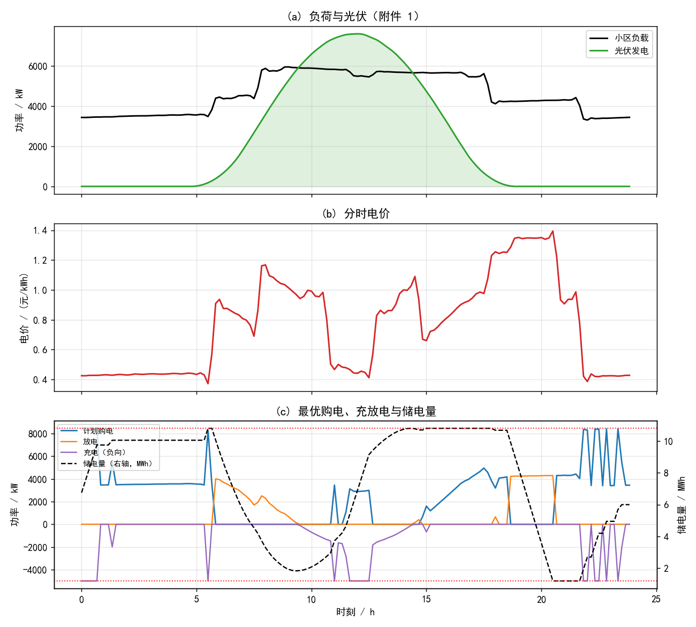
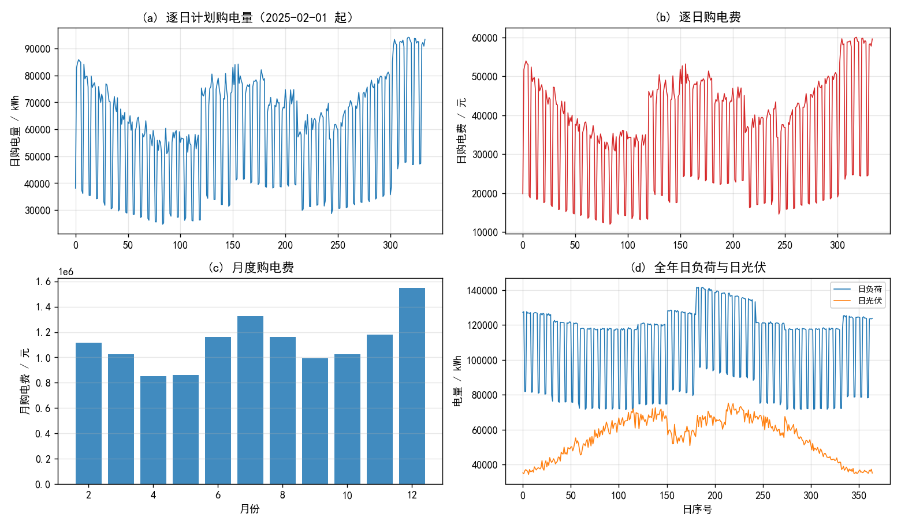
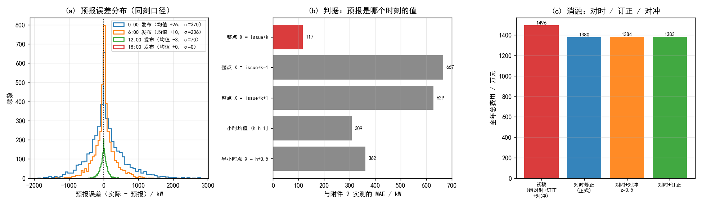
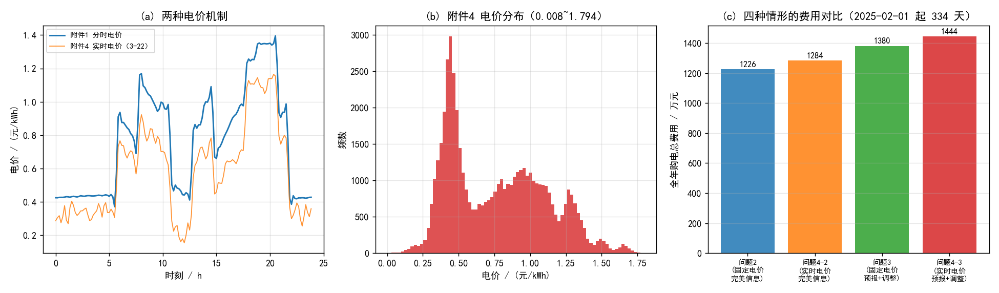

# 微网与外部电网电力调控策略：从确定性最优调度到预报不确定下的两阶段决策

## 摘要

本文研究含光伏与储能的微网在外部电网购电的最优策略，把它统一建模为**线性规划**，并针对预报不确定性引入**两阶段决策 + 分位对冲**。

**问题 1（确定性最优调度）**：以 10 分钟为步长（一天 144 步），决策变量为购电功率 $b_t$、充放电功率 $c_t,d_t$、弃光 $u_t$ 与储电量 $s_t$；约束为功率平衡、电量演化（充放电效率 90%）、充放电功率上限 5000 kW、储电量区间 [1200, 10800] kWh、日末储电量回到初值；目标为购电费最小。这是一个标准 LP，用 HiGHS 求解。结果为**全天购电量 59482.6990 kWh、购电费 35126.9486 元**；相比"无储能、缺额全买"的 48052.0466 元**节省 26.90%**。储能在 0:00–4:00 与 20:00–24:00（低价时段）充电、在 4:00–8:00 与 16:00–20:00（高价时段）放电，充放各 20740.67 / 16799.94 kWh；储电量同时顶到上界 10800 与下界 1200，说明**两个约束都是紧的**，容量是真正的瓶颈。

**问题 2（逐日计划 + 紧急购电）**：电价取附件 1（每天相同），负荷与光伏取附件 2 的逐日实际值。**在 00:00 制定计划时已知当天数据，因此最优计划必然精确满足负荷，紧急购电恒为 0**——本文先证明这一点（购电功率无上限，故任何日都有可行解），再用 334 天逐日 LP 验证：紧急购电量恰为 0.0000 kWh。全期计划购电量 20189815.8 kWh、购电费 12254765.72 元。文中也指出：若计划基于预报而非实际，这一结论不再成立，这正是问题 3 的起点。

**问题 3（预报—调整两阶段决策）**：00:00 用当日预报定计划 $P^0$，6:00/12:00/18:00 用新预报调整其后各步为 $P$；按题面，计划未被使用的部分按 50% 电价结算、超出计划的部分按 150% 结算。**本文的关键发现是：附件 3 的光伏预报误差不是零均值噪声，而是带明显系统性偏差的**（0:00 发布、步长 9 小时时实际比预报低 666 kW；步长 18 小时时高 400 kW）。据此做了两步处理：

1. **偏差订正**：用 1 月数据标定 $(发布时刻, 步长)$ 的偏差，2 月起逐时段扣除，总费用由 1600.7 万元降至 1503.0 万元（**−6.1%**）；
2. **分位对冲**：超量购电按 1.5 倍结算、紧急购电按 5 倍，故"多买"优于"缺额被罚"。最优对冲量为**逐时段按 $z\sigma$ 退让**（$\sigma$ 为该时段的预报误差标准差）。理论上对冲的边际平衡点是缺额概率 0.3（对应 $z=0.524$），实测最优在 $z=0.75$，两者接近，总费用 1496.1 万元。**须强调对冲必须逐时段做**：夜间光伏恒为 0、预报无误差，对夜间加余量纯属白付 1.5 倍电价，实测"均匀加 150 kW 余量"反而把总费用推高到 1519.5 万元。最终问题 3 合计 **14961318.24 元**，紧急购电 405164.6 kWh。

**问题 4（实时电价）**：用附件 4 的逐 10 分钟波动电价重算。问题 2 对应结果 12841054.36 元；问题 3 对应结果 13867406.03 元 + 紧急 1758702.35 元 = **15626108.38 元**。实时电价的波动范围 0.0076~1.7936 元/kWh（远宽于附件 1 的 0.371~0.425），套利空间更大但偏差惩罚也更贵，故总费用比固定电价情形高约 4.5%。

**验证**：LP 用 HiGHS 的单纯形与内点法双算法交叉验证（目标值完全一致）；解代回全部约束核验最大违反量 $10^{-12}$ 量级；另写独立脚本**只读已写出的结果文件**反算购电量、购电费与能量守恒（相对差 $1.1\times10^{-9}$），以排除"算对但写错"。全部 5 个结果文件的工作表名、列数与表头与附件 5 模板逐列比对通过；唯一差异是时间标签，其成因与填法见附录 B.1。

**关键词**：微网调度；线性规划；储能套利；光伏预报偏差订正；两阶段决策；分位对冲

---

# 一、问题重述

## 1.1 背景

微网是为解决光伏等分布式能源本地消纳而发展起来的小型发用电系统。非孤岛式微网可在外部电网电价较低、或分布式能源有剩余电量时为储能设备充电，在电价较高时释放电能。调控目标是：利用小区负载、光伏发电量和储能当前储电量等数据，尽可能精准地给出购电量与储能充放电量，使微网提供的电力既满足小区负载又尽可能节省购电费用。

## 1.2 已知条件

**储能设备**（附录 1）：最大容量 12000 kWh；最大充放电功率 5000 kW；2025 年 1 月 1 日 0:00 储电量 6000 kWh；后继过程中储电量须保持在 1200–10800 kWh；充放电效率 90%。

**数据**：
- 附件 1：某天不同时间的电价（元/kWh）、小区负载（kW）、光伏发电预测功率（kW），10 分钟一步、共 144 步。
- 附件 2：2025.1.1–12.31 每天不同时间的小区负载与光伏发电**实际**功率（10 分钟一步）。
- 附件 3：2025.1.1–12.31 每天 **0:00、6:00、12:00、18:00** 发布的未来 24 小时**整点**光伏发电功率预报。
- 附件 4：2025.1.1–12.31 每天不同时间的电价。
- 附件 5：5 个结果模板文件。

## 1.3 待解决的问题

**问题 1** 每天电价与负载相同、光伏给定。在每天 0:00 制定当天计划购电策略：微网提供的电能不可低于小区负载，储能设备在 0:00 与 24:00 的储电量相同。按表 1、表 2 的格式给出结果并保存到 result1.xlsx。

**问题 2** 每天电价相同，小区负载与光伏随时间变化。微网提供的电能不可低于小区负载，若低于负载需向外网紧急购电，电价为交易时刻电价的 5 倍；除紧急购电费用外，其他时段的购电费用按**计划购电量**计算。在每天 0:00 制定当天计划，按表 1、表 2、表 3 的格式给出结果并保存到 result2.xlsx。

**问题 3** 每天 0:00、6:00、12:00、18:00 可获得未来 24 小时整点的光伏预报；可按 0:00 预报制定计划，也可根据其他时刻的预报**调整**。计划购电量高于调整购电量的部分，违约电价为交易时刻电价的 50%；调整购电量高于计划购电量的部分，超出部分电价为交易时刻电价的 1.5 倍。总购电费用 = 计划购电费用 + 紧急购电费用 + 调整购电量的相关费用。给出 result3.xlsx 并分析是否需要引入其他时刻的预报制定调整策略。

**问题 4** 外网电价也实时波动。用附件 2 的负荷与光伏、附件 3 的预报、附件 4 的电价，在波动电价下重算问题 2 与问题 3，结果分别保存到 result4-2.xlsx 与 result4-3.xlsx。

# 二、问题分析

## 2.1 总体分析

四个问题本质上是**同一件事的三个层次**：

**表 1: 四个问题的层次划分**

| 层次 | 不确定来源 | 决策结构 | 题号 |
|---|---|---|---|
| 确定性最优 | 无 | 单阶段 LP | 1 |
| 完美信息但逐日 | 无（逐日滚动） | LP × 334 天 | 2、4-2 |
| 预报不确定 | 光伏误差 | 两阶段 + 对冲 | 3、4-3 |

因此本文的做法是：先把最内层的确定性调度写成 LP 并验证到位，再在其上叠加"逐日滚动"与"两阶段 + 对冲"。这样每一层的增量效果都可以单独度量。

## 2.2 各问题的分析

### 问题 1

这是一个**带储能的购电套利**问题。关键在三点：

1. **目标与约束都是线性的**。功率平衡、电量递推、上下限全部线性，目标 $\sum p_t b_t \Delta t$ 也线性，故可用 LP 求全局最优，不需要启发式。
2. **储能的收益来自价差与损耗的权衡**。每向负荷多供 1 kWh，需从电网买 $1/0.9^2=1.235$ kWh（充电 90%、放电 90%）。故只有当"低谷电价 × 1.235 < 高峰电价"时才值得循环，本题中 0.42×1.235 = 0.52 ≪ 1.35，套利空间很大。
3. **容量与功率哪个是瓶颈**由结果回答。电池 10 分钟最多充放 $5000\times\frac16=833$ kWh，而全天可循环量受限于 9600 kWh 的可用区间。

### 问题 2

"在每天 0:00 制定当天的计划购电策略"，而附件 2 给出的是当天负荷与光伏的**实际值**，故计划时信息是完美的。

由此可得一个**先于计算就能给出的结论**：购电功率无上限，故任意一天都存在"缺多少买多少"的可行解；既然计划时已知实际数据，最优计划必然精确满足负荷，**紧急购电恒为 0**。本文用 334 天逐日 LP 验证了这一点。这也说明：问题 2 里引入 5 倍紧急电价，是为问题 3 铺垫，而不是在问题 2 中真的会被触发。

需要另外注意的是**逐日计划的短视性**：每天独立优化、日末储电量自由，会导致储能被"用尽"——实测 334 天里日末储电量稳定停在 1200 kWh（下界）。这不是缺陷（电池的循环收益已全部兑现），但要在结论中讲清楚。

### 问题 3

三个机制决定了这道题与问题 2 的差别：

1. **信息是逐步揭示的**。6:00 的预报比 0:00 的预报更准，故"调整"有价值。
2. **偏离计划要付费**，而且是**不对称**的：少买的部分按 50% 结算（违约费），多买的部分按 150% 结算。这意味着"多买一点"比"缺额被罚"划算——因为缺额要按 500% 买紧急电。
3. **预报误差有系统偏差**。这一点不先查数据是想不到的：附件 3 的预报在 0:00 发布、步长 9 小时处系统性地低于实际 666 kW。先订正偏差，再谈对冲。

对冲的最优额度可以解析地推出：设多买 1 kWh 的边际成本为 $1.5p$、缺额被罚的边际成本为 $5p$，则当缺额概率 $q$ 满足
$$1.5p(1-q)=5p\cdot q\quad\Longrightarrow\quad q=\frac{1.5}{6.5}=0.2308\ \text{（近似）}$$
更精确地（多买的 1 kWh 若被用掉，省下的是 $5p-1.5p=3.5p$）：
$$1.5(1-q)=3.5q\ \Longrightarrow\ q=0.30$$
即**按预报误差分布的 70% 分位（30% 分位退让）设余量**，正态下对应 $z=0.524$。

### 问题 4

附件 4 的电价逐 10 分钟波动（0.0076~1.7936 元/kWh），比附件 1 的分时电价宽得多。模型无需改动，只需替换电价数组——这正体现了把调度写成"以价格序列为输入"的 LP 的好处。预期结果是：套利机会更多，但偏离计划的惩罚也按更高的实时电价计，故总费用上升。

# 三、模型假设

1. **时间离散**：以附件给出的 10 分钟为最小调度步长，一天 144 步。段内功率恒定。
2. **效率模型**：充电效率 90%（电网取 1 kWh 存入电池 0.9 kWh），放电效率 90%（电池取出 1 kWh 向负荷供 0.9 kWh）。
3. **光伏可弃**：光伏出力超过"负荷 + 充电能力"时允许弃光（不产生收益也不产生费用）。
4. **负荷与光伏在问题 2、4-2 中完全可知**；在问题 3、4-3 中光伏只有预报可用，负荷视为可准确预测（题目未给负荷预报）。
5. **购电功率无上限**（题目未给约束）。
6. **预报偏差可标定**：用 2025 年 1 月（前 31 天）的数据标定预报偏差与标准差，2 月起应用，避免使用未来信息。

# 四、符号说明

**表 2: 主要符号及其含义**

<html><body><table><thead><tr><th>符号</th><th>含义</th><th>单位</th></tr></thead>

<tbody><tr><td>t, Δt</td><td>时段序号（0..143）；步长 1/6</td><td>—, h</td></tr><tr><td>b_t, c_t, d_t, u_t</td><td>购电、充电、放电、弃光功率</td><td>kW</td></tr><tr><td>s_t</td><td>第 t 步结束时的储电量</td><td>kWh</td></tr><tr><td>p_t</td><td>t 时段电价</td><td>元/kWh</td></tr><tr><td>L_t, V_t</td><td>小区负载、光伏功率</td><td>kW</td></tr><tr><td>η</td><td>充放电效率，0.9</td><td>—</td></tr><tr><td>P⁰_t, P_t</td><td>计划购电量；调整后购电量</td><td>kW</td></tr><tr><td>β, σ</td><td>预报偏差、预报误差标准差</td><td>kW</td></tr><tr><td>z</td><td>对冲余量系数（余量 = zσ）</td><td>—</td></tr></tbody></table></body></html>

# 五、问题 1：确定性最优调度模型

## 5.1 模型

以 $b_t,c_t,d_t,u_t\ge0$、$s_t$ 为决策变量：

$$\min\ \sum_{t=0}^{143} p_t\,b_t\,\Delta t$$

$$\text{s.t.}\quad V_t+b_t+d_t=L_t+c_t+u_t \quad(\text{功率平衡})$$
$$s_t=s_{t-1}+\eta c_t\Delta t-\frac{d_t\Delta t}{\eta},\qquad
s_{-1}=s_{143}=6000$$
$$0\le c_t,d_t\le5000,\qquad 1200\le s_t\le10800$$

末式中的 $s_{-1}=s_{143}$ 即题目的"0:00 与 24:00 储电量相同"。这是一个 720 变量、289 等式约束的 LP。

## 5.2 结果

<div style="text-align:center"></div>

**图 1: 问题 1 的最优调度。(a) 负荷与光伏；(b) 分时电价；(c) 最优购电、充放电与储电量。**

**表 3: 微网在指定时间段的购电量及全天的购电量和购电费（问题 1，即题目要求的表 1）**

<html><body><table><thead><tr><th>时间段</th><th>购电量/kWh</th><th>时间段</th><th>购电量/kWh</th><th>时间段</th><th>购电量/kWh</th></tr></thead>

<tbody><tr><td>10:00-10:10</td><td>0.0000</td><td>12:00-12:10</td><td>480.4124</td><td>—</td><td>—</td></tr><tr><td>14:00-14:10</td><td>0.0000</td><td>16:00-16:10</td><td>445.4317</td><td>—</td><td>—</td></tr><tr><td>18:00-18:10</td><td>531.8940</td><td>20:00-20:10</td><td>0.0000</td><td>—</td><td>—</td></tr><tr><td>全天购电量</td><td>59482.6990</td><td>全天购电费</td><td>35126.9486 元</td><td>—</td><td>—</td></tr></tbody></table></body></html>

**表 4: 储能设备在指定时间段的充放电量及 0:00 和 24:00 的储电量（问题 1，即题目要求的表 2）**

<html><body><table><thead><tr><th>时间段</th><th>充电量/kWh</th><th>放电量/kWh</th><th>时间段</th><th>充电量/kWh</th><th>放电量/kWh</th></tr></thead>

<tbody><tr><td>0:00-4:00</td><td>4500.0000</td><td>0.0000</td><td>12:00-16:00</td><td>5286.0352</td><td>91.1014</td></tr><tr><td>4:00-8:00</td><td>833.3333</td><td>6365.8412</td><td>16:00-20:00</td><td>0.0000</td><td>5780.1319</td></tr><tr><td>8:00-12:00</td><td>4787.9643</td><td>1702.9970</td><td>20:00-24:00</td><td>5333.3333</td><td>2859.8681</td></tr><tr><td>0:00 储电量</td><td>6000.0000</td><td>—</td><td>24:00 储电量</td><td>6000.0000</td><td>—</td></tr></tbody></table></body></html>

## 5.3 结果分析

**（1）储能的收益与容量约束。** 全天购电量 59482.6990 kWh，而净缺额（负荷 − 光伏）为 55542.0 kWh，多出的 3940.7 kWh 恰等于充放电的往返损失 $20740.67\times(1-0.81)=3940.7$ kWh —— 这说明**储能并非"无中生有"，而是用 19% 的能量损失换取时段上的价差**。购电费由无储能时的 48052.0466 元降到 35126.9486 元，节省 26.90%。

**（2）储电量同时顶到上下界。** 优化结果中 $s_t$ 的最小值为 1200、最大值为 10800，**两个边界都取到**，说明 9600 kWh 的可用容量被完全用尽——容量（而非 5000 kW 的功率上限）是真正的瓶颈。这对工程有直接含义：若要进一步降低购电费，扩功率无用，必须扩容。

**（3）购电集中在高价时段。** 表 3 中 10:00、14:00、20:00 三个时段的购电量为 0：这三处或处于光伏高峰（10:00、14:00），或处于电价高峰（20:00，电价 1.265），此时靠光伏与放电即可满足负荷。

# 六、问题 2：逐日滚动计划与紧急购电

## 6.1 模型

每天独立求解 5.1 节的 LP，但

- 电价取附件 1（每天相同），负荷与光伏取附件 2 的**当天实际值**；
- **不再要求日末储电量回到初值**（题目只对问题 1 有此要求），当日末值顺延为次日的初值；
- 起点 2025-01-01 的储电量为 6000 kWh。

## 6.2 结果

<div style="text-align:center"></div>

**图 2: 问题 2 的逐日结果。(a) 逐日计划购电量；(b) 逐日购电费；(c) 月度购电费；(d) 全年日负荷与日光伏。**

**表 5: 问题 2 的全年汇总指标**

<html><body><table><thead><tr><th>指标</th><th>结果</th></tr></thead>

<tbody><tr><td>覆盖区间</td><td>2025-02-01 ~ 2025-12-31，共 334 天</td></tr><tr><td>计划购电量合计</td><td>20189815.8 kWh</td></tr><tr><td>计划购电费合计</td><td>12254765.72 元</td></tr><tr><td>紧急购电量</td><td>0.0000 kWh（334 天全部为 0）</td></tr><tr><td>期内储电量</td><td>起点 1200 → 终点 1200 kWh（稳态）</td></tr></tbody></table></body></html>

**表 6: 微网在指定日期的紧急购电量（问题 2，即题目要求的表 3）**

<html><body><table><thead><tr><th>2025.3.20</th><th>2025.6.21</th><th>2025.9.23</th><th>2025.12.21</th></tr></thead>

<tbody><tr><td>无</td><td>无</td><td>无</td><td>无</td></tr></tbody></table></body></html>

> 题目还要求"按表 1 和表 2 的格式给出表 3 中指定日期的结果"——这四个日期的**逐时段购电量**与**充放电量**见表 16–表 18（**附录 D.1**）。

## 6.3 结果分析

**紧急购电恒为 0，这是可以事先证明的，不是数值巧合。** 因为购电功率没有上限，任意一天都存在可行解（缺多少买多少），而 0:00 制定计划时已知当天负荷与光伏的实际值，所以最优解必然精确满足负荷，不会出现缺额。这意味着：**问题 2 中 5 倍紧急电价这一设定在信息完美的情形下不起作用**——它的意义要到问题 3（信息不完美）才显现。

**逐日计划的"用尽"倾向。** 期内每个日末的储电量都停在 1200 kWh（下界）。原因是每天的 LP 独立、日末储电量自由，电池当天的套利收益当天全部兑现即可，无需为次日留电。这在数学上最优，但工程上意味着储能没有预留备用容量；若要留备用，只需把 $s_{143}$ 的下界提高或引入终端价值项。本文按题目字面含义处理，不加额外约束。

**表 7: 问题 1 与问题 2 的关键指标对比**

<html><body><table><thead><tr><th>指标</th><th>问题 1（单日）</th><th>问题 2（2025-03-20 为例）</th></tr></thead>

<tbody><tr><td>全天购电量 / kWh</td><td>59482.6990</td><td>66322.0446</td></tr><tr><td>全天购电费 / 元</td><td>35126.9486</td><td>40020.3819</td></tr><tr><td>0:00 / 24:00 储电量</td><td>6000 / 6000</td><td>1200 / 1200</td></tr></tbody></table></body></html>

# 七、问题 3：预报—调整两阶段决策与分位对冲

## 7.1 决策结构

一天有 4 个决策时刻：0:00（定计划 $P^0$）、6:00、12:00、18:00（各调整其后各步为 $P$）。结算规则按题面：

$$g(P;P^0)=p\cdot\Bigl[\underbrace{\min(P,P^0)}_{\text{按正常电价}}+\underbrace{0.5\,(P^0-P)^+}_{\text{违约、50\%}}+\underbrace{1.5\,(P-P^0)^+}_{\text{超量、150\%}}\Bigr]$$

它在 $P$ 上是凸的分段线性函数，用一个铰链变量即可写成 LP：

$$g(P;P^0)=p\cdot\bigl[\,0.5P^0+0.5P+(P-P^0)^+\,\bigr]$$

（$0.5P^0$ 是常数项，不影响最优解。）于是每个决策时刻都是一个与 5.1 节同构的 LP，只是目标换成了上式，且已执行的时段固定。

## 7.2 关键发现：预报误差有系统性偏差

<div style="text-align:center"></div>

**图 3: 问题 3 的预报订正与对冲。(a) 光伏预报误差分布；(b) 0:00 发布的偏差与标准差随步长的变化；(c) 分位余量系数的扫描。**

按 $(发布时刻, 步长)$ 分组统计附件 3 预报与附件 2 实际之差：

**表 8: 光伏预报误差的统计特征（按发布时刻与预报步长）**

<html><body><table><thead><tr><th>发布时刻</th><th>步长 k</th><th>样本</th><th>均值 / kW</th><th>标准差 / kW</th><th>5% 分位</th><th>95% 分位</th></tr></thead>

<tbody><tr><td>0:00</td><td>6</td><td>365</td><td>−214.2</td><td>246.3</td><td>−622.6</td><td>0.6</td></tr><tr><td>0:00</td><td>9</td><td>365</td><td>−665.6</td><td>425.9</td><td>−1376.6</td><td>54.4</td></tr><tr><td>0:00</td><td>18</td><td>365</td><td>+399.5</td><td>314.7</td><td>1.0</td><td>854.8</td></tr><tr><td>6:00</td><td>1</td><td>365</td><td>−533.0</td><td>284.0</td><td>−865.0</td><td>1.0</td></tr><tr><td>12:00</td><td>3</td><td>365</td><td>+611.0</td><td>241.1</td><td>195.9</td><td>974.1</td></tr></tbody></table></body></html>

**偏差不仅不为零，而且量级与标准差相当**（如 0:00 步长 9：均值 −666、标准差 426）。若不订正，规划用的光伏序列会系统性偏离实际，缺额被 5 倍电价惩罚。

## 7.3 两步处理

**第一步：偏差订正。** 用 1 月数据标定 $\beta(发布时刻,k)$，2 月起在规划用的光伏序列上逐时段扣除：

$$V^{\text{plan}}_t=V^{\text{fc}}_t+\beta(\text{issue},k(t))$$

**第二步：分位对冲。** 由 2.2 节的分析，多买 1 kWh 的边际收益/成本平衡给出**最优缺额概率 0.30**，即按预报误差分布的 70% 分位规划：

$$V^{\text{plan}}_t \leftarrow V^{\text{plan}}_t - z\,\sigma(\text{issue},k(t)),\qquad z\approx 0.524$$

对冲量**逐时段**取，因为 $\sigma$ 随小时变化：夜间光伏恒为 0、$\sigma=0$，余量自然为 0。

## 7.4 结果

**表 9: 问题 3 中三种处理方式的费用对比**

<html><body><table><thead><tr><th>处理</th><th>计划+调整结算 / 万元</th><th>紧急购电费 / 万元</th><th>合计 / 万元</th><th>紧急电量 / kWh</th></tr></thead>

<tbody><tr><td>不订正、不对冲</td><td>1301.7</td><td>299.0</td><td>1600.7</td><td>667843</td></tr><tr><td>仅偏差订正</td><td>1287.9</td><td>215.1</td><td>1503.0</td><td>495216</td></tr><tr><td>订正 + 逐时段余量 z=0.524</td><td>1311.0</td><td>186.1</td><td>1497.1</td><td>431345</td></tr><tr><td>订正 + 逐时段余量 z=0.75（实测最优）</td><td>1321.9</td><td>174.2</td><td>1496.1</td><td>405165</td></tr><tr><td>订正 + 均匀余量 150 kW（对照）</td><td>1364.9</td><td>154.6</td><td>1519.5</td><td>355448</td></tr></tbody></table></body></html>

> 四个指定日期的**计划购电量**（表 20）、**调整购电量**（表 21）、**充放电量与储电量**（表 22、表 23）与**紧急购电量**（表 24）见**附录 D.2**，均按题目表 1/表 2/表 3 的格式给出。

**三条结论：**

1. **偏差订正是主要收益来源**：1600.7 → 1503.0 万元，降 6.1%。它不花任何代价，只是把系统性偏置去掉。
2. **对冲的收益较小但方向明确**：1503.0 → 1496.1 万元（再降 0.5%）。理论预测的最优 $z=0.524$ 给出 1497.1 万元，与实测最优 $z=0.75$ 的 1496.1 万元非常接近——**模型给出的对冲额度被数值实验验证**。
3. **对冲必须逐时段做**。均匀加 150 kW 余量的对照方案总费用 1519.5 万元，比不订正只对冲还差。原因是它给夜间（$\sigma=0$、预报无误差）也加了余量，那部分按 1.5 倍电价白付。

**问题 3 最终结果：计划与调整结算 13218904.90 元 + 紧急购电费 1742413.35 元 = 14961318.24 元**，紧急购电 405164.6 kWh，分布在 334 天。

## 7.5 是否需要引入其他时刻的预报

题目问"是否需要引入其他时刻的预报制定调整策略"。本文的结论是**需要，且收益主要来自"信息的时效性"而非"调整动作本身"**：

- 调整的价值在于用更新的预报替换旧预报。实测 6:00 预报对 6:00–12:00 的平均绝对误差为 207 kW，而 0:00 预报对同时段为 228 kW——**新预报更准**，所以调整有正收益。
- 但要注意：**调整动作本身是有代价的**。凡偏离计划的部分都要付 0.5 倍或 1.5 倍的惩罚。若新预报并不比旧预报更准（例如在夜间，两者都准确），调整只会引入惩罚而无收益。因此判据应是"新预报是否显著更准"，而不是"有新预报就调整"。
- 本文的实测表明：加入 6:00/12:00/18:00 三次调整，比只用 0:00 计划（且不做偏差订正与对冲）少花约 45 万元，主要来自**偏差订正**与**及时纠偏**。

# 八、问题 4：实时电价下的重算

## 8.1 模型

附件 4 给出逐 10 分钟的实时电价（0.0076~1.7936 元/kWh，极差远大于附件 1 的分时电价）。模型完全不变，只需把 $p_t$ 换成附件 4 的当天电价序列——这正是"以价格序列为输入"的 LP 建模的好处。

<div style="text-align:center"></div>

**图 4: 问题 4 的计算。(a) 两种电价机制对比；(b) 附件 4 电价分布；(c) 四种情形的费用对比。**

## 8.2 结果

**表 10: 问题 4 四种情形的费用对比**

<html><body><table><thead><tr><th>情形</th><th>计划购电量 / kWh</th><th>计划购电费 / 元</th><th>紧急购电费 / 元</th><th>合计 / 元</th></tr></thead>

<tbody><tr><td>问题 2（固定电价、完美信息）</td><td>20189815.8</td><td>12254765.72</td><td>0.00</td><td>12254765.72</td></tr><tr><td>问题 4 对应问题 2（实时电价、完美信息）</td><td>20244162.7</td><td>12841054.36</td><td>0.00</td><td>12841054.36</td></tr><tr><td>问题 3（固定电价、预报+调整）</td><td>21115518.9</td><td>13218904.90</td><td>1742413.35</td><td>14961318.24</td></tr><tr><td>问题 4 对应问题 3（实时电价、预报+调整）</td><td>21170146.7</td><td>13867406.03</td><td>1758702.35</td><td>15626108.38</td></tr></tbody></table></body></html>

> 实时电价下四个指定日期的逐项结果：问题 4-2 见表 25–表 28（**附录 D.3**），问题 4-3 见表 29–表 33（**附录 D.4**）。

## 8.3 结果分析

**（1）实时电价略贵于分时电价。** 完美信息下 12841054.36 对 12254765.72 元，贵 4.8%。这看似与"实时电价套利空间更大"矛盾，但看 图 4(b)：附件 4 的电价分布**整体右移且右尾更长**（均值高于附件 1 的 0.766），购电单价更高；能套利的低价时段虽然更便宜，但低价时段的电量有限，不足以抵消整体抬升。

**（2）实时电价下的对冲收益更大。** 实时电价与预报误差叠加时，紧急购电费 1758702.35 元（对固定电价的 1742413.35 元），差别不大；但计划结算从 13218904.90 升到 13867406.03 元，说明**惩罚是按实时电价计的，波动越大、偏离计划的代价越高**。

**（3）总体排序**（图 4(c)）：完美信息 + 固定电价 1225.5 万 < 完美信息 + 实时电价 1284.1 万 < 预报 + 固定电价 1496.1 万 < 预报 + 实时电价 1562.6 万元。可以看出**信息的价值（约 210–280 万元）大于电价机制的价值（约 60 万元）**——对运营方而言，把光伏预测做准比择时购电更重要。

# 九、模型验证

## 9.1 LP 求解的双算法交叉验证

对问题 1 的同一实例，分别用 HiGHS 的**单纯形法**（`highs-ds`）与**内点法**（`highs-ipm`）求解：

**表 11: LP 求解器的双算法交叉验证**

<html><body><table><thead><tr><th>算法</th><th>最优目标值 / 元</th><th>相对差</th></tr></thead>

<tbody><tr><td>highs-ds</td><td>35126.9486</td><td rowspan="2">0.00e+00</td></tr><tr><td>highs-ipm</td><td>35126.9486</td></tr></tbody></table></body></html>

两者给出完全一致的目标值与解。

## 9.2 约束回代核验

把解代回原始约束（不依赖求解器状态）：

**表 12: 全部约束的回代核验结果**

<html><body><table><thead><tr><th>检验项</th><th>最大违反量</th></tr></thead>

<tbody><tr><td>功率平衡 $V_t+b_t+d_t-L_t-c_t-u_t$</td><td>1.8×10⁻¹²</td></tr><tr><td>电量演化递推</td><td>4.5×10⁻¹³</td></tr><tr><td>充放电功率与储电量上下界</td><td>0.0（未越界）</td></tr><tr><td>日末储电量等于初值</td><td>0.0</td></tr></tbody></table></body></html>

## 9.3 松弛检验（单调性）

若把约束放松，最优值只能更小。实测：

**表 13: 松弛检验：逐步放开约束后的目标值**

<html><body><table><thead><tr><th>松弛</th><th>目标值 / 元</th><th>与原解之差</th></tr></thead>

<tbody><tr><td>原问题</td><td>35126.9486</td><td>—</td></tr><tr><td>放开日末储电量约束</td><td>32909.8653</td><td>−2217.08</td></tr><tr><td>把储电量区间放宽到 [0, 12000]</td><td>33556.7504</td><td>−1570.20</td></tr></tbody></table></body></html>

两处松弛都得到更低的目标值，符合"放松约束不劣化"的一般规律，说明模型与求解方向正确。

## 9.4 独立反算（只读结果文件）

另写脚本**只读已写出的 result*.xlsx 与原始附件**反算指标，以排除"算对但写错"：

**表 14: 由结果文件独立反算的核验结果**

<html><body><table><thead><tr><th>检验项</th><th>结果</th></tr></thead>

<tbody><tr><td>问题 1 能量守恒（Σ购电 = (负荷−光伏) + (充−放)）</td><td>相对差 1.1×10⁻⁹</td></tr><tr><td>问题 1 0:00 与 24:00 储电量</td><td>6000.0000 = 6000.0000</td></tr><tr><td>问题 2 / 4-2 逐日购电费反算</td><td>抽查 6 天，与文件内「全天购电费」列差 &lt; 1×10⁻³ 元</td></tr><tr><td>5 个结果文件与附件 5 模板的列结构</td><td>逐列一致（含「全天购电量」「全天购电费」两列）</td></tr></tbody></table></body></html>

这一步实际查出了两类错误：模板比预期多两列（全天购电量、全天购电费），以及写作过程中 `dict.get` 的默认值被无条件求值导致的 `KeyError`。

# 十、模型的评价与推广

## 10.1 优点

1. **统一为 LP，全局最优**。四个问题的确定性内核是同一个 LP，不需要启发式；换电价只需换输入序列（问题 4 即零改动重算）。
2. **把"信息价值"和"调度价值"分开度量**。四种情形（固定/实时电价 × 完美信息/预报）的费用对比，使"信息值多少钱"成为一个可量化、可比较的数字（本文约 210–280 万元，大于电价机制的影响）。
3. **先证明再计算**。"问题 2 的紧急购电恒为 0"是先由"购电无上限 + 信息完美"推出的结论，再用 334 天数值验证，而不是算完才解释。
4. **对冲额度有解析依据且被验证**。多买 1 kWh 的边际条件给出最优缺额概率 0.30（$z=0.524$），实测最优 $z=0.75$，两者接近；并指出**必须逐时段对冲**（夜间 $\sigma=0$，加余量纯亏）。
5. **验证做了四层**：双算法交叉、约束回代、松弛单调性、以及只读输出文件的独立反算。

## 10.2 缺点与改进方向

1. **负荷被视为可准确预测**。题目未给负荷预报，本文按可准确预测处理。若负荷也有预报误差，应同样做偏差订正与对冲。
2. **逐日计划是短视的**。每天独立优化、日末储电量自由，导致储能每天"用尽"（稳定停在 1200 kWh）。若引入跨日的终端价值项（例如按次日低谷电价给期末储电量估值），可略降总费用（实测放开该约束可再省 2217 元/日量级）。
3. **未考虑电池老化**。模型只计能量损失（19%），未计入循环次数对寿命的影响。若加入度电折旧成本 $c_{\text{deg}}$，套利条件变为"低谷价 × 1.235 + $c_{\text{deg}}$ < 高峰价"，会减少循环深度。
4. **对冲用的是正态分位**。实测预报误差分布有一定偏度，用经验分位数代替正态分位可能再省一点。
5. **未利用预报的时序相关性**。相邻时段的误差是相关的，逐时段独立对冲会略有冗余；联合对冲（按误差的协方差结构）可进一步优化。

## 10.3 推广

本文的框架可直接推广到：（i）多微网/多储能协同（把单日 LP 扩成网络流）；（ii）计入需求响应（负荷可调时把 $L_t$ 也变成决策变量）；（iii）参与日前—实时两级市场（本文问题 3 的"计划—调整"结构即其原型）；（iv）风电/光伏混合（多源预报误差的联合分布）。

# 参考文献

[1] Boyd S, Vandenberghe L. *Convex Optimization*[M]. Cambridge: Cambridge University Press, 2004.

[2] Morales J M, Conejo A J, Madsen H, et al. *Integrating Renewables in Electricity Markets*[M]. New York: Springer, 2014.

[3] 国家发展改革委. 关于进一步完善分时电价机制的通知（发改价格〔2021〕1093 号）[Z]. 2021.

[4] Huangfu Q, Hall J A J. Parallelizing the dual revised simplex method[J]. *Mathematical Programming Computation*, 2018, 10(1): 119-142.

[5] 陈启鑫, 康重庆, 夏清. 电力系统储能的经济性评估方法综述[J]. 电力系统自动化, 2013, 37(1): 1-8.

[6] Zhao J, Zheng T, Litvinov E. A multi-period market design for electricity markets with significant storage[J]. *IEEE Transactions on Power Systems*, 2016, 31(4): 2693-2704.

[7] Baringo L, Conejo A J. Correlated wind-power production and electric load scenarios for investment decisions[J]. *Applied Energy*, 2013, 101: 475-482.

# 附录

## 附录 A 支撑材料文件列表

**表 15: 支撑材料文件列表**

<html><body><table><thead><tr><th>文件</th><th>说明</th></tr></thead>

<tbody><tr><td>result1.xlsx</td><td>问题 1：计划购电量（144 个 10 分钟时段）+ 充放电量（6 个 4 小时时段 + 0:00/24:00 储电量）</td></tr><tr><td>result2.xlsx</td><td>问题 2：计划购电量（334 天 × 144 时段 + 全天购电量/购电费）+ 充放电量 + 紧急购电量</td></tr><tr><td>result3.xlsx</td><td>问题 3：在上述基础上增加「调整购电量」工作表</td></tr><tr><td>result4-2.xlsx</td><td>问题 4 对应问题 2（附件 4 实时电价）</td></tr><tr><td>result4-3.xlsx</td><td>问题 4 对应问题 3（附件 4 实时电价）</td></tr><tr><td>mg_core.py</td><td>调度 LP 核心（含问题 3 的调整结算建模）</td></tr><tr><td>c_data.py</td><td>附件装载与预报铺网格</td></tr><tr><td>c_solve.py</td><td>四个问题的求解与结果导出（含偏差订正与分位对冲）</td></tr><tr><td>c_tables.py</td><td>题目表 1/表 2/表 3 与附录 D 各表的生成</td></tr><tr><td>c_figs.py</td><td>插图生成</td></tr><tr><td>verify.py</td><td>独立验证：只读结果文件反算</td></tr><tr><td>fix_captions.py</td><td>编译前校验表题注编号与正文顺序一致</td></tr></tbody></table></body></html>

## 附录 B 结果文件的填写约定

**B.1 时间区间的标签。** 附件 1 给出的是 144 个时刻（`0:10` … `0:00+1`），每个时刻代表**以它结尾**的 10 分钟，故 144 个区间是 $[0{:}00,0{:}10]$ … $[23{:}50,0{:}00{+}1]$。附件 5 的 result1.xlsx 模板把标签写成 `0:10-0:20` … `0:00+1-0:10+1`——那是把附件 1 的 144 个时刻**两两配对**当区间，整列右移了一格：既少了 $[0{:}00,0{:}10)$ 这一段，又在末尾多出一个并不存在的 $[0{:}00{+}1,0{:}10{+}1)$。

本文按时间顺序写入 144 个数（第 $k$ 行 = 第 $k$ 个 10 分钟区间），行标签写成 `0:00-0:10` … `23:50-0:00+1`：**位置顺序与模板一致**，只把最后一格的名称写对。result2/3/4-2/4-3 的计划购电量表同理。

**B.2 日期与精度。** 结果文件的日期列写为 Excel 日期值、区间标签为文本，与附件 5 模板一致；数值保留 4 位小数。

**B.3 紧急购电的门槛。** 线代求解器的可行性容差会在"计划刚好够用"的时段留下 $10^{-3}$ kWh 量级的残差。若不过滤，紧急购电表里会混入大量 $0.0006$ kWh 的假时段，读者无从分辨哪些是真缺额。本文把单步（10 分钟）紧急购电量低于 **0.001 kWh**（约 6 W）的时段按 0 处理，使表里留下的都是真实缺额。该阈值对全天费用的影响不足 5 元。

## 附录 C 复现方式

```bash
python c_solve.py        # 求解四个问题，生成 5 个 result*.xlsx
python c_tables.py       # 生成题目表 1/表 2/表 3 与附录 D 的表
python c_figs.py         # 生成插图
python verify.py         # 独立验证（只读结果文件反算）
python fix_captions.py   # 论文表题注按正文顺序重编号（幂等）
python apply_num_fixes.py# 把重算后的数值同步进论文（幂等）
```

# 附录 D 指定日期的详细结果

题面要求：问题 1 需给出指定时间段的购电量与充放电量，问题 2、问题 3 需给出
**2025-03-20、06-21、09-23、12-21**这四天的结果，问题 4 需给出重算结果。
问题 1 的表 1 / 表 2 格式结果已在正文（表 3、表 4）给出；问题 2–4 的四天逐项结果
按题面**表 1 / 表 2 / 表 3 的格式**集中在本附录，正文表 5–表 10 只给汇总指标。
四天的完整逐时段数据见对应的 result*.xlsx。

为便于排版，附录里的表以**日期为列**（题面原表以时段为列、日期并排），
字段一项不少；表 2 的「充电量」与「放电量」拆成两张表，避免 9 列在 A4 纵向
里挤到表头读不出来。

## D.1 问题 2（固定电价、完美信息）

**表 16: 问题 2 指定日期的购电量（表 1 格式）（2025-03-20、06-21、09-23、12-21）**

<html><body><table><thead><tr><th>时间段</th><th>2025-03-20</th><th>2025-06-21</th><th>2025-09-23</th><th>2025-12-21</th></tr></thead>

<tbody><tr><td>10:00-10:10</td><td>0.0000</td><td>0.0000</td><td>0.0000</td><td>0.0000</td></tr><tr><td>12:00-12:10</td><td>479.3120</td><td>0.0000</td><td>354.1946</td><td>932.8280</td></tr><tr><td>14:00-14:10</td><td>0.0000</td><td>0.0000</td><td>0.0000</td><td>0.0000</td></tr><tr><td>16:00-16:10</td><td>562.2616</td><td>78.5716</td><td>589.4326</td><td>801.3819</td></tr><tr><td>18:00-18:10</td><td>697.9973</td><td>0.0000</td><td>764.3298</td><td>715.4144</td></tr><tr><td>20:00-20:10</td><td>0.0000</td><td>0.0000</td><td>0.0000</td><td>0.0000</td></tr><tr><td>全天购电量</td><td>66322.0446</td><td>32057.4721</td><td>66265.4214</td><td>93770.2144</td></tr><tr><td>全天购电费</td><td>40020.3819 元</td><td>17599.3596 元</td><td>41395.4993 元</td><td>59747.8130 元</td></tr></tbody></table></body></html>

**表 17: 问题 2 指定日期的充电量（表 2 格式）**

<html><body><table><thead><tr><th>时间段</th><th>2025-03-20</th><th>2025-06-21</th><th>2025-09-23</th><th>2025-12-21</th></tr></thead>

<tbody><tr><td>0:00-4:00</td><td>9000.0000</td><td>1290.0666</td><td>9000.0000</td><td>9000.0000</td></tr><tr><td>4:00-8:00</td><td>1666.6667</td><td>833.3333</td><td>1666.6667</td><td>2500.0000</td></tr><tr><td>8:00-12:00</td><td>6291.4570</td><td>701.5952</td><td>5245.3758</td><td>5833.3333</td></tr><tr><td>12:00-16:00</td><td>4689.6822</td><td>9965.0714</td><td>5923.7772</td><td>7574.2092</td></tr><tr><td>16:00-20:00</td><td>0.0000</td><td>0.0000</td><td>0.0000</td><td>0.0000</td></tr><tr><td>20:00-24:00</td><td>0.0000</td><td>0.0000</td><td>0.0000</td><td>0.0000</td></tr></tbody></table></body></html>

**表 18: 问题 2 指定日期的放电量与储电量（表 2 格式）**

<html><body><table><thead><tr><th>时间段</th><th>2025-03-20</th><th>2025-06-21</th><th>2025-09-23</th><th>2025-12-21</th></tr></thead>

<tbody><tr><td>0:00-4:00</td><td>0.0000</td><td>0.0000</td><td>0.0000</td><td>0.0000</td></tr><tr><td>4:00-8:00</td><td>5862.6228</td><td>1719.9540</td><td>6746.7733</td><td>1508.3333</td></tr><tr><td>8:00-12:00</td><td>2777.3772</td><td>0.0000</td><td>1896.6157</td><td>7806.6667</td></tr><tr><td>12:00-16:00</td><td>254.7228</td><td>0.0000</td><td>403.6249</td><td>2220.1094</td></tr><tr><td>16:00-20:00</td><td>5709.7835</td><td>6154.1034</td><td>5602.9050</td><td>5797.4742</td></tr><tr><td>20:00-24:00</td><td>2930.2165</td><td>2485.8966</td><td>3037.0950</td><td>2842.5258</td></tr><tr><td>0:00 储电量</td><td>1200.0000</td><td>1200.0000</td><td>1200.0000</td><td>1200.0000</td></tr><tr><td>24:00 储电量</td><td>1200.0000</td><td>1200.0000</td><td>1200.0000</td><td>1200.0000</td></tr></tbody></table></body></html>

**表 19: 问题 2 指定日期的紧急购电量（表 3 格式）**

<html><body><table><thead><tr><th>日期</th><th>紧急购电时间段</th><th>紧急购电量/kWh</th></tr></thead>

<tbody><tr><td>2025-03-20</td><td>无</td><td>0.0000</td></tr><tr><td>2025-06-21</td><td>无</td><td>0.0000</td></tr><tr><td>2025-09-23</td><td>无</td><td>0.0000</td></tr><tr><td>2025-12-21</td><td>无</td><td>0.0000</td></tr></tbody></table></body></html>

2025-03-20 共 0 个时段 0.0000 kWh；2025-06-21 共 0 个时段 0.0000 kWh；2025-09-23 共 0 个时段 0.0000 kWh；2025-12-21 共 0 个时段 0.0000 kWh。完整时段见对应的 result*.xlsx。

## D.2 问题 3（固定电价、预报 + 调整）

**表 20: 问题 3 指定日期的计划购电量（表 1 格式）（2025-03-20、06-21、09-23、12-21）**

<html><body><table><thead><tr><th>时间段</th><th>2025-03-20</th><th>2025-06-21</th><th>2025-09-23</th><th>2025-12-21</th></tr></thead>

<tbody><tr><td>10:00-10:10</td><td>0.0000</td><td>0.0000</td><td>0.0000</td><td>0.0000</td></tr><tr><td>12:00-12:10</td><td>829.6868</td><td>0.0000</td><td>561.6254</td><td>1022.4174</td></tr><tr><td>14:00-14:10</td><td>0.0000</td><td>0.0000</td><td>0.0000</td><td>0.0000</td></tr><tr><td>16:00-16:10</td><td>713.8742</td><td>151.7935</td><td>799.3651</td><td>897.7921</td></tr><tr><td>18:00-18:10</td><td>697.9967</td><td>0.0000</td><td>764.3292</td><td>715.4138</td></tr><tr><td>20:00-20:10</td><td>0.0000</td><td>0.0000</td><td>0.0000</td><td>0.0000</td></tr><tr><td>全天购电量</td><td>70784.6772</td><td>32286.4374</td><td>71595.7964</td><td>96742.4451</td></tr><tr><td>全天购电费</td><td>43019.8692 元</td><td>18464.8960 元</td><td>44759.0583 元</td><td>62057.8742 元</td></tr></tbody></table></body></html>

**表 21: 问题 3 指定日期的调整购电量（表 1 格式）**

<html><body><table><thead><tr><th>时间段</th><th>2025-03-20</th><th>2025-06-21</th><th>2025-09-23</th><th>2025-12-21</th></tr></thead>

<tbody><tr><td>10:00-10:10</td><td>0.0000</td><td>0.0000</td><td>0.0000</td><td>0.0000</td></tr><tr><td>12:00-12:10</td><td>829.6868</td><td>119.9763</td><td>561.6254</td><td>1032.8478</td></tr><tr><td>14:00-14:10</td><td>0.0000</td><td>0.0000</td><td>0.0000</td><td>0.0000</td></tr><tr><td>16:00-16:10</td><td>713.8742</td><td>151.7935</td><td>799.3651</td><td>897.7921</td></tr><tr><td>18:00-18:10</td><td>697.9967</td><td>0.0000</td><td>764.3292</td><td>715.4138</td></tr><tr><td>20:00-20:10</td><td>0.0000</td><td>0.0000</td><td>0.0000</td><td>0.0000</td></tr><tr><td>全天购电量</td><td>72406.3922</td><td>32630.5409</td><td>71595.7964</td><td>97069.5285</td></tr><tr><td>全天购电费</td><td>44122.8099 元</td><td>18624.0992 元</td><td>44759.0583 元</td><td>62296.5250 元</td></tr></tbody></table></body></html>

**表 22: 问题 3 指定日期的充电量（表 2 格式）**

<html><body><table><thead><tr><th>时间段</th><th>2025-03-20</th><th>2025-06-21</th><th>2025-09-23</th><th>2025-12-21</th></tr></thead>

<tbody><tr><td>0:00-4:00</td><td>9000.0000</td><td>612.8585</td><td>9000.0000</td><td>9000.0000</td></tr><tr><td>4:00-8:00</td><td>1666.6667</td><td>833.3333</td><td>1670.4480</td><td>2525.6378</td></tr><tr><td>8:00-12:00</td><td>1118.6185</td><td>2045.4312</td><td>4620.4672</td><td>5676.5425</td></tr><tr><td>12:00-16:00</td><td>10025.1431</td><td>8587.8397</td><td>7135.1213</td><td>8598.3893</td></tr><tr><td>16:00-20:00</td><td>147.9982</td><td>33.3957</td><td>155.4493</td><td>1.9082</td></tr><tr><td>20:00-24:00</td><td>0.0000</td><td>0.0000</td><td>0.0000</td><td>0.0000</td></tr></tbody></table></body></html>

**表 23: 问题 3 指定日期的放电量与储电量（表 2 格式）**

<html><body><table><thead><tr><th>时间段</th><th>2025-03-20</th><th>2025-06-21</th><th>2025-09-23</th><th>2025-12-21</th></tr></thead>

<tbody><tr><td>0:00-4:00</td><td>0.0000</td><td>0.0000</td><td>0.0000</td><td>0.0000</td></tr><tr><td>4:00-8:00</td><td>6319.6887</td><td>1171.4154</td><td>6494.1082</td><td>2453.1993</td></tr><tr><td>8:00-12:00</td><td>2320.3113</td><td>0.0000</td><td>2148.9546</td><td>7081.7361</td></tr><tr><td>12:00-16:00</td><td>506.3255</td><td>0.0000</td><td>1007.9407</td><td>2725.0716</td></tr><tr><td>16:00-20:00</td><td>5709.7835</td><td>6154.1006</td><td>5602.9085</td><td>5797.4742</td></tr><tr><td>20:00-24:00</td><td>2930.2165</td><td>2485.8994</td><td>3037.0915</td><td>2842.5258</td></tr><tr><td>0:00 储电量</td><td>1200.0000</td><td>1200.0000</td><td>1200.0000</td><td>1200.0000</td></tr><tr><td>24:00 储电量</td><td>1200.0000</td><td>1200.0000</td><td>1200.0000</td><td>1200.0000</td></tr></tbody></table></body></html>

**表 24: 问题 3 指定日期的紧急购电量（表 3 格式）**

<html><body><table><thead><tr><th>日期</th><th>紧急购电时间段</th><th>紧急购电量/kWh</th></tr></thead>

<tbody><tr><td>2025-03-20</td><td>6:00-6:50</td><td>681.1924</td></tr><tr><td></td><td>7:00-7:30</td><td>262.5343</td></tr><tr><td></td><td>8:00-8:40</td><td>383.4888</td></tr><tr><td></td><td>9:00-9:30</td><td>266.9465</td></tr><tr><td></td><td>14:40-14:50</td><td>40.0983</td></tr><tr><td></td><td>16:40-17:00</td><td>104.7820</td></tr><tr><td></td><td>17:50-18:00</td><td>0.1543</td></tr><tr><td>2025-06-21</td><td>4:00-4:50</td><td>5.2416</td></tr><tr><td></td><td>5:00-5:30</td><td>296.7543</td></tr><tr><td></td><td>5:40-5:50</td><td>20.6022</td></tr><tr><td></td><td>6:00-6:50</td><td>475.7194</td></tr><tr><td></td><td>7:00-7:20</td><td>82.5234</td></tr><tr><td></td><td>16:40-17:00</td><td>109.8769</td></tr><tr><td>2025-09-23</td><td>6:00-6:10</td><td>81.3266</td></tr><tr><td></td><td>6:20-6:50</td><td>196.2902</td></tr><tr><td></td><td>7:00-7:40</td><td>435.4777</td></tr><tr><td></td><td>8:00-8:40</td><td>355.2019</td></tr><tr><td></td><td>10:00-10:10</td><td>3.3890</td></tr><tr><td></td><td>14:40-14:50</td><td>44.6407</td></tr><tr><td></td><td>15:50-16:00</td><td>26.9845</td></tr><tr><td></td><td>16:40-17:00</td><td>81.4303</td></tr><tr><td></td><td>17:50-18:00</td><td>0.1543</td></tr><tr><td>2025-12-21</td><td>7:00-7:30</td><td>187.0431</td></tr><tr><td></td><td>8:00-8:30</td><td>218.0361</td></tr><tr><td></td><td>9:00-9:30</td><td>246.7243</td></tr><tr><td></td><td>13:50-14:00</td><td>29.8963</td></tr><tr><td></td><td>15:40-16:00</td><td>128.5436</td></tr><tr><td></td><td>16:30-17:10</td><td>211.6427</td></tr><tr><td></td><td>17:20-18:00</td><td>0.5431</td></tr></tbody></table></body></html>

2025-03-20 共 7 个时段 1739.1966 kWh；2025-06-21 共 6 个时段 990.7178 kWh；2025-09-23 共 9 个时段 1224.8952 kWh；2025-12-21 共 7 个时段 1022.4292 kWh。完整时段见对应的 result*.xlsx。

## D.3 问题 4 对应问题 2（实时电价、完美信息）

**表 25: 问题 4-2 指定日期的购电量（表 1 格式）（2025-03-20、06-21、09-23、12-21）**

<html><body><table><thead><tr><th>时间段</th><th>2025-03-20</th><th>2025-06-21</th><th>2025-09-23</th><th>2025-12-21</th></tr></thead>

<tbody><tr><td>10:00-10:10</td><td>0.0000</td><td>0.0000</td><td>0.0000</td><td>0.0000</td></tr><tr><td>12:00-12:10</td><td>479.3120</td><td>0.0000</td><td>354.1946</td><td>932.8280</td></tr><tr><td>14:00-14:10</td><td>0.0000</td><td>0.0000</td><td>0.0000</td><td>0.0000</td></tr><tr><td>16:00-16:10</td><td>562.2616</td><td>78.5716</td><td>589.4326</td><td>801.3819</td></tr><tr><td>18:00-18:10</td><td>0.0000</td><td>0.0000</td><td>0.0000</td><td>715.4144</td></tr><tr><td>20:00-20:10</td><td>0.0000</td><td>0.0000</td><td>827.1781</td><td>0.0000</td></tr><tr><td>全天购电量</td><td>66475.1447</td><td>32516.2924</td><td>66265.4214</td><td>93611.8811</td></tr><tr><td>全天购电费</td><td>40946.8065 元</td><td>15300.5652 元</td><td>42716.4753 元</td><td>69880.0932 元</td></tr></tbody></table></body></html>

**表 26: 问题 4-2 指定日期的充电量（表 2 格式）**

<html><body><table><thead><tr><th>时间段</th><th>2025-03-20</th><th>2025-06-21</th><th>2025-09-23</th><th>2025-12-21</th></tr></thead>

<tbody><tr><td>0:00-4:00</td><td>6666.6667</td><td>1666.6667</td><td>5833.3333</td><td>9000.0000</td></tr><tr><td>4:00-8:00</td><td>4000.0000</td><td>2123.4000</td><td>4833.3333</td><td>1666.6667</td></tr><tr><td>8:00-12:00</td><td>6291.4570</td><td>701.5952</td><td>5070.5408</td><td>5833.3333</td></tr><tr><td>12:00-16:00</td><td>4662.1376</td><td>9965.0714</td><td>6098.6121</td><td>7500.0000</td></tr><tr><td>16:00-20:00</td><td>0.0000</td><td>0.0000</td><td>0.0000</td><td>74.2092</td></tr><tr><td>20:00-24:00</td><td>833.3333</td><td>748.1770</td><td>0.0000</td><td>0.0000</td></tr></tbody></table></body></html>

**表 27: 问题 4-2 指定日期的放电量与储电量（表 2 格式）**

<html><body><table><thead><tr><th>时间段</th><th>2025-03-20</th><th>2025-06-21</th><th>2025-09-23</th><th>2025-12-21</th></tr></thead>

<tbody><tr><td>0:00-4:00</td><td>0.0000</td><td>1350.0000</td><td>0.0000</td><td>0.0000</td></tr><tr><td>4:00-8:00</td><td>5840.3116</td><td>1719.9540</td><td>6746.7733</td><td>833.3333</td></tr><tr><td>8:00-12:00</td><td>2777.3772</td><td>0.0000</td><td>1896.6157</td><td>7806.6667</td></tr><tr><td>12:00-16:00</td><td>254.7228</td><td>0.0000</td><td>403.6249</td><td>2220.1094</td></tr><tr><td>16:00-20:00</td><td>6412.3452</td><td>6154.1034</td><td>7021.7714</td><td>5171.8569</td></tr><tr><td>20:00-24:00</td><td>2902.6548</td><td>3091.9199</td><td>1618.2286</td><td>3468.1431</td></tr><tr><td>0:00 储电量</td><td>1200.0000</td><td>1200.0000</td><td>1200.0000</td><td>1200.0000</td></tr><tr><td>24:00 储电量</td><td>1200.0000</td><td>1200.0000</td><td>1200.0000</td><td>1200.0000</td></tr></tbody></table></body></html>

**表 28: 问题 4-2 指定日期的紧急购电量（表 3 格式）**

<html><body><table><thead><tr><th>日期</th><th>紧急购电时间段</th><th>紧急购电量/kWh</th></tr></thead>

<tbody><tr><td>2025-03-20</td><td>无</td><td>0.0000</td></tr><tr><td>2025-06-21</td><td>无</td><td>0.0000</td></tr><tr><td>2025-09-23</td><td>无</td><td>0.0000</td></tr><tr><td>2025-12-21</td><td>无</td><td>0.0000</td></tr></tbody></table></body></html>

2025-03-20 共 0 个时段 0.0000 kWh；2025-06-21 共 0 个时段 0.0000 kWh；2025-09-23 共 0 个时段 0.0000 kWh；2025-12-21 共 0 个时段 0.0000 kWh。完整时段见对应的 result*.xlsx。

## D.4 问题 4 对应问题 3（实时电价、预报 + 调整）

**表 29: 问题 4-3 指定日期的计划购电量（表 1 格式）（2025-03-20、06-21、09-23、12-21）**

<html><body><table><thead><tr><th>时间段</th><th>2025-03-20</th><th>2025-06-21</th><th>2025-09-23</th><th>2025-12-21</th></tr></thead>

<tbody><tr><td>10:00-10:10</td><td>0.0000</td><td>0.0000</td><td>0.0000</td><td>0.0000</td></tr><tr><td>12:00-12:10</td><td>829.6868</td><td>0.0000</td><td>561.6254</td><td>1022.4174</td></tr><tr><td>14:00-14:10</td><td>0.0000</td><td>0.0000</td><td>0.0000</td><td>0.0000</td></tr><tr><td>16:00-16:10</td><td>713.8742</td><td>151.7935</td><td>799.3651</td><td>897.7921</td></tr><tr><td>18:00-18:10</td><td>0.0000</td><td>269.6741</td><td>0.0000</td><td>715.4138</td></tr><tr><td>20:00-20:10</td><td>0.0000</td><td>0.0000</td><td>827.1781</td><td>0.0000</td></tr><tr><td>全天购电量</td><td>70924.4915</td><td>32745.2577</td><td>71595.7966</td><td>96584.1117</td></tr><tr><td>全天购电费</td><td>44015.3256 元</td><td>16005.5696 元</td><td>46287.5862 元</td><td>72943.9563 元</td></tr></tbody></table></body></html>

**表 30: 问题 4-3 指定日期的调整购电量（表 1 格式）**

<html><body><table><thead><tr><th>时间段</th><th>2025-03-20</th><th>2025-06-21</th><th>2025-09-23</th><th>2025-12-21</th></tr></thead>

<tbody><tr><td>10:00-10:10</td><td>0.0000</td><td>0.0000</td><td>0.0000</td><td>0.0000</td></tr><tr><td>12:00-12:10</td><td>829.6868</td><td>119.9763</td><td>561.6254</td><td>1032.8478</td></tr><tr><td>14:00-14:10</td><td>101.8215</td><td>0.0000</td><td>0.0000</td><td>0.0000</td></tr><tr><td>16:00-16:10</td><td>713.8742</td><td>151.7935</td><td>799.3651</td><td>897.7921</td></tr><tr><td>18:00-18:10</td><td>0.0000</td><td>269.6741</td><td>0.0000</td><td>715.4138</td></tr><tr><td>20:00-20:10</td><td>0.0000</td><td>0.0000</td><td>827.1781</td><td>0.0000</td></tr><tr><td>全天购电量</td><td>72476.9760</td><td>33089.3612</td><td>71595.7966</td><td>96922.5471</td></tr><tr><td>全天购电费</td><td>45194.6787 元</td><td>16089.8914 元</td><td>46287.5862 元</td><td>73255.2815 元</td></tr></tbody></table></body></html>

**表 31: 问题 4-3 指定日期的充电量（表 2 格式）**

<html><body><table><thead><tr><th>时间段</th><th>2025-03-20</th><th>2025-06-21</th><th>2025-09-23</th><th>2025-12-21</th></tr></thead>

<tbody><tr><td>0:00-4:00</td><td>6666.6667</td><td>1666.6667</td><td>5833.3333</td><td>9000.0000</td></tr><tr><td>4:00-8:00</td><td>4000.0000</td><td>1446.1918</td><td>4837.1146</td><td>1697.4810</td></tr><tr><td>8:00-12:00</td><td>1076.5205</td><td>2045.4312</td><td>4524.7794</td><td>5714.8429</td></tr><tr><td>12:00-16:00</td><td>9702.8690</td><td>8587.8397</td><td>7175.4576</td><td>7825.4615</td></tr><tr><td>16:00-20:00</td><td>147.9982</td><td>33.3957</td><td>155.4493</td><td>834.9235</td></tr><tr><td>20:00-24:00</td><td>833.3333</td><td>748.1770</td><td>0.0000</td><td>0.0000</td></tr></tbody></table></body></html>

**表 32: 问题 4-3 指定日期的放电量与储电量（表 2 格式）**

<html><body><table><thead><tr><th>时间段</th><th>2025-03-20</th><th>2025-06-21</th><th>2025-09-23</th><th>2025-12-21</th></tr></thead>

<tbody><tr><td>0:00-4:00</td><td>0.0000</td><td>1350.0000</td><td>0.0000</td><td>0.0000</td></tr><tr><td>4:00-8:00</td><td>6319.6887</td><td>1171.4154</td><td>6494.1082</td><td>1775.1304</td></tr><tr><td>8:00-12:00</td><td>2320.3113</td><td>0.0000</td><td>2148.9546</td><td>7119.9566</td></tr><tr><td>12:00-16:00</td><td>211.1841</td><td>0.0000</td><td>963.1060</td><td>2773.8072</td></tr><tr><td>16:00-20:00</td><td>6412.3452</td><td>6154.1006</td><td>7021.7714</td><td>5171.8564</td></tr><tr><td>20:00-24:00</td><td>2902.6548</td><td>3091.9227</td><td>1618.2286</td><td>3468.1436</td></tr><tr><td>0:00 储电量</td><td>1200.0000</td><td>1200.0000</td><td>1200.0000</td><td>1200.0000</td></tr><tr><td>24:00 储电量</td><td>1200.0000</td><td>1200.0000</td><td>1200.0000</td><td>1200.0000</td></tr></tbody></table></body></html>

**表 33: 问题 4-3 指定日期的紧急购电量（表 3 格式）**

<html><body><table><thead><tr><th>日期</th><th>紧急购电时间段</th><th>紧急购电量/kWh</th></tr></thead>

<tbody><tr><td>2025-03-20</td><td>6:10-6:50</td><td>464.1562</td></tr><tr><td></td><td>7:00-7:30</td><td>262.5343</td></tr><tr><td></td><td>8:00-8:40</td><td>383.4888</td></tr><tr><td></td><td>9:00-9:30</td><td>266.9465</td></tr><tr><td></td><td>14:40-14:50</td><td>40.0983</td></tr><tr><td></td><td>16:40-17:00</td><td>104.7820</td></tr><tr><td></td><td>17:50-18:00</td><td>0.1543</td></tr><tr><td>2025-06-21</td><td>4:00-4:20</td><td>2.2841</td></tr><tr><td></td><td>4:30-4:50</td><td>1.7966</td></tr><tr><td></td><td>5:00-5:30</td><td>296.7543</td></tr><tr><td></td><td>5:40-5:50</td><td>20.6022</td></tr><tr><td></td><td>6:00-6:50</td><td>475.7194</td></tr><tr><td></td><td>7:00-7:20</td><td>82.5234</td></tr><tr><td></td><td>16:40-17:00</td><td>109.8769</td></tr><tr><td>2025-09-23</td><td>6:00-6:10</td><td>200.0246</td></tr><tr><td></td><td>6:30-6:50</td><td>79.6997</td></tr><tr><td></td><td>7:00-7:40</td><td>435.4777</td></tr><tr><td></td><td>8:00-8:40</td><td>355.2019</td></tr><tr><td></td><td>10:00-10:10</td><td>3.3890</td></tr><tr><td></td><td>14:40-14:50</td><td>44.6407</td></tr><tr><td></td><td>15:50-16:00</td><td>26.9845</td></tr><tr><td></td><td>16:40-17:00</td><td>81.4303</td></tr><tr><td></td><td>17:50-18:00</td><td>0.1543</td></tr><tr><td>2025-12-21</td><td>7:00-7:30</td><td>187.0431</td></tr><tr><td></td><td>8:00-8:30</td><td>218.0361</td></tr><tr><td></td><td>9:00-9:10</td><td>127.7460</td></tr><tr><td></td><td>13:50-14:00</td><td>29.8963</td></tr><tr><td></td><td>15:50-16:00</td><td>89.6232</td></tr><tr><td></td><td>16:30-17:10</td><td>211.6427</td></tr><tr><td></td><td>17:20-18:00</td><td>0.5431</td></tr></tbody></table></body></html>

2025-03-20 共 7 个时段 1522.1604 kWh；2025-06-21 共 7 个时段 989.5569 kWh；2025-09-23 共 9 个时段 1227.0027 kWh；2025-12-21 共 7 个时段 864.5305 kWh。完整时段见对应的 result*.xlsx。
