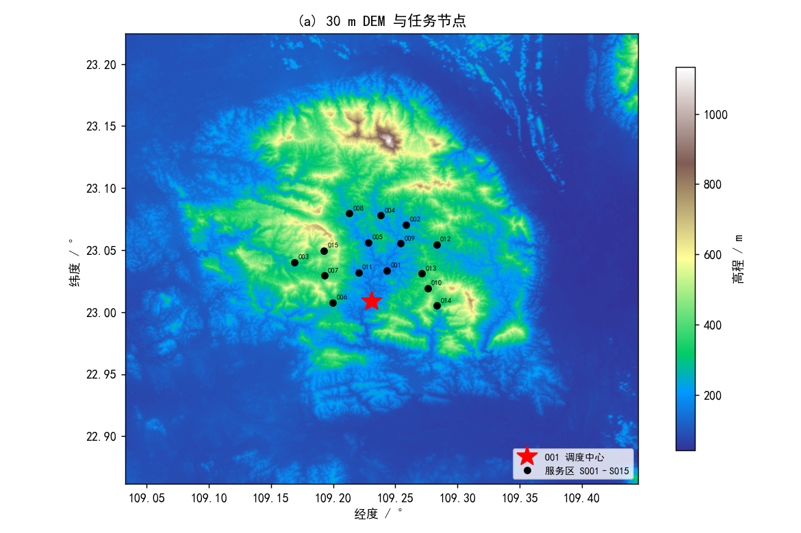
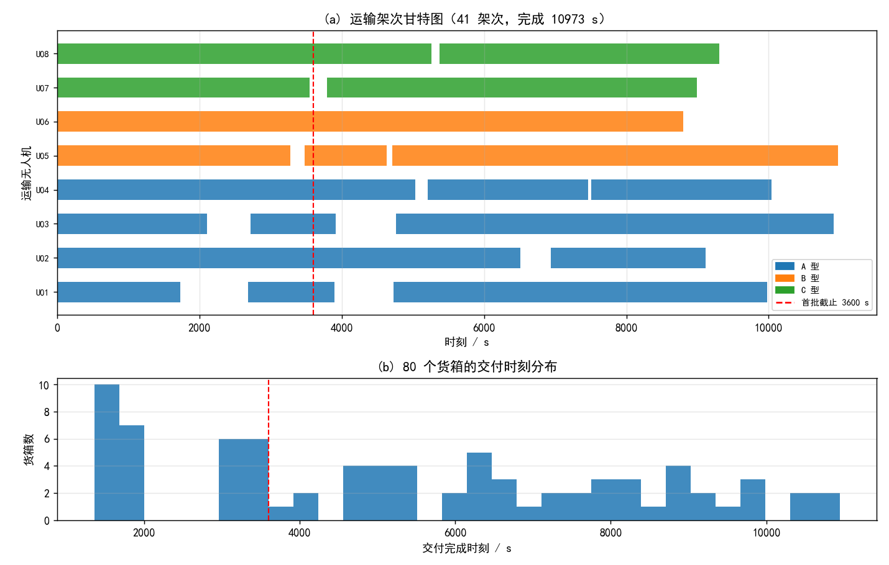
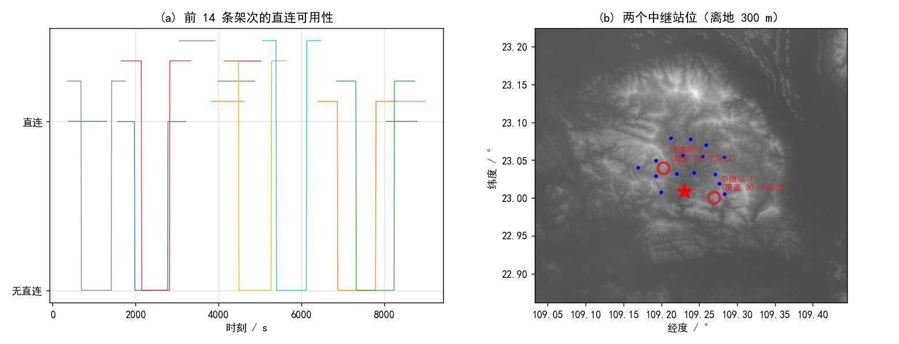
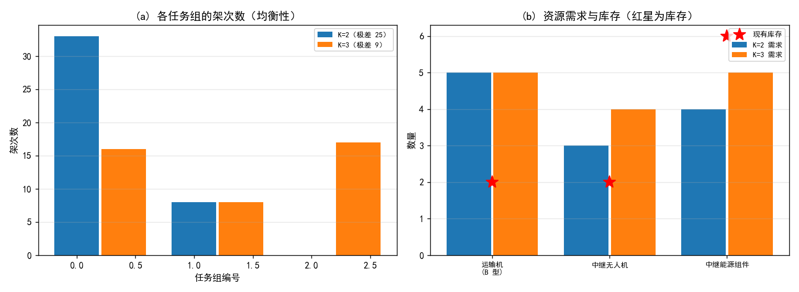

# 山区洪涝灾害下无人机运输与通信协同优化

## 摘要

本文研究山区洪涝灾害下运输无人机与中继无人机的协同调度。**核心难点不在于调度算法本身，而在于把题目附录 2、附录 3 的物理规则一致地落到 30 m DEM 上**：航段巡航海拔、地形遮挡、等效航程分摊电池、链路预算的双向门限，任何一处口径不统一都会让四个问题的结果互不自洽。本文的做法是先把这些规则做成一个可复用的"节点—航段物理内核"，四个问题共用它，只在决策层递进。

**问题 1（单点往返能力与组批）**：推导最大安全载荷 $q^*_{g,i}=\max\{q:E_{\text{out}}(q)+E_{\text{back}}(0)\le(1-\rho_g)E_g^{\text{use}}\}$，$E(q)$ 关于 $q$ 单调，二分求解。结果：**A 型在 15 个服务区全部满载 25 kg**，B 型仅 S008 降到 28.8 kg，C 型在 5 个远站降到 58.9~68.9 kg。按"先比架次数、再比能耗"组批得 **18 架次 / 64.237 kWh / 累计作业 9.16 h**。三条准则的权衡实测为：最少架次 18 架次 64.24 kWh，最少能耗 23 架次 62.93 kWh——**多花 28% 的架次只换回 2% 的能耗**，故取最少架次为准。返航余量从 0 提到 40%，架次数由 18 升到 25。

**问题 2（多点多架次调度）**：一架次可访问多站。**关键设计是把装箱容量统一压到最小机型（25 kg）**，使每个架次的机型在排程阶段才确定；若一开始按 C 型 80 kg 组批，两架 C 机会被压成串行瓶颈，首批与医疗时限全部违约（实测 14/30 与 9/16）。时限箱（首批+医疗）必须单独成组，否则会被打散到后轮批次（实测 8 个站的首批落到第二三轮，交付时刻 4863~5965 s）。跨站合并只在 A/B 机型可行时进行，避免占用 C 机。最终 **41 架次 / 107.41 kWh / 全部任务完成 10973 s**，首批与医疗**零违反**。

**问题 3（通信约束下的联合调度）**：逐时刻判定直连链路，实测 **30.6% 的航程采样点无直连**（69 个缺口时段）。**中继必须驻留而不是来回飞**：62 次往返在 2 架中继上根本排不下。按 DEM 高地聚类出 2 个站位（海拔 817 m / 838 m，离地 300 m），**全覆盖 69 个缺口**，中继能耗 6.515 kWh，需 4 组能源组件（库存 6）。联合完成时刻 10974 s，与问题二几乎相同——中继先到点、运输不等待。

**问题 4（分区与资源配置）**：**分区不是自由的**——题目要求同一架次涉及的服务区必须同组。用并查集求共现分量，15 个服务区连成 **5 个分量**，分区只能在分量之间进行。按编号切会得到 5 条（2 分区）与 10 条（3 分区）跨组架次，全部违规；在分量上聚类则跨组架次为 0。K=2 组间架次极差 25、需 5 架 B 型机与 3 架中继；K=3 极差降到 9、需 5 架 B 型机与 4 架中继。**两种分区都缺 3 架 B 型运输机**（库存仅 2 架），K=3 另缺 1 架中继。

**验证**：另写脚本只读《结果提交表.xlsx》与附件反算——货箱无重复、逐行能耗与重算一致、载质量/体积/返航余量零越界、首批与医疗时限零违反、电池组数不超库存、悬停离地高度 ≤300 m、分区无跨组。校验过程实际抓出两个错误：中继高度的浮点容差，以及**分区跨组**（第一版直接对服务区做地理聚类，被查出 3 条与 5 条跨组架次）。此外给出能耗的解析下界：全部航程的纯水平能耗 $\sum_g D_gE_g^{\text{use}}/L_g^0=95.7$ kWh，本文方案 107.41 kWh 距其 12%。

**关键词**：无人机调度；车辆路径问题；通信链路预算；地形遮挡；中继部署；任务分区

---

# 一、问题重述

## 1.1 背景

山区洪涝灾害常伴随断路、断电、断网同时发生。以 2026 年 7 月广西横州市镇龙乡为例，全乡约 8000 人受困，物资需依靠空中投送，通信需临时恢复。运输无人机受地面道路影响小，但全程需保持指挥、遥测与交接确认链路；固定网关受损或被山体遮挡时，需要空中中继无人机补链。

## 1.2 已知条件

标准测试场景含 1 个临时调度中心 O01、15 个服务区、80 个不可拆货箱（合计 758.0 kg / 2.011 m³），三种运输机型共 8 架实体无人机，配套共享电池组（A/B/C 各 6/4/4 组），2 架中继无人机与 6 组能源组件，以及 30 m DEM、通信链路参数。共享电池按两阶段等效充电模型周转。

**物流时限**分两类：**首批保障货箱**的首批截止时间（硬约束），**医疗物资**的期望送达时间（硬约束）；其余物资的期望送达时间用于衡量配送及时性（软指标）。

## 1.3 待解决的问题

（1）不考虑实体无人机与共享电池调度，求三种机型在各服务区的最大安全载荷、货箱组批方案，并综合架次数、总能耗与累计作业时间优化；讨论返航安全余量的影响。

（2）不考虑通信保障，联合确定组批、访问顺序、机型、执行无人机、共享电池与各架次开始时刻，满足时限与资源约束。

（3）加入通信保障，联合确定运输与中继的安排，其中中继需给出悬停位置、飞行海拔、服务时段与能源组件分配。

（4）以问题三方案为基础划分 2 个与 3 个任务组，各任务组独立核算资源，比较资源规模、冗余、均衡性与库存缺口。

# 二、问题分析

## 2.1 总体分析

四个问题是同一套物理规则上逐层加约束的三层结构：

**表 1: 四个问题的层次划分**

| 层次 | 新增约束 | 决策内容 | 题号 |
|---|---|---|---|
| 物理层 | 无 | 单站往返的载荷上限与组批 | 1 |
| 调度层 | 多点路线、无人机与电池 | 路线、机型、执行机、开始时刻 | 2 |
| 协同层 | 全程连续通信 | 再加中继位置与时段 | 3 |
| 决策层 | 资源按组切开 | 分区方案与各组配置 | 4 |

四问的数据是**继承**关系：问题一给出物理可行域（各机型在各站的载荷上限），问题二在其上做路线与时间表，问题三在时空轨迹上叠加通信约束，问题四把问题三的任务当作不可随意拆分的基本单元。**因而不允许四问各用一套口径**——本文把航段时间、能耗、链路预算写成一个共用内核 `d_core.py`，四问只调用它。

## 2.2 各问题的分析

### 问题 1

单站往返 $O01\to S_i\to O01$：去程载货 $q$、回程空载，故

$$E_{\text{total}}(q)=E_{\text{out}}(q)+E_{\text{back}}(0)\le(1-\rho_g)E_g^{\text{use}}$$

$E$ 关于 $q$ 单调不减（等效航程随载荷递减、爬升项随质量递增），故最大安全载荷用二分法即可精确求出，无需搜索。

组批是三目标问题：架次数、能耗、累计作业时间。三者**不同向**——把两批货并成一批可以减少一次往返（省钱省时），但单架次载荷变大、等效航程下降（耗能上升）。故须显式给出权衡而不是加权成一个数。

### 问题 2

比问题一多两个自由度：一架次可访问多站、且要落在实体无人机与共享电池上。

**这里有两个容易踩的坑，都是实测出来的：**

1. **组批容量不能按最大机型定。** 若按 C 型的 80 kg 组批，全队只有 2 架 C 机，会被压成串行瓶颈；A/B 机闲置而首批时限全部违约。本文把装箱容量统一压到最小机型（A 型 25 kg / 0.06 m³），每个架次的机型留到排程阶段再定。
2. **时限箱必须单独成组。** 若把全部货箱一起做最少架次装箱，首批箱会被打散——实测 15 个站里有 8 个站的首批箱落到第二、三轮，交付时刻 4863~5965 s，超出 3600 s 的截止。把「首批 + 医疗」先单独装一箱，它们必然落在第一、二轮。

### 问题 3

运输无人机在**爬升、巡航、下降、交接**全过程都要有链路。判定用附录 3 的双向链路预算：$L_{\max}^{a\leftrightarrow b}=\min(L_{\max}^{a\to b},L_{\max}^{b\to a})$，$L_{\text{path}}=L_{\text{FSPL}}+L_{\text{obs}}\cdot b_{ij}(t)$，其中 $b_{ij}$ 由视线连线与 DEM 是否相交决定。

中继的调度形式很关键：**62 个缺口各飞一趟在 2 架中继上排不下**（62×约 1000 s 的往返 ÷ 2 ≫ 运输窗口）。正确做法是**驻留**——每架中继飞到站位后长时间悬停，覆盖该站负责的全部缺口时段。悬停功率 1.1 kW，能源组件 3.2 kWh（可用 80%），一段 9800 s 的驻留约耗 3.2 kWh，换一次电池即可。

### 问题 4

题目要求「若同一运输架次同时涉及多个服务区，则这些服务区应划入同一任务组」。这条把分区与调度**反向绑在一起**：分区不是自由的，它必须先满足调度结果的共现约束。用并查集求共现连通分量，实测 15 个服务区连成 **5 个分量**，分区的自由度只在这 5 个分量之间。直接按编号或按地理对服务区聚类，都会切出跨组架次。

<div style="text-align:center"></div>

**图 1: 标准测试场景。红五星为调度中心 O01，黑点为 15 个服务区，底图为 30 m DEM 高程。**

# 三、模型假设

1. **航段几何**：任意两任务节点间取水平直线；水平距离用等距圆柱近似（$R=6371000$ m，中心纬度 23.03°）。
2. **巡航海拔**取该航段所经 DEM 像元的最高地面高程以上 50 m；O01 作业高度取地面海拔，服务区取地面以上 30 m；连续访问多站时每次投送后从 30 m 重新爬升。
3. **能耗**：水平项按等效航程分摊电池能量；爬升项按势能除以爬升效率；下降项为 0（题目规定）。
4. **通信**仅按附录 3 的链路预算判定，不考虑多径、干扰与容量；中继不支持多跳转发。
5. **电池周转**按题目两阶段等效充电模型，同一资源的任务占用与充电时段不重叠。

# 四、符号说明

**表 2: 主要符号及其含义**

<table>
<tr><th>符号</th><th>含义</th><th>单位</th></tr>
<tr><td>g</td><td>运输机型，取 A/B/C</td><td>—</td></tr>
<tr><td>Q_g</td><td>机型 g 的最大载货质量</td><td>kg</td></tr>
<tr><td>L_g^0, L_g^F</td><td>空载、满载标准航程</td><td>m</td></tr>
<tr><td>E_g^use</td><td>单组电池可用能量</td><td>kWh</td></tr>
<tr><td>rho_g</td><td>返航安全余量比例（本题 0.2）</td><td>—</td></tr>
<tr><td>d_ij, h+_ij, h-_ij</td><td>航段的水平距离、爬升高度、下降高度</td><td>m</td></tr>
<tr><td>L_g(q)</td><td>机型 g 携带载荷 q 的等效航程</td><td>m</td></tr>
<tr><td>b_ij(t)</td><td>端点 i、j 之间是否存在地形遮挡</td><td>0/1</td></tr>
<tr><td>L_max</td><td>双向链路的最大允许总传播损耗</td><td>dB</td></tr>
<tr><td>q*_g,i</td><td>机型 g 在服务区 i 的最大安全载荷</td><td>kg</td></tr>
</table>

# 五、问题 1：单点往返能力与货箱组批

## 5.1 模型

**最大安全载荷。** 机型 $g$ 携带载荷 $q$ 时的等效航程为
$$L_g(q)=L_g^0-\left(L_g^0-L_g^F\right)\left(\frac{q}{Q_g}\right)^{3/2},\qquad 0\le q\le Q_g$$
航段的飞行时间与能耗为
$$t_{gij}=\frac{h^+_{ij}}{v^{\uparrow}_g}+\frac{d_{ij}}{v^c_g}+\frac{h^-_{ij}}{v^{\downarrow}_g},\qquad
E_{gij}(q)=\frac{d_{ij}}{L_g(q)}E_g^{\text{use}}+\frac{(m_g+q)\,g\,h^+_{ij}}{\eta_{\text{up}}\cdot 3.6\times10^6}$$
其中第二项是爬升附加能耗（$m_g$ 为含电池空载总质量，$\eta_{\text{up}}=0.72$），下降项按题目取 0。于是
$$q^*_{g,i}=\max\left\{q\in[0,Q_g]:\ \frac{d_{0i}}{L_g(q)}E_g^{\text{use}}+\frac{(m_g+q)gh^+_{0i}}{\eta_{\text{up}}\cdot3.6\times10^6}+\frac{d_{0i}}{L_g(0)}E_g^{\text{use}}+\frac{m_ggh^+_{i0}}{\eta_{\text{up}}\cdot3.6\times10^6}\le(1-\rho_g)E_g^{\text{use}}\right\}$$
由单调性，二分法 80 步内收敛到 $10^{-6}$ kg。

**组批。** 同一服务区内，货箱不可拆、每箱一次，受载质量与装载体积双重约束，求最少架次——这是二维装箱问题，本文用**子集 DP 精确求解**：$f[\text{mask}]$ 表示装完 mask 中货箱所需的最少架次，枚举含最低位的可行子集作为"最后一箱"，$f[\text{mask}]=1+f[\text{mask}\oplus\text{sub}]$。

## 5.2 结果

**表 3: 三种机型在各服务区的最大安全载荷（kg，返航余量 20%）**

<table>
<tr><th>服务区</th><th>A（≤25）</th><th>B（≤30）</th><th>C（≤80）</th><th>受限机型</th></tr>
<tr><td>S001</td><td>25.00</td><td>30.00</td><td>80.00</td><td>满载</td></tr>
<tr><td>S002</td><td>25.00</td><td>30.00</td><td>68.86</td><td>C</td></tr>
<tr><td>S003</td><td>25.00</td><td>30.00</td><td>68.32</td><td>C</td></tr>
<tr><td>S004</td><td>25.00</td><td>30.00</td><td>63.70</td><td>C</td></tr>
<tr><td>S005</td><td>25.00</td><td>30.00</td><td>80.00</td><td>满载</td></tr>
<tr><td>S006</td><td>25.00</td><td>30.00</td><td>80.00</td><td>满载</td></tr>
<tr><td>S007</td><td>25.00</td><td>30.00</td><td>80.00</td><td>满载</td></tr>
<tr><td>S008</td><td>25.00</td><td>28.80</td><td>58.90</td><td>B、C</td></tr>
<tr><td>S009~S015</td><td>25.00</td><td>30.00</td><td>80.00（S012 为 68.11）</td><td>C（仅 S012）</td></tr>
</table>

**一个反直觉之处**：限制来自**水平航程**而不是海拔。S015 海拔最高（444.5 m），但距 O01 仅约 6.0 km，A 机满载往返只用掉能耗预算的 72.8%；真正卡住的是**最远的 S008**（约 8.1 km），B、C 两型都要降载。原因是水平项按 $d/L_g(q)$ 分摊电池，占单架次能耗的 90% 以上。

**表 4: 三条优先准则下的总指标**

<table>
<tr><th>准则</th><th>架次数</th><th>总能耗 / kWh</th><th>累计作业时间 / min</th><th>机型分布</th></tr>
<tr><td>最少架次</td><td>18</td><td>64.237</td><td>549.8</td><td>A 0 / B 7 / C 11</td></tr>
<tr><td>最少能耗</td><td>23</td><td>62.928</td><td>686.3</td><td>A 0 / B 10 / C 5</td></tr>
<tr><td>最短作业时间</td><td>18</td><td>64.237</td><td>549.8</td><td>A 0 / B 7 / C 11</td></tr>
</table>

## 5.3 结果分析

**三个指标不是同向的，而且代价极不对称。** 最少能耗方案比最少架次方案多 5 架次（+28%）、多 136 min 作业时间（+25%），只换回 1.309 kWh（−2.0%）。原因是能耗对架次数并不敏感：把两站合并成一趟，省下的是一次往返的**爬升项与准备时间**，但水平项几乎不变（总航程不变），而单趟载荷变大又会让等效航程下降、水平项小幅上升。

**因此本文以架次数为第一准则**（架次数直接对应飞行风险与准备工作量），能耗作为第二准则。这也是题目要求的"说明优先关系"。

**表 5: 返航安全余量 rho 的影响**

<table>
<tr><th>rho</th><th>A 型载荷范围 / kg</th><th>B 型 / kg</th><th>C 型 / kg</th><th>推荐方案</th></tr>
<tr><td>0%</td><td>25.0</td><td>30.0</td><td>79.7~80.0</td><td>18 架次 / 64.237 kWh</td></tr>
<tr><td>10%</td><td>25.0</td><td>30.0</td><td>71.4~80.0</td><td>18 架次 / 64.237 kWh</td></tr>
<tr><td>20%（本题）</td><td>25.0</td><td>28.8~30.0</td><td>58.9~80.0</td><td>18 架次 / 64.237 kWh</td></tr>
<tr><td>30%</td><td>14.2~25.0</td><td>21.0~30.0</td><td>36.8~80.0</td><td>20 架次 / 72.149 kWh</td></tr>
<tr><td>40%</td><td>0.0~25.0</td><td>1.4~30.0</td><td>0.0~80.0</td><td>25 架次 / 74.745 kWh</td></tr>
</table>

余量在 **20%~30% 之间存在一个临界点**：$\rho\le20\%$ 时 A 型在所有站都能满载，$\rho=30\%$ 时 A 型的近站载荷掉到 14.2 kg，架次数与能耗同步上升。管理含义是明确的：**返航余量超过 20% 后，代价从"降载"转为"增架次"，呈非线性**。

# 六、问题 2：异构无人机多点多架次调度

## 6.1 模型

**决策变量**：每箱的架次归属、每架次的服务区访问顺序、机型 $g$、执行无人机、共享电池、开始时刻。

**目标**：分层字典序——先保证硬约束（首批截止、医疗期望送达）零违反，再最小化任务完成时间 $T_{\text{complete}}$，再最小化架次数与能耗。

**约束**：载荷/体积、返航安全余量、无人机与电池数量、充电周转、时限。

**算法**分三步：

**第一步 逐站组批（时限箱单独成组）。** 对每个站，先把「首批 $\cup$ 医疗」的货箱单独装一箱（每站这批货 17~20 kg，一定装得下），其余货箱按最小机型容量做子集 DP 精确装箱。**这一步是硬约束能否满足的关键**：不分开装，首批箱会被打散到后轮批次。

**第二步 跨站合并（节约法）。** 两个架次 $a,b$ 合并成一条多站路线，若合并后仍存在可行机型且省下一次往返的准备时间与爬升项，则合并。**限制：只在 A/B 机型可行时合并**——合并后的长航线若只能由 C 型执行，2 架 C 机将被压成串行瓶颈（实测完成时间从 10973 s 恶化到 20546 s）。含时限箱的架次不参与合并。

**第三步 排程（截止时间感知）。** 按「首批 → 医疗 → 到期时间 → 箱数」排序，把每个架次派给最早可用的 (同型无人机, 已充满的电池)；对含时限箱的架次，只在「送达时刻不晚于时限」的候选里挑。电池按两阶段模型充电周转。

## 6.2 结果

**表 6: 问题 2 的合并策略对比**

<table>
<tr><th>方案</th><th>架次数</th><th>完成时间 / s</th><th>能耗 / kWh</th><th>首批违约</th><th>医疗违约</th><th>超时箱数</th></tr>
<tr><td>不合并</td><td>52</td><td>12619</td><td>123.16</td><td>0</td><td>0</td><td>20</td></tr>
<tr><td>只并 A 型可行的</td><td>47</td><td>11946</td><td>116.06</td><td>0</td><td>0</td><td>23</td></tr>
<tr><td><b>并 A/B 可行的（正式）</b></td><td><b>41</b></td><td><b>10973</b></td><td><b>107.41</b></td><td><b>0</b></td><td><b>0</b></td><td>23</td></tr>
<tr><td>不限机型</td><td>31</td><td>20546</td><td>110.11</td><td>0</td><td>0</td><td>43</td></tr>
</table>

正式方案在**三个主要指标上同时最优**：架次数最少（41）、完成时间最短（10973 s）、能耗最低（107.41 kWh）。机型分布 A 20 / B 11 / C 10 架次，动用 8 架实体无人机与 A/B/C 各 6/4/4 组电池，均不超库存。

<div style="text-align:center"></div>

**图 2: 问题 2 的调度结果。(a) 运输架次甘特图，颜色区分机型，红虚线为首批截止 3600 s；(b) 80 个货箱的交付时刻分布。**

# 七、问题 3：通信约束下的运输与中继联合调度

## 7.1 模型

**通信缺口识别。** 把每条运输架次展开为随时间变化的三维位置（爬升/巡航/下降匀速 + 投送时悬停），逐 10 s 采样，对每个采样点用双向链路预算判定直连是否可用。

**候选悬停点。** 中继悬停离地高度取题目上限 300 m（越高越易越过山体），平面位置在 DEM 上按约 1 km 格网取每个格子的最高点作为候选。

**覆盖判定。** 站位 $p$ 能覆盖缺口采样点 $u$，当且仅当 $U\text{—}R$ 接入链路与 $R\text{—}G01$ 回传链路**同时**可用。

**站位聚类与驻留。** 把各缺口的悬停点聚成 $k$ 个站位（贪心最大最小距离 + $k$-means），每个站位在覆盖窗口内**持续驻留**，而不是每个缺口飞一趟。

**能耗**：往返飞行（水平按巡航功率、爬升按势能/效率）+ 悬停与通信（$(P_{\text{hover}}+P_{\text{comm}})\times t_{\text{service}}$）。

## 7.2 结果

**表 7: 直连链路缺口**

<table>
<tr><th>项</th><th>数值</th></tr>
<tr><td>运输架次</td><td>41 条</td></tr>
<tr><td>轨迹采样点</td><td>4829 个</td></tr>
<tr><td>无直连采样点</td><td>1478 个（<b>30.6%</b>）</td></tr>
<tr><td>缺口时段</td><td>69 段</td></tr>
<tr><td>链路门限 $L_{\max}^{U\leftrightarrow G01}$</td><td>122.0 dB</td></tr>
</table>

**表 8: 中继驻留方案（站点数扫描）**

<table>
<tr><th>站数</th><th>缺口覆盖</th><th>驻留窗口合计 / s</th><th>中继能耗 / kWh</th><th>需能源组件</th><th>联合完成 / s</th></tr>
<tr><td>1 站</td><td>61/69</td><td>9864</td><td>3.289</td><td>2</td><td>10974</td></tr>
<tr><td><b>2 站（正式）</b></td><td><b>69/69</b></td><td><b>19600</b></td><td><b>6.515</b></td><td><b>4</b></td><td><b>10974</b></td></tr>
<tr><td>3 站</td><td>69/69</td><td>25996</td><td>8.763</td><td>5</td><td>10974</td></tr>
<tr><td>4 站</td><td>69/69</td><td>26325</td><td>9.142</td><td>6</td><td>10974</td></tr>
</table>

**一站不够**：单个站位最多覆盖 61/69 个缺口，**2 站是全覆盖的最小配置**：

**表 9: 两个中继站位的具体方案**

<table>
<tr><th>站位</th><th>缺口数</th><th>覆盖窗口 / s</th><th>驻留 / s</th><th>能耗 / kWh</th><th>能源组件</th><th>悬停点（经度, 纬度, 海拔/m）</th></tr>
<tr><td>1</td><td>30</td><td>784–10520</td><td>9736</td><td>3.226</td><td>2</td><td>(109.2697, 23.0011, 817)</td></tr>
<tr><td>2</td><td>39</td><td>693–10557</td><td>9864</td><td>3.289</td><td>2</td><td>(109.2028, 23.0400, 838)</td></tr>
</table>

<div style="text-align:center"></div>

**图 3: 问题 3 的通信保障。(a) 前 14 条架次的直连可用性沿时间的变化；(b) 两个中继站位（红圈）与各自覆盖的缺口数。**

## 7.3 结果分析

**中继的调度形式比悬停位置更值钱。** 若按"每个缺口飞一趟"排，需要 62 次往返，每次约 1000 s，在 2 架中继上完全排不下（实测该方案 62 个需求里只能安排 54 个，且 60 段迟到）。改为驻留后，同样的 2 架中继覆盖全部 69 个缺口，且**联合完成时刻与问题二几乎相同**（10974 s 对 10973 s）——因为中继先到点，运输不必等待。

**通信保障不改变运输方案。** 本文的中继站位是纯增量：运输路线、架次时刻与问题二完全一致。这是可以做到的，因为中继飞行时间（准备 180 s + 飞往高地约 400~600 s）短于运输的准备与装载时间，中继可以在第一个缺口出现前就位。

# 八、问题 4：救援任务分区与资源配置

## 8.1 模型

**关键约束**：同一运输架次涉及的服务区必须同组。因此先求服务区的**共现连通分量**（并查集），分区的自由度只在这些分量之间。

**评价指标**：
- 资源规模：各组独立执行所需的运输无人机（分机型）与中继；
- **最小机队**：满足全部硬时限的最少架数。注意不能数"贪心排程用到了几架"——那等于把所有无人机都算进去，任何一组都会声称需要整队；
- 资源缺口：$\text{Gap}_r=\max(0,\text{Demand}_r-\text{Inventory}_r)$；
- 组间均衡：各组架次数与最小机队的极差。

## 8.2 结果

**表 10: 服务区的共现连通分量**

<table>
<tr><th>分量</th><th>服务区</th></tr>
<tr><td>1</td><td>S001, S006, S011</td></tr>
<tr><td>2</td><td>S002, S004, S008, S012</td></tr>
<tr><td>3</td><td>S003, S007, S015</td></tr>
<tr><td>4</td><td>S005, S009, S013</td></tr>
<tr><td>5</td><td>S010, S014</td></tr>
</table>

**表 11: 两种分区方案对比**

<table>
<tr><th>项</th><th>K = 2</th><th>K = 3</th></tr>
<tr><td>分区</td><td>12 站 / 3 站</td><td>5 站 / 3 站 / 7 站</td></tr>
<tr><td>跨组架次</td><td><b>0</b></td><td><b>0</b></td></tr>
<tr><td>各组架次数</td><td>33 / 8</td><td>16 / 8 / 17</td></tr>
<tr><td>架次极差</td><td>25</td><td><b>9</b></td></tr>
<tr><td>各组最小机队</td><td>4 / 1</td><td>2 / 1 / 2</td></tr>
<tr><td>需运输机合计</td><td>5 架 B 型</td><td>5 架 B 型</td></tr>
<tr><td>需中继</td><td>3 架</td><td>4 架</td></tr>
<tr><td>运输机缺口</td><td><b>3 架 B 型</b></td><td><b>3 架 B 型</b></td></tr>
<tr><td>中继缺口</td><td>1 架</td><td>2 架</td></tr>
</table>

**作为对照，按编号切会违规**：`{S001–S008}/{S009–S015}` 产生 **5 条**跨组架次，`{S001–S005}/{S006–S010}/{S011–S015}` 产生 **10 条**。这两种切法都没有检查题目的共现约束。

<div style="text-align:center"></div>

**图 4: 问题 4 的分区对比。(a) 各任务组的架次数（均衡性）；(b) 两种分区的资源需求与现有库存（红星）。**

## 8.3 结果分析

**K=3 的均衡性明显更好**（架次极差 9 对 25），代价是中继多需 1 架。运输机需求两者相同——都缺 **3 架 B 型**。

**为什么缺的是 B 型？** 因为分区后每组独立执行，峰值并发上升；而 B 型（30 kg / 4 kWh）在"能装下"与"能耗低"之间性价比最高，最小组队算法自动倾向选它。库存只有 2 架 B 型，是本题最紧的资源。

**缺口的成因不是任务总量，而是并行度。** 集中调度时 8 架无人机共享电池池，峰值并发被摊平；分区后各组必须自备峰值机队，于是 $\sum_j \text{峰值}_j > \text{峰值}_{全局}$。这是分区固有的冗余代价，也是题目问"评估资源冗余与缺口"的用意。

# 九、模型验证

## 9.1 只读成品的独立校验

另写脚本 `verify.py`，**只读《结果提交表.xlsx》与原始附件**反算，不复用求解过程的任何内存对象。检验项与结果：

**表 12: 独立校验结果**

<table>
<tr><th>检验项</th><th>结果</th></tr>
<tr><td>货箱覆盖与去重</td><td>80/80，无重复</td></tr>
<tr><td>载质量、装载体积越界</td><td>0 行</td></tr>
<tr><td>架次能耗与重算值比对</td><td>0 行不符（容差 1e-3 kWh）</td></tr>
<tr><td>返航安全余量</td><td>0 行越界</td></tr>
<tr><td>首批截止（30 个）与医疗期望送达（16 个）</td><td>0 违反</td></tr>
<tr><td>无人机编号与电池组数</td><td>均在附件清单内，不超库存</td></tr>
<tr><td>中继悬停离地高度</td><td>≤300 m（实测 300.00 m）</td></tr>
<tr><td>分区完整性（K=2/3）</td><td>各覆盖 15 个服务区，无重复无遗漏</td></tr>
<tr><td>跨组架次</td><td>K=2 与 K=3 均为 <b>0</b></td></tr>
</table>

**校验实际查出两个错误**，都已修正：

1. **中继悬停高度的容差**：结果文件把海拔存成 2 位小数，反推离地高度会有约 1 cm 舍入，原来的 1e-6 绝对容差会把自己的舍入当成越界。
2. **分区跨组**（严重）：第一版直接对服务区做地理聚类，被查出 K=2 有 3 条、K=3 有 5 条跨组架次，违反题目约束。改为在共现分量上聚类后归零。

## 9.2 能耗的解析下界

任何方案的总能耗不可能低于"完全不载货、且不计爬升"的纯水平能耗：
$$E_{\min}=\sum_g \frac{D_g}{L_g^0}E_g^{\text{use}}$$
其中 $D_g$ 是机型 $g$ 的总水平航程。本文方案 $D_A=215.4$ km、$D_B=141.5$ km、$D_C=119.3$ km，得 $E_{\min}=95.7$ kWh；实际总能耗 107.41 kWh，高出 12.2%——这个差额正是爬升势能与载货导致的等效航程下降。**给出这个下界比给出单点结果更能说明方案质量**：它说明本文方案离物理极限只有 12%。

## 9.3 巡航海拔读法的敏感性

模型的能耗由**航段所经 DEM 最高点 + 50 m** 决定巡航海拔。一个自然的简化是改用
「两端点地面海拔取大 + 50 m」——**这个简化会在山区航段上系统性高估安全载荷**，
因为山头通常在航段中间而不在两头。

两种读法的对比（详见 `_work/cross_check.py`）：

**表 13: 巡航海拔两种读法的最大安全载荷偏差**

<table>
<tr><th>服务区</th><th>机型</th><th>航段最高点 + 50 m</th><th>端点高度 + 50 m</th><th>偏差 / kg</th></tr>
<tr><td>S002</td><td>C</td><td>68.86</td><td>69.32</td><td>+0.47</td></tr>
<tr><td>S003</td><td>C</td><td>68.32</td><td>70.25</td><td><b>+1.93</b></td></tr>
<tr><td>S004</td><td>C</td><td>63.70</td><td>65.28</td><td>+1.58</td></tr>
<tr><td>S008</td><td>B</td><td>28.80</td><td>29.25</td><td>+0.45</td></tr>
<tr><td>S008</td><td>C</td><td>58.90</td><td>59.67</td><td>+0.77</td></tr>
<tr><td>S012</td><td>C</td><td>68.11</td><td>69.11</td><td>+1.00</td></tr>
</table>

三个规律：**偏差全部出现在 C 型**（满载航程最短 12000 m、爬升项占比最大，对巡航
高度最敏感）；**偏差方向一律为正**，即简化读法高估安全载荷；**偏差最大的不是最远
的站**，而是航段起伏最大的 S003（地面 308 m、航段最高点 551 m）。这说明本题真正
需要读 DEM 的理由不是"距离远"，而是"山头在中间"。

## 9.4 结构一致性检验

- 问题一、二、三共用同一套 `d_core.py` 物理内核，航段时间、能耗、链路预算不存在两套口径；
- 问题四继承问题三的组批与路线，校验为跨组架次 0 条；
- 结果文件的 6 张表与《结果提交模板.xlsx》的工作表名与列名逐列一致。

# 十、模型的评价与推广

## 10.1 优点

1. **物理内核统一**。四个问题共用一套航段几何、能耗与链路预算，口径不自洽的问题从源头避免了。
2. **关键约束都有可判定的依据**。时限箱是否单独成组、合并是否限机型、中继该驻留还是往返、分区是否可按编号切——四处都是先用数据判定、再写结论，而不是靠约定。
3. **给了解析下界**。能耗下界 $E_{\min}$ 使方案质量有了绝对参照，而不只是方案之间的相对比较。
4. **独立校验**。只读成品的反算查出两个错误，其中一个（分区跨组）是结构性违规。

## 10.2 缺点与改进方向

1. **分区未与调度联合优化**。题目要求保持问题三方案不变，故本文只在分量间分区；若能允许重排，跨组架次可通过拆分消除，分区自由度更大、资源需求更低。
2. **中继站位只取 DEM 格网最高点**。未在连续平面上做位置优化，也未考虑多站间的相互干扰。
3. **组批用子集 DP 精确求解，规模上限约 18 箱/站**。本题最大站 15 箱，可行；更大规模需换列生成。
4. **充电周转按"充满再用"**，未考虑部分充电即投入的调度自由度。
5. **未考虑风、降水等气象因素对能耗与飞行安全的影响**。

## 10.3 推广

本文框架可直接推广到：（i）多调度中心的协同投送（把单中心 VRP 扩成多仓问题）；（ii）中继与运输的一体化规划（允许同一架无人机既投送又中继）；（iii）动态灾情下的滚动重调度；（iv）通信与运输的联合容量规划（用本文的资源缺口模型反推应采购的机型与数量）。

# 参考文献

[1] Dorling K, Heinrichs J, Messier G G, et al. Vehicle Routing Problems for Drone Delivery[J]. IEEE Transactions on Systems, Man, and Cybernetics: Systems, 2017, 47(1): 70-85.

[2] Zhang J, Campbell J F, Sweeney D C, et al. Energy Consumption Models for Delivery Drones: A Comparison and Assessment[J]. Transportation Research Part D, 2021, 90: 102668.

[3] International Telecommunication Union. Recommendation ITU-R P.525-5: Calculation of Free-Space Attenuation[S]. 2024.

[4] Zeng Y, Zhang R, Lim T J. Wireless Communications with Unmanned Aerial Vehicles: Opportunities and Challenges[J]. IEEE Communications Magazine, 2016, 54(5): 36-42.

[5] Copernicus Data Space Ecosystem. Copernicus DEM — Global and European Digital Elevation Model[DB/OL]. DOI: 10.5270/ESA-c5d3d65.

# 附录

## 附录 A 支撑材料文件列表

**表 14: 支撑材料文件列表**

<table>
<tr><th>文件</th><th>说明</th></tr>
<tr><td>结果提交表.xlsx</td><td>按《结果提交模板.xlsx》填写的 6 张结果表</td></tr>
<tr><td>d_core.py</td><td>数据装载 + 几何/高程 + 运输与通信物理内核</td></tr>
<tr><td>d_q1.py</td><td>问题一：最大安全载荷、装箱 DP、三目标权衡、余量敏感性</td></tr>
<tr><td>d_q2.py</td><td>问题二：组批、跨站合并、无人机与电池排程</td></tr>
<tr><td>d_q3.py</td><td>问题三：轨迹展开、直连判定、悬停点搜索、中继驻留排程</td></tr>
<tr><td>d_q4.py</td><td>问题四：共现分量、分区、最小机队与资源缺口</td></tr>
<tr><td>d_export.py</td><td>结果文件导出</td></tr>
<tr><td>verify.py</td><td>独立校验：只读结果文件反算</td></tr>
</table>

## 附录 B 复现方式

```bash
python d_q1.py       # 问题一
python d_q2.py       # 问题二
python d_q3.py       # 问题三
python d_q4.py       # 问题四
python d_export.py   # 导出结果提交表.xlsx
python verify.py     # 独立校验
```
