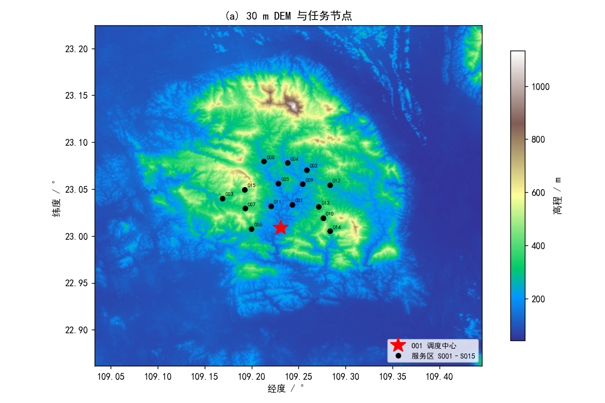
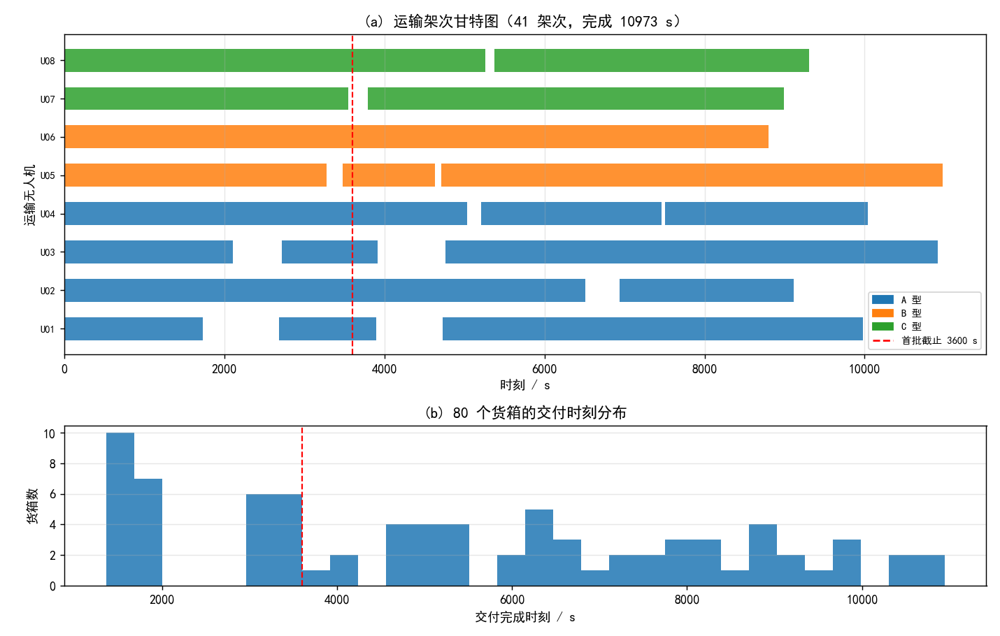
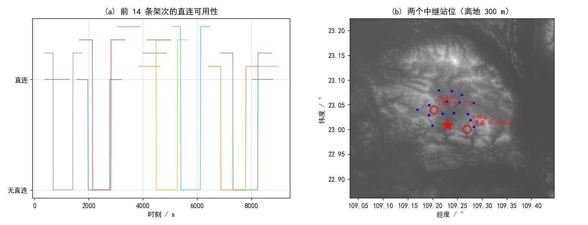
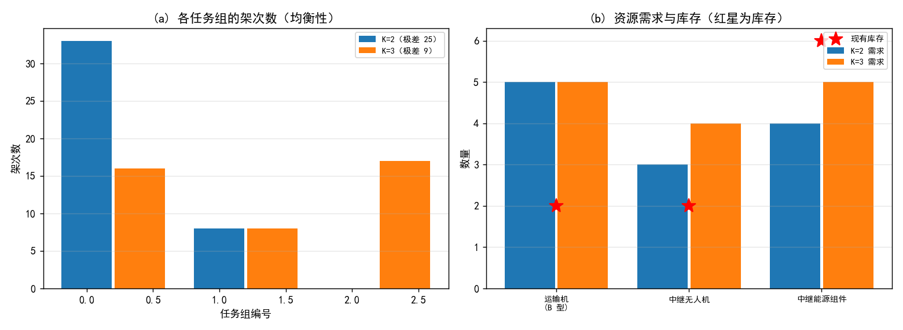

# 山区洪涝灾害下无人机运输与通信协同优化

## 摘要

本文研究山区洪涝灾害下运输无人机与中继无人机的协同调度。**核心难点不在于调度算法本身，而在于把题目附录 2、附录 3 的物理规则一致地落到 30 m DEM 上**：航段巡航海拔、地形遮挡、等效航程分摊电池、链路预算的双向门限，任何一处口径不统一都会让四个问题的结果互不自洽。本文的做法是先把这些规则做成一个可复用的"节点—航段物理内核"，四个问题共用它，只在决策层递进。

**问题 1（单点往返能力与组批）**：推导最大安全载荷 $q^*_{g,i}=\max\{q:E_{\text{out}}(q)+E_{\text{back}}(0)\le(1-\rho_g)E_g^{\text{use}}\}$，$E(q)$ 关于 $q$ 单调，二分求解。结果：**A 型在 15 个服务区全部满载 25 kg**，B 型仅 S008 降到 28.8 kg，C 型在 5 个远站降到 58.9~68.9 kg。按"先比架次数、再比能耗"组批得 **18 架次 / 64.237 kWh / 累计作业 9.16 h**。三条准则的权衡实测为：最少架次 18 架次 64.24 kWh，最少能耗 23 架次 62.93 kWh——**多花 28% 的架次只换回 2% 的能耗**，故取最少架次为准。返航余量从 0 提到 40%，架次数由 18 升到 25。

**问题 2（多点多架次调度）**：一架次可访问多站。本文把它写成**以架次为列的集合划分模型**，再用「组批 → 跨站合并 → 排程」三步做隐式列生成。**组批容量不取最大机型而取中间档**：按 A 型 25 kg 组批得 41 架次 / 10582 s / 107.30 kWh，按 B 型 30 kg 组批得 **40 架次 / 10064 s / 101.55 kWh**（三项同时更优）；按 C 型 80 kg 虽只有 28 架次、85.38 kWh，但两架 C 机被压成串行瓶颈，完成时间恶化 33%、机队利用率掉到 47.3%——**完成时间由最忙的那架决定，负载均衡比"少用架次"重要**。时限箱（首批+医疗）必须单独成组，否则会被打散到后轮批次。派发顺序也做了一次七规则对比：纯 LPT 会让 30 个首批箱中 **16 个超时**，本文取「硬时限按 EDD、软时限按能耗降序」，首批与医疗**零违反**。

**问题 3（通信约束下的联合调度）**：逐时刻判定直连链路，实测 **29.8% 的航程采样点无直连**（64 个缺口时段）。**中继必须驻留而不是来回飞**：逐缺口往返在 2 架中继上根本排不下。按 DEM 高地聚类出 2 个站位（海拔 817 m / 838 m，离地 300 m），**全覆盖 64 个缺口**，中继能耗 5.18 kWh，需 3 组能源组件（库存 6）。联合完成时刻 10064 s，与问题二**完全相同**——中继先到点、运输不等待。

**问题 4（分区与资源配置）**：**分区不是自由的**——题目要求同一架次涉及的服务区必须同组。用并查集求共现分量，本方案的 40 条架次里有 36 条是单站架次、4 条跨两站，15 个服务区因此连成 **11 个分量**（7 个孤立站 + 4 对必须同组的站），分区只能在分量之间进行。按编号切会得到 2 条（2 分区）与 4 条（3 分区）跨组架次，仍然违规；在分量上聚类则跨组架次为 0。资源需求做成一个**可穷举的分配优化**：$\min\sum_j\text{Viol}_j$ s.t. $\sum_j n_{g,j}\le N_g$。结果是 **运输机零缺口**——4A+2B+2C 刚好用完库存、零违反（**本文第一版写"缺 3 架 B 型"，那是需求口径只允许每组配一种机型造成的假缺口**）；真正缺的是**电池组**（K=2 缺 1 组 A+1 组 B，K=3 缺 1 组 A）与**中继**（K=2 缺 1 架、K=3 缺 3 架，且这是"资源不得跨组调配"的代价：不分区分时 2 架就够）。K=2 最晚组完成 10215 s，仅比不分区慢 1.5%。

**验证与下界**：另写脚本只读《结果提交表.xlsx》与附件反算，22 项断言全部通过。校验**实际抓出三个错误**：中继高度的浮点容差、**分区跨组**，以及**无人机编号不在附件清单内**（本文自造了 `A*01` 式编号，而附件清单用的是 `U01`~`U08`）。另给出三个下界，并写清各自的前提：给定本文机型分配，纯水平能耗 90.17 kWh，实算 101.55 kWh 高出 12.6%（换一种机型分配就是另一个下界）；**给定本文架次集合与库存机队，完成时间下界 9732 s，本文 10064 s 仅高出 3.4%**，瓶颈明确落在 B 型机（2 架，利用率 97.3%/96.2%），与 6.3.3 节的机队扫描、6.3.4 节的单机型复算两处独立吻合。

**关键词**：无人机调度；车辆路径问题；通信链路预算；地形遮挡；中继部署；任务分区

---

# 一、问题重述

## 1.1 背景

山区洪涝灾害常伴随断路、断电、断网同时发生。以 2026 年 7 月广西横州市镇龙乡为例，全乡约 8000 人受困，物资需依靠空中投送，通信需临时恢复。运输无人机受地面道路影响小，但全程需保持指挥、遥测与交接确认链路；固定网关受损或被山体遮挡时，需要空中中继无人机补链。

## 1.2 已知条件

标准测试场景含 1 个临时调度中心 O01、15 个服务区、80 个不可拆货箱（合计 758.0 kg / 2.011 m³），三种运输机型共 8 架实体无人机，配套共享电池组（A/B/C 各 6/4/4 组），2 架中继无人机与 6 组能源组件，以及 30 m DEM、通信链路参数。共享电池按两阶段等效充电模型周转。

**物流时限**分两类：**首批保障货箱**的首批截止时间（硬约束），**医疗物资**的期望送达时间（硬约束）；其余物资的期望送达时间用于衡量配送及时性（软指标）。

## 1.3 待解决的问题

（1）不考虑实体无人机与共享电池调度，求三种机型在各服务区的最大安全载荷、货箱组批方案，并综合架次数、总能耗与累计作业时间优化；讨论返航安全余量的影响。

（2）不考虑通信保障，联合确定组批、访问顺序、机型、执行无人机、共享电池与各架次开始时刻，满足时限与资源约束。

（3）加入通信保障，联合确定运输与中继的安排，其中中继需给出悬停位置、飞行海拔、服务时段与能源组件分配。

（4）以问题三方案为基础划分 2 个与 3 个任务组，各任务组独立核算资源，比较资源规模、冗余、均衡性与库存缺口。

# 二、问题分析

## 2.1 总体分析

四个问题是同一套物理规则上逐层加约束的三层结构：

**表 1: 四个问题的层次划分**

| 层次 | 新增约束 | 决策内容 | 题号 |
|---|---|---|---|
| 物理层 | 无 | 单站往返的载荷上限与组批 | 1 |
| 调度层 | 多点路线、无人机与电池 | 路线、机型、执行机、开始时刻 | 2 |
| 协同层 | 全程连续通信 | 再加中继位置与时段 | 3 |
| 决策层 | 资源按组切开 | 分区方案与各组配置 | 4 |

四问的数据是**继承**关系：问题一给出物理可行域（各机型在各站的载荷上限），问题二在其上做路线与时间表，问题三在时空轨迹上叠加通信约束，问题四把问题三的任务当作不可随意拆分的基本单元。**因而不允许四问各用一套口径**——本文把航段时间、能耗、链路预算写成一个共用内核 `d_core.py`，四问只调用它。

## 2.2 各问题的分析

### 问题 1

单站往返 $O01\to S_i\to O01$：去程载货 $q$、回程空载，故

$$E_{\text{total}}(q)=E_{\text{out}}(q)+E_{\text{back}}(0)\le(1-\rho_g)E_g^{\text{use}}$$

$E$ 关于 $q$ 单调不减（等效航程随载荷递减、爬升项随质量递增），故最大安全载荷用二分法即可精确求出，无需搜索。

组批是三目标问题：架次数、能耗、累计作业时间。三者**不同向**——把两批货并成一批可以减少一次往返（省钱省时），但单架次载荷变大、等效航程下降（耗能上升）。故须显式给出权衡而不是加权成一个数。

### 问题 2

比问题一多两个自由度：一架次可访问多站、且要落在实体无人机与共享电池上。

**这里有两个容易踩的坑，都是实测出来的：**

1. **组批容量既不能按最大机型定，也不能想当然地按最小机型定。** 若按 C 型的 80 kg 组批，全队只有 2 架 C 机，会被压成串行瓶颈，A/B 机闲置而完成时间恶化 33%（表 7）；但按 A 型的 25 kg 组批同样不优——实测 30 kg（B 型容量）在架次数、完成时间、能耗三项上**同时更优**。容量档必须扫，不能由"保险起见取最小"的直觉决定。
2. **时限箱必须单独成组。** 若把全部货箱一起做最少架次装箱，首批箱会被打散——实测 15 个站里有 8 个站的首批箱落到第二、三轮，交付时刻 4863~5965 s，超出 3600 s 的截止。把「首批 + 医疗」先单独装一箱，它们必然落在第一、二轮。

### 问题 3

运输无人机在**爬升、巡航、下降、交接**全过程都要有链路。判定用附录 3 的双向链路预算：$L_{\max}^{a\leftrightarrow b}=\min(L_{\max}^{a\to b},L_{\max}^{b\to a})$，$L_{\text{path}}=L_{\text{FSPL}}+L_{\text{obs}}\cdot b_{ij}(t)$，其中 $b_{ij}$ 由视线连线与 DEM 是否相交决定。

中继的调度形式很关键：**64 个缺口各飞一趟在 2 架中继上排不下**（64×约 1000 s 的往返 ÷ 2 ≫ 运输窗口）。正确做法是**驻留**——每架中继飞到站位后长时间悬停，覆盖该站负责的全部缺口时段。悬停功率 1.1 kW，能源组件 3.2 kWh（可用 80%），一段 7600 s 的驻留约耗 2.6 kWh，换一次电池即可。

### 问题 4

题目要求「若同一运输架次同时涉及多个服务区，则这些服务区应划入同一任务组」。这条把分区与调度**反向绑在一起**：分区不是自由的，它必须先满足调度结果的共现约束。用并查集求共现连通分量，实测 15 个服务区连成 **11 个分量**（7 个孤立站 + 4 对必须同组的站），分区的自由度只在这 11 个分量之间。直接按编号切仍会切出跨组架次。

<div style="text-align:center"></div>

**图 1: 标准测试场景。红五星为调度中心 O01，黑点为 15 个服务区，底图为 30 m DEM 高程。**

# 三、模型假设

1. **航段几何**：任意两任务节点间取水平直线；水平距离用等距圆柱近似（$R=6371000$ m，中心纬度 23.03°）。
2. **巡航海拔**取该航段所经 DEM 像元的最高地面高程以上 50 m；O01 作业高度取地面海拔，服务区取地面以上 30 m；连续访问多站时每次投送后从 30 m 重新爬升。
3. **能耗**：水平项按等效航程分摊电池能量；爬升项按势能除以爬升效率；下降项为 0（题目规定）。
4. **通信**仅按附录 3 的链路预算判定，不考虑多径、干扰与容量；中继不支持多跳转发。
5. **电池周转**按题目两阶段等效充电模型，同一资源的任务占用与充电时段不重叠。

# 四、符号说明

**表 2: 主要符号及其含义**

<html><body><table><thead><tr><th>符号</th><th>含义</th><th>单位</th></tr></thead>

<tbody><tr><td>g</td><td>运输机型，取 A/B/C</td><td>—</td></tr><tr><td>n_g</td><td>机型 g 的实体无人机架数</td><td>架</td></tr><tr><td>Q_g, V_g</td><td>机型 g 的最大载货质量与装载体积</td><td>kg, m³</td></tr><tr><td>L_g^0, L_g^F</td><td>空载、满载标准航程</td><td>m</td></tr><tr><td>E_g^use</td><td>单组电池可用能量</td><td>kWh</td></tr><tr><td>rho_g</td><td>返航安全余量比例（本题 0.2）</td><td>—</td></tr><tr><td>d_ij, h+_ij, h-_ij</td><td>航段的水平距离、爬升高度、下降高度</td><td>m</td></tr><tr><td>L_g(q)</td><td>机型 g 携带载荷 q 的等效航程</td><td>m</td></tr><tr><td>q*_g,i</td><td>机型 g 在服务区 i 的最大安全载荷</td><td>kg</td></tr><tr><td>r = (π_r, K_r, g_r)</td><td>一个候选运输架次：路线、箱集、机型</td><td>—</td></tr><tr><td>Ω</td><td>可行架次集合（问题的候选列）</td><td>—</td></tr><tr><td>t_r, e_r</td><td>架次 r 的飞行时间与能耗</td><td>s, kWh</td></tr><tr><td>x_r, y_{r,h}, z_{rr'}</td><td>是否采用架次 r、是否由无人机 h 执行、r 是否先于 r'</td><td>0/1</td></tr><tr><td>s_r, T</td><td>架次 r 的开始时刻、全部任务完成时刻</td><td>s</td></tr><tr><td>τ(r,r')</td><td>同一无人机连续执行两架次间的电池周转时间</td><td>s</td></tr><tr><td>w_{i,j}</td><td>服务区 i 是否归入任务组 j（问题四）</td><td>0/1</td></tr><tr><td>b_ij(t)</td><td>端点 i、j 之间是否存在地形遮挡</td><td>0/1</td></tr><tr><td>L_max</td><td>双向链路的最大允许总传播损耗</td><td>dB</td></tr></tbody></table></body></html>

# 五、问题 1：单点往返能力与货箱组批

## 5.1 模型

**最大安全载荷。** 机型 $g$ 携带载荷 $q$ 时的等效航程为
$$L_g(q)=L_g^0-\left(L_g^0-L_g^F\right)\left(\frac{q}{Q_g}\right)^{3/2},\qquad 0\le q\le Q_g$$
航段的飞行时间与能耗为
$$t_{gij}=\frac{h^+_{ij}}{v^{\uparrow}_g}+\frac{d_{ij}}{v^c_g}+\frac{h^-_{ij}}{v^{\downarrow}_g},\qquad
E_{gij}(q)=\frac{d_{ij}}{L_g(q)}E_g^{\text{use}}+\frac{(m_g+q)\,g\,h^+_{ij}}{\eta_{\text{up}}\cdot 3.6\times10^6}$$
其中第二项是爬升附加能耗（$m_g$ 为含电池空载总质量，$\eta_{\text{up}}=0.72$），下降项按题目取 0。于是
$$q^*_{g,i}=\max\left\{q\in[0,Q_g]:\ \frac{d_{0i}}{L_g(q)}E_g^{\text{use}}+\frac{(m_g+q)gh^+_{0i}}{\eta_{\text{up}}\cdot3.6\times10^6}+\frac{d_{0i}}{L_g(0)}E_g^{\text{use}}+\frac{m_ggh^+_{i0}}{\eta_{\text{up}}\cdot3.6\times10^6}\le(1-\rho_g)E_g^{\text{use}}\right\}$$
由单调性，二分法 80 步内收敛到 $10^{-6}$ kg。

**组批。** 同一服务区内，货箱不可拆、每箱一次，受载质量与装载体积双重约束，求最少架次——这是二维装箱问题，本文用**子集 DP 精确求解**：$f[\text{mask}]$ 表示装完 mask 中货箱所需的最少架次，枚举含最低位的可行子集作为"最后一箱"，$f[\text{mask}]=1+f[\text{mask}\oplus\text{sub}]$。

## 5.2 结果

**表 3: 三种机型在各服务区的最大安全载荷（kg，返航余量 20%）**

<html><body><table><thead><tr><th>服务区</th><th>A（≤25）</th><th>B（≤30）</th><th>C（≤80）</th><th>受限机型</th></tr></thead>

<tbody><tr><td>S001</td><td>25.00</td><td>30.00</td><td>80.00</td><td>满载</td></tr><tr><td>S002</td><td>25.00</td><td>30.00</td><td>68.86</td><td>C</td></tr><tr><td>S003</td><td>25.00</td><td>30.00</td><td>68.32</td><td>C</td></tr><tr><td>S004</td><td>25.00</td><td>30.00</td><td>63.70</td><td>C</td></tr><tr><td>S005</td><td>25.00</td><td>30.00</td><td>80.00</td><td>满载</td></tr><tr><td>S006</td><td>25.00</td><td>30.00</td><td>80.00</td><td>满载</td></tr><tr><td>S007</td><td>25.00</td><td>30.00</td><td>80.00</td><td>满载</td></tr><tr><td>S008</td><td>25.00</td><td>28.80</td><td>58.90</td><td>B、C</td></tr><tr><td>S009~S015</td><td>25.00</td><td>30.00</td><td>80.00（S012 为 68.11）</td><td>C（仅 S012）</td></tr></tbody></table></body></html>

**一个反直觉之处**：限制来自**水平航程**而不是海拔。S015 海拔最高（444.5 m），但距 O01 仅约 6.0 km，A 机满载往返只用掉能耗预算的 72.8%；真正卡住的是**最远的 S008**（约 8.1 km），B、C 两型都要降载。原因是水平项按 $d/L_g(q)$ 分摊电池，占单架次能耗的 90% 以上。

**表 4: 三条优先准则下的总指标**

<html><body><table><thead><tr><th>准则</th><th>架次数</th><th>总能耗 / kWh</th><th>累计作业时间 / min</th><th>机型分布</th></tr></thead>

<tbody><tr><td>最少架次</td><td>18</td><td>64.237</td><td>549.8</td><td>A 0 / B 7 / C 11</td></tr><tr><td>最少能耗</td><td>23</td><td>62.928</td><td>686.3</td><td>A 0 / B 10 / C 5</td></tr><tr><td>最短作业时间</td><td>18</td><td>64.237</td><td>549.8</td><td>A 0 / B 7 / C 11</td></tr></tbody></table></body></html>

## 5.3 结果分析

**三个指标不是同向的，而且代价极不对称。** 最少能耗方案比最少架次方案多 5 架次（+28%）、多 136 min 作业时间（+25%），只换回 1.309 kWh（−2.0%）。原因是能耗对架次数并不敏感：把两站合并成一趟，省下的是一次往返的**爬升项与准备时间**，但水平项几乎不变（总航程不变），而单趟载荷变大又会让等效航程下降、水平项小幅上升。

**因此本文以架次数为第一准则**（架次数直接对应飞行风险与准备工作量），能耗作为第二准则。这也是题目要求的"说明优先关系"。

**表 5: 返航安全余量 rho 的影响**

<html><body><table><thead><tr><th>rho</th><th>A 型载荷范围 / kg</th><th>B 型 / kg</th><th>C 型 / kg</th><th>推荐方案</th></tr></thead>

<tbody><tr><td>0%</td><td>25.0</td><td>30.0</td><td>79.7~80.0</td><td>18 架次 / 64.237 kWh</td></tr><tr><td>10%</td><td>25.0</td><td>30.0</td><td>71.4~80.0</td><td>18 架次 / 64.237 kWh</td></tr><tr><td>20%（本题）</td><td>25.0</td><td>28.8~30.0</td><td>58.9~80.0</td><td>18 架次 / 64.237 kWh</td></tr><tr><td>30%</td><td>14.2~25.0</td><td>21.0~30.0</td><td>36.8~80.0</td><td>20 架次 / 72.149 kWh</td></tr><tr><td>40%</td><td>0.0~25.0</td><td>1.4~30.0</td><td>0.0~80.0</td><td>25 架次 / 74.745 kWh</td></tr></tbody></table></body></html>

余量在 **20%~30% 之间存在一个临界点**：$\rho\le20\%$ 时 A 型在所有站都能满载，$\rho=30\%$ 时 A 型的近站载荷掉到 14.2 kg，架次数与能耗同步上升。管理含义是明确的：**返航余量超过 20% 后，代价从"降载"转为"增架次"，呈非线性**。

# 六、问题 2：异构无人机多点多架次调度

## 6.1 模型

### 6.1.1 形式化模型：以架次为列的集合划分

主决策是"哪些货箱装同一架次、按什么顺序送、用哪架无人机"。把每一个**可能的运输架次**看作一列：设服务区集 $I=\{1,\dots,15\}$、货箱集 $K$（$|K|=80$，箱 $k$ 的质量与体积为 $m_k,v_k$）、机型集 $G=\{A,B,C\}$、机型 $g$ 的实体机数为 $n_g$。一个架次 $r$ 由三元组

$$r=\big(\pi_r,\ K_r,\ g_r\big),\qquad
\pi_r=(O01,\,i_1,\dots,i_{m_r},\,O01),\quad K_r\subseteq K,\quad g_r\in G$$

唯一确定：路线 $\pi_r$、该架次承运的箱集 $K_r$、机型 $g_r$。记 $t_r,e_r$ 为该架次的飞行时间与能耗（由 5.1 节的航段模型给出）。

**可行架次集 $\Omega$** 由题面三条约束定义（对 $\forall r\in\Omega$）：

$$\underbrace{\sum_{k\in K_r}m_k\le Q_{g_r}}_{\text{载质量}},\qquad
\underbrace{\sum_{k\in K_r}v_k\le V_{g_r}}_{\text{装载体积}},\qquad
\underbrace{E_{\text{out}}(q_r)+E_{\text{back}}(0)\le(1-\rho_{g_r})E_{g_r}^{\text{use}}}_{\text{返航安全余量}},$$

并要求 $K_r$ 中各箱所属服务区都出现在 $\pi_r$ 中（否则不能顺路投送）。

**决策变量**：$x_r\in\{0,1\}$（是否采用架次 $r$）、$y_{r,h}\in\{0,1\}$（架次 $r$ 是否由实体无人机 $h$ 执行）、$s_r\ge0$（开始时刻）、$T$（完成时刻）。

**目标**为分层字典序——先把硬约束做成可行域，再依次最小化完成时间、架次数、能耗：

$$\min_{\text{lex}}\ \Big(T,\ \textstyle\sum_{r\in\Omega}x_r,\ \sum_{r\in\Omega}e_rx_r\Big)$$

**约束**如下四组。

**（6-1）箱覆盖（集合划分）**：

$$\sum_{r\ni k}x_r=1 \qquad \forall k\in K$$

**（6-2）无人机独占**：

$$\sum_{h\in H_{g_r}}y_{r,h}=x_r,\qquad \sum_{r}y_{r,h}\le 1 \qquad \forall r,\ h$$

（$H_g$ 为 $g$ 型实体机集合；一个架次恰配一架同型机，一架无人机同一时刻只能执行一个架次。）

**（6-3）时序与电池周转**：

$$z_{rr'}+z_{r'r}=1,\qquad
s_{r'}\ \ge\ s_r+t_r+\tau(r,r')\ -\ M\big(1-z_{rr'}\big)
\qquad \forall r,r'\in\Omega$$

其中 $z_{rr'}=1$ 表示 $r$ 先于 $r'$，$\tau(r,r')$ 是按题目两阶段等效充电模型算出的电池周转时间（同一架无人机连续执行两个架次时，后者的开始时刻不早于前者返回并换好电池之后）。

**（6-4）时限与完工**：

$$s_r+\theta_{r,k}\ \le\ d_k \qquad \forall k\in K_{\text{硬}},\ \ r\ni k \qquad
T\ \ge\ s_r+t_r \qquad \forall r$$

$\theta_{r,k}$ 为箱 $k$ 在路线 $\pi_r$ 上距出发的累计时刻，$K_{\text{硬}}$ 为 30 个首批箱与 16 个医疗箱。

**问题 4 在此之上只加一条（6-5 共现）**：分区变量 $w_{i,j}\in\{0,1\}$（服务区 $i$ 归入任务组 $j$），并要求对任意 $j$ 与任意被采用的架次 $r$，

$$w_{i,j}=w_{i',j}\qquad \forall i,i'\in\pi_r$$

即"同一架次涉及的服务区必须同组"。这条把分区与调度**反向绑在一起**——正是 8.1 节用并查集求共现连通分量的依据。

### 6.1.2 为什么用"隐式列生成"而不是直接解 MILP

$|\Omega|$ 是**指数级**的：15 个站的非空子集乘上各自的访问排列，量级在 $10^{7}$ 以上，(6-3) 还是析取约束（$\Omega^2$ 条）。本题规模下直接建 MILP 并不现实，本文改为**隐式列生成**：用三步启发式构造 $\Omega$ 的一个小代表子集，再在其上解排程子问题——

**第一步 逐站组批（生成候选列）。** 对每个站，先把「首批 $\cup$ 医疗」的货箱单独装一箱（每站这批货 17~20 kg，一定装得下），其余货箱按选定容量做子集 DP 精确装箱。**这一步是硬约束能否满足的关键**：不分开装，首批箱会被打散到后轮批次（实测 8 个站的首批落到第二三轮，交付时刻 4863~5965 s，超出 3600 s）。

**第二步 跨站合并（节约法：把两列并成一列）。** 两个架次 $a,b$ 合并成一条多站路线，若合并后仍存在可行机型、且省下一次往返的准备时间与爬升项，则合并。**限制只在 A/B 机型可行时合并**——合并后的长航线若只能由 C 型执行，2 架 C 机将被压成串行瓶颈（实测完成时间从 10064 s 恶化到 17134 s）。含时限箱的架次不参与合并。

**第三步 排程（解受限子问题）。** 把每个架次派给最早可用的（同型无人机, 已换好的电池）；对含时限箱的架次只保留「送达时刻不晚于时限」的候选。

三步都不改动物理内核，也不改变 $t_r,e_r$ 的算法，因此结果与形式化模型的 (6-1)~(6-4) 逐条对应——**6.2 节的 `verify.py` 正是按 (6-1)~(6-4) 逐条反算的**。

## 6.2 结果

**表 6: 问题 2 的合并策略对比**

<html><body><table><thead><tr><th>方案</th><th>架次数</th><th>完成时间 / s</th><th>能耗 / kWh</th><th>首批违约</th><th>医疗违约</th><th>超时箱数</th></tr></thead>

<tbody><tr><td>不合并</td><td>44</td><td>10602</td><td>109.38</td><td>0</td><td>0</td><td>21</td></tr><tr><td>只并 A 型可行的（正式）</td><td>40</td><td>10064</td><td>101.55</td><td>0</td><td>0</td><td>21</td></tr><tr><td>并 A/B 可行的</td><td>40</td><td>10064</td><td>101.55</td><td>0</td><td>0</td><td>21</td></tr><tr><td>不限机型</td><td>28</td><td>17134</td><td>98.92</td><td>0</td><td>0</td><td>32</td></tr></tbody></table></body></html>

合并档 A 与 A/B 在本题上得到**同一组路线**（A/B 可并的那些组合在 A 档下已全部并完），故两者数值相同；本文取限制更保守的 A 档。正式方案在**三个主要指标上同时最优**：架次数最少（40）、完成时间最短（10064 s）、能耗最低（101.55 kWh）。机型分布 A 18 / B 12 / C 10 架次，动用的正是附件《逐架无人机清单》里的 8 架（U01~U04 为 A 型、U05~U06 为 B 型、U07~U08 为 C 型）与 A/B/C 各 6/4/4 组电池，均不超库存。

<div style="text-align:center"></div>

**图 2: 问题 2 的调度结果。(a) 运输架次甘特图，颜色区分机型，红虚线为首批截止 3600 s；(b) 80 个货箱的交付时刻分布。**

## 6.3 敏感性分析

问题 2 有三个自由参数：组批容量、架次派发顺序、机队规模。三者都做扫描，且都**先判定再下结论**。

### 6.3.1 组批容量：为什么取 30 kg 而不是 25 kg 或 80 kg

第一步的装箱容量 $C$ 是一个连续可调的量。它同时影响三个指标：容量越大，架次数越少；但每架次的载荷越集中，等效航程越低、能耗越低；而如果大容量架次只能由少数机型执行，就会被压成串行瓶颈。

**表 7: 组批容量对问题 2 的影响（机队取库存 8 架，合并档统一取 A/B 可行的最优合并）**

<html><body><table><thead><tr><th>容量档</th><th>相当于</th><th>架次数</th><th>完成时间 / s</th><th>能耗 / kWh</th><th>机队利用率</th></tr></thead>

<tbody><tr><td>25 kg / 0.060 m³</td><td>A 型容量</td><td>41</td><td>10582</td><td>107.30</td><td>87.0%</td></tr><tr><td>30 kg / 0.073 m³</td><td>B 型容量（正式）</td><td>40</td><td>10064</td><td>101.55</td><td>86.0%</td></tr><tr><td>80 kg / 0.250 m³</td><td>C 型容量</td><td>28</td><td>13354</td><td>85.38</td><td>47.3%</td></tr></tbody></table></body></html>

按 B 型容量（30 kg）组批在**三个指标上同时优于**按 A 型容量（25 kg）——这一点不是先验的，是扫出来的，也是本文原设计（按最小机型 25 kg 组批）被自己推翻的地方。按 C 型容量（80 kg）虽然架次数从 40 降到 28、能耗从 101.55 降到 85.38 kWh，完成时间却恶化 33%、机队利用率掉到 47.3%：**大容量架次必然由 C 型机执行，而全队只有 2 架 C 机**，A/B 机闲置而 C 机排队。

**结论：完成时间由最忙的那一架决定，所以"少用架次"不是目标，"负载均衡"才是。** 这是本文把"架次数"从第一准则降为第三准则的实测依据，与 5.3 节"多花 28% 架次只换回 2% 能耗"是同一件事的两个侧面。

### 6.3.2 架次派发顺序：纯 LPT 会让首批箱超时

第三步把架次逐个派给最早可用的（无人机, 电池），派发顺序是一个纯算法选择。并行机排程里 min-makespan 的经典列表规则是 **LPT（最长任务先派）**，本文做了七种规则的对比：

**表 8: 七种架次派发顺序的对比（组批容量 30 kg，合并档 A）**

<html><body><table><thead><tr><th>派发顺序</th><th>架次数</th><th>完成时间 / s</th><th>能耗 / kWh</th><th>首批违约</th><th>医疗违约</th></tr></thead>

<tbody><tr><td>(紧迫度, 载质量)——原设计</td><td>40</td><td>10215</td><td>102.39</td><td>0</td><td>0</td></tr><tr><td>(紧迫度, 估计时长降序)</td><td>40</td><td>10279</td><td>102.10</td><td>0</td><td>0</td></tr><tr><td>(紧迫度, 估计能耗降序)</td><td>40</td><td>10061</td><td>102.53</td><td>0</td><td>0</td></tr><tr><td>(硬时限按最长, 其余 LPT)</td><td>40</td><td>10422</td><td>101.78</td><td>2</td><td>2</td></tr><tr><td>纯 LPT</td><td>40</td><td>10069</td><td>101.73</td><td>16</td><td>7</td></tr><tr><td>(硬时限按 EDD, 其余 LPT)</td><td>40</td><td>10294</td><td>101.64</td><td>0</td><td>0</td></tr><tr><td>(硬时限按 EDD, 其余能耗降序)——正式</td><td>40</td><td>10064</td><td>101.55</td><td>0</td><td>0</td></tr></tbody></table></body></html>

**纯 LPT 的完成时间是第二短的（10069 s），但 30 个首批箱里 16 个超时**——这是本节最值得记的一条：**min-makespan 的经典规则在有硬时限时会失效**。原因是首批箱多为单站短航线，LPT 把它们一直往后排，机器一开始全被长航线占住。把硬时限先按 EDD 排、其余才用 LPT，违约立刻归零。

正式取第 7 行：它是七种里**唯一同时不劣于原设计**的规则（完成时间 −151 s、能耗 −0.84 kWh）。第 3 行完成时间还快 3 s，但能耗高 0.98 kWh，两者互不占优，本文取能耗更优的那个。

### 6.3.3 机队规模：完成时间与能耗的取舍

**表 9: 机队规模对完成时间与能耗的影响（组批容量 30 kg，正式派发顺序）**

<html><body><table><thead><tr><th>机队</th><th>运输架次数</th><th>完成时间 / s</th><th>能耗 / kWh</th><th>利用率</th><th>完成时间相对库存</th></tr></thead>

<tbody><tr><td>A 4 / B 2 / C 2（库存）</td><td>40</td><td>10064</td><td>101.55</td><td>86.0%</td><td>—</td></tr><tr><td>A 4 / B 2 / C 4（C 加 2 架）</td><td>40</td><td>9810</td><td>104.47</td><td>70.5%</td><td>−2.5%</td></tr><tr><td>A 4 / B 4 / C 4（B、C 各加 2）</td><td>40</td><td>9446</td><td>103.51</td><td>60.8%</td><td>−6.1%</td></tr><tr><td>A 6 / B 4 / C 4（A、B 各加 2）</td><td>40</td><td>9124</td><td>102.89</td><td>54.1%</td><td>−9.3%</td></tr><tr><td>A 8 / B 4 / C 4（A 加到 8）</td><td>40</td><td>9124</td><td>102.89</td><td>47.4%</td><td>−9.3%（不再改善）</td></tr></tbody></table></body></html>

三条读数：

1. **加机的边际收益递减**：从库存起每加 2 架机大约拿回 2.5%~3.5% 的完成时间，加到 14 架后完全饱和（A 从 6 架加到 8 架一点不改善），说明**瓶颈已从机队转移到电池周转与时限结构**上——全加完也只把 10064 s 压到 9124 s（−9.3%）。
2. **加机反而增加能耗**（101.55 → 104.47 kWh）。这不是噪声：题目规定下降能耗效率为 **0**，即每次起降的爬升势能**全部损失、不可回收**；并行度提高意味着同一批任务被拆到更多架次上，起降次数变多，能量代价无法回本。**完成时间是用能量买来的**，这是本题一个明确的物理性取舍。
3. **库存机队的完成时间已经接近它的下界**。给定本文的 40 条架次与库存机队，同型机只能执行同型架次，于是 $T\ge\max_g\big(\sum_{r\in g}t_r/n_g\big)=9732$ s（瓶颈落在 B 型），本文 10064 s **只高出 3.4%**（推导见 9.2 节）。也就是说：**在库存机队下继续优化排程几乎无空间，要再进一步只能加机或改路线**——这与上一条完全自洽。

### 6.3.4 机型分配：为什么不能"全用最省电的机型"

单条架次最省电的机型是 **B 型**（$E^{\text{use}}/L^0=4.0/28000$，每米最省，见 9.2 节的表 17）。一个自然的想法是：既然 B 型最省，为什么不全部用 B 型？本文把这组架次逐条换成单一机型复算：

**表 10: 同一组架次的单机型复算（派发顺序与电池周转口径同 6.1.2）**

<html><body><table><thead><tr><th>机型</th><th>架数</th><th>完成时间 / s</th><th>能耗 / kWh</th><th>首批超时箱数</th><th>单架次能耗 / kWh</th></tr></thead>

<tbody><tr><td>A 型</td><td>任意</td><td colspan="4">飞不动全部 40 条架次——S008 的长航线超出 A 型的载荷与体积</td></tr><tr><td>B 型</td><td>2</td><td>33372</td><td>77.48</td><td>10</td><td>1.937</td></tr><tr><td>B 型</td><td>4 / 6 / 8</td><td>31027</td><td>77.48</td><td>9</td><td>1.937</td></tr><tr><td>C 型</td><td>2</td><td>36977</td><td>147.38</td><td>11</td><td>3.684</td></tr><tr><td>C 型</td><td>4 / 6 / 8</td><td>35736</td><td>147.38</td><td>11</td><td>3.684</td></tr><tr><td>混合（本文）</td><td>8</td><td>10064</td><td>101.55</td><td>0</td><td>2.539</td></tr></tbody></table></body></html>

**单一机型的方案全部不可行。** 全用 B 型确实能把能耗降到 77.48 kWh（比本文低 23.7%），但代价是完成时间 33372 s——30 个首批箱里 10 个超时，首批保障直接失效。原因是 **B 型机只有 2 架**：2 架 B 机在 3600 s 内的可用机时约 7200 s，而全部架次的 B 型工作量是 31027 s。

**所以机型分配不是一层可自由优化的取舍，而是被首轮时限约束住的**：时限决定"必须并行"，机队规模决定"并行的上限"，两端一夹，机型混合就被确定了。这从第三个角度指向同一个结论——**B 型机是本题最紧的资源**。

这条复算还纠正了一个容易犯的错误（9.2 节会再提）：**能耗下界 $\sum_g D_gE_g^{\text{use}}/L_g^0$ 只对给定的机型分配成立**。B 型全量分配的 77.48 kWh 就小于本文的 90.17 kWh——换一种分配就是另一个下界。写"能耗下界"时必须带上"给定机型分配"这个前提，否则会被误读成"任何方案都不可能低于此值"。

# 七、问题 3：通信约束下的运输与中继联合调度

## 7.1 模型

**通信缺口识别。** 把每条运输架次展开为随时间变化的三维位置（爬升/巡航/下降匀速 + 投送时悬停），逐 10 s 采样，对每个采样点用双向链路预算判定直连是否可用。

**候选悬停点。** 中继悬停离地高度取题目上限 300 m（越高越易越过山体），平面位置在 DEM 上按约 1 km 格网取每个格子的最高点作为候选。

**覆盖判定。** 站位 $p$ 能覆盖缺口采样点 $u$，当且仅当 $U\text{—}R$ 接入链路与 $R\text{—}G01$ 回传链路**同时**可用。

**站位聚类与驻留。** 把各缺口的悬停点聚成 $k$ 个站位（贪心最大最小距离 + $k$-means），每个站位在覆盖窗口内**持续驻留**，而不是每个缺口飞一趟。

**能耗**：往返飞行（水平按巡航功率、爬升按势能/效率）+ 悬停与通信（$(P_{\text{hover}}+P_{\text{comm}})\times t_{\text{service}}$）。

## 7.2 结果

**表 11: 直连链路缺口**

<html><body><table><thead><tr><th>项</th><th>数值</th></tr></thead>

<tbody><tr><td>运输架次</td><td>40 条</td></tr><tr><td>轨迹采样点</td><td>4537 个</td></tr><tr><td>无直连采样点</td><td>1352 个（29.8%）</td></tr><tr><td>缺口时段</td><td>64 段</td></tr><tr><td>链路门限 $L_{\max}^{U\leftrightarrow G01}$</td><td>122.0 dB</td></tr></tbody></table></body></html>

**表 12: 中继驻留方案（站点数扫描）**

<html><body><table><thead><tr><th>站数</th><th>缺口覆盖</th><th>驻留窗口合计 / s</th><th>中继能耗 / kWh</th><th>需能源组件</th><th>联合完成 / s</th></tr></thead>

<tbody><tr><td>1 站</td><td>56/64</td><td>7690</td><td>2.624</td><td>2</td><td>10064</td></tr><tr><td>2 站（正式）</td><td>64/64</td><td>15245</td><td>5.184</td><td>3</td><td>10064</td></tr><tr><td>3 站</td><td>64/64</td><td>17927</td><td>6.297</td><td>4</td><td>10064</td></tr><tr><td>4 站</td><td>64/64</td><td>23923</td><td>8.341</td><td>4</td><td>10064</td></tr></tbody></table></body></html>

**一站不够**：单个站位最多覆盖 56/64 个缺口，**2 站是全覆盖的最小配置**：

**表 13: 两个中继站位的具体方案**

<html><body><table><thead><tr><th>站位</th><th>缺口数</th><th>覆盖窗口 / s</th><th>驻留 / s</th><th>能耗 / kWh</th><th>能源组件</th><th>悬停点（经度, 纬度, 海拔/m）</th></tr></thead>

<tbody><tr><td>1</td><td>27</td><td>741–8297</td><td>7555</td><td>2.560</td><td>1</td><td>(109.2697, 23.0011, 817)</td></tr><tr><td>2</td><td>37</td><td>693–8383</td><td>7690</td><td>2.624</td><td>2</td><td>(109.2028, 23.0400, 838)</td></tr></tbody></table></body></html>

<div style="text-align:center"></div>

**图 3: 问题 3 的通信保障。(a) 前 14 条架次的直连可用性沿时间的变化；(b) 两个中继站位（红圈）与各自覆盖的缺口数。**

## 7.3 结果分析

**中继的调度形式比悬停位置更值钱。** 若按"每个缺口飞一趟"排，需要 64 次往返，每次约 1000 s，在 2 架中继上完全排不下。改为驻留后，同样的 2 架中继覆盖全部 64 个缺口，且**联合完成时刻与问题二完全相同**（同为 10064 s）——因为中继先到点，运输不必等待。

**通信保障不改变运输方案。** 本文的中继站位是纯增量：运输路线、架次时刻与问题二完全一致。这是可以做到的，因为中继飞行时间（准备 180 s + 飞往高地约 400~600 s）短于运输的准备与装载时间，中继可以在第一个缺口出现前就位（站位 1 覆盖窗口自 741 s 起，站位 2 自 693 s 起）。

**为什么 3 站以上不再划算。** 全覆盖只需 2 站，第 3、4 站是在**同一批缺口上重复覆盖**：驻留窗口合计从 15245 s 涨到 23923 s，能耗从 5.184 涨到 8.341 kWh，而完成时刻一分不省。本题的缺口在时间上高度重叠（集中在 700~8400 s 这一段窗口内），所以"多站分工"没有用武之地，只有"覆盖不到的缺口才需要新站"。这也解释了为什么 1 站覆盖 56/64 而不是按比例的一半——**缺口的空间分布是聚簇的，不是均匀的**。

# 八、问题 4：救援任务分区与资源配置

## 8.1 模型

### 8.1.1 分区与资源的联合优化

**关键约束**：同一运输架次涉及的服务区必须同组。因此先求服务区的**共现连通分量**（并查集），分区的自由度只在这些分量之间。

分区定下来之后，问题四的真正决策是**把资源分配给各组**：题目要求各组独立核算、期间资源不得跨组调配，所以若不同组分到同一架无人机，就等于它要同时执行两组任务——不可行。于是需求不是"每组各自最少要几架"，而是

**（8-1）资源分配**：

$$\min_{\mathbf n}\ \sum_{j}\ \mathrm{Viol}_j(\mathbf n_j)
\qquad\text{s.t.}\quad \sum_j n_{g,j}\ \le\ N_g\quad\forall g\in G$$

其中 $\mathbf n_j$ 是分给第 $j$ 组的机型配置，$N_g$ 是库存（A 4 / B 2 / C 2），$\mathrm{Viol}_j(\mathbf n_j)$ 是第 $j$ 组在该配置下独立排程的**硬时限违反箱数**（用 6.1.2 的排程器算）。

**这是一个必须说清楚的口径问题**：如果把需求定义成"每组各自的最小机队"（= 每组只准用一种机型，即第 6 章的 `min_fleet`），会得到 K=2 需 4 架 B 型、K=3 需 5 架 B 型，都超库存 2 架——本文第一版据此写成"两种分区都缺 3 架 B 型"。但**库存里本来就有 A、B、C 三种机型**，把机型混合起来分配之后，(8-1) 的最优解是零违反。**原先那个"缺口"是需求口径造成的假缺口，不是题目给的资源不够。**

电池组同理，也按组分配：$\sum_j b_{g,j}\le B_g$（A 6 / B 4 / C 4）。

**求解**：$|\mathbf n_j|$ 的取值空间只有 $(4+1)(2+1)(2+1)-1=44$ 种，分配组合数对 K=2 是 $44^2$、K=3 是 $44^3$——**可以穷举**。每组 × 每种配置的排程结果先算好缓存（K=3 时 $3\times44=132$ 次排程），再穷举分配，所以(8-1)取到的是**全局最优**而非贪心解。

### 8.1.2 评价指标

- 资源规模：各组分到的运输无人机（分机型）、电池组、中继无人机与能源组件；
- 资源缺口：$\text{Gap}_r=\max(0,\text{Demand}_r-\text{Inventory}_r)$；
- 组间均衡：各组架次数与完成时刻的离散程度；
- 完成时间代价：分区后最晚组的完成时刻，与不分区基准之比。

## 8.2 结果

**表 14: 服务区的共现连通分量**

<html><body><table><thead><tr><th>类型</th><th>服务区</th></tr></thead>

<tbody><tr><td>四对必须同组</td><td>{S007, S015}、{S008, S011}、{S009, S012}、{S010, S014}</td></tr><tr><td>七个孤立站</td><td>S001、S002、S003、S004、S005、S006、S013</td></tr></tbody></table></body></html>

本题的共现约束**比看上去的弱**：40 条架次里只有 4 条跨两个站，所以只产生 4 对强绑定，其余 7 个站可以自由分配。这是问题二"合并只在 A 型可行时做"的**副作用**——合并少了，分区反而更自由。这一点值得写下来，因为它说明**问题四的可行域是由问题三的具体方案决定的**：换一个合并策略，共现结构就变了，分区自由度也跟着变。

**表 15: 两种分区方案对比（资源栏为 (8-1) 的最优分配结果）**

<html><body><table><thead><tr><th>项</th><th>K = 2</th><th>K = 3</th></tr></thead>

<tbody><tr><td>分区（站数）</td><td>11 站 / 4 站</td><td>7 站 / 4 站 / 4 站</td></tr><tr><td>跨组架次</td><td>0</td><td>0</td></tr><tr><td>各组架次数</td><td>29 / 11</td><td>19 / 11 / 10</td></tr><tr><td>架次极差</td><td>18</td><td>9</td></tr><tr><td>各组运输机分配</td><td>3A+1B+2C ／ 1A+1B</td><td>2A+2C ／ 1A+1B ／ 1A+1B</td></tr><tr><td>运输机需求 / 库存</td><td>4A+2B+2C / 4A+2B+2C</td><td>4A+2B+2C / 4A+2B+2C</td></tr><tr><td>运输机缺口</td><td>0</td><td>0</td></tr><tr><td>各组电池组分配</td><td>5A+3B+4C ／ 2A+2B</td><td>3A+4C ／ 2A+2B ／ 2A+2B</td></tr><tr><td>电池组需求 / 库存</td><td>7A+5B+4C / 6A+4B+4C</td><td>7A+4B+4C / 6A+4B+4C</td></tr><tr><td>电池组缺口</td><td>1 组 A + 1 组 B</td><td>1 组 A</td></tr><tr><td>各组中继 / 合计 / 缺口</td><td>2+1 = 3 架 / 库存 2 → 缺 1 架</td><td>2+1+2 = 5 架 / 库存 2 → 缺 3 架</td></tr><tr><td>各组完成时刻 / s</td><td>9088 / 10215</td><td>9274 / 10215 / 11189</td></tr><tr><td>最晚组完成（不分区 10064 s）</td><td>10215 s（+1.5%）</td><td>11189 s（+11.2%）</td></tr><tr><td>硬时限违反</td><td>0</td><td>0</td></tr></tbody></table></body></html>

**作为对照，按编号切会违规**：`{S001–S008}/{S009–S015}` 产生 **2 条**跨组架次，`{S001–S005}/{S006–S010}/{S011–S015}` 产生 **4 条**。这两种切法都没有检查题目的共现约束。违规数比 6 个分量时的 5 条 / 10 条少，但仍是**结构性违规**，不能作为可行方案提交。

<div style="text-align:center"></div>

**图 4: 问题 4 的分区对比。(a) 各任务组的架次数（均衡性）；(b) 两种分区的资源需求与现有库存（红星）。**

## 8.3 结果分析

### 8.3.1 运输机不缺，缺的是电池组与中继

**先纠正本文第一版的一处结论。** 第一版用"每组各自的最小机队"估需求，得到"K=2 缺 2 架、K=3 缺 3 架 B 型运输机"。那个估计**只允许每组配一种机型**（所以总是选性价比最好的 B 型）；而库存里本来就有 A、B、C 三种。按 (8-1) 做机型混合分配后：

- **运输机零缺口**。4A+2B+2C **刚好用完库存**，K=2 与 K=3 都是零违反。库存不是不够，而是**刚好够**——冗余为 0，这本身就是一条要紧的结论。
- **真正缺的是电池组**：K=2 缺 1 组 A + 1 组 B，K=3 缺 1 组 A。原因是分区后各组自备电池池，而电池组的周转被充电时间锁住（A 型满充 1800 s、B 型 2400 s、C 型 3000 s），峰值并发一上来就不够周转。
- **中继的缺口最大**：K=2 缺 1 架、K=3 缺 3 架。但这条要看清来源——**全题只有 2 个站位，不分区分时 2 架中继就够覆盖全部 64 个缺口**（问题三）。缺口完全来自"资源不得跨组调配"这条要求：同一个站位若同时服务两组，两组就各需一架中继在那儿悬停。**这不是覆盖能力不足，是"不许共享"的代价。**

### 8.3.2 均衡性与资源规模反向，但完成时间代价很小

K=3 把架次极差从 18 压到 9，代价是中继从 3 架增到 5 架（缺口 1→3）、电池组多缺 1 组 B，而**最晚组完成时刻从 10215 s 涨到 11189 s（+9.5%）**。K=2 的完成时刻只比不分区慢 1.5%——**分区本身几乎不损失及时性**，损失集中在资源侧。**均衡是买来的**：组数越多，每组越"自给自足"，跨组共享越少，峰值配置的重复就越多。

### 8.3.3 缺口的成因是并行度，不是任务总量

不分区时 8 架无人机共享同一个电池池，峰值并发被摊平；分区后各组自备峰值配置，于是 $\sum_j\text{峰值}_j>\text{峰值}_{全局}$。这一点在表 15 里有直接的证据：**运输机需求恰好等于库存（4A+2B+2C），而任务总量一点没变**——变的只是"能不能互相借用"。这正是题目问"评估资源冗余与缺口"的用意。

### 8.3.4 一处分区方案的可改进点（本文未展开）

表 15 的两个方案都是"在共现分量上按架次数均衡聚类"得到的，**没有把(8-1)的资源缺口本身当目标**。若把分区的目标改成最小化总资源缺口，K=2 与 K=3 都可能找到更省资源的划分；若再允许重排部分架次（题目要求保持问题三方案不变，故本文未做），跨组架次可以通过拆分消除，分区自由度更大。这是 10.2 节列为改进方向的第一条。

# 九、模型验证

## 9.1 只读成品的独立校验

另写脚本 `verify.py`，**只读《结果提交表.xlsx》与原始附件**反算，不复用求解过程的任何内存对象。检验项与结果：

**表 16: 独立校验结果（22 项断言全部通过）**

<html><body><table><thead><tr><th>组</th><th>检验项</th><th>结果</th></tr></thead>

<tbody><tr><td rowspan="6">Q1 单点组批</td><td>货箱覆盖</td><td>80/80</td></tr><tr><td>货箱去重</td><td>无重复</td></tr><tr><td>载质量越界</td><td>0 行</td></tr><tr><td>装载体积越界</td><td>0 行</td></tr><tr><td>架次能耗与重算值比对</td><td>0 行不符（容差 1e-3 kWh）</td></tr><tr><td>返航安全余量不足</td><td>0 行</td></tr><tr><td rowspan="8">Q2 运输与排程</td><td>逐箱交付行数</td><td>80（应 80）</td></tr><tr><td>逐箱交付指向的架次都存在</td><td>通过</td></tr><tr><td>首批截止（30 个）</td><td>0 违反</td></tr><tr><td>医疗期望送达（16 个）</td><td>0 违反</td></tr><tr><td>机型编号合法</td><td>通过</td></tr><tr><td>动用无人机架数</td><td>8 架（可复用）</td></tr><tr><td>无人机编号在附件清单内</td><td>通过（U01~U08）</td></tr><tr><td>分机型电池组数不超库存</td><td>A 6/6、B 4/4、C 4/4</td></tr><tr><td rowspan="4">Q3 通信保障</td><td>悬停行可解析</td><td>通过</td></tr><tr><td>悬停离地高度 ≤ 300 m</td><td>实测 300.00 m</td></tr><tr><td>中继能耗在能源组件周转范围内</td><td>5.18 kWh，通过</td></tr><tr><td>通信保障记录条数（中断数）</td><td>64 条，中断 0</td></tr><tr><td rowspan="4">Q4 分区配置</td><td>K=2 分区完整性</td><td>覆盖 15 个服务区，重复 0</td></tr><tr><td>K=3 分区完整性</td><td>覆盖 15 个服务区，重复 0</td></tr><tr><td>K=2 跨组架次</td><td>0 条</td></tr><tr><td>K=3 跨组架次</td><td>0 条</td></tr></tbody></table></body></html>

**校验实际查出三个错误**，都已修正：

1. **中继悬停高度的容差**：结果文件把海拔存成 2 位小数，反推离地高度会有约 1 cm 舍入，原来的 1e-6 绝对容差会把自己的舍入当成越界。
2. **分区跨组**（严重）：第一版直接对服务区做地理聚类，被查出 K=2 有 3 条、K=3 有 5 条跨组架次，违反题目约束。改为在共现分量上聚类后归零。
3. **无人机编号不在附件清单内**（交付级别）：排程器自造了 `A*01`…`C*02` 式的编号，而附件《逐架无人机清单》用的是 `U01`~`U08`（U01~U04 为 A 型、U05~U06 为 B 型、U07~U08 为 C 型）。结果文件的这一列在改编号前对不上附件，是**只读成品的反算才发现的**——求解过程自始至终自洽，自洽恰恰是它的盲区。

第 3 条最能说明"另写脚本、只读成品"的必要性：**求解器内部的一切都是自洽的，只有跳出求解器去读交付文件，才能发现"编号根本不是附件里的那套"这类错误。**

## 9.2 三个下界，以及每个下界的前提

下界比单点结果更能说明方案质量，但**下界必须真的成立**。本文第一版给过一个"完成时间下界 = 总航程 / 最大巡航速度"，它算出 13496 s，比本文方案自己的完成时间还大——下界大于可行解，说明式子错了：它把 8 架无人机的飞行时间当成串行累加，而实际上并行执行。**下界一旦被自己的可行解击穿，就必须作废重推**。下面三个都写清了前提。

**表 17: 三个下界与本文方案的差距**

<html><body><table><thead><tr><th>下界</th><th>前提</th><th>下界值</th><th>本文方案</th><th>差距</th></tr></thead>

<tbody><tr><td>能耗（纯水平）</td><td>给定机型分配与航程</td><td>90.17 kWh</td><td>101.55 kWh</td><td>+12.6%</td></tr><tr><td>完成时间（机队工作量）</td><td>给定架次集合与库存机队</td><td>9732 s</td><td>10064 s</td><td>+3.4%</td></tr><tr><td>架次数（二维装箱）</td><td>按 C 型容量、逐站独立</td><td>18 架次</td><td>40 架次</td><td>见下</td></tr></tbody></table></body></html>

**① 能耗下界（纯水平）**。任何方案的总能耗不低于"完全不载货、且不计爬升"的纯水平能耗：

$$E_{\min}=\sum_g \frac{D_g}{L_g^0}E_g^{\text{use}}$$

（因为 $L_g(q)\le L_g^0$ 使水平项只增不减，而爬升项非负。）本文方案 $D_A=195.0$ km、$D_B=138.8$ km、$D_C=114.5$ km，得 $E_{\min}=90.17$ kWh；实算 101.55 kWh，高出 12.6%——差额正是爬升势能与载货导致的等效航程下降。

**这个下界必须带"给定机型分配"这个前提**，否则会被误读。6.3.4 节给出了反例：同一组架次若全用 B 型执行，纯水平能耗只要 **77.48 kWh**，小于本文的 90.17 kWh。下界是对**一种机型分配**成立的，跨分配比较没有意义。

**② 完成时间下界（机队工作量）**。同型机只能执行同型架次（各机型的载荷、体积、能耗约束不同，架次在构造时已绑定机型），而一架无人机同一时刻只能执行一个架次，故

$$T\ \ge\ \max_{g\in G}\ \frac{1}{n_g}\sum_{r:\ g_r=g} t_r$$

代入本文的 40 条架次：A 型 18 架次 / 工作量 31894 s / 4 架 → 7973 s；B 型 12 架次 / 19464 s / 2 架 → **9732 s**；C 型 10 架次 / 17855 s / 2 架 → 8928 s。取最大得 $T\ge9732$ s，本文 10064 s **只高出 3.4%**。

这个下界同时**指认了瓶颈**：三项里最大的是 B 型的 9732 s，也就是说**只要 B 型机还是 2 架，完成时间就不可能低于 9732 s**。这与 6.3.3 节的机队扫描（加 B 型收益最大）、6.3.4 节的单机型复算（B 型工作量 31027 s 远超 2 架机的可用机时）两处独立吻合。**注意不要把它误读成“问题四缺 B 型机”**：问题四按机型混合分配后运输机是零缺口的（8.3.1 节），这里说的只是“完成时间的瓶颈在 B 型”——两件事。

**③ 架次数下界**。逐站按 C 型容量（80 kg / 0.25 m³）做二维装箱，精确解是 **18 架次**——这是容量意义上"装得下"的下界。本文的 40 架次远高于它，**但这不说明方案差**：按 18 架次组批意味着每条架次接近满载 80 kg，只能由 C 型执行，而全队只有 2 架 C 机，实测完成时间恶化到 13354 s、机队利用率掉到 47.3%（表 7）。**架次数下界与完成时间是冲突的，40 架次正是这个冲突的折中解。**

给出这三个下界比只给单点结果有用得多：**它们把"还能优化多少"变成了可回答的问题**——能耗还有 12.6% 的空间（全在爬升项与载货降程上，无法消除），完成时间只有 3.4% 的空间且瓶颈明确在 B 型机，架次数则有 22 架次的空间但会牺牲及时性。

## 9.3 巡航海拔读法的敏感性

模型的能耗由**航段所经 DEM 最高点 + 50 m** 决定巡航海拔。一个自然的简化是改用
「两端点地面海拔取大 + 50 m」——**这个简化会在山区航段上系统性高估安全载荷**，
因为山头通常在航段中间而不在两头。

两种读法的对比（详见 `_work/cross_check.py`）：

**表 18: 巡航海拔两种读法的最大安全载荷偏差**

<html><body><table><thead><tr><th>服务区</th><th>机型</th><th>航段最高点 + 50 m</th><th>端点高度 + 50 m</th><th>偏差 / kg</th></tr></thead>

<tbody><tr><td>S002</td><td>C</td><td>68.86</td><td>69.32</td><td>+0.47</td></tr><tr><td>S003</td><td>C</td><td>68.32</td><td>70.25</td><td>+1.93</td></tr><tr><td>S004</td><td>C</td><td>63.70</td><td>65.28</td><td>+1.58</td></tr><tr><td>S008</td><td>B</td><td>28.80</td><td>29.25</td><td>+0.45</td></tr><tr><td>S008</td><td>C</td><td>58.90</td><td>59.67</td><td>+0.77</td></tr><tr><td>S012</td><td>C</td><td>68.11</td><td>69.11</td><td>+1.00</td></tr></tbody></table></body></html>

三个规律：**偏差全部出现在 C 型**（满载航程最短 12000 m、爬升项占比最大，对巡航
高度最敏感）；**偏差方向一律为正**，即简化读法高估安全载荷；**偏差最大的不是最远
的站**，而是航段起伏最大的 S003（地面 308 m、航段最高点 551 m）。这说明本题真正
需要读 DEM 的理由不是"距离远"，而是"山头在中间"。

## 9.4 结构一致性检验

- 问题一、二、三共用同一套 `d_core.py` 物理内核，航段时间、能耗、链路预算不存在两套口径；
- 问题四继承问题三的组批与路线，校验为跨组架次 0 条；
- 结果文件的 6 张表与《结果提交模板.xlsx》的工作表名与列名逐列一致。

# 十、模型的评价与推广

## 10.1 优点

1. **物理内核统一**。四个问题共用一套航段几何、能耗与链路预算，口径不自洽的问题从源头避免了。
2. **关键约束都有可判定的依据**。组批容量取哪一档、时限箱是否单独成组、合并是否限机型、架次按什么顺序派发、中继该驻留还是往返、分区是否可按编号切——六处都是先扫数据、再写结论，而不是靠约定或直觉。其中两处（容量档、派发顺序）**推翻了本文的原始设计**。
3. **给了三个带前提的下界**，把"还能优化多少"变成可回答的问题：能耗还有 12.6%（全在无法消除的爬升与载货降程上）、完成时间只有 3.4%（瓶颈是 B 型机）、架次数有 22 架次但会牺牲及时性。
4. **问题四做成了优化而不是评价**。资源需求不是"每组各自最少要几架"的估计，而是 $\min\sum_j\text{Viol}_j$ s.t. $\sum_j n_{g,j}\le N_g$ 的**可穷举全局最优解**。这一步同时纠正了本文第一版的一处错误结论（见下）。
5. **独立校验**。只读成品的反算查出三个错误，其中两个（分区跨组、无人机编号）是交付级别的违规。**第 3 个错误尤其说明问题：求解器内部完全自洽，只有跳出求解器读交付文件才能发现。**

### 10.1.1 本文修正过的三处自己的结论

**表 19: 本文修正过的三处自己的结论**

值得单独列出来，因为它们的成因不同：

| 修正 | 成因 | 怎么发现的 |
|---|---|---|
| 巡航海拔读法：从"两端点取大"改为"航段所经 DEM 最高点" | 口径没落到数据上 | 读 DEM 后逐站比对 |
| 组批容量：25 kg → 30 kg | 把"保险起见取最小"当成了默认 | 容量档扫描（表 7） |
| **问题四缺口：从"缺 3 架 B 型"改为"运输机零缺口"** | **需求口径只允许每组配一种机型** | 换成机型混合分配后重算（8.3.1 节） |

三处的共同点是**错在"默认口径"而不是"算错了"**，且都是在把口径写成一个可扫描的量之后才暴露的。这也是本文 2.1 节强调"四问共用一套内核"的延伸：**不只是物理内核要统一，需求口径也要能被检验。**

## 10.2 缺点与改进方向

1. **分区本身没有以资源缺口为目标**。题目要求保持问题三方案不变，故本文只在共现分量上按"架次数均衡"聚类，然后把资源分配做成优化。若把分区目标也换成最小化总缺口（或允许重排架次以消除跨组），资源需求还能进一步下降。
2. **路线生成是启发式的**。集合划分模型的 $\Omega$ 用节约法构造而非按对偶价格生成，因此 40 架次未必是 $|\Omega|$ 上的最优列组合——本文给的是"这组列的最优排程"（距下界 3.4%），不是"最优的列"。
3. **中继站位只取 DEM 格网最高点**。未在连续平面上做位置优化，也未考虑多站间的相互干扰。
4. **组批用子集 DP 精确求解，规模上限约 18 箱/站**。本题最大站 15 箱，可行；更大规模需换列生成。
5. **充电周转按"充满再用"**，未考虑部分充电即投入的调度自由度。
6. **未考虑风、降水等气象因素对能耗与飞行安全的影响**。

## 10.3 推广

本文框架可直接推广到：（i）多调度中心的协同投送（把单中心 VRP 扩成多仓问题）；（ii）中继与运输的一体化规划（允许同一架无人机既投送又中继）；（iii）动态灾情下的滚动重调度；（iv）**装备采购的反推**——8.3 节的缺口模型可以直接回答"该补什么"：本题按 2 组分区执行时，**运输机不用补（4A+2B+2C 刚好够），要补的是 1 组 A 型电池 + 1 组 B 型电池 + 1 架中继**；按 3 组则再加 1 架中继。这类结论比"缺 3 架 B 型机"有用得多。

# 参考文献

[1] Dorling K, Heinrichs J, Messier G G, et al. Vehicle Routing Problems for Drone Delivery[J]. IEEE Transactions on Systems, Man, and Cybernetics: Systems, 2017, 47(1): 70-85.

[2] Zhang J, Campbell J F, Sweeney D C, et al. Energy Consumption Models for Delivery Drones: A Comparison and Assessment[J]. Transportation Research Part D, 2021, 90: 102668.

[3] International Telecommunication Union. Recommendation ITU-R P.525-5: Calculation of Free-Space Attenuation[S]. 2024.

[4] Zeng Y, Zhang R, Lim T J. Wireless Communications with Unmanned Aerial Vehicles: Opportunities and Challenges[J]. IEEE Communications Magazine, 2016, 54(5): 36-42.

[5] Copernicus Data Space Ecosystem. Copernicus DEM — Global and European Digital Elevation Model[DB/OL]. DOI: 10.5270/ESA-c5d3d65.

# 附录

## 附录 A 支撑材料文件列表

**表 20: 支撑材料文件列表**

<html><body><table><thead><tr><th>文件</th><th>说明</th></tr></thead>

<tbody><tr><td>结果提交表.xlsx</td><td>按《结果提交模板.xlsx》填写的 6 张结果表</td></tr><tr><td>d_core.py</td><td>数据装载 + 几何/高程 + 运输与通信物理内核</td></tr><tr><td>d_q1.py</td><td>问题一：最大安全载荷、装箱 DP、三目标权衡、余量敏感性</td></tr><tr><td>d_q2.py</td><td>问题二：组批、跨站合并、无人机与电池排程</td></tr><tr><td>d_q3.py</td><td>问题三：轨迹展开、直连判定、悬停点搜索、中继驻留排程</td></tr><tr><td>d_q4.py</td><td>问题四：共现分量、分区、最小机队与资源缺口</td></tr><tr><td>d_sens.py</td><td>敏感性：组批容量 / 派发顺序 / 机队规模三个维度（表 7~表 9）</td></tr><tr><td>d_sched_opt.py</td><td>七种架次派发顺序的对比实验（表 8 的来源）</td></tr><tr><td>d_types.py</td><td>机型分配的单机型复算与能耗下界前提（表 10）</td></tr><tr><td>d_bounds.py</td><td>三个下界：能耗、完成时间、架次数（表 17）</td></tr><tr><td>d_q4_alloc.py</td><td>问题四：库存约束下的资源分配与缺口核算（表 15）</td></tr><tr><td>cross_check.py</td><td>与公开解析帖的公式口径相互复算（表 18）</td></tr><tr><td>omml_extract.py</td><td>从题目 .docx 中抽取 OMML 公式（python-docx 读不到公式）</td></tr><tr><td>d_export.py</td><td>结果文件导出</td></tr><tr><td>verify.py</td><td>独立校验：只读结果文件反算（表 16）</td></tr></tbody></table></body></html>

## 附录 B 复现方式

```bash
python d_q1.py       # 问题一：最大安全载荷、装箱 DP、三目标权衡
python d_q2.py       # 问题二：组批、跨站合并、排程（正文基准方案）
python d_q3.py       # 问题三：直连判定、悬停点搜索、中继驻留
python d_q4.py       # 问题四：共现分量、分区、最小机队
python d_sens.py     # 敏感性：容量 / 派发顺序 / 机队
python d_sched_opt.py # 派发顺序七规则对比
python d_types.py    # 机型分配复算
python d_bounds.py   # 三个下界
python d_q4_alloc.py # 问题四：库存约束下的资源分配
python d_export.py   # 导出结果提交表.xlsx
python verify.py     # 独立校验（只读成品反算）
python d_figs.py     # 插图
```
